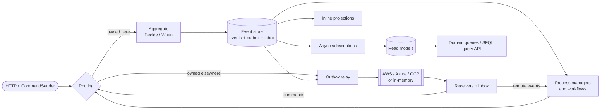
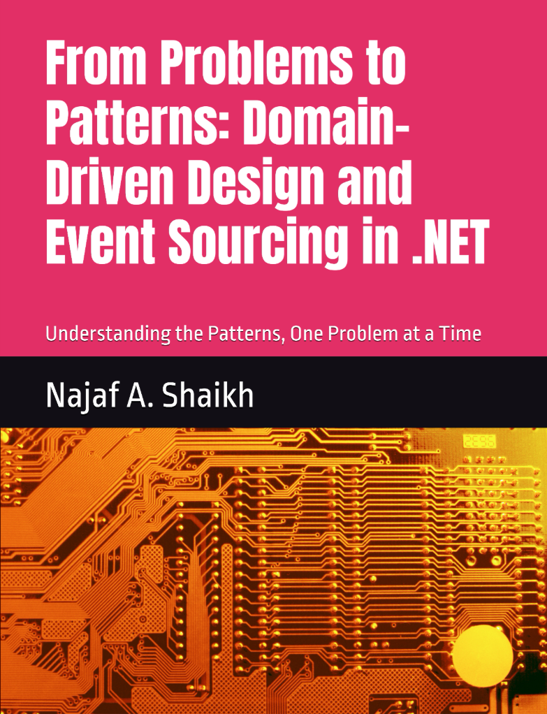

#  SourceFlow.Net v3.0.0
[](https://github.com/CodeShayk/SourceFlow.Net/blob/master/LICENSE)
[](https://github.com/CodeShayk/SourceFlow.Net/releases/latest)
[](https://github.com/CodeShayk/SourceFlow.Net/actions/workflows/v3-pr.yml)
[](https://dotnet.microsoft.com/en-us/download/dotnet/10.0)
<p align="center"> </p>
<p align="center">
  <strong>An event-sourcing and CQRS framework for .NET 10: pure aggregates, effectively-once messaging across services, projections, a query language, workflows you can draw, and the tools to run them in production.</strong>
</p>

---

## Overview

SourceFlow.Net lets you build a domain as event-sourced services. You write aggregates as pure functions that decide
events from commands, and the framework stores the events, keeps your read models up to date, moves commands and events
between services over the cloud broker of your choice, and runs long-lived workflows between them. Messages are handled
effectively once, everything is traced and measured with OpenTelemetry, and a source generator replaces reflection, so
services start fast and work with Native AOT and trimming.

v3.0.0 is a redesign of v2 for .NET 10. If you are upgrading, read [what changed](docs/v3.0.0/Documentation/Versions/v3.0.0/CHANGELOG.md)
and the [migration guide](docs/v3.0.0/guides/migrating-from-v2.md); v2 is documented in [docs/legacy-version](docs/legacy-version).

### Key features

- **Event-sourced aggregates as pure deciders.** `Decide(command, context)` returns a `Decision` (accept with events,
  reject with an error, or no-op); `When(event)` evolves the state. No base classes, no I/O in the domain, trivial to test.
- **Business rejections are values.** A rejection is an `Error` with a stable code, returned to the caller (HTTP 422) or
  sent back to the service that asked, never an exception.
- **Source generation instead of reflection.** A module per assembly registers its aggregates, handlers, projections,
  process managers and message types; analyzers catch mistakes at build time (SF0001 and on).
- **Effectively-once messaging.** A transactional outbox and per-consumer inbox in the same store as the events, idempotent
  command ids, optimistic concurrency with automatic re-decide.
- **One command owner, many subscribers.** Commands are routed to the one service that owns them, locally or over the broker;
  events are published to topics and subscribed to by others.
- **Persistence.** PostgreSQL and SQL Server event stores with a commit-ordered, gap-free global position; an in-memory store
  for tests and development.
- **Projections and read models.** Inline (same transaction) or async (partitioned, fenced subscriptions with checkpoints),
  document projections, EF Core projections, rebuilds with blue/green generations.
- **Cloud transports with parity.** AWS (SNS/SQS), Azure (Service Bus) and Google Cloud (Pub/Sub), all passing one
  conformance kit, plus an in-memory reference broker; provisioning modes and topology as data.
- **Query side.** Named, versioned domain queries bound at startup, and SFQL, a query language with CESQL predicates compiled
  to injection-proof SQL, served by a per-service query API.
- **Workflows and SourceFlow Studio.** Write a workflow between services in YAML; the build compiles it into a process manager
  with retries, timeouts, compensation and operator hand-off. Studio draws, validates, simulates and tests it in the browser.
- **Security and compliance.** Encryption of personal data with per-subject keys and crypto-shredding (AWS KMS, Azure Key
  Vault, Google Cloud KMS), redaction, multi-tenancy with row-level security.
- **Operations.** OpenTelemetry traces and metrics with standard semantic conventions, health checks, dashboards and alerts,
  and the `dotnet sourceflow` CLI for schema, streams, projections, parked messages, manifests and workflows.

### A taste

```csharp
[StronglyTypedId]
public readonly partial record struct AccountId(Guid Value);

[MessageType("bank.account.deposit", 1)]
public sealed record Deposit(AccountId AccountId, decimal Amount) : ICommand<BankAccount>;

[MessageType("bank.account.deposited", 1)]
public sealed record MoneyDeposited(AccountId AccountId, decimal Amount, decimal BalanceAfter) : IEvent;

[Aggregate("bank-account")]
public sealed partial record BankAccount : IAggregate<BankAccount, AccountId>
{
    public static BankAccount Initial { get; } = new();
    public AccountStatus Status { get; init; }
    public decimal Balance { get; init; }

    public Decision Decide(Deposit c, DecisionContext ctx) => this switch
    {
        { Status: not AccountStatus.Open } => Decision.Reject(AccountErrors.NotOpen),
        _ when c.Amount <= 0 => Decision.Reject(AccountErrors.AmountMustBePositive),
        _ => Decision.Accept(new MoneyDeposited(c.AccountId, c.Amount, Balance + c.Amount)),
    };

    private BankAccount When(MoneyDeposited e) => this with { Balance = e.BalanceAfter };
}

[SourceFlowModule(typeof(AccountsJsonContext))]
public sealed partial class AccountsModule;
```

```csharp
builder.Services.AddSourceFlow(sf =>
{
    sf.ServiceName = "bank";
    sf.AddModule<AccountsModule>();
    sf.UsePostgreSql(connectionString);
    sf.UseAwsTransport(o => o.Region = "eu-west-1");    // or UseAzureTransport, UseGcpTransport, UseInMemoryTransport
});

// 200 with an ETag, 202 when sent on to its owner, 422 for a rejection, 409 for a conflict
app.MapCommand<Deposit>("/accounts/{accountId}/deposits");
```

```csharp
CommandResult result = await sender.SendAsync(new Deposit(accountId, 50m));   // ICommandSender
// result.Status: Accepted, NoOp, Rejected, Conflict, Duplicate or Dispatched (sent to its owner)
```

The [Bank sample](samples/Bank) is a complete service; the [OrderFulfilment sample](samples/OrderFulfilment) is four services
and the workflow between them.

### Architecture



One core package holds the programming model, the runtime and the extensibility interfaces (SPIs); adapters implement them
for each database and cloud. See the [architecture documentation](docs/v3.0.0/Documentation/Architecture/README.md).

## Packages

Every package targets **.NET 10** (`net10.0`).

| Package | What it does | Docs |
|---------|--------------|------|
| `SourceFlow.Net` | Core: programming model, runtime, outbox/inbox, subscriptions, middleware, telemetry, in-memory adapters, SPIs. Includes the source generator and analyzers. | [README](docs/v3.0.0/Documentation/SourceFlow.Net-README.md) |
| `SourceFlow.Storage.PostgreSQL` | Event store, outbox, inbox, checkpoints, leases and documents on PostgreSQL; SFQL compiler. | [README](docs/v3.0.0/Documentation/SourceFlow.Storage.PostgreSQL-README.md) |
| `SourceFlow.Storage.SqlServer` | The same on SQL Server. | [README](docs/v3.0.0/Documentation/SourceFlow.Storage.SqlServer-README.md) |
| `SourceFlow.Storage.EntityFrameworkCore` | EF Core read-model projections in the SourceFlow transaction. | [README](docs/v3.0.0/Documentation/SourceFlow.Storage.EntityFrameworkCore-README.md) |
| `SourceFlow.Cloud.Aws` | SNS/SQS transport, provisioner, AWS KMS keys. | [README](docs/v3.0.0/Documentation/SourceFlow.Cloud.Aws-README.md) |
| `SourceFlow.Cloud.Azure` | Service Bus transport, provisioner, Azure Key Vault keys. | [README](docs/v3.0.0/Documentation/SourceFlow.Cloud.Azure-README.md) |
| `SourceFlow.Cloud.Gcp` | Pub/Sub transport, provisioner, Google Cloud KMS keys. | [README](docs/v3.0.0/Documentation/SourceFlow.Cloud.Gcp-README.md) |
| `SourceFlow.AspNetCore` | Command endpoints, domain query endpoints, the query API, health checks. | [README](docs/v3.0.0/Documentation/SourceFlow.AspNetCore-README.md) |
| `SourceFlow.Testing` | Given/When/Then specs, workflow specs, in-memory test host, storage and transport conformance kits. | [README](docs/v3.0.0/Documentation/SourceFlow.Testing-README.md) |
| `SourceFlow.Tool` | The `sourceflow` command-line tool (run from the repository or inside a service; not packaged as a .NET tool yet). | [README](docs/v3.0.0/Documentation/SourceFlow.Tool-README.md) |
| `SourceFlow.Studio` | Service manifests, domain workspace, workflow DSL, validator, simulator, exporters; the Studio web app (`studio/app`) and the `workflow-diff` GitHub Action (`studio/action`), which are to be published as `@sourceflow/studio` and `sourceflow/workflow-diff`. | [README](docs/v3.0.0/Documentation/SourceFlow.Studio-README.md) |

### Roadmap

| Package | Version | Release date | Details | .NET |
|---------|---------|--------------|---------|------|
| SourceFlow.Net and the packages above | v3.0.0 | Unreleased | Redesign: event sourcing with pure deciders, source generation, outbox/inbox, PostgreSQL and SQL Server stores, AWS/Azure/GCP transports with parity, SFQL query side, workflows and Studio. See the [changelog](docs/v3.0.0/Documentation/Versions/v3.0.0/CHANGELOG.md). | [](https://dotnet.microsoft.com/en-us/download/dotnet/10.0) |
| SourceFlow | v2.0.0 [](https://badge.fury.io/nu/SourceFlow.Net) | 15th Mar 2026 | Core functionality with integrated cloud abstractions ([docs](docs/legacy-version/SourceFlow.Net-README.md)). | .NET 10, 9, Standard 2.1, 2.0 |
| SourceFlow | v1.0.0 | 29th Nov 2025 | Initial stable release with event sourcing and CQRS. | .NET 10, 9, Standard 2.1, 2.0, Framework 4.6.2 |

## Getting started

```bash
dotnet add package SourceFlow.Net
dotnet add package SourceFlow.Storage.PostgreSQL     # or SourceFlow.Storage.SqlServer
dotnet add package SourceFlow.AspNetCore             # HTTP command endpoints and health checks
dotnet add package SourceFlow.Cloud.Aws              # or .Azure / .Gcp, when services talk over a broker
```

The `sourceflow` CLI runs inside your service (`dotnet run -- sourceflow …`, after `SourceFlowCli.TryRunAsync` in
`Program.cs`) or from this repository (`dotnet run --project src/Tooling/SourceFlow.Tool -- …`); see the
[CLI README](docs/v3.0.0/Documentation/SourceFlow.Tool-README.md).

Start the demo: PostgreSQL, the [Bank sample](samples/Bank) service on http://localhost:8080, a query console for it on
http://localhost:5080 and the Aspire dashboard on http://localhost:18888 (see [samples/README.md](samples/README.md)):

```bash
docker compose up -d
curl -X POST http://localhost:8080/accounts/0193a7a0-0000-7000-8000-000000000001 \
  -H 'Content-Type: application/json' -d '{ "holder": "Ada", "initialDeposit": 100 }'
```

Open the OrderFulfilment workflow in SourceFlow Studio:

```bash
dotnet run --project src/Tooling/SourceFlow.Tool -- studio --workspace samples/OrderFulfilment
```

## Documentation

- **[Documentation index](docs/v3.0.0/Documentation/README.md)**: package READMEs, architecture, guides.
- **[Wiki: the complete guide](docs/v3.0.0/Documentation/wiki.md)**: concepts, getting started, every feature, best practices, FAQ.
- **Guides**: [workflows](docs/v3.0.0/guides/workflows.md), [workflow DSL reference](docs/v3.0.0/guides/workflow-dsl-reference.md),
  [OpenTelemetry](docs/v3.0.0/guides/opentelemetry.md), [reading generated code](docs/v3.0.0/guides/reading-generated-code.md),
  [migrating from v2](docs/v3.0.0/guides/migrating-from-v2.md).
- **Design**: the [design documents](docs/v3.0.0/Design/README.md) and [architecture decision records](docs/v3.0.0/ADRs/README.md).

## Companion Book

<a href="https://www.amazon.com/Problems-Patterns-Domain-Driven-Sourcing-Understanding-ebook/dp/B0GX32V9F1/">
  
</a>

**From Problems to Patterns — Domain-Driven Design and Event Sourcing in .NET**
*By Najaf A. Shaikh · First Edition, 2026*

The complete, runnable companion code for all 32 chapters of the book is available in the [dd-event-sourcing-dotnet-samples](https://github.com/CodeShayk/dd-event-sourcing-dotnet-samples) repository. Every code example builds and all tests pass. The code evolves chapter by chapter through a single Bank Account domain — starting from a naive CRUD implementation and ending with a containerised, observable, event-sourced system built on **SourceFlow.Net**.

## Support

If you are having problems, please let me know by [raising a new issue](https://github.com/CodeShayk/SourceFlow.Net/issues/new/choose).

## License

This project is licensed with the [MIT license](LICENSE).

## Contributing

We welcome contributions! Please see the [contributing guide](CONTRIBUTING.md) for details.
- Bug reports: create an [issue](https://github.com/CodeShayk/sourceflow.net/issues/new/choose)
- Feature requests: start a [discussion](https://github.com/CodeShayk/SourceFlow.Net/discussions)
- Documentation: help improve the [docs](docs/v3.0.0/Documentation/README.md)
- Code: submit [pull requests](https://github.com/CodeShayk/SourceFlow.Net/pulls)

## Credits
Thank you for reading. Please fork, explore, contribute and report. Happy Coding !! :)
