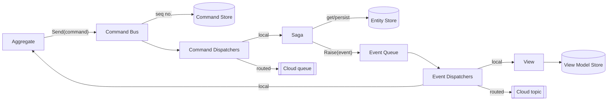

# 01 — Product Vision and Scope

## 1. Problem

.NET teams applying Domain-Driven Design, CQRS and an append-only history of state changes tend to rebuild the same plumbing for every service:

- a way to send a command to the right handler and record that it happened;
- a way to rebuild an entity's state by replaying that history;
- a way to publish domain events to in-process read models and to other services;
- persistence for the write model, the history and the read models;
- and, once the service is distributed, cloud queues and topics, duplicate-message handling, dead letters, encryption and tracing.

This plumbing is easy to get subtly wrong, and it ties domain code to infrastructure.

## 2. Vision

SourceFlow.Net is a lightweight, extensible .NET framework that gives a team the whole command→state→event→view loop from **one registration call**. It keeps domain code free of infrastructure. Moving from a single process to a distributed, multi-cloud deployment should be a **configuration change, not a domain-code change**.

## 3. The core model in one paragraph

SourceFlow.Net is **command-sourced**: the durable log is the sequence of *commands* applied to each entity, not a stream of events. An **Aggregate** sends a command. The **Command Bus** gives it the next per-entity sequence number, dispatches it to **Sagas** (which load the entity, change it and persist the new state), and then appends the command to the **Command Store**. Sagas raise **Events**, which go through an **Event Queue** to **Views** (which update denormalised **View Models**) and back to **Aggregates**. Replaying an entity's commands through the same pipeline rebuilds its state. With a cloud provider configured, chosen commands and events also travel over queues and topics to other bounded contexts.

## 4. Users

| Persona | Needs | Main touchpoints |
|---------|-------|------------------|
| **Domain developer** | Model aggregates, sagas and views without writing plumbing. Get type safety and testability. | `Aggregate<T>`, `Saga<T>`, `View<T>`, `Command<T>`, `Event<T>`, `UseSourceFlow()` |
| **Platform / DevOps engineer** | Run services on AWS or GCP with automatic provisioning, health checks, tracing, encryption and safe retries. | `UseSourceFlowAws()`, `UseSourceFlowGcp()`, options classes, health checks, OpenTelemetry |
| **Persistence integrator** | Back the stores with a relational database, possibly a different engine per store. | `AddSourceFlowEfStores*()`, `AddSourceFlowIdempotency*()` |
| **Framework extender** | Add a store, a cloud provider or cross-cutting middleware. | `ICommandStore`, `IEntityStore`, `IViewModelStore`, `ICommandDispatcher`, `IEventDispatcher`, the four middleware interfaces, `IIdempotencyService`, `IMessageEncryption` |
| **Learner / book reader** | A readable reference implementation of DDD, CQRS and command sourcing that goes with the companion book. | Samples in tests, architecture docs |

## 5. Goals

| ID | Goal | How we know it's met |
|----|------|----------------------|
| G1 | A working local command→saga→event→view flow with one registration call | `services.UseSourceFlow(assemblies)` plus store registrations runs the end-to-end test scenario (see `tests/SourceFlow.Core.Tests/E2E`) |
| G2 | Rebuild any entity from its command history | `ICommandPublisher.ReplayCommands(id)` reproduces the entity and its view models |
| G3 | Distribute commands and events across services with no domain-code change | Adding `UseSourceFlowAws(...)` or `UseSourceFlowGcp(...)` with a bus configuration routes the chosen message types, and sagas and views stay unchanged |
| G4 | Same routing API on every cloud provider | One `BusConfigurationBuilder` drives both the AWS and GCP providers |
| G5 | Production-grade operations | Idempotency, dead-letter capture, envelope encryption, health checks and OpenTelemetry traces and metrics are available on every provider |
| G6 | Pluggable persistence | Any store can be replaced by implementing one interface. The EF Core package supports SQL Server out of the box and any EF provider through a callback |
| G7 | Broad .NET reach | The core library targets .NET Standard 2.0 and 2.1 plus .NET 8, 9 and 10 |

## 6. Non-goals (current scope)

- **Not an event store.** Events are not persisted. Only commands, entity snapshots (current state) and view models are.
- **No snapshotting** of the command log, and no log compaction or archiving.
- **No message-schema versioning or upcasting** for stored commands or wire messages. Types are identified by assembly-qualified name.
- **No query API** beyond `IViewModelStore.Get<T>(id)`. Querying read models is left to the application.
- **No hosted UI or admin console** (for example for dead-letter replay).
- **No distributed transactions** across the command log, entity store and event dispatch.
- **Azure provider**: on the roadmap but not built (see §9).

## 7. Product composition

| Package | Version | Target frameworks | Purpose | Key dependencies |
|---------|---------|-------------------|---------|------------------|
| `SourceFlow.Net` | 2.0.0 | netstandard2.0, netstandard2.1, net8.0, net9.0, net10.0 | Core framework: domain model, pipelines, store contracts, DI, telemetry, **cloud abstractions** (bus configuration, idempotency, dead letters, circuit breaker, encryption contracts, masking, cloud telemetry) | System.Text.Json, M.E.DependencyInjection/Logging abstractions, OpenTelemetry 1.14 |
| `SourceFlow.Stores.EntityFramework` | 2.0.0 | net8.0, net9.0, net10.0 | EF Core 9 implementations of the command, entity and view-model stores, plus the idempotency service | EF Core 9 (+ SqlServer), Polly 8, OpenTelemetry |
| `SourceFlow.Cloud.AWS` | 2.0.0 | netstandard2.1, net8.0, net9.0, net10.0 | Commands over Amazon SQS, events over Amazon SNS→SQS, KMS encryption, health check | AWSSDK SQS/SNS/KMS 3.7 |
| `SourceFlow.Cloud.GCP` | 2.0.0-beta.1 | net8.0, net9.0, net10.0 | Commands and events over Google Cloud Pub/Sub, Cloud KMS encryption, health check, emulator support | Google.Cloud.PubSub.V1 3.17, Google.Cloud.Kms.V1 3.16 |

Since v2.0.0, cloud abstractions live in the core package under `SourceFlow.Cloud.*`. The separate `SourceFlow.Cloud.Core` package is gone (see [v2.0.0 changelog](../legacy-version/Versions/v2.0.0/CHANGELOG.md)).

## 8. Key user journeys

### J1 — Handle a command locally
1. The application resolves an aggregate (for example through `IAggregateFactory.Create<T>()`) and calls a domain method.
2. The aggregate builds a `Command<TPayload>` that references the target entity (by id, or as a new entity) and calls `Send`.
3. The command bus runs dispatch middleware, assigns the next sequence number, dispatches to every saga that implements `IHandles<TCommand>`, then appends the command to the command store.
4. The saga loads or creates the entity, applies the change, persists it and, if it implements `IHandlesWithEvent<TCommand,TEvent>`, raises the event.
5. The event queue sends the event to every view implementing `IProjectOn<TEvent>` (which persist view models) and every aggregate implementing `ISubscribes<TEvent>`.

### J2 — Rebuild an entity
1. The application calls `aggregate.ReplayCommands(entityId)`.
2. The bus loads the entity's commands in sequence order, marks each as a replay, and re-dispatches them without assigning new sequence numbers or re-appending them.
3. Sagas and views reapply the changes, which rebuilds the entity and its projections.

### J3 — Send a command to another service
1. At startup, the service declares in a `BusConfigurationBuilder` which commands go to which queue, which events go to which topic, which queues it listens on and which topics it subscribes to.
2. A bootstrapper resolves or creates the cloud resources before the listeners start.
3. Routed commands and events are serialised and published. The receiving service's listener deserialises each message and hands it to its local sagas, or to its views and aggregates.

### J4 — Run safely in production
1. The operator chooses an idempotency backend: in-memory for a single instance, EF for several instances, or a custom one.
2. The operator turns on telemetry and exports traces and metrics over OTLP.
3. The operator adds the provider health check to the host's health endpoint.
4. Optionally, the operator turns on KMS envelope encryption, dead-letter capture and a circuit breaker. On AWS these are opt-in today; see [GAP-01](06-Gaps-Risks-and-Open-Questions.md#gap-01).

## 9. Roadmap (from README and changelogs)

| Release | Date | Scope |
|---------|------|-------|
| v1.0.0 | 29 Nov 2025 | Core command sourcing, CQRS, sagas, views, EF stores |
| v2.0.0 | 15 Mar 2026 (README); changelog says "TBC" | Cloud.Core merged into the core package (namespace break), AWS provider, idempotency builder, EF idempotency store |
| GCP provider | 2.0.0-beta.1 (latest commit) | Pub/Sub provider with emulator-based CI |
| Azure provider | TBC | Service Bus provider with Azurite-based tests (announced, not built) |

## 10. Glossary

| Term | Meaning in SourceFlow.Net |
|------|---------------------------|
| **Entity** | Write-model state object implementing `IEntity` (integer `Id`). Persisted whole in the entity store. |
| **Aggregate** | Domain façade for one entity type (`Aggregate<TEntity>`). Sends commands and reacts to events. Does **not** change state directly. |
| **Saga** | Command handler for one entity type (`Saga<TEntity>`). Loads the entity, applies the command, persists it and raises events. Can publish follow-up commands. |
| **Command** | An intent to change one entity: `Command<TPayload>` with an `EntityRef` (id + `IsNew`), a payload and metadata. The unit of the durable log. |
| **Event** | A notification that an entity changed: `Event<TEntity>` whose payload is the entity. Not persisted. |
| **View / View model** | A projection (`View<TViewModel>`) that turns events into a denormalised read model (`IViewModel`). |
| **Command log / store** | Append-only, per-entity ordered record of commands (`ICommandStore`). |
| **Replay** | Re-dispatching an entity's stored commands to rebuild state (`Metadata.IsReplay = true`). |
| **Dispatcher** | Pluggable outbound transport for commands (`ICommandDispatcher`) or events (`IEventDispatcher`). Local and cloud dispatchers run side by side. |
| **Bus configuration** | Code-first routing table: command type → queue, event type → topic, plus the queues this service listens on and the topics it subscribes to. |
| **Bootstrapper** | Hosted service that turns short queue and topic names into provider resource identifiers, creating them if needed. |
