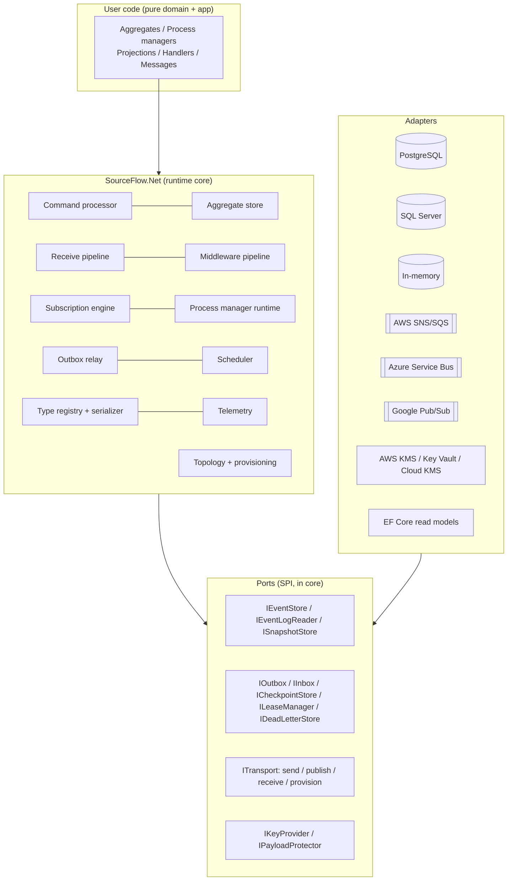
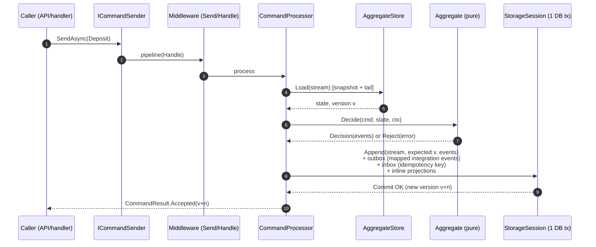
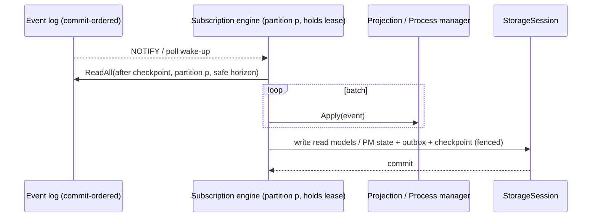
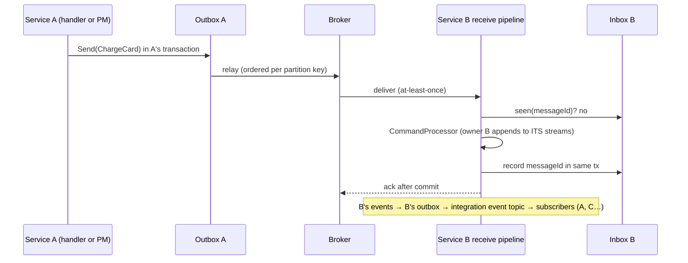

# 01 — Architecture Overview

## 1. Scope and assumptions

**In scope.** A .NET 10 library for building event-sourced, message-driven services using DDD and CQRS. It covers aggregates, command handling, process managers, projections, an event store, a transactional outbox and inbox, cloud transports, observability, security and test tooling.

**Out of scope (YAGNI, see §4).** Hosting a broker, a query language, a UI or admin portal, a multi-tenancy framework, and GraphQL or REST endpoints.

**Assumptions.** Each one is a design input; if it turns out to be wrong, the decision named should be revisited.

| # | Assumption | If wrong, revisit |
|---|------------|-------------------|
| A1 | Users run on .NET 10 and can adopt C# 14. | [ADR-001](ADRs/ADR-001-target-dotnet-10-and-csharp-14.md) |
| A2 | The write-side store is a relational database (PostgreSQL first, SQL Server second). Teams that need a dedicated event database can add an adapter later. | [ADR-009](ADRs/ADR-009-event-store-on-adonet-postgresql-first.md) |
| A3 | A typical service handles 10²–10⁴ commands/s at peak, and aggregate streams are mostly short (fewer than 1,000 events). Long streams use snapshots. | [doc 09](09-Performance-and-Scalability.md) |
| A4 | Cross-service communication is asynchronous messaging. Synchronous RPC is out of scope. | [ADR-007](ADRs/ADR-007-single-command-ownership-route-local-xor-remote.md) |
| A5 | Teams accept at-least-once delivery from brokers. The library makes processing *effectively once* using the inbox and outbox. | [ADR-006](ADRs/ADR-006-transactional-outbox-and-inbox-for-effectively-once.md) |
| A6 | v2 users accept a major-version break in return for a migration tool. | [doc 12](12-Migration-Delivery-and-Traceability.md) |

## 2. Quality goals

Each quality is a measurable scenario. Targets are validated in M2 to M4 ([doc 09](09-Performance-and-Scalability.md), [doc 11](11-Testing-and-Quality.md)).

| Quality | Scenario | Target |
|---------|----------|--------|
| **Durability** | The process is killed at any instruction during command handling | No accepted command loses its events or its outbound messages. No message is published without the matching events being committed. |
| **Durability** | The broker is unavailable for 30 minutes | Commands still succeed locally. The outbox buffers messages and drains in order once the broker is back, with no loss. |
| **Correctness** | Two instances handle commands for the same aggregate at the same time | Exactly one append wins for each version. The loser re-decides on fresh state. Stream history always reproduces state. |
| **Correctness** | Subscriptions under concurrent writers | Every committed event is delivered to every subscription partition exactly once in effect, in per-stream order. None is skipped. |
| **Observability** | An operator asks "why is read model X stale?" | The answer comes from standard OpenTelemetry signals (`subscription.lag`, traces linked from command to projection) within 5 minutes, without reading code. |
| **Performance** | Handling an in-process command against the in-memory store | p50 ≤ 20 µs, ≤ 2 KB allocated per command (excluding the user's events) |
| **Performance** | A PostgreSQL append of 1–3 events plus outbox | 1 network round trip. p99 ≤ 10 ms on a same-AZ database |
| **Scalability** | Adding service instances | Command throughput scales close to linearly until the database saturates. Projections scale up to P partitions. |
| **Maintainability** | Adding a transport | Implement the transport SPI (about 6 interfaces) and pass the conformance kit. Core code doesn't change. |
| **Security** | A message arrives with an unregistered `type` | It is rejected before deserialisation and parked as a dead letter. No type is instantiated. |
| **Portability** | Publishing as Native AOT | Core, the PostgreSQL store and every transport are trim- and AOT-safe, with no `RequiresUnreferencedCode` warnings. |

## 3. Design principles and how they are applied

| Principle | Concrete application in v3 |
|-----------|----------------------------|
| **S**ingle responsibility | Aggregates only decide and evolve (pure). The `CommandProcessor` only orchestrates load→decide→append. Persistence, transport and serialisation are separate ports. v2's "Saga", which both handled commands and persisted entities, is split. |
| **O**pen/closed | New transports, stores, serialisers, middleware and KMS providers plug in through SPIs. The core is closed to modification. |
| **L**iskov substitution | Every adapter must pass a **conformance kit** (storage and transport), so substitutability is tested, not hoped for. |
| **I**nterface segregation | Small role interfaces: `IEventStore` (streams), `IEventLogReader` (global reads), `IOutbox`, `IInbox`, `ICheckpointStore`, `ILeaseManager`. An adapter implements only the capabilities it supports. |
| **D**ependency inversion | The core depends on ports it defines. Adapters depend on the core, never the other way round. Domain code depends on nothing but the `SourceFlow.Abstractions` attributes and interfaces. |
| **DRY** | One middleware abstraction for every stage (v2 had four). One envelope, used by every transport. One retry and dead-letter policy engine. Platform libraries replace custom code: Polly v8 replaces v2's circuit breaker, `Microsoft.Extensions.Compliance.Redaction` replaces v2's masker, and `TimeProvider` is used for time. |
| **KISS** | Aggregates are records with methods; no base class needed. One input queue per service endpoint by default. Sensible defaults let a working service configure only a connection string and a service name. |
| **YAGNI** | See §4. Features are added only where a product requirement or gap calls for them. |
| **Explicit over implicit** | Stable message type names, an explicit `[SourceFlowModule]` registration, explicit routing, explicit consistency mode per projection. No assembly scanning. |
| **Fail fast** | Topology, routing, handler coverage, type registry and options are validated at **startup** (`ValidateOnStart`), and where possible at **compile time** (analyzers). |
| **Pit of success** | The default pipeline includes inbox, outbox, retries, dead-lettering, telemetry and redaction. v2's opt-in "Enhanced" split is gone (GAP-01). |
| **Functional core, imperative shell** | Domain logic is pure and deterministic. I/O lives in the runtime shell. |
| **Ports and adapters (hexagonal)** | The package structure enforces the dependency rule (§5). |
| **Least astonishment** | Ignored options are not allowed: every option is either honoured or rejected by validation (GAP-03). |

## 4. Deliberately not built (YAGNI register)

| Not building | Why | Trigger to reconsider |
|--------------|-----|-----------------------|
| An event store on EF Core | The ORM adds per-append overhead and gives no control over ordering or locking SQL. EF Core stays for **read models** only. | Demand from users bound to EF-only database providers |
| A custom circuit breaker or retry engine | Polly v8 via `Microsoft.Extensions.Resilience` is the platform standard. | — |
| A query bus or mediator for reads | Read models are plain stores. A *query language* **is** in scope ([ADR-023](ADRs/ADR-023-sfql-query-language-with-cesql-predicates.md), [doc 14](14-Query-Side-and-SFQL.md)), but there is no request/response query bus around it. | — |
| ~~General joins in SFQL~~ | **Now in scope** (product request, 2026-11-10; [ADR-026](ADRs/ADR-026-per-service-query-api-with-sql-syntax-and-injection-proof-compilation.md)): bounded `INNER`/`LEFT` equality joins, grouping and ordering, plus a SQL syntax, behind the per-service query API | — |
| `UNION`, CTEs and window functions in SFQL | Not needed for the requested constructs; more surface to secure | Measured demand (`sfql/1.1`) |
| ~~A saga DSL or state-machine designer~~ | **Trigger met (product request, 2026-11-10).** Now in scope as the separate utility *SourceFlow Studio*: a YAML DSL compiled to process managers, plus a React designer ([doc 15](15-Workflow-DSL-and-Studio.md), [ADR-024](ADRs/ADR-024-workflow-dsl-compiled-to-process-managers.md), [ADR-025](ADRs/ADR-025-studio-react-spa-with-shared-wasm-core.md)). Still **no runtime workflow engine** | — |
| A runtime workflow interpreter / engine | DSL workflows are compiled into process managers. One execution model (ADR-024) | — |
| Database-per-tenant and schema-per-tenant | **Conjoined** tenancy with row-level security is in 3.0 ([ADR-022](ADRs/ADR-022-conjoined-multi-tenancy-with-row-level-security.md)). Separate databases per tenant wait for demand. | Tenants needing physical isolation |
| A claim-check (large payload offload) | Size validation is in 3.0. Offloading is 3.x. | Messages above broker limits in real workloads |
| Archiving cold streams to object storage | Monthly range partitioning of the events table **is** in 3.0 as an opt-in, because the capacity model shows tier M needs it ([doc 09 §5](09-Performance-and-Scalability.md#5-capacity-model)). Detached partitions can be archived with standard database tooling. A built-in archive tier behind `IEventStore` is not needed yet. | Users needing transparent reads of archived streams |
| Snapshots on by default | Most streams are short. Snapshots are a per-aggregate opt-in policy. | `aggregate.load.events` p95 > 200 |

## 5. Logical architecture

**Dependency rules** (enforced by an architecture test in CI using `NetArchTest` or similar):

1. `SourceFlow.Abstractions` depends on nothing outside the BCL.
2. `SourceFlow.Net` (core) depends only on `Abstractions` and `Microsoft.Extensions.*`, `System.Diagnostics.*`, `System.Text.Json` and Polly.
3. Adapters depend on the core. The core never references an adapter, even through reflection (v2's `UseEFIdempotency` reflection hack is removed).
4. Domain code needs only `SourceFlow.Abstractions`, which keeps domain assemblies free of infrastructure.

## 6. Package map

All packages target `net10.0` only and are versioned together (`3.0.x`).

| Package | Contents | Key dependencies |
|---------|----------|------------------|
| `SourceFlow.Abstractions` | Marker interfaces (`ICommand<TAggregate>`, `IEvent`), attributes (`[Aggregate]`, `[MessageType]`, `[StronglyTypedId]`, `[SourceFlowModule]`, `[PersonalData]`, `[Queryable]`, `[Tag]`, `[RenamedFrom]`, `[Emits]`, `[Rejects]`), `Decision`, `Reaction`, `Error`, `ConsistencyToken`, id primitives | BCL only |
| `SourceFlow.Net` | Runtime: command processor, aggregate store, receive pipeline, middleware, outbox relay, scheduler, subscription engine, process manager runtime, type registry, schema catalog, SFQL parser, binder and in-memory interpreter, STJ serializer, telemetry, health checks, the SPIs, in-memory adapters. (The SFQL SQL compilers live in the storage packages.) | M.E.DI/Hosting/Options/Logging, Polly/M.E.Resilience, M.E.Compliance.Redaction, System.Diagnostics |
| `SourceFlow.Generators` *(analyzer, bundled in `SourceFlow.Abstractions`)* | Incremental source generators (module registration, decide/evolve dispatch, JSON contexts, strongly typed ids) and analyzers (SF0001…) | Roslyn |
| `SourceFlow.Testing` | Given/When/Then specs for aggregates, process managers and projections. Fake transport and store with fault injection. `FakeTimeProvider` integration. Base classes for the conformance kits. | xUnit-agnostic core |
| `SourceFlow.PostgreSql` | Event store, snapshots, outbox, inbox, checkpoints, leases, dead letters, document read-model store, LISTEN/NOTIFY wake-up | Npgsql |
| `SourceFlow.SqlServer` | Same capabilities on SQL Server | Microsoft.Data.SqlClient |
| `SourceFlow.EntityFrameworkCore` | Projections that write EF Core read models in the projection transaction | EF Core 10 |
| `SourceFlow.AmazonSqs` | AWS SNS/SQS transport and provisioner | AWSSDK.SQS/SNS |
| `SourceFlow.AzureServiceBus` | Azure Service Bus transport and provisioner | Azure.Messaging.ServiceBus |
| `SourceFlow.GooglePubSub` | Google Pub/Sub transport and provisioner | Google.Cloud.PubSub.V1 |
| `SourceFlow.Security.AwsKms`, `.AzureKeyVault`, `.GoogleKms` | `IKeyProvider` implementations for envelope encryption and crypto-shredding | the respective SDKs |
| `SourceFlow.AspNetCore` | `MapCommand<T>()` (Idempotency-Key, If-Match → expected version, ProblemDetails, ETag, consistency-token header) and the opt-in `MapSourceFlowQuery()` endpoint | ASP.NET Core |
| `SourceFlow.OpenTelemetry` | `AddSourceFlowInstrumentation()` for the tracer and meter providers, plus histogram views. Keeps the OpenTelemetry SDK a dependency of the user's app, not of the core. | OpenTelemetry SDK |
| `SourceFlow.Workflows.Abstractions` | Runtime types used by generated workflows (status, compensation entries, operator commands). Referenced only by services that use the DSL | BCL + Abstractions |
| `SourceFlow.Workflows` | Workflow DSL core: YAML model, validator, simulator, path enumerator, spec generator, exporters, manifest model. netstandard2.0 build bundled in the generator | YamlDotNet |
| `SourceFlow.Workflows.Wasm` + `@sourceflow/studio` (npm) | SourceFlow Studio: the WebAssembly build of the core, and the React designer (separate utility, own release train) | .NET browser-wasm; React 19 |
| `SourceFlow.Tool` (`dotnet sourceflow`) | CLI: topology export and validate, projection rebuild, dead-letter list/replay/discard, v2 migration | System.CommandLine |

Splitting `Abstractions` from the runtime lets domain assemblies avoid every runtime dependency. Splitting KMS providers from transports keeps dependencies independent: a team can use AWS KMS with Azure Service Bus.

## 7. Runtime components

| Component | Responsibility | Doc |
|-----------|----------------|-----|
| **Type registry** | Maps logical type name ↔ CLR type ↔ JSON type info ↔ schema version and upcasters. It is the allow-list for deserialisation. | 04 |
| **Command router** | Resolves a command to its local handler or its remote endpoint (exactly one). | 04 |
| **Command processor** | Load aggregate → decide → append, all in one storage session. Re-decides on concurrency conflict. | 03, 05 |
| **Aggregate store** | Loads state from snapshot plus tail events, using the generated `Evolve`. Optional state cache. | 05 |
| **Storage session** | The unit of work over one database transaction: append, outbox, inbox, inline projections, process state, checkpoint. | 05 |
| **Outbox relay** | Claims outbox partitions and publishes in order through the transport, deleting after acknowledgement. | 04 |
| **Receive pipeline** | Transport delivery → validate type → decrypt → deserialise → inbox → handler → commit → ack. Retry and park on failure. | 04 |
| **Subscription engine** | Reads the global log in commit order and drives projections and process managers per partition, with fenced leases and checkpoints. | 06 |
| **Process manager runtime** | Event in → load state → react → persist state + outbox commands + timers, in one transaction. | 03 |
| **Scheduler** | Durable timers and delayed messages (outbox rows with `deliver_at`). | 04 |
| **Topology and provisioner** | Builds the topology model from routing. Validates, creates or exports broker resources. | 07 |
| **Telemetry** | One `ActivitySource` and `Meter` named `SourceFlow`. Semantic conventions. Source-generated logging. | 08 |
| **Schema catalog** | Generated JSON Schemas for every message and read-model type. Registered at startup, compatibility-checked in CI, exported as AsyncAPI. | 14 |
| **Query engine + per-service query API** | Request guard → SFQL (pipeline or SQL syntax) parse → bind → policy → plan → compile to parameterised SQL, executed on a read-only connection. Consistency tokens. HTTP API in every service with injection defence | 14 |
| **Workflow compiler** (build time) | `.sfflow.yaml` → validated → generated process manager + timers + operator commands; service manifest emission | 15 |
| **Tenant context** | `ITenantResolver` → ambient tenant → envelope `sftenant` → `SET LOCAL sourceflow.tenant` for RLS | [ADR-022](ADRs/ADR-022-conjoined-multi-tenancy-with-row-level-security.md) |

## 8. Key runtime flows

### 8.1 Local command (the common path)

On `ConcurrencyException` at commit, the processor reloads and re-decides, up to `MaxConcurrencyRetries` (default 3) with jittered backoff, then returns `CommandResult.Conflict`. Re-deciding is safe because `Decide` is pure ([ADR-003](ADRs/ADR-003-aggregates-as-pure-deciders-decide-evolve.md), [ADR-008](ADRs/ADR-008-optimistic-concurrency-with-automatic-re-decide.md)).

### 8.2 Async projection and process manager

### 8.3 Cross-service command and integration event

Because B handles the command with its own command processor, **the owning service appends, sequences and can replay it** (GAP-19).

## 9. Hosting model

- `services.AddSourceFlow(sf => …)` registers everything. Background work runs as `IHostedLifecycleService`s so the ordering is explicit:
  1. **StartingAsync**: validate options, registry, routing and handler coverage. Fail fast.
  2. **StartAsync**: provision or validate topology (according to mode). Start the outbox relay, scheduler, subscription engine and receivers.
  3. **StartedAsync**: report readiness (health check `sourceflow.ready`).
  4. **StoppingAsync**: stop receivers taking new messages. Drain in-flight work within `ShutdownTimeout` (default 25 s). Release leases. Messages not yet acknowledged return to the broker.
- Options are bound with the configuration binding source generator and validated with `[OptionsValidator]` source-generated validators plus `ValidateOnStart()`, so binding and validation are AOT-safe.
- **Roles.** One process can run every role, or a deployment can split them, for example `sf.Roles = SourceFlowRoles.CommandApi | SourceFlowRoles.Workers`. A role that is off doesn't start its hosted services. This lets API pods and worker pods scale independently with the same code.

## 10. What to revisit as the system grows

| Signal | Revisit |
|--------|---------|
| The event table is larger than about 1 TB, or index bloat hurts append latency | Archive or tier cold streams (doc 05 §9). Consider a dedicated event database adapter. |
| More than about 30 projections on one database | Separate read-model databases (async only). Raise the partition count. |
| The outbox relay can't keep up (`outbox.age` p95 > 1 s) | Raise outbox partitions and relay concurrency. Batch publishing (SNS/SQS `PublishBatch`, ASB batches). |
| Cross-region active-active demand | Per-region stream ownership, plus a replication design (not in 3.0). |
| Broker limits on message size are hit | Claim-check package (3.x). |
