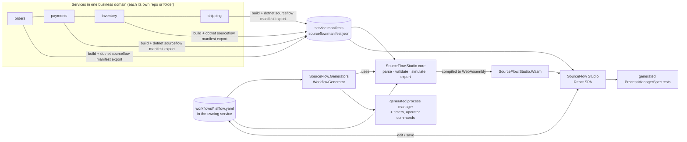

# 15 — Workflow DSL and SourceFlow Studio

Design drivers: [ADR-024](ADRs/ADR-024-workflow-dsl-compiled-to-process-managers.md), [ADR-025](ADRs/ADR-025-studio-react-spa-with-shared-wasm-core.md), [ADR-020](ADRs/ADR-020-process-managers-with-durable-state-and-timers.md) and [ADR-007](ADRs/ADR-007-single-command-ownership-route-local-xor-remote.md). Requirements: [product doc 07](../product/07-Workflow-Designer-Requirements.md) (WFD-10…37, WFD-NFR-1…6).

## 1. Scope and position

**SourceFlow Studio** is a **separate utility** made of three parts:

1. a **workflow DSL** (YAML), which is the source of truth for orchestrated sagas;
2. **build-time tooling** (validator, simulator, code generator), which turns each workflow into an ordinary v3 **process manager** owned by one service;
3. a **React designer** that visualises a whole business domain and edits, simulates and exports workflows.

It is **not** a workflow engine. At run time a DSL workflow *is* a generated process manager: same storage, outbox, inbox, timers, telemetry and tests as a hand-written one (ADR-020). Services that don't use the DSL take no dependency on any of it (WFD-NFR-1).



**One semantics (WFD-NFR-2).** Parsing, validation and simulation are implemented **once**, in C# (`SourceFlow.Studio`). The Roslyn generator, the CLI and the browser (compiled to WebAssembly) all use that same implementation. TypeScript never reimplements workflow semantics; it renders, edits and calls the core.

## 2. Concepts

| Term | Meaning |
|------|---------|
| **Business domain workspace** | The services that together implement one business domain, described in `sourceflow.domain.yaml` (§4) |
| **Service manifest** | Machine-readable description of one service, produced from its code and routing (§3) |
| **Workflow** | An orchestrated saga: a state machine owned by **one** service (the orchestrator) that sends commands to aggregates in any service of the domain and reacts to their events (ADR-007: commands go to their owner) |
| **Step** | Send one command and await its outcome (success event, rejection, timeout), or simply await an event |
| **Business retry** | Re-attempt of a step on a *business* failure (for example `payment.declined`), declared in the DSL. Infrastructure retries (broker, database) stay in the runtime (doc 04 §9) and are invisible to the workflow |
| **Compensation** | The semantic undo of a completed step (for example refund a captured payment) |
| **Pivot** | The point of no return. After it succeeds, failures use forward recovery only |
| **Terminal states** | `Completed`, `Compensated` (failed and fully rolled back), `ManualIntervention` (needs an operator), `Aborted` (operator stopped it) |
| **Choreography chain** | An event flow between services with no orchestrator. Shown on the domain map; not authored in the DSL |

## 3. Service manifest (WFD-11, WFD-12)

### 3.1 Content

```json
{
  "manifestVersion": 1,
  "service": "payments",
  "endpoint": "payments",
  "sourceflowVersion": "3.0.0",
  "aggregates": [{
    "name": "payment",
    "commands": [{
      "type": "payments.charge", "version": 1,
      "emits": ["payments.payment-captured.v1"],
      "rejects": ["payments.declined", "payments.fraud_suspected"],
      "replyOnReject": true
    }]
  }],
  "processManagers": [{ "name": "refund-retry", "handles": ["…"], "sends": ["…"], "schedules": ["…"] }],
  "projections": [{ "name": "payment-summary", "version": 1, "handles": ["…"] }],
  "publishes": [{ "domainEvent": "payments.payment-captured.v1", "as": "payments.payment-captured-v1.v1", "topic": "payments.events" }],
  "subscribes": ["orders.events"],
  "commandRoutes": [{ "command": "inventory.reserve-stock.v1", "to": "inventory" }],
  "workflows": [{ "name": "…", "version": 1, "file": "workflows/….sfflow.yaml" }],
  "schemas": "catalog://payments"
}
```

### 3.2 How it is produced

| Part | Source | Mechanism |
|------|--------|-----------|
| Aggregates, commands, handled events, process managers, projections | Compile time | `SourceFlow.Generators` emits `[assembly: SourceFlowManifest("<json>")]` with the static part |
| `emits` / `rejects` per command | Compile time, static analysis of `Decide` | `IEvent` instances created in `Decision.Accept(…)` arguments; `Decision.Reject(X.Y)` resolved to the constant `Error.Code` of a static field. Where analysis can't decide (events built in helpers, computed codes), the author declares `[Emits(typeof(MoneyDeposited))]` / `[Rejects("account.insufficient_funds")]`, and **SF0019** warns until the declaration exists |
| Routes, publications, subscriptions, `replyOnReject` | Configuration (run time) | `dotnet sourceflow manifest export --project <csproj>` builds the project and runs its `AddSourceFlow(…)` configuration in **design-time mode** (`SOURCEFLOW_DESIGN_TIME=1`: no hosted services, no I/O, no provisioning). It merges the routing table with the static part and writes `artifacts/sourceflow.manifest.json` |
| Schemas | Catalog (doc 14 §2) | Referenced, not copied |

Manifests are build artifacts. CI regenerates them, and a drift check fails if a committed manifest differs from the regenerated one.

**As built (WP-S.1): the static part.** Every assembly with SourceFlow types gets `[assembly: SourceFlowManifest(json)]`, compact JSON with `manifestVersion: 1`, the assembly name and the referenced `SourceFlow.Net` version.

- **References.** Every message reference uses the CloudEvents form `{name}.v{version}` (for example `payments.payment-captured.v1`). Command entries keep `type` and `version` apart, as in §3.1.
- **`messages`.** Every `[MessageType]`: `type`, `version`, `kind` (`command`, `event`, `integration-event`, `timeout`), `clrType`, the target `aggregate` for commands, and `fields`. Each field has its JSON name, a schema-like `type` (`string`, `integer`, `number`, `boolean`, `uuid`, `date-time`, `date`, `time`, `duration`, `uri`, `array`, `object`; strongly typed ids use their backing type), `nullable` and `personalData`. The validator uses them for WF-V12 and WF-V14 without loading the catalog.
- **`aggregates`.** Commands with `emits` and `rejects`, and the events `When` handles. Commands owned by an `ICommandHandler` join their aggregate's entry, with `HandleAsync` analysed the same way.
- **`processManagers`.** `handles` (a `CommandRejected<T>` reaction is `{T}.rejected.v{n}`), `sends` (commands created in `React`) and `schedules` (messages passed to `Reaction.Schedule`).
- **`projections`.** Document and session projections, with name, version and handled events.
- **Analysis.** It reads only the method's own body. It resolves:
  - events created inline in `Decision.Accept`, including params, collection expressions, conditionals and switch arms;
  - codes from `new Error("code", …)`, static `Error` fields and properties initialised that way (also in another file), `with` expressions, `Error.InvalidCommand` and the `Error` built-ins.
- **SF0019.** It warns when an event comes from a helper, a code is computed, or a decision comes from a helper method, until `[Emits]`/`[Rejects]` declares it. The declarations are added to the manifest.
- **Not here.** `service`, `endpoint`, `publishes`, `subscribes`, `commandRoutes` and `replyOnReject` are configuration; `manifest export` adds them (WP-S.2).

**As built (WP-S.2): the export.**

- **Design-time mode.** With `SOURCEFLOW_DESIGN_TIME=1`, `AddSourceFlow` doesn't register the SourceFlow host. It listens for the generic host's `HostBuilt` diagnostic event, which `HostBuilder`, `HostApplicationBuilder` and `WebApplicationBuilder` all raise.
  - **On `HostBuilt`.** It writes the manifest to `SOURCEFLOW_MANIFEST_OUT` (or standard output) and ends the process.
  - **What runs.** The application's configuration runs, but the host never starts. No hosted service, provisioning, storage or transport call runs. Code after `Build()` doesn't run either.
  - **Requirement.** Applications must use the generic host.
- **`dotnet sourceflow manifest export`.**
  - **`--project <csproj>`.** Builds the project, then runs `dotnet run --no-build --no-launch-profile` in design-time mode. Arguments after `--` go to the application, for example a placeholder connection string. The default output is `<project>/artifacts/sourceflow.manifest.json`.
  - **Inside a service.** `dotnet run -- sourceflow manifest export` exports from the service's own provider.
  - **`--check`.** Compares with the committed file, ignoring CRLF, and fails on drift with the first differing line.
- **Merge rules.** The runtime model decides membership; the static manifests (§3.2) supply emits, rejects and fields. Only the messages, aggregates, process managers and projections the service registers are listed.
  - **`commandRoutes`.** Carries `replyOnReject`. It is a property of the sender's route, so it belongs there rather than on the owner's command as in the §3.1 example.
  - **`subscribes`.** Entries are objects `{ topic, only?, where? }`, not plain topic names.
  - **Output.** Indented JSON with LF line endings, sorted. Repeated runs are byte-identical.
- **CI.** The Bank sample's manifest is committed as `samples/Bank/Bank.Api/sourceflow.manifest.json`, outside the ignored `artifacts/` folder. `v3-pr.yml` checks it for drift.

## 4. Business domain workspace (WFD-10)

```yaml
# sourceflow.domain.yaml — at the root of a mono-repo, or in a dedicated "domain" repo
domain: commerce
description: Order to delivery
services:
  - name: orders     # orchestrator of order-fulfilment
    manifest: services/orders/artifacts/sourceflow.manifest.json
    workflows: services/orders/workflows
  - name: payments
    manifest: services/payments/artifacts/sourceflow.manifest.json
  - name: inventory
    manifest: services/inventory/artifacts/sourceflow.manifest.json
  - name: shipping
    manifest: ../shipping-repo/artifacts/sourceflow.manifest.json   # other repos via path or URL
```

The workspace only **reads** other services' manifests. Workflows are always stored in, and compiled by, the **owning** service. That keeps product Q2 (ownership and boundaries) and ADR-007.

**As built (WP-S.2).** `DomainWorkspace.LoadAsync` (in `SourceFlow.Studio`) takes the file or a folder that holds it.

- **Paths.** Relative paths resolve against the workspace file's folder.
- **Errors.** Unknown keys are errors that give the line and column. So are a missing `domain`, an empty or duplicated service list, a missing or invalid manifest, and a manifest whose `service` differs from the entry's `name`.
- **Remote manifests.** Manifests given as URLs are refused unless the caller supplies a fetcher, so the workspace works offline (§6.4).
- **Workflow files.** `*.sfflow.yaml` files under `workflows` are listed recursively, sorted.
- **Manifest model.** `ServiceManifest` and its JSON reader live under `Dsl/` so the generator can compile them too (WP-S.5).

## 5. Workflow DSL (`sourceflow.workflow/1`)

### 5.1 Example: order fulfilment with success, failures, retries and rollback

```yaml
sourceflow.workflow: 1
name: order-fulfilment
version: 1
owner: orders                         # generated into the orders service
description: Reserve stock, take payment, ship.

start:
  on: orders.order-placed.v1          # local domain event of the owner
  correlate: data.orderId             # instance id
data:                                 # instance data, typed from schemas
  orderId: { from: start.data.orderId }
  amount:  { from: start.data.total }
  lines:   { from: start.data.lines }

steps:
  - id: reserve-stock
    send:  { command: inventory.reserve-stock.v1, map: { orderId: $data.orderId, lines: $data.lines } }
    await:
      success: inventory.stock-reserved.v1
      failure:
        - rejected: inventory.out_of_stock
          then: fail                  # → compensate completed steps (none yet) → Compensated
    timeout: { after: PT5M, retry: { max: 2 }, then: fail }
    compensate:
      send:  { command: inventory.release-stock.v1, map: { orderId: $data.orderId } }
      await: { success: inventory.stock-released.v1 }
      retry: { max: 5, backoff: exponential, initial: PT30S, cap: PT10M }
      timeout: { after: PT15M }

  - id: charge-payment
    send:  { command: payments.charge.v1, map: { orderId: $data.orderId, amount: $data.amount } }
    await:
      success:
        on: payments.payment-captured.v1
        capture: { paymentId: event.data.paymentId }
      failure:
        - rejected: payments.declined
          retry: { max: 3, backoff: fixed, initial: PT10M }    # business retry
          then: fail
        - rejected: payments.fraud_suspected
          then: fail
    timeout: { after: PT2M, retry: { max: 2 }, then: fail }
    compensate:
      send:  { command: payments.refund.v1, map: { paymentId: $data.paymentId, amount: $data.amount } }
      await: { success: payments.refunded.v1 }
      retry: { max: 5, backoff: exponential, initial: PT1M }
      timeout: { after: PT30M }

  - id: review-large-order
    when: "$data.amount > 5000"        # CESQL guard; skipped when false
    await:
      success: orders.order-approved.v1
      failure:
        - on: orders.order-rejected-by-review.v1
          then: fail
    timeout: { after: P1D, then: manual }

  - id: create-shipment
    pivot: true                        # point of no return
    send:  { command: shipping.create-shipment.v1, map: { orderId: $data.orderId, lines: $data.lines } }
    await:
      success: shipping.shipment-created.v1
      failure:
        - rejected: shipping.address_invalid
          then: { goto: await-address-fix }    # forward recovery after pivot
    timeout: { after: PT1H, retry: { max: 3, backoff: exponential, initial: PT5M }, then: manual }

  - id: await-address-fix
    await: { success: orders.address-corrected.v1 }
    timeout: { after: P2D, then: manual }
    next: create-shipment

on:
  completed:   { send: { command: orders.mark-fulfilled.v1, map: { orderId: $data.orderId } } }
  compensated: { send: { command: orders.cancel-order.v1,   map: { orderId: $data.orderId, reason: $failure.code } } }
  manual:      { alert: true }         # metric + structured log + dead-letter-style record
```

### 5.2 Grammar (summary; the JSON Schema `schemas/workflow-1.json` is normative)

| Element | Fields | Rules |
|---------|--------|-------|
| root | `sourceflow.workflow`, `name`, `version`, `owner`, `description?`, `start`, `data?`, `steps`, `on?` | `owner` must be the compiling service |
| `start` | `on` (message type), `correlate` (path), `when?` (CESQL) | `on` is a domain event of the owner, or an integration event the owner subscribes to |
| `data` | `name: { from: path }` or `{ type, default }` | Types inferred from schemas. Becomes the instance state |
| step | `id`, `send?`, `await`, `timeout`, `retry?`, `compensate?`, `pivot?`, `when?`, `next?` | Steps run in order unless `next`/`goto` |
| `send` | `command`, `map` (field → `$data.x` / `event.data.x` / literal / `{ $hook: Name }`) | The command's owner comes from the manifests; `$hook` → user partial method |
| `await` | `success` (type or `{ on, capture, when? }`), `failure[]` (`rejected: code` or `on: type`, `retry?`, `then`) | `rejected` requires `replyOnReject` on the target route (WF-V08) |
| `timeout` | `after` (ISO-8601 duration), `retry?`, `then` (`fail` \| `manual` \| `{ goto }`) | Required on every wait (WF-V06) |
| `retry` | `max`, `backoff` (`fixed` \| `exponential`), `initial`, `cap?`, `jitter?` (default true) | `max` ≤ 20; total retry window < the timeout of an enclosing wait |
| `compensate` | `send`, `await`, `retry`, `timeout` | Not allowed on the pivot or any step after it |
| `then` | `fail`, `manual`, `{ goto: stepId }`, `complete` | `fail` isn't allowed after the pivot (WF-V07) |

Expressions use **CESQL** (the same expression language and evaluator as SFQL; doc 14 §4) over `$data`, `event` and `$failure`. Complex logic uses `$hook` partial methods that the author implements in C#. These are pure and deterministic, and the analyzers check them as for `React` (SF0004/SF0009).

### 5.3 Execution semantics

The generated process manager's state is:

```text
WorkflowState = (Status, StepId, Phase, Attempt, CompensationStack, Data, Failure?)
Status ∈ { Running, Completed, Compensating, Compensated, ManualIntervention, Aborted }
Phase  ∈ { Awaiting, Retrying }
CompensationStack = [ (stepId, compensation, attempt) … ]   # pushed on each step success that declares compensate
```

| Event in state | Transition |
|----------------|------------|
| `start.on` (no instance) | Create the instance; bind `data`; enter the first step whose `when` is true |
| Enter step with `send` | Outbox: the command to its owner with `MessageId = UUIDv5(instance, step, attempt)` (deterministic, so re-sends are idempotent at the owner's inbox); schedule `WorkflowTimeout(step, attempt)` at `now + timeout.after` |
| `success` event (matching correlation, `when` true) | `capture` into data; cancel the timer; push the compensation if declared; go to `next`, `goto` or the following step; after the last step, `Completed` + `on.completed` |
| Failure (`CommandRejected<T>` with a matching code, or a failure event) | If `retry` attempts remain: phase `Retrying`, schedule the re-send after the backoff. Otherwise apply `then` |
| `WorkflowTimeout(step, attempt)` for the **current** attempt | `timeout.retry` attempts remain → re-send; otherwise `timeout.then`. Stale timeouts (old attempt) are ignored |
| `then: fail` (only before the pivot) | Status `Compensating`; pop the stack **in reverse order**, sending each compensation and awaiting its success with its own retry and timeout. Stack empty → `Compensated` + `on.compensated` |
| A compensation exhausts its retries or times out | `ManualIntervention` + `on.manual` (alert). The remaining stack is preserved |
| `then: manual` | `ManualIntervention`; current position preserved |
| Operator `ResumeWorkflow(instance, fromStep?)` | Resume at the current or given step (forward), or continue compensating when in `Compensating` |
| Operator `AbortWorkflow(instance, reason)` | `Aborted`. No compensation unless `compensate: true` is passed |
| Any message for a terminal instance | Ignored (process-manager completion rule, doc 03 §6.1) |

**Infrastructure failures** (a broker outage, the owner service down) never reach the workflow as failures: the runtime retries and parks them (doc 04 §9). The workflow sees only business outcomes, plus **timeouts**. That is why every wait needs a timeout.

### 5.4 Validation rules (WFD-28)

| ID | Rule | Severity |
|----|------|----------|
| WF-V01 | Every referenced message type exists in the workspace manifests or catalogs | Error |
| WF-V02 | Each `send.command` is owned by exactly one service; the owner service routes it there (or owns it locally) | Error |
| WF-V03 | `await.success` events can be produced by the commanded aggregate (`emits`), or are integration events published by that service and **subscribed** by the owner | Error |
| WF-V04 | Every awaited message can be correlated to the instance: a `correlate`/`capture` path, or the envelope correlation (commands sent by the workflow carry it) | Error |
| WF-V05 | Every state is reachable; at least one path reaches `Completed` | Error |
| WF-V06 | Every wait has a timeout (or `timeout: none` with a `reason`) | Error |
| WF-V07 | After the pivot, no `then: fail` and no `compensate` | Error |
| WF-V08 | `rejected: code` needs the code in the command's `rejects` and `replyOnReject` on the route | Error |
| WF-V09 | Every step before the pivot that changes state in another service has `compensate`, or `compensate: none` with a `reason` | Warning |
| WF-V10 | Retries bounded (`max` ≤ 20); retry window shorter than the enclosing timeout | Error |
| WF-V11 | `goto` targets exist; no cycle without an await (no infinite loop) | Error |
| WF-V12 | `map` fields exist in the command schema with compatible types; required fields are mapped | Error |
| WF-V13 | CESQL guards bind against `data` and event schemas | Error |
| WF-V14 | No `[PersonalData]` field in `data` unless the owner marks it as personal data (it is then crypto-shredded in state like any other) | Warning |
| WF-V15 | `name@version` unique per owner; changing a published version's structure without bumping `version` | Error |
| WF-V16 | Compensation commands aren't themselves compensated (no nested sagas inside compensation) | Error |

### 5.5 Code generation (WFD-29)

The `WorkflowGenerator` (part of `SourceFlow.Generators`) reads `**/*.sfflow.yaml` as `AdditionalFiles` (added automatically by the package's build props) and, per workflow, emits:

- `[ProcessManager("order-fulfilment@1")] partial record OrderFulfilmentWorkflowV1 : IProcessManager<…>`, with the state from §5.3, typed `Data` fields, a `CorrelateBy` per handled message, and `React` methods implementing the transition table;
- generated messages: `OrderFulfilmentTimeoutV1(StepId, Attempt)`, and operator commands `ResumeWorkflow`, `AbortWorkflow` and `RetryWorkflowStep`, owned by the owner service;
- partial-method declarations for every `$hook`; a missing implementation is a compile error (SF0021);
- the manifest's `workflows` entry.

Diagnostics map **WF-V01…V16** to **SF0020** (with the rule id in the message) at the YAML location, so build errors point at the line in the `.sfflow.yaml` file.

Commands of other services are referenced by **logical name**. The owner must reference those services' **contract packages** (commands and integration events), so the generator can resolve CLR types. Otherwise it reports SF0020/WF-V01 with a hint.

### 5.6 Versioning of running instances

- The name includes the version (`order-fulfilment@1`). Publishing a structural change requires `version: 2` (WF-V15).
- Both versions stay registered: **new** instances start on the latest version, and **in-flight** instances finish on the version they started on.
- `dotnet sourceflow workflow list --name order-fulfilment --version 1 --active` shows whether v1 can be removed. Removing a version with active instances is blocked by a startup check (a domain query on process state).

## 6. SourceFlow Studio (React designer)

### 6.1 Views

| View | Shows | Requirements |
|------|-------|--------------|
| **Domain map** | Services as containers; aggregates inside; edges for commands (to owner), domain-event → integration-event publications, subscriptions; choreography chains highlighted on hover | WFD-13 |
| **Workflow statechart** | States and steps with edge types: **success** (solid, ✓), **failure** (dashed, ✕ + code), **retry** (loop, ↻ n× + backoff), **timeout** (clock), **compensation** (separate lane, dotted, ⟲, reverse order numbering), **pivot** (diamond), **manual** (hand), terminal states | WFD-30 |
| **Swimlane sequence** | One lane per service; for the selected path, the ordered commands and events, including retries and compensations | WFD-31 |
| **DSL editor** | Monaco YAML side by side, with schema completion, hover docs (message schemas from the catalog) and live diagnostics from the WASM core | WFD-32 |
| **Simulation** | Pick an outcome per step (success, a specific rejection, timeout); step or run; see state, data, outbox messages, timers, and the compensation stack as it unwinds | WFD-33 |
| **Path explorer** | Enumerates every distinct path (retry loops at 0, 1 and max) with coverage marks; **generate specs** writes `ProcessManagerSpec` tests for selected paths into the owner's test project | WFD-34 |
| **Diff** | Before/after of a workflow (git refs), with added, removed and changed states and edges | WFD-36 (PR review) |
| **Observe** *(Studio 1.1)* | Live instance counts per state, stuck instances, recent failures, using the owner's generated domain query `<svc>.workflow-instances.v1` (Q2 boundary; doc 14 Q-B4) | WFD-37 |

Visual encodings never rely on colour alone. Each path type has a distinct line style, icon and text label (WFD-NFR-4).

### 6.2 Editing model

- **The DSL text is the model.** Visual edits are translated into minimal YAML edits through a CST-preserving writer, so comments, ordering and formatting survive a round trip (lossless).
- The palette lists the commands and events available from the workspace manifests, filtered by what is valid at the selected step (WF-V02/V03).
- Every edit is validated within 100 ms by the WASM core. Diagnostics appear on the canvas and in the editor.
- Layout uses ELK (layered algorithm), with stable node positions stored in a sidecar file `*.sfflow.layout.json` (optional, ignored by the generator).

### 6.3 Architecture (ADR-025)

| Part | Technology | Notes |
|------|------------|-------|
| SPA | React 19, TypeScript (strict), Vite | `studio/` folder; npm package `@sourceflow/studio` |
| Graph rendering | React Flow (`@xyflow/react`) + **elkjs** layout | Custom node and edge types per §6.1 |
| Editor | Monaco + `monaco-yaml` (JSON Schema) | |
| State | Zustand (UI), TanStack Query (local host API) | |
| UI kit | Radix primitives (accessible) | |
| Shared core | **`SourceFlow.Studio.Wasm`**: .NET 10 `browser-wasm` exporting `[JSExport]` functions `parse`, `validate`, `simulateStep`, `enumeratePaths`, `toMermaid`, `toBpmn`, `generateSpecs` | Loaded lazily in a Web Worker; typed TS facade generated from the C# signatures |
| Local host | `dotnet sourceflow studio [--workspace] [--port]` (in `SourceFlow.Tool`) | Serves the embedded SPA; REST over the workspace (read manifests, read/write `.sfflow.yaml` and layout files, run `manifest export`); binds `127.0.0.1` only; no auth needed locally; `--read-only` flag |
| Static build | `npx @sourceflow/studio build --workspace sourceflow.domain.yaml --out site/` | Read-only site for docs portals |
| PR diagrams | GitHub Action `sourceflow/workflow-diff` (Node + WASM core + elkjs → SVG) | Comments before/after diagrams on PRs that change `*.sfflow.yaml` |

Exports: SVG and PNG (client-side), Mermaid `stateDiagram-v2`, BPMN 2.0 XML (export only; product WQ2).

### 6.4 Security and privacy

- Works offline: no remote calls except optional observe mode to the configured service URL.
- No telemetry is sent. The local host binds to loopback and refuses non-loopback `Host` headers (DNS-rebinding guard).
- File writes are restricted to the workspace's workflow and layout paths.

## 7. Runtime support and observability

The runtime adds no new execution model. The small runtime types used by generated code live in the core package, namespace **`SourceFlow.Workflows`** in `SourceFlow.Net` ([ADR-027](ADRs/ADR-027-single-core-package-with-extensibility-spis-and-categorised-adapters.md)): `WorkflowStatus`, `CompensationEntry`, `WorkflowFailure`, the operator command base types, and an `IWorkflowHooks` marker. No extra package is needed.

| Signal | Detail |
|--------|--------|
| `sourceflow.workflow.transitions` (counter) | Tags: `workflow`, `version`, `kind` (success, failure, retry, timeout, compensate, manual, complete). Low cardinality: no instance ids |
| `sourceflow.workflow.active` (observable gauge) | Tags: `workflow`, `status` (from process state, sampled) |
| `sourceflow.workflow.manual_intervention` (counter) | **Alert on any increase** (added to the generated alert rules, doc 08 §6) |
| Span `workflow {name} {step}` | Child of the process-manager `react` span. Attributes: step, attempt, transition kind |
| CLI | `dotnet sourceflow workflow list|show|resume|abort|retry-step` (sends the generated operator commands to the owner) |

## 8. Packages

| Package / artifact | Targets | Contents |
|--------------------|---------|----------|
| `SourceFlow.Net` (extended) | net10.0 | Runtime types for generated workflows (§7), namespace `SourceFlow.Workflows` |
| `SourceFlow.Studio` (`src/Workflows/`) | net10.0 | DSL model, YAML reader (YamlDotNet) with source positions, JSON Schema, validator (WF-V*), simulator, path enumerator, spec generator, Mermaid/BPMN exporters, manifest model and merger. The `Dsl/**` sources are also **compiled into the generator** (one implementation, two compilations; [ADR-027 §6](ADRs/ADR-027-single-core-package-with-extensibility-spis-and-categorised-adapters.md#6-studio-and-the-generator-share-one-dsl-implementation)) |
| `SourceFlow.Studio.Wasm` (`src/Workflows/`) | net10.0 `browser-wasm` | `[JSExport]` facade over `SourceFlow.Studio`. Shipped inside the npm package and the tool, not on NuGet |
| `SourceFlow.Generators` (extended; packed in `SourceFlow.Net`) | netstandard2.0 (compiler plugin) | `WorkflowGenerator`; manifest emission; SF0019, SF0020, SF0021; the linked `SourceFlow.Studio` DSL sources and YamlDotNet |
| `SourceFlow.Tool` (extended) | net10.0 | `manifest export`, `workflow …`, `studio` |
| `@sourceflow/studio` (npm) | browser | React SPA + static-build CLI |

Release train: **Studio 1.0** is versioned on its own, but its DSL schema (`sourceflow.workflow/1`) and manifest version (`manifestVersion: 1`) are compatibility contracts with SourceFlow 3.x (doc 12 §5.2).

## 9. Testing (summary; detail in the implementation plans)

- **Core**: property-based tests that the simulator and the generated process manager agree on every enumerated path (**differential testing**: same inputs → same state sequence and outbox).
- **Generator**: snapshot tests of the generated code; WF-V rule diagnostics at YAML positions.
- **End to end**: the order-fulfilment sample across four services. All paths (success, retry-then-success, compensated, timeout-retry, manual → resume, pivot forward recovery) run on the in-memory transport and on each cloud transport.
- **Studio**: Vitest component tests, Playwright end-to-end tests (load workspace, edit, validate, simulate, generate specs, export, round trip byte-equality), axe-core accessibility checks, and a performance budget test (200 states < 1 s).
