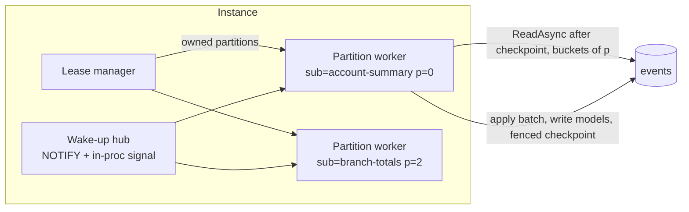

# 06 — Projections and Subscriptions

Design drivers: [ADR-010](../ADRs/ADR-010-commit-ordered-global-position-for-gap-free.md), [ADR-016](../ADRs/ADR-016-projections-inline-or-async-with-partitioned-fenced.md) and [ADR-020](../ADRs/ADR-020-process-managers-with-durable-state-and-timers.md). Fixes v2's in-memory, uncheckpointed, non-rebuildable projections (EVT-02..04, DOM-10) and the lost-event risk on crashes.

## 1. Subscribers and their sources

| Subscriber | Source | Mode | Default poison policy |
|------------|--------|------|-----------------------|
| Projection (document, EF Core, custom) | Local event log | Inline or async | **Stop** the partition |
| Process manager | Local event log, and/or remote integration events (receive pipeline) | Async | **Park** and continue |
| `IEventHandler<T>` | Local event log, and/or remote integration events | Async | **Park** and continue |
| Integration-event projection (read model built from *other* services' events) | Receive pipeline, `Project` stage | Async | **Stop** |

Remote events always arrive through the **receive pipeline** (doc 04 §5), deduplicated by the inbox and ordered per partition key. Local events always arrive through the **subscription engine** described here. A subscriber can consume both kinds; both paths end in the same `Project` or `Handle` stage middleware.

## 2. Subscription engine



**Partition worker loop**

```text
while lease held:
   batch = LogReader.Read(after = checkpoint, buckets = range(p), max = BatchSize)     // safe horizon only
   if batch empty: await WakeUp or IdleDelay (adaptive 10 ms → 1 s); continue
   using session = BeginSession()
       subscriber.ApplyBatch(batch, session)                 // middleware Project stage per event
       session.SaveCheckpoint(sub, p, batch.Last.Position, leaseToken)   // fenced (doc 05 §7.3)
       session.Commit()                                      // read model + checkpoint atomically
   on LeaseLost: drop batch, stop worker
   on transient error: retry batch with backoff (same batch, same checkpoint)
   on poison event: apply poison policy (§7)
```

- **Wake-ups.** The PostgreSQL adapter `LISTEN`s on `sourceflow`. After a commit, outside the transaction, it sends one `pg_notify` that covers every commit since the previous one (WP-4.7: a NOTIFY inside the commit serialises every commit on PostgreSQL's notification lock). The SQL Server adapter has no `NOTIFY`, so it polls adaptively. In both, an in-process signal fires after local commits for the lowest latency. Target: event to async projection p95 ≤ 100 ms on PostgreSQL ([doc 09](09-Performance-and-Scalability.md)).
- **Batch size** is adaptive: it starts at 100, grows to `MaxBatchSize` (default 1,000) while catching up, and shrinks when caught up.

> **As built (WP-C.7, CR-29).** A failing batch is applied again one event at a time (with `ImmediateRetries`) to find the failing event. For process managers and event handlers under the Park policy, a transient failure then holds the partition at that event and retries it on the `DelayedRetries` schedule, as the receive path does; only when that budget is spent, or at once for a permanent error, is the event parked. A projection that chose Park parks at once; Stop keeps its own backoff (§7). A parked event's dead-letter id is derived from the consumer and the event id, so a crash between parking and the checkpoint re-parks the same dead letter (UT-SUB-30).

## 3. Partitioning

- Each event carries `bucket = xxHash32(stream_id) & 1023` (doc 05 §1.1). A subscription with `P` partitions (a power of two, 1 to 1024) gives partition `p` the buckets `[p·1024/P, (p+1)·1024/P)`.
- **Per-stream order is preserved**, because a stream always lands in one bucket and so one partition. Order *across* streams is not guaranteed between partitions. Projections that need cross-stream ordering (rare, for example running global totals) use `P = 1`.
- **Changing P** (`dotnet sourceflow projection repartition <name> --partitions 8`):
  1. stop the subscription;
  2. set every new partition's checkpoint to the **minimum** of the old checkpoints;
  3. restart.

  The events between the minimum and each old position are re-applied. That is safe only for **idempotent** projections, so the version guard (§5) is required, and the command refuses to run otherwise. Alternatively, do a blue/green rebuild (§6).

## 4. Leases, fencing and work distribution

- Every `(subscription, partition)` and every outbox partition is a lease (doc 05 §7.4).
- Instances heartbeat into `sourceflow.nodes(node_id, heartbeat_at, roles)`. The *fair share* is `ceil(total_leases / live_nodes)`.
- Each instance acquires free or expired leases up to its fair share, and releases leases above it, one per rebalance interval, to avoid thundering herds.
- Every commit carries the lease's **fencing token**, and the checkpoint update fails if the token is stale. A garbage-collection pause or network partition therefore can't cause two instances to commit the same partition.
- Failover time ≈ lease TTL (30 s by default). It is configurable, and the trade-off is between failover speed and renewal traffic.

## 5. Consistency of async projections

| Read-model location | Guarantee | How |
|---------------------|-----------|-----|
| Same database as the events | **Exactly-once effect** | Read-model writes and the checkpoint commit in one transaction (fenced) |
| Different database (for example a reporting SQL Server, Elasticsearch) | **At-least-once, idempotent** | The checkpoint is stored in the *target* database when it supports transactions. Otherwise every document or row stores `version` (stream version, or global position for cross-stream models), and writes are guarded with `WHERE version < @incoming` |

`IDocumentProjection` applies the version guard automatically, and **on read**: before applying an event, it compares the stored document's version with `ctx.StreamVersion` and skips the event when it is already reflected. A write-only guard isn't enough. Re-applying an already-applied event to the *current* document would double-count incremental projections, such as `count += 1` (design correction DC-2, found during the implementation spike). Document reads therefore return `(data, version)`. EF Core and custom projections get `ctx.StreamVersion` and `ctx.Position`, plus a helper (`IdempotentUpsert`).

> **As built (WP-C.8, CR-31).** A document keyed by its source stream is guarded by the stream version, as above. A document fed by many streams (a total, a cross-stream index) has no stream version to compare, so it records the global position of the last event applied (`StoredDocument.Position`; the `position_commit` and `position_seq` columns, PostgreSQL V008, SQL Server V003). An event at or below that position was applied already and is skipped, so a repartition or a replay that starts at an earlier checkpoint doesn't count it twice (UT-PRJ-13). Every document projection is therefore guarded, and `projection repartition` keeps exempting all of them from `--idempotent`. A deleted cross-stream document loses its position: replaying events from before the delete could recreate it.

## 6. Rebuilds (blue/green)

1. Bump the projection version: `[Projection("account-summary", Version = 2)]`.
2. On deploy, the engine starts subscription `account-summary@2` from position zero. It writes to collection `account-summary@2` (documents) or to tables resolved through `ctx.TargetSchema` (EF Core).
3. `account-summary@1` keeps serving reads and keeps updating.
4. Once `@2` lag is below `SwitchLagThreshold` (default 100 events), the engine updates `sourceflow.collection_aliases` (`account-summary → @2`) in one transaction. `IDocumentReader<AccountSummary>` resolves the alias on every query (cached, invalidated by notification).
5. `@1` is stopped. Its data is dropped after `RetainPreviousFor` (default 7 days), or by `dotnet sourceflow projection drop account-summary@1`.

The CLI command `projection rebuild <name@version>` forces steps 2–5 without a code change (same version, new generation suffix: `account-summary@1.2`). `projection generations` lists the aliases, `projection switch` rolls back to a retained generation, and `--in-place` drops and replays the same generation instead.

**Details ([ADR-032](../ADRs/ADR-032-blue-green-read-model-generations-behind-forward-only-aliases.md)).**
- The alias only moves forward, by compare-and-set: one node switches it.
- Old-version nodes stop their generation once a newer version serves reads.
- EF Core projections take part when they opt in to a schema per generation (`IGenerationSchemaContext`). Their reads resolve the generation with `IReadModelResolver`.
- A service runs one version of each projection; `Projections(p => p.Remove<T>())` leaves out a module's older one.
- Inline projections always write their first generation.

**Rebuild speed.** `IDocumentProjection` is *batch-aware*:
1. Collect the document keys touched by the batch.
2. Load them with one `GetMany`.
3. Apply every event in memory.
4. Upsert each changed document **once**.

For a typical rebuild this cuts database round trips from O(events) to O(batches) ([doc 09](09-Performance-and-Scalability.md)).

Replay is side-effect free by construction: projections are pure functions of events, and event handlers and process managers are **never** part of a rebuild. They keep their own subscriptions and checkpoints (E2E-08, UT-SUB-28). This closes v2's replay side-effect problem (GAP-06).

## 7. Errors and poison events

| Policy | Behaviour | Use for |
|--------|-----------|---------|
| `Stop` | Retry with backoff (1 s to 5 min, capped). The partition halts at the poison event; others continue. Health is `Degraded`, and `subscription.stalled` = 1 for that partition. An operator fixes the code and redeploys, or skips the event (`projection skip <name> --partition p --position …`, which is audited). | Projections, where correctness matters more than freshness |
| `Park` | After the retry budget, the event is copied to dead letters (consumer = subscription), the checkpoint moves past it, and work continues. | Process managers, event handlers |

v2's silent swallowing is impossible: every failure is retried, stops the partition, or is parked, and each case is visible in metrics (GAP-07, NFR-REL-06).

## 8. Inline projections

- They run in the command's transaction, after the append (ES-R1). They use the same `When` code as async projections; the mode is a registration choice.
- They are allowed only when the read model is in the same database as the events (validated at startup).
- A failure fails the command (`CommandResult` failed, nothing appended). Keep inline projections small and fast, because they add directly to write latency.
- An inline projection still has a checkpointed **async shadow** used for rebuilds. The rebuild path is identical for both modes.

## 9. Observability of subscriptions

| Signal | Meaning |
|--------|---------|
| `sourceflow.subscription.lag` (gauge, events; tags: subscription, partition) | Events between the checkpoint and the head (estimated from `seq`) |
| `sourceflow.subscription.lag_time` (gauge, seconds) | `now − created_at` of the next unprocessed event. The primary freshness SLO signal |
| `sourceflow.subscription.horizon_age` (gauge, seconds) | Age of the oldest in-progress write transaction holding back the safe horizon |
| `sourceflow.subscription.batch.duration` (histogram) | Apply-and-commit time per batch |
| `sourceflow.subscription.stalled` (gauge 0/1) | The partition is halted by `Stop` |
| `sourceflow.lease.owned` (gauge) | Leases held by this node |
| Span `project {subscription}` | One per batch, with **links** to the producing command spans, taken from each event's `traceparent` (capped at 32 links) |
