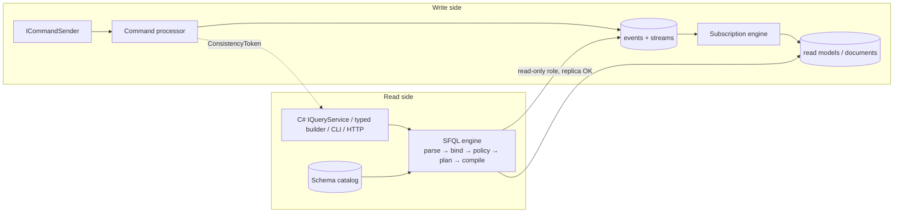

# 14 — Query Side: Event Schema Catalog and SFQL

Design drivers: [ADR-005](../ADRs/ADR-005-logical-message-type-names-and-registry.md), [ADR-016](../ADRs/ADR-016-projections-inline-or-async-with-partitioned-fenced.md), [ADR-022](../ADRs/ADR-022-conjoined-multi-tenancy-with-row-level-security.md) **[ADR-023](../ADRs/ADR-023-sfql-query-language-with-cesql-predicates.md)** and **[ADR-026](../ADRs/ADR-026-per-service-query-api-with-sql-syntax-and-injection-proof-compilation.md)**. This document specifies how the **read side** of CQRS is queried, separately from writes: the event schema catalog that makes events queryable, and SFQL, the query language that runs over it.

## 1. CQRS separation rules

| Rule | Detail |
|------|--------|
| Q-R1 | **Writes never read through the query side.** `Decide`, `When` and `React` get state only from their own stream (or DCB query, [ADR-021](../ADRs/ADR-021-dynamic-consistency-boundaries-dcb-in-3-1.md)). Using `IQueryService` inside aggregate, process-manager or projection code is an **error** (analyzer SF0015). Using it in an `ICommandHandler` is a **warning** (SF0016: "decisions based on eventually consistent reads"). |
| Q-R2 | **Queries never write.** SFQL has no data-changing grammar. Execution uses a `QueryDataSource` whose database role has `SELECT` only on `events`, `streams`, `documents`, `schemas` and `collection_aliases`. It can't read `outbox`, `inbox` or `data_keys`. |
| Q-R3 | **Separate resources.** `sf.Query(q => q.ConnectionString = …)` may point at a **read replica**. Query load never competes for the write pool. |
| Q-R4 | **Logical addressing.** Queries name logical event types, schema fields, collections and aggregates, never tables or JSON paths. The physical schema can evolve without breaking queries. |
| Q-R5 | **Consistency is explicit.** Every query states, or defaults to, a consistency level (§6). Read-your-writes uses tokens, not sleeps. |
| Q-R6 | **Every service exposes a query API** (§9) over its own events and read models. It validates syntax and policy before anything runs, supports the basic SQL read constructs (joins, filtering, grouping, ordering, …) through the SQL syntax (§4.2), and is injection-proof by construction (§9.3). |

### 1.1 Query ownership: the service boundary (Q2)

Product sign-off on Q2 requires that **querying events is modelled within the owning service's domain and business boundary**. The rules:

| Rule | Detail |
|------|--------|
| Q-B1 | **One catalog per service.** The schema catalog and SFQL binder see only the event types, read models and aggregates registered by the service's own modules. A query naming another service's event type fails to bind (SFQ0204 *type not owned by this service*). |
| Q-B2 | **No cross-service event-log access.** The read-only query role is granted on the service's own database or schema only. There is no federated query across services. |
| Q-B3 | **Foreign facts become local read models.** To query data that originated elsewhere, the service subscribes to the other service's *integration events* and projects them into **its own** read model, named in its own vocabulary. That read model is then queryable like any other. |
| Q-B4 | **Stable contracts are named domain queries; ad-hoc querying is a permissioned capability.** Inside the service, developers and operators may run ad-hoc SFQL (subject to permissions). Toward other services and UIs, a service publishes **named domain queries**, versioned like integration events: `[DomainQuery("accounts.overdrawn-accounts", 1)]` binds an SFQL text with typed parameters and a typed result record. The per-service query API (§9) also accepts **ad-hoc** queries (pipeline or SQL syntax) for callers holding `sourceflow.query.adhoc`: operators, analysts, BI tools and the service's own UIs. Ad-hoc results aren't a versioned contract; clients that need stability use a named query. |
| Q-B5 | **The vocabulary is the domain's.** Query names, parameters and result fields use the bounded context's ubiquitous language, never storage terms. A named query's result is a read model or projection of events, never raw `data` blobs, unless the query is explicitly an audit query of the service's own log. |
| Q-B6 | **Reporting across services** is a separate bounded context (for example "reporting"). It owns read models built from the integration events it subscribes to, and applies these same rules. |

```csharp
// A named, versioned domain query: the contract other services and UIs use (Q-B4)
[DomainQuery("accounts.overdrawn-accounts", 1)]
public sealed partial record OverdrawnAccounts(decimal Below) : IDomainQuery<OverdrawnAccount>
{
    public const string Sfql = """
        from readmodel "account-summary"
        | where status = 'Open' and balance < @below
        | project accountId = id, holderSegment = segment, balance
        | order by balance asc
        """;
}
public sealed record OverdrawnAccount(Guid AccountId, string HolderSegment, decimal Balance);

// In-process: var rows = await queries.ExecuteAsync(new OverdrawnAccounts(Below: 0m), ct);
// HTTP:       app.MapDomainQueries();   →   GET /queries/accounts.overdrawn-accounts/v1?below=0
```

The generator binds every `[DomainQuery]` at **build time** against the catalog (analyzer SF0018: the query doesn't bind, or its result columns don't match the result record). A broken contract therefore fails compilation, not production.



## 2. Event schema catalog

Queries need to know, statically, which fields every event type has, in every version. The catalog is that knowledge.

### 2.1 Generation

For every `[MessageType]`, the source generator emits a **JSON Schema 2020-12** document with SourceFlow extensions:

```json
{
  "$schema": "https://json-schema.org/draft/2020-12/schema",
  "$id": "urn:sourceflow:schema:bank.account.opened:2",
  "title": "AccountOpened",
  "type": "object",
  "properties": {
    "accountId":      { "type": "string", "format": "uuid", "x-sourceflow-tag": "account" },
    "givenName":      { "type": "string", "x-sourceflow-personal-data": { "subject": "customerId" },
                        "x-sourceflow-renamed-from": { "1": "holder" } },
    "familyName":     { "type": "string", "x-sourceflow-personal-data": { "subject": "customerId" } },
    "customerId":     { "type": "string", "format": "uuid", "x-sourceflow-queryable": true },
    "initialDeposit": { "type": "string", "format": "decimal", "x-sourceflow-queryable": true },
    "openedAt":       { "type": "string", "format": "date-time" }
  },
  "required": ["accountId", "givenName", "familyName", "customerId", "initialDeposit", "openedAt"],
  "x-sourceflow": { "type": "bank.account.opened", "version": 2, "kind": "event", "aggregate": "bank-account" }
}
```

Attributes on message members drive the extensions:

| Attribute | Effect on querying |
|-----------|--------------------|
| `[Queryable]` | The field may appear in `where`, `order by` and `summarize by` over the event log. It generates a **partial expression index** (§7.2). |
| `[RenamedFrom("holder", Version = 1)]` | The binder maps the field to its old name when reading rows of that version. |
| `[PersonalData]` | The field can't be filtered, sorted or grouped (it is ciphertext). It is decrypted or masked only in `project` (§8). |
| `[Tag("account")]` | The field becomes a tag ([ADR-021](../ADRs/ADR-021-dynamic-consistency-boundaries-dcb-in-3-1.md)). Tags are always queryable through `has_tag()`. |

Decimals are serialised as strings (`format: decimal`) so they compare exactly.

### 2.2 Storage, compatibility and export

```sql
CREATE TABLE sourceflow.schemas (
    tenant_id     text NOT NULL DEFAULT '-',      -- '-' = shared (schemas are code, not tenant data)
    message_type  text NOT NULL,
    type_version  int  NOT NULL,
    kind          text NOT NULL,                  -- command | event | integration-event | readmodel
    service       text NOT NULL,
    json_schema   jsonb NOT NULL,
    fingerprint   text NOT NULL,                  -- SHA-256 of canonical schema
    first_seen_at timestamptz NOT NULL DEFAULT now(),
    PRIMARY KEY (tenant_id, message_type, type_version));
```

- **Registration.** At startup each service upserts its schemas (idempotent). A *different* fingerprint for an existing `(type, version)` **fails startup**, because a published version is immutable.
- **Compatibility check in CI.** `dotnet sourceflow schema check --baseline schemas.lock.json` enforces these rules:
  - adding an optional field is allowed;
  - removing, retyping or renaming a field requires a new version plus an upcaster (and `[RenamedFrom]` for renames);
  - changes to integration events are always checked against the *published* baseline.
- **Read-model schemas.** Document projections register their document type with `kind = readmodel`, so `readmodel` queries are checked too.
- **Export.** `dotnet sourceflow schema export --format asyncapi` writes an **AsyncAPI 3.0** document: channels are endpoints and topics from the topology, messages are integration-event schemas, and CloudEvents headers are included. Tools that ingest AsyncAPI (for example EventCatalog) can publish it as a browsable event catalog. `--format jsonschema` writes the raw schemas.

## 3. SFQL overview

SFQL has **two syntaxes that parse into one AST**. The binder, policy, planner, compilers and security rules are therefore identical for both:

```text
-- Pipeline syntax (language = "sfql")
from events of "bank.account.deposited"
| where data.amount >= @min and time >= ago(7d)
| project stream, time, amount = data.amount
| order by time desc
| take 100
```

```sql
-- SQL syntax (language = "sql"): a read-only SELECT subset
SELECT e.stream, e.time, e.data.amount AS amount
FROM events."bank.account.deposited" e
WHERE e.data.amount >= @min AND e.time >= ago(7d)
ORDER BY e.time DESC
LIMIT 100
```

- A pipeline query is one **source**, a sequence of **stages** and optional **options**. A SQL query is one `SELECT` with joins, filters, grouping, ordering and limits (§4.2).
- Keywords are case-insensitive. Identifiers are case-sensitive camelCase, matching the JSON. In SQL syntax, `"double quotes"` delimit identifiers and `'single quotes'` delimit strings (the SQL standard). In pipeline syntax, CESQL string rules apply.
- **Values come only from parameters** (`@name`) or literals, and both become bound parameters in generated SQL (§9.3, rule I-3). Caller text is never spliced into SQL.
- Specification identifier: `sfql/1`, covering both syntaxes. A future breaking change is `sfql/2`, selected by `options (language = 'sfql/2')` or the API's `language` field.

## 4. Grammar (`sfql/1`, EBNF)

### 4.1 Pipeline syntax

```ebnf
query          = source , { "|" , stage } , [ options ] ;

source         = "from" , ( events_src | stream_src | readmodel_src | aggregate_src | schema_src ) , [ "as" , ident ] ;
events_src     = "events" , [ "of" , string , { "," , string } , [ "version" , integer ] ] , [ "upcast" ] ;
stream_src     = "stream" , value ;
readmodel_src  = "readmodel" , string ;
aggregate_src  = "aggregate" , string , "id" , value , [ "as" , "of" , ( "version" | "time" ) , value ] ;
schema_src     = "schema" , [ "of" , string ] ;

stage          = where | project | distinct | summarize | order | skip | take | join | lookup ;
where          = "where" , expr ;
project        = "project" , item , { "," , item } ;
distinct       = "distinct" , [ item , { "," , item } ] ;
item           = [ ident , "=" ] , expr ;
summarize      = "summarize" , agg , { "," , agg } , [ "by" , item , { "," , item } ] ;
agg            = [ ident , "=" ] , agg_fn , "(" , [ "distinct" ] , [ expr ] , ")" ;
agg_fn         = "count" | "count_distinct" | "sum" | "avg" | "min" | "max" ;
order          = "order" , "by" , sort , { "," , sort } ;
sort           = expr , [ "asc" | "desc" ] , [ "nulls" , ( "first" | "last" ) ] ;
skip           = "skip" , value ;                                   (* read-model-only, §7.4 *)
take           = "take" , value ;
join           = "join" , [ "kind" , "=" , ( "inner" | "left" ) ] ,
                 ( readmodel_src | events_src | stream_src ) , "as" , ident , "on" , join_cond ;
join_cond      = column , "=" , column , { "and" , column , "=" , column } ;
lookup         = "lookup" , "readmodel" , string , "on" , "key" , "=" , expr , "as" , ident ;   (* sugar: left join on id *)
column         = [ ident , "." ] , path ;

options        = "options" , "(" , option , { "," , option } , ")" ;
option         = ident , "=" , ( value | ident , "(" , [ value ] , ")" ) ;

value          = literal | parameter ;
parameter      = "@" , ident ;

(* expr: the CloudEvents SQL (CESQL) v1 expression grammar — NOT, AND, OR, XOR, =, !=, <>, <, <=, >, >=,
   +, -, *, /, %, LIKE, IN (list), EXISTS, and CESQL built-in functions — extended with:
     paths            alias.field , data.a.b , data.items[0].sku
     parameters       @name
     literals         decimal 12.50m ; duration 7d / 12h / 30m / 15s ; datetime('2026-01-01T00:00:00Z')
     predicates       x BETWEEN a AND b ; x IS [NOT] NULL ; has_tag('account:…')
     conditionals     CASE WHEN c THEN a { WHEN … } [ ELSE b ] END
     functions        now() ; ago(duration) ; bin(timestamp, duration) ; coalesce(a, b, …) ; cast(x as type) ;
                      lower, upper, trim, length, concat, substring, abs, round, floor, ceiling   (allow-list, §9.3 I-5) *)
```

### 4.2 SQL syntax (read-only `SELECT` subset)

```ebnf
sql_query    = "select" , [ "distinct" ] , select_list ,
               "from" , table_ref , { join_clause } ,
               [ "where" , sql_expr ] ,
               [ "group" , "by" , sql_expr , { "," , sql_expr } , [ "having" , sql_expr ] ] ,
               [ "order" , "by" , sql_sort , { "," , sql_sort } ] ,
               [ "limit" , value , [ "offset" , value ] ] ,
               [ options ] ;                          (* exactly one statement: no ';' *)
select_list  = "*" | select_item , { "," , select_item } ;
select_item  = ( sql_expr | ident , "." , "*" ) , [ [ "as" ] , ident ] ;
table_ref    = ( "readmodel" , "." , name
               | "events" , [ "." , name ]
               | "stream" , "(" , value , ")" ) , [ [ "as" ] , ident ] ;
join_clause  = [ "inner" | "left" , [ "outer" ] ] , "join" , table_ref , "on" , join_cond ;
sql_sort     = sql_expr , [ "asc" | "desc" ] , [ "nulls" , ( "first" | "last" ) ] ;
name         = ident | quoted_ident ;                (* readmodel."account-summary", events."bank.account.deposited" *)
sql_expr     = expr                                  (* §4.1 expression grammar, plus aggregates below *)
             | sql_expr , [ "not" ] , "in" , "(" , subquery , ")"
             | [ "not" ] , "exists" , "(" , subquery , ")" ;
subquery     = "select" , select_item , "from" , table_ref , [ "where" , expr ] ;   (* depth 1, no joins inside *)
aggregate    = "count" , "(" , ( "*" | [ "distinct" ] , expr ) , ")"
             | ( "sum" | "avg" | "min" | "max" ) , "(" , expr , ")" ;
```

There are **no productions** for anything that writes, changes schema, calls procedures, separates statements or carries comments. That makes the grammar itself an allow-list (§9.3, rules I-1 and I-2).

### 4.3 Supported constructs

| Construct | Pipeline | SQL syntax | Notes |
|-----------|:--------:|:----------:|-------|
| Projection, aliases, `*` / `alias.*` | ✔ `project` | ✔ | `*` expands to the source's schema fields, never raw storage columns |
| `DISTINCT` | ✔ `distinct` | ✔ | |
| **Filtering**: comparison, `AND`/`OR`/`NOT`, `IN (list)`, `BETWEEN`, `LIKE`, `IS [NOT] NULL`, `EXISTS attr` | ✔ `where` | ✔ `WHERE` | CESQL semantics (§5.5) |
| **Joins**: `INNER`, `LEFT [OUTER]` | ✔ `join` | ✔ | Equality conditions, ≤ 3 joins (G-7…G-9) |
| `RIGHT` / `FULL` / `CROSS` joins | ✗ | ✗ | SFQ0102; rewrite `RIGHT` as `LEFT` |
| **Grouping**: `GROUP BY`, `count`, `count(distinct)`, `sum`, `avg`, `min`, `max`, `HAVING` | ✔ `summarize` + `where` | ✔ | G-1, G-2, G-11 |
| **Ordering**: multiple keys, `ASC`/`DESC`, `NULLS FIRST`/`LAST` | ✔ `order by` | ✔ | Deterministic tiebreak appended (G-6) |
| `LIMIT` / `OFFSET` | ✔ `take` / `skip` | ✔ | `OFFSET` only on read-model-only queries, ≤ 10,000 (§7.4) |
| `CASE`, `CAST`, `COALESCE`, allow-listed scalar functions | ✔ | ✔ | §9.3 I-5 |
| Subqueries in `WHERE`: `IN (SELECT …)`, `EXISTS (SELECT …)` | ✗ (use `join`) | ✔ | Depth 1, ≤ 2 per query, correlated by equality only (G-12) |
| `UNION`, CTEs (`WITH`), window functions | ✗ | ✗ | SFQ0102. Candidates for `sfql/1.1` |
| `INSERT`, `UPDATE`, `DELETE`, `MERGE`, DDL, `EXEC`/`CALL`, `SET`, transactions, `;`, comments | ✗ | ✗ | **Never.** No grammar production (SFQ0102) |

### 4.4 Composition rules

| Rule | Detail |
|------|--------|
| G-1 | `where` before `summarize` filters rows. `where` after `summarize` (SQL: `HAVING`) filters groups and may reference aggregate names. |
| G-2 | After `summarize` / `GROUP BY`, only the grouping items and aggregates are in scope. |
| G-3 | `project` / the `SELECT` list sets the output columns. Without it, the source's default columns are returned (§5). |
| G-4 | `join` and `lookup` come before `summarize`. `lookup` is shorthand for `join kind=left … on alias.id = key`. |
| G-5 | `take`/`LIMIT` ≤ `MaxRows` (default 1,000, configurable up to 10,000). Without it, the engine returns pages of `PageSize` (default 100). |
| G-6 | Ordering is made total by appending each source's key (`position` for events, `id` for read models, the grouping keys after `GROUP BY`), so pagination is stable. |
| G-7 | Join conditions are conjunctions of **equalities between columns**. At least one side of each equality must be an **indexed key**: read-model `id` or a `[Queryable]` field; event `id`, `stream`, `aggregatekey`, `sfcorrelationid`, `sfcausationid`, or a `[Queryable]` data field. Otherwise SFQ0405, unless `allow_scan` is given with its permission. |
| G-8 | Joining two `events` sources requires both to be bounded under the SFQ0401 rules (§7.3), otherwise SFQ0406. |
| G-9 | The binder adds `tenant` equality between every joined pair. Join keys can't be personal data (SFQ0301). Every source must belong to this service (Q-B1). |
| G-10 | In multi-source queries, columns are referenced as `alias.field`. An unqualified name that is ambiguous gives SFQ0205. |
| G-11 | Every non-aggregated output expression must appear in the grouping keys (SFQ0206). |
| G-12 | Subqueries: only in `WHERE`, as `IN`/`EXISTS`; depth 1; at most 2 per query; may reference outer columns only through equality. No joins, grouping or ordering inside. |

## 5. Sources and their attributes

### 5.1 `events` — the global log

| Attribute | Type | Meaning | Indexed |
|-----------|------|---------|---------|
| `id` | uuid | Event id | ✔ |
| `type` | string | Logical type, without version | ✔ (with `time`) |
| `typeversion` | integer | Schema version | — |
| `source` | string | Producing service | — |
| `subject`, `stream` | string | Stream id (aliases) | ✔ |
| `aggregatekey` | string | The aggregate-id segment of the stream (join key to read models keyed by aggregate id) | ✔ (via `stream`) |
| `version` | integer | Stream version | ✔ (with `stream`) |
| `position` | position | Global commit-ordered position (opaque, comparable) | ✔ |
| `time` | timestamp | Decision time (`ctx.Now`), also stored as `created_at` | ✔ (with `type`) |
| `sfcorrelationid`, `sfcausationid` | uuid | Correlation and causation | ✔ |
| `tenant`, `sftenant` | string | Tenant (implicitly filtered, §8) | ✔ (leading key) |
| `tags` | string[] | DCB tags | ✔ (GIN) |
| `data` | object | Payload, typed only after `of` narrows the types (§5.4) | `[Queryable]` fields |

The attribute names deliberately equal **CloudEvents attribute names**. A CESQL filter written for a subscription, such as `type LIKE 'bank.account.%' AND sfcorrelationid = '…'`, runs unchanged as an SFQL `where`.

Default columns are `position, stream, version, type, typeversion, time, data`.

### 5.2 `stream "<id>"`

The events of one stream in version order, with the same attributes as `events`. It is always read at **latest** consistency, which is safe because per-stream order is guaranteed (doc 05 §5.3).

### 5.3 `readmodel "<collection>"`

The documents of a projection collection, resolved through `collection_aliases` (doc 06 §6). Attributes are the document's schema fields plus `id`, `version` and `updatedAt`. Fields marked `[Queryable]` on the document type get expression indexes.

### 5.4 Typing of `data`

| Situation | Behaviour |
|-----------|-----------|
| `events` without `of` | `data` is **opaque**. Only `exists data.x` and `project data` are allowed. Referencing `data.x` in other positions is compile error SFQ0201. This forces narrowing, which is both typed and index-friendly. |
| `events of "t1", "t2"` | `data.x` must exist in at least one listed type, with compatible types (SFQ0202 otherwise). Rows of types without `x` evaluate `data.x` as **missing** (§5.5). |
| Several versions of one type | The binder rewrites `data.x` per version using `[RenamedFrom]`. A field absent from a version is *missing* for rows of that version. |
| `events of "t" version N` | Restricts to one version. Fields are typed exactly from that version's schema. |
| `… upcast` | Rows are fetched with their envelope predicates in SQL, **upcast in process** to the latest version, and their data predicates evaluated in memory. This is correct for structural changes (splits and merges) but costs more, and is flagged by the cost guard (§7). |

### 5.5 Null and missing semantics (CESQL-aligned)

- A *missing* field or attribute in a predicate makes that comparison **false**. That matches CESQL, where an absent attribute produces an evaluation error and the expression yields false. `exists data.x` and `x is null` test for it explicitly.
- `is null` is true for missing fields and for explicit JSON `null`.
- Aggregates ignore missing and null values (`count()` counts rows; `count(x)` counts non-null values).
- Type errors that can be detected statically (string compared with number) are **compile errors**. Over opaque or dynamic values, CESQL's implicit casting rules apply.

### 5.6 `aggregate "<name>" id @id [as of version|time …]` — temporal state

This source returns **one row**: the aggregate's state, folded in process with its generated `Evolve` from events up to the given version or time (time means `time <=` the bound). It is strongly consistent and reuses snapshots where `snapshot.version ≤ bound`. Columns are the state record's properties. It answers "what did the account look like at month end?" without building a projection.

### 5.7 `schema [of "<type>"]`

Catalog introspection. It lists types, versions and fields with their types and attributes (queryable, PII, tags, renamed-from). The CLI uses it for autocompletion.

### 5.8 Source naming in the SQL syntax

| Pipeline syntax | SQL syntax |
|-----------------|------------|
| `readmodel "account-summary"` | `readmodel."account-summary"` |
| `events of "bank.account.deposited"` | `events."bank.account.deposited"` (all versions; filter `typeversion` to restrict) |
| `events` | `events` |
| `stream @s` | `stream(@s)` |
| `aggregate … as of …`, `schema` | Pipeline only. Catalog discovery over HTTP is `GET /query/schema` (§9.1) |

## 6. Consistency semantics

| Source | Default | Options |
|--------|---------|---------|
| `events` | `horizon`: only events below the safe horizon (doc 05 §5). Results are **monotonic**: a page never later gains earlier rows, so continuation tokens are stable. | `latest`: also includes committed events above the horizon. Fresher, but not monotonic across pages. |
| `stream` | `latest` | — |
| `readmodel` | `eventual`: whatever the projection has applied | `at_least(@token)`: wait until the projection's checkpoint for the token's partition ≥ the token's position, or until `timeout`. Then either fail (`ConsistencyTimeout`) or return with `stale = true` (`on_timeout = 'stale'`). |
| `aggregate … as of` | Strong | — |

**Consistency tokens.** `CommandResult` carries a `ConsistencyToken` (position, bucket, tenant), serialisable as an opaque string. In HTTP, return it in a header, for example `SourceFlow-Consistency`. A client that just wrote can then query its own write:

```text
from readmodel "account-summary" | where id = @id
options (consistency = at_least(@token), timeout = 2s)
```

Inline projections satisfy any token immediately. With a read replica, the wait checks the **replica's** checkpoint rows. They replicate with the data, so the guarantee holds across replication lag.

**Joins and consistency.** Each joined source keeps its own consistency: `events` at `horizon` (or `latest`), read models at `eventual` (or `at_least`). `at_least(@token)` waits until **every** read model in the query has passed the token. The response's `consistency.sources[]` reports the level applied to each source. Joining events with a read model that lags can show events whose projection hasn't caught up yet; use `at_least` when that matters.

## 7. Execution, safety and performance

### 7.1 Pipeline

```text
request ─► Request guard (size, characters, limits, rate limit; §9.2)
text ─► Lexer ─► Parser (pipeline or SQL syntax; recursive descent, allow-list grammar) ─► AST
     ─► Binder   (catalog: names, types, version rewrites, aliases)
     ─► Policy   (tenant predicate, PII rules, permissions, cost guard)
     ─► Planner  (push down to SQL vs evaluate in memory: upcast, PII projection, temporal fold)
     ─► Compiler (PostgreSQL | SQL Server | in-memory interpreter), parameterised
     ─► Executor (read-only connection, statement timeout, streaming reader)
     ─► Post-processor (decrypt or mask PII, upcast, shape) ─► IAsyncEnumerable<QueryRow>
```

Plans are cached by `(normalised text hash, catalog fingerprint, provider)`. The parser has no dependencies and is fuzzed (doc 10 §7).

### 7.2 Indexes that queries can rely on

| Index | Supports |
|-------|----------|
| `events (tenant_id, event_type, created_at)` | `of` + time ranges |
| `events (tenant_id, stream_id, stream_version)` (unique) | `stream`, `subject` |
| `events ((metadata->>'correlationId'))` and the causation index | Tracing queries |
| `events USING gin (tags)` | `has_tag` |
| **Generated** partial expression indexes, one per `[Queryable]` event field: `CREATE INDEX … ON events (tenant_id, ((data->>'customerId')::uuid)) WHERE event_type = 'bank.account.opened'` (SQL Server: persisted computed column + filtered index) | Typed `data` predicates |
| Generated expression indexes on `documents` for `[Queryable]` read-model fields | `readmodel` predicates |

`dotnet sourceflow db index sync` produces or applies these indexes from the catalog, so indexes follow the schema and are never hand-written.

### 7.3 Cost guard (enforced at policy time)

| Rule | Error if violated |
|------|-------------------|
| An `events` query must be bounded by at least one of: `of` + a time range ≤ `MaxTimeRange` (default 31 days); `stream`; correlation or causation id; `has_tag`; a position range; a `[Queryable]` equality predicate | SFQ0401 *unbounded scan*. It may be overridden with `options (allow_scan = true)` plus the `sourceflow.query.scan` permission |
| A `data` predicate on a field that isn't `[Queryable]` must be combined with a bounding predicate | SFQ0402 |
| `upcast` queries are limited to `MaxUpcastRows` (default 50,000) examined | SFQ0403 |
| More joins than `MaxJoins` (default 3, cap 5), or subqueries beyond G-12 | SFQ0404 |
| A join condition that isn't an equality on an indexed key on at least one side (G-7) | SFQ0405 (override: `allow_scan` + permission) |
| A join of two `events` sources without bounds on both (G-8) | SFQ0406 |
| Estimated plan cost above `MaxEstimatedCost` (opt-in: PostgreSQL `EXPLAIN (FORMAT JSON)` total cost; SQL Server estimated subtree cost) | SFQ0407 |
| More than `MaxGroups` result groups (default 10,000) | SFQ0408 (at run time) |
| `OFFSET`/`skip` on a query with an `events` or `stream` source, or above `MaxOffset` | SFQ0409 |
| Request limits exceeded (§9.4) | SFQ0103 |
| Statement timeout (`QueryTimeout`, default 5 s, cap 30 s) | `QueryTimeout` |

`ExplainAsync` (and `dotnet sourceflow query --explain`) shows the bound plan, the generated SQL with parameter placeholders, the indexes used, and the cost-guard decision.

### 7.4 Pagination

Results are ordered and keyset-paginated. The continuation token is opaque and contains the last sort key (always ending in the G-6 tiebreak keys), the query hash and the catalog fingerprint. It is rejected if the query text or the schema changed. `OFFSET`/`skip` is accepted **only when every source is a read model**, up to `MaxOffset` (default 10,000). Queries touching the moving event log must use continuation tokens (SFQ0409).

## 8. Security semantics

| Concern | Semantics |
|---------|-----------|
| **Tenancy** ([ADR-022](../ADRs/ADR-022-conjoined-multi-tenancy-with-row-level-security.md)) | The binder injects `tenant = <ambient tenant>` into every source. `options (tenants = 'all')` needs the `sourceflow.query.cross-tenant` permission. PostgreSQL RLS enforces it again at the database. |
| **Archived streams** ([doc 05 §9](05-Event-Store-and-Persistence.md#9-retention-archiving-and-growth)) | `from events` leaves out events of archived streams. `options (include_archived = true)` includes them and needs no permission. `from stream` and `from aggregate` always read archived streams. |
| **Personal data** (doc 10 §4) | `[PersonalData]` fields can't appear in `where`, `order by`, `summarize` or `lookup` keys (SFQ0301), because they are ciphertext. In `project` they are decrypted in process **only** with the `sourceflow.query.pii` permission. Otherwise they come back redacted. Erased subjects come back as `"[erased]"`. |
| **Permissions** | `sourceflow.query.events`, `.readmodels`, `.aggregates`, `.schema`, `.pii`, `.scan`, `.cross-tenant`, `.adhoc` (ad-hoc API queries), `.validate`, `.explain` (reveals physical schema: operators only). They are evaluated through `IAuthorizationService` policies against the caller's `ClaimsPrincipal`, or the service identity for in-process calls. |
| **Injection** (SQL and script) | Defended in layers, by construction: §9.3 rules I-1…I-8 and S-1…S-6. |
| **Audit** | Every executed query records a span and, optionally, an audit log entry (query hash, principal, tenant, row count). Literal values are logged only if `LogQueryParameters` is on, and are redacted. |

## 9. Query API (one per service) and other surfaces

### 9.1 HTTP endpoints

Every service maps the query API in its host (Q-R6). Mapping **fails closed**: startup fails if no authorization policy is attached.

```csharp
app.MapSourceFlowQueryApi("/query")              // SourceFlow.AspNetCore
   .RequireAuthorization("sourceflow-query");    // required; otherwise startup fails (SFQ0504)
app.MapDomainQueries();                          // named, versioned contracts (Q-B4)
```

| Method and path | Purpose | Permission |
|-----------------|---------|------------|
| `POST /query` | Execute an ad-hoc query in the pipeline (`"language": "sfql"`) or SQL (`"language": "sql"`) syntax | `sourceflow.query.adhoc` + source permissions (§8) |
| `POST /query/validate` | Parse, bind and policy-check **without executing**. Returns diagnostics with positions | `sourceflow.query.validate` |
| `POST /query/explain` | Bound plan, parameterised SQL (placeholders only, no values) and cost estimate | `sourceflow.query.explain` |
| `GET /query/schema` | The service's queryable sources and fields visible to the caller (PII and `[Queryable]` flagged) | `sourceflow.query.schema` |
| `GET /queries`, `GET /queries/{name}/v{n}` | Named domain queries (Q-B4) | Per-query policy |

The endpoints are described in the service's OpenAPI 3.1 document (ASP.NET Core built-in OpenAPI), including request and response schemas and the error model.

**Request**

```json
POST /query
Content-Type: application/json

{
  "language": "sql",
  "query": "SELECT a.id, a.balance, c.segment FROM readmodel.\"account-summary\" a JOIN readmodel.\"customer-profile\" c ON c.id = a.customerId WHERE a.status = @status AND a.balance < @below ORDER BY a.balance LIMIT 50",
  "parameters": { "status": "Open", "below": 0 },
  "options": { "consistency": "at_least", "token": "73421", "timeout": "PT2S", "pageSize": 50 },
  "continuation": null
}
```

**Response** (`200`, `application/json`; or `application/x-ndjson`, one row per line plus a trailer line carrying `continuation` and `consistency`):

```json
{
  "columns": [ { "name": "id", "type": "string" }, { "name": "balance", "type": "decimal" }, { "name": "segment", "type": "string" } ],
  "rows": [ [ "0193a8…", "-12.50", "retail" ] ],
  "continuation": "eyJ…",
  "consistency": { "sources": [ { "source": "readmodel.account-summary", "level": "at_least", "stale": false } ] },
  "queryHash": "sha256:9f2c…"
}
```

Decimals are returned as strings (exact). Timestamps use RFC 3339 UTC.

**Errors** are RFC 9457 `application/problem+json`, with diagnostics and positions but **never** an echo of the caller's text (§9.3 S-3):

```json
{
  "type": "https://sourceflow.net/problems/query-invalid",
  "title": "The query is not valid.",
  "status": 400,
  "diagnostics": [
    { "code": "SFQ0102", "message": "Statement type 'DELETE' is not supported: the query API is read-only.", "line": 1, "column": 1, "length": 6 }
  ]
}
```

| Status | When |
|--------|------|
| 400 | Syntax, bind or policy diagnostics (SFQ01xx–04xx) |
| 403 | Missing permission (SFQ0501) |
| 409 | Continuation token invalid for this query or schema (SFQ0601) |
| 413 | Request or query too large (SFQ0103) |
| 415 | Content type other than `application/json` |
| 429 | Rate or concurrency limit (SFQ0502/0503), with `Retry-After` |
| 503 | Consistency wait timed out with `on_timeout = 'fail'` (SFQ0602), with `Retry-After` |
| 504 | Statement timeout |

### 9.2 Request processing

```text
HTTP request
 ├─ Transport guard   body ≤ 64 KB · application/json only · JSON depth ≤ 16 · authenticated · rate + concurrency limits
 ├─ Text guard        valid UTF-8 · NFC normalisation · reject NUL/control chars (except TAB, LF, CR), bidi overrides
 │                    and isolates (U+202A–U+202E, U+2066–U+2069), zero-width chars outside string literals
 │                    · length ≤ 16 KB · tokens ≤ 4,000 · nesting depth ≤ 32                            (SFQ0103/0104)
 ├─ Parse             allow-list grammar (§4); one statement; precise error positions                   (SFQ0101/0102)
 ├─ Bind              names resolved only against this service's catalog; parameters typed              (SFQ02xx)
 ├─ Policy            tenant · PII · permissions · cost guard · limits                                  (SFQ03xx–05xx)
 │                    └─ /query/validate stops here and returns diagnostics
 ├─ Plan + compile    parameterised SQL from catalog identifiers and placeholders only (I-3)
 ├─ Execute           read-only connection and transaction · statement timeout · RLS tenant · streaming
 └─ Serialise         System.Text.Json (escaping on) · safe headers (S-2)
```

### 9.3 Injection defence

**SQL injection.** The query API is **not a SQL pass-through**.

| Rule | Defence |
|------|---------|
| I-1 | **No pass-through.** Caller text is never sent to the database, in whole or in part. It is parsed into an AST by SourceFlow's own grammar, and SQL is generated from the AST. |
| I-2 | **Allow-list grammar.** Only the read-only constructs in §4.3 have productions. `INSERT`/`UPDATE`/`DELETE`/`MERGE`, DDL, `EXEC`/`CALL`, `COPY`, `SET`, `GRANT`, transaction control, `;`, comments (`--`, `/* */`), `INTO`, `UNION` and dynamic SQL are syntax errors (SFQ0102) that name the construct. |
| I-3 | **Only safe tokens reach SQL.** Generated SQL contains only fixed templates; identifiers derived from the **catalog** (table, column and JSON-key names from the service's own schemas, quoted by the provider's quoting function); and **parameter placeholders**. **Every value that came from the request** becomes a typed `DbParameter`: literals in the text, parameters, type and collection names, durations, `LIKE` patterns, `IN` lists, `LIMIT`/`OFFSET`. A property test checks that the SQL text never contains any request literal (QRY-60). |
| I-4 | **Catalog-only name resolution.** Unknown names are bind errors (SFQ0202/0204). `pg_catalog`, `information_schema`, `sys.*`, SourceFlow's internal tables (`outbox`, `inbox`, `data_keys`) and other services' data are unreachable by construction. |
| I-5 | **Function allow-list.** CESQL built-ins plus the SFQL functions in §4.1. No database function can be called directly. |
| I-6 | **Typed parameters.** JSON parameter values are converted to the type the binder expects (SFQ0203 on mismatch). A string parameter is always one value and is never re-parsed as query text. |
| I-7 | **Least privilege (defence in depth).** A read-only role with `SELECT` on query tables only (Q-R2); a read-only transaction (`SET TRANSACTION READ ONLY` on PostgreSQL; `ApplicationIntent=ReadOnly` + snapshot on SQL Server); `statement_timeout`; RLS tenant isolation (ADR-022). Even a compiler defect can't write data or cross tenants. |
| I-8 | **Abuse (SQL denial of service).** Limits (§9.4), the cost guard (§7.3), optional `EXPLAIN` cost ceiling (SFQ0407), rate and concurrency limits. `LIKE` patterns are parameters; the in-memory evaluator uses a linear-time matcher (no backtracking regex, so no ReDoS). |

**Script injection.**

| Rule | Defence |
|------|---------|
| S-1 | **No dynamic code evaluation.** Query text, CESQL expressions and parameters are interpreted by a tree-walking evaluator or compiled to parameterised SQL. They are never passed to `eval`, Roslyn scripting, `Expression.Compile`, or database-side scripting (no `EXECUTE`/`sp_executesql` with caller text, no `DO` blocks). |
| S-2 | **Non-executable responses.** Only `application/json`, `application/x-ndjson` or `application/problem+json`, with `X-Content-Type-Options: nosniff`, `Content-Security-Policy: default-src 'none'; frame-ancestors 'none'` and `Cache-Control: no-store`. Never HTML. String values are encoded by System.Text.Json's default encoder, which escapes `<`, `>`, `&`, `'` and `"`, so stored markup such as `<script>` arrives as `<script>`. |
| S-3 | **No reflection of input.** Error messages are constant templates with codes, positions and at most a 64-character JSON-encoded token. They never contain the raw query or parameter values. Logs record the query **hash**; values only when `LogQueryParameters` is on, and then redacted (doc 10 §5). |
| S-4 | **Spreadsheet formula injection.** CSV export (CLI `--format csv`, optional API `Accept: text/csv`) prefixes cells that start with `=`, `+`, `-`, `@`, TAB or CR with `'`. |
| S-5 | **Clients.** SourceFlow Studio and the samples render results as text (React's default escaping). `dangerouslySetInnerHTML` is banned by a lint rule. |
| S-6 | **Browser access.** CORS is off by default; when enabled, origins are explicit and wildcards are never combined with credentials. The API authenticates with bearer tokens and accepts only `application/json` bodies, so it isn't exposed to CSRF by default. |

### 9.4 Limits

Defaults are configurable through `sf.Query(q => q.Limits…)`, within hard caps.

| Limit | Default | Hard cap |
|-------|---------|----------|
| Request body | 64 KB | 256 KB |
| Query text | 16 KB | 64 KB |
| Tokens / expression nesting depth | 4,000 / 32 | 16,000 / 64 |
| Joins / subqueries | 3 / 2 (depth 1) | 5 / 4 |
| `IN` list items / parameters | 1,000 / 100 | 10,000 / 500 |
| Selected columns / grouping keys | 64 / 8 | 256 / 32 |
| Page size / `MaxRows` | 100 / 1,000 | 1,000 / 10,000 |
| `OFFSET` (read models only) | 10,000 | 100,000 |
| Statement timeout | 5 s | 30 s |
| Rate (per principal) / concurrency (per principal / per service) | 60 per min / 4 / 32 | configurable |

### 9.5 In-process and CLI surfaces

```csharp
public interface IQueryService
{
    IAsyncEnumerable<QueryRow> QueryAsync(string query, object? parameters = null, QueryOptions? options = null, CancellationToken ct = default);
    IAsyncEnumerable<T> QueryAsync<T>(string query, object? parameters = null, QueryOptions? options = null, CancellationToken ct = default);
    ValueTask<QueryPage<T>> QueryPageAsync<T>(string query, object? parameters = null, string? continuation = null, CancellationToken ct = default);
    ValueTask<QueryValidation> ValidateAsync(string query, object? parameters = null, CancellationToken ct = default);
    ValueTask<QueryPlan> ExplainAsync(string query, object? parameters = null, CancellationToken ct = default);
}
// QueryOptions.Language = QueryLanguage.Sfql | QueryLanguage.Sql (default Sfql)

// Typed builder: generated accessors; translates a restricted expression subset into the same AST (no IQueryable provider)
var bigDeposits = await queries.Events<MoneyDeposited>()
    .Where(e => e.Amount >= 10_000m)
    .Since(TimeSpan.FromDays(7))
    .Project(e => new { e.Stream, e.Time, e.Data.Amount })
    .OrderByDescending(e => e.Time)
    .Take(100)
    .ToListAsync(ct);

// Temporal state
var atMonthEnd = await queries.AggregateAsOf<BankAccount>(accountId, AsOf.Time(monthEnd), ct);
```

| Surface | Package | Default |
|---------|---------|---------|
| `IQueryService` + typed builder | `SourceFlow.Net` (guards, parsers, binder, policy, interpreter), with SQL compilers in the storage packages | On |
| **HTTP query API** (§9.1) | `SourceFlow.AspNetCore` | **Mapped in every service** (service template and samples). Requires an authorization policy (fail closed) |
| CLI: `dotnet sourceflow query "<query>" [--sql] --param min=10000 [--validate] [--explain] [--format table\|json\|csv]` | `SourceFlow.Tool` | — |

## 10. Compilation examples

**Example A — filtered events (PostgreSQL)**

```text
from events of "bank.account.deposited"
| where data.amount >= @min and time >= ago(7d)
| project stream, time, amount = data.amount
| order by time desc
| take 100
```
```sql
SELECT e.stream_id AS stream, e.created_at AS time, (e.data->>'amount')::numeric AS amount, e.tx_id, e.seq
  FROM sourceflow.events e
 WHERE e.tenant_id = $1                                   -- policy: tenant
   AND e.event_type = $2                                  -- request value → parameter (I-3); all versions
   AND (e.data->>'amount')::numeric >= $3
   AND e.created_at >= now() - $4::interval              -- ago(7d) → parameter
   AND e.tx_id < pg_snapshot_xmin(pg_current_snapshot()) -- consistency: horizon
 ORDER BY e.created_at DESC, e.tx_id DESC, e.seq DESC     -- G-6 tiebreak
 LIMIT $5;                                               -- page size + 1 to detect the next page
```

**Example B — aggregation (SQL Server)**

```text
from events of "bank.account.deposited", "bank.account.withdrawn"
| where time between @from and @to
| summarize total = sum(data.amount), n = count() by type, day = bin(time, 1d)
| order by day
```
```sql
SELECT e.EventType AS [type],
       DATEADD(day, DATEDIFF(day, 0, e.CreatedAt), 0) AS [day],
       SUM(CAST(JSON_VALUE(e.Data, '$.amount') AS decimal(38, 10))) AS total,
       COUNT_BIG(*) AS n
  FROM sourceflow.Events e
 WHERE e.TenantId = @tenant
   AND e.EventType IN (@type1, @type2)
   AND e.CreatedAt BETWEEN @from AND @to
   AND e.Rv < MIN_ACTIVE_ROWVERSION()
 GROUP BY e.EventType, DATEADD(day, DATEDIFF(day, 0, e.CreatedAt), 0)
 ORDER BY [day];
```

**Example C — rename across versions.** `from events of "bank.account.opened" | where data.givenName = 'Ada'` is rejected with **SFQ0301** because `givenName` is personal data. A non-PII renamed field `branchCode` (`[RenamedFrom("branch", Version = 1)]`) compiles to:

```sql
WHERE e.event_type = $3
  AND CASE e.type_version WHEN 1 THEN e.data->>'branch' ELSE e.data->>'branchCode' END = $2
```

**Example D — correlation trace (no narrowing needed, because correlation bounds the scan)**

```text
from events | where sfcorrelationid = @cid | order by position
```

**Example E — read model with read-your-writes and a lookup**

```text
from readmodel "account-summary"
| where status = 'Open' and balance < 0
| lookup readmodel "customer-profile" on key = customerId as customer
| project id, balance, segment = customer.segment
| order by balance asc
| take 50
options (consistency = at_least(@token), timeout = 2s)
```

**Example F — temporal state**

```text
from aggregate "bank-account" id @id as of time datetime('2026-01-31T23:59:59Z')
```

**Example G — SQL syntax: join + grouping + having + ordering (PostgreSQL)**

```sql
SELECT c.segment, COUNT(*) AS accounts, SUM(a.balance) AS total
FROM readmodel."account-summary" a
JOIN readmodel."customer-profile" c ON c.id = a.customerId
WHERE a.status = 'Open'
GROUP BY c.segment
HAVING SUM(a.balance) > @minTotal
ORDER BY total DESC
LIMIT 20
```
```sql
SELECT (c.data->>'segment') AS "segment", COUNT(*) AS "accounts", SUM((a.data->>'balance')::numeric) AS "total"
  FROM sourceflow.documents a
  JOIN sourceflow.documents c
    ON c.tenant_id = a.tenant_id                          -- G-9: tenant equality added
   AND c.collection = $2                                  -- 'customer-profile@1' (alias-resolved) as a parameter
   AND c.id = (a.data->>'customerId')                     -- G-7: equality on c.id (indexed key)
 WHERE a.tenant_id = $1 AND a.collection = $3
   AND (a.data->>'status') = $4                           -- the literal 'Open' became a parameter (I-3)
 GROUP BY (c.data->>'segment')
HAVING SUM((a.data->>'balance')::numeric) > $5
 ORDER BY "total" DESC, "segment" ASC                     -- G-6: deterministic tiebreak on the group key
 LIMIT $6;
```

**Example H — pipeline syntax: events joined to a read model**

```text
from events of "bank.account.deposited" as e
| where e.data.amount >= @min and e.time >= ago(7d)
| join kind=left readmodel "account-summary" as s on s.id = e.aggregatekey
| project stream = e.stream, time = e.time, amount = e.data.amount, segment = s.segment
| order by time desc
| take 100
```

The `events` side is bounded by type and time (SFQ0401 satisfied). The join is an equality on the read model's `id` (G-7). Each source keeps its own consistency: events at `horizon`, the read model at `eventual` (§6).

**Example I — what the API rejects or neutralises**

| Request | Outcome |
|---------|---------|
| `SELECT * FROM readmodel."account-summary"; DROP TABLE x` | **SFQ0102** at `;`: statement separators aren't in the grammar. Nothing executes |
| `SELECT * FROM readmodel."account-summary" WHERE status = 'Open' -- ' OR 1=1` | **SFQ0102**: comments aren't in the grammar |
| `SELECT usename FROM pg_catalog.pg_user` | **SFQ0202**: `pg_catalog` isn't a source in this service's catalog (I-4) |
| `UPDATE readmodel."account-summary" SET balance = 0` | **SFQ0102**: read-only API |
| `… WHERE status = @s` with `{ "s": "Open' OR '1'='1" }` | Runs safely: the whole string is **one bound value**; no rows match (I-3, I-6) |
| Parameter `{ "name": "<script>alert(1)</script>" }`, or stored data containing it | Treated as data. Echoed values are JSON-escaped (`<script>…`); responses are never HTML (S-2) |
| Query text containing U+202E (right-to-left override) or NUL | **SFQ0104** |
| `SELECT * FROM events` | **SFQ0401** unbounded scan |
| `… JOIN readmodel."customer-profile" c ON c.fullName = a.holder` | **SFQ0301**: personal data can't be a join key |
| A query with 6 joins | **SFQ0404** |

## 11. Observability

| Signal | Detail |
|--------|--------|
| Span `sourceflow.query` | `sourceflow.query.source`, `sourceflow.query.hash`, `db.system.name`, rows, `sourceflow.query.consistency`, wait time for `at_least`. `db.query.text` holds the **parameterised** SQL only when opted in. |
| `sourceflow.query.duration` (histogram, s) | Tags: `source`, `outcome` (ok, timeout, rejected, error) |
| `sourceflow.query.rows` (histogram) | Tag: `source` |
| `sourceflow.query.rejected` (counter) | Tags: `reason` (SFQ code), `stage` (guard, parse, bind, policy). Spikes in SFQ0102/0104 are a probing signal; alert on them |
| `sourceflow.query.api.requests` (counter) | Tags: `endpoint` (query, validate, explain, schema, named), `status` |
| `sourceflow.query.api.throttled` (counter) | Rate and concurrency rejections (SFQ0502/0503) |
| `sourceflow.query.consistency_wait` (histogram, s) | Time spent waiting on tokens. A rising trend means projection lag. |
| Slow-query log | Queries above `SlowQueryThreshold` (default 1 s) are logged at Warning, with their plan hash |

## 12. Testing

- **Golden tests**: SFQL text → AST → SQL per provider, approved with snapshots.
- **CESQL conformance**: the CloudEvents CESQL TCK cases run through SFQL's expression evaluator (in-memory) and its SQL compilers.
- **Cross-provider equivalence**: the same query over the same seeded data gives identical rows on PostgreSQL, SQL Server and in-memory. These cases are part of the storage conformance kit (doc 11 §4).
- **Policy tests**: tenant isolation (with and without RLS), PII rejection and redaction, cost guard, permissions.
- **Parser fuzzing**: SharpFuzz on the lexer and both parsers (pipeline and SQL syntax). Differential parsing: equivalent pipeline and SQL queries produce the same AST.
- **Injection corpus**: OWASP SQL-injection cheat-sheet payloads, sqlmap tamper variants, stacked queries, comment tricks, Unicode homoglyphs and bidi controls, NUL bytes, JSON depth bombs, XSS payloads in parameters and in stored data. Each must be **rejected** with an SFQ01xx/02xx code, or **executed safely** with values as parameters. It must never cause a database error, and never return unescaped `<script`.
- **No-literal property** (CsCheck): random valid ASTs with random literal strings → the generated SQL text never contains a literal; every value is a parameter (QRY-60).
- **Joins and grouping**: cross-provider equivalence (in-memory, PostgreSQL, SQL Server) for inner and left joins, `GROUP BY`/`HAVING`, `DISTINCT`, subqueries and `NULLS FIRST`/`LAST` ordering.
- **API contract tests** (`WebApplicationFactory`): every endpoint, status code, problem+json shape, security header, limit, rate limit, and fail-closed mapping.
- **DAST**: nightly OWASP ZAP API scan of the Bank sample's `/query` endpoints, driven by its OpenAPI document.

## 13. Diagnostics reference (excerpt)

| Code | Meaning |
|------|---------|
| SFQ0101 | Syntax error (with position and expected tokens) |
| SFQ0102 | Unsupported construct or statement (the grammar is read-only and allow-listed; names the construct) |
| SFQ0103 | Request limit exceeded (body, text, tokens, depth, joins, `IN` list, parameters …) |
| SFQ0104 | Forbidden characters (invalid UTF-8, NUL/control, bidi override or isolate, zero-width outside literals) |
| SFQ0201 | `data` field access on an un-narrowed `events` source |
| SFQ0202 | Field not found in any listed type or version, or incompatible types across them |
| SFQ0203 | Type mismatch in a comparison or function call |
| SFQ0204 | Type not owned by this service: queries stay inside the service boundary (Q-B1) |
| SFQ0205 | Ambiguous column in a multi-source query; qualify it with an alias |
| SFQ0206 | Output expression is neither aggregated nor a grouping key |
| SFQ0301 | Personal-data field used in a filter, sort, group or lookup key |
| SFQ0401 | Unbounded scan |
| SFQ0402 | Non-queryable field without a bounding predicate |
| SFQ0403 | Upcast row limit exceeded |
| SFQ0404 | Too many joins or subqueries |
| SFQ0405 | Join condition isn't an equality on an indexed key |
| SFQ0406 | Join of two `events` sources without bounds on both |
| SFQ0407 | Estimated plan cost above the configured ceiling |
| SFQ0408 | Too many result groups |
| SFQ0409 | `OFFSET`/`skip` not allowed here (event sources) or above the maximum |
| SFQ0501 | Permission denied (names the missing permission) |
| SFQ0502 | Rate limit exceeded |
| SFQ0503 | Concurrency limit exceeded |
| SFQ0504 | Query API mapped without an authorization policy (startup error) |
| SFQ0601 | Continuation token invalid for this query or schema |
| SFQ0602 | Consistency wait timed out (`on_timeout = 'fail'`) |
