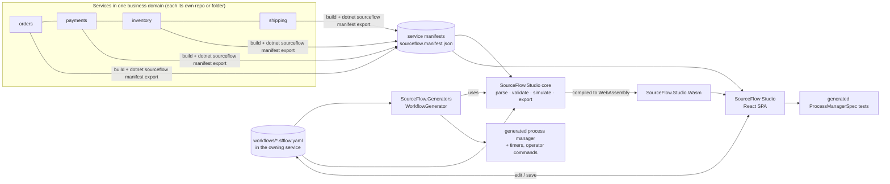

# 15 — Workflow DSL and SourceFlow Studio

Design drivers: [ADR-024](../ADRs/ADR-024-workflow-dsl-compiled-to-process-managers.md), [ADR-025](../ADRs/ADR-025-studio-react-spa-with-shared-wasm-core.md), [ADR-020](../ADRs/ADR-020-process-managers-with-durable-state-and-timers.md) and [ADR-007](../ADRs/ADR-007-single-command-ownership-route-local-xor-remote.md). Requirements: [product doc 07](../../product/07-Workflow-Designer-Requirements.md) (WFD-10…37, WFD-NFR-1…6).

## 1. Scope and position

**SourceFlow Studio** is a **separate utility** made of three parts:

1. a **workflow DSL** (YAML), which is the source of truth for orchestrated sagas;
2. **build-time tooling** (validator, simulator, code generator), which turns each workflow into an ordinary v3 **process manager** owned by one service;
3. a **React designer** that visualises a whole business domain and edits, simulates and exports workflows.

It is **not** a workflow engine. At run time a DSL workflow *is* a generated process manager: same storage, outbox, inbox, timers, telemetry and tests as a hand-written one (ADR-020). Services that don't use the DSL take no dependency on any of it (WFD-NFR-1).



**One semantics (WFD-NFR-2).** Parsing, validation and simulation are implemented **once**, in C# (`SourceFlow.Studio`). The Roslyn generator, the CLI and the browser (compiled to WebAssembly) all use that same implementation. TypeScript never reimplements workflow semantics; it renders, edits and calls the core.

## 2. Concepts

| Term | Meaning |
|------|---------|
| **Business domain workspace** | The services that together implement one business domain, described in `sourceflow.domain.yaml` (§4) |
| **Service manifest** | Machine-readable description of one service, produced from its code and routing (§3) |
| **Workflow** | An orchestrated saga: a state machine owned by **one** service (the orchestrator) that sends commands to aggregates in any service of the domain and reacts to their events (ADR-007: commands go to their owner) |
| **Step** | Send one command and await its outcome (success event, rejection, timeout), or simply await an event |
| **Business retry** | Re-attempt of a step on a *business* failure (for example `payment.declined`), declared in the DSL. Infrastructure retries (broker, database) stay in the runtime (doc 04 §9) and are invisible to the workflow |
| **Compensation** | The semantic undo of a completed step (for example refund a captured payment) |
| **Pivot** | The point of no return. After it succeeds, failures use forward recovery only |
| **Terminal states** | `Completed`, `Compensated` (failed and fully rolled back), `ManualIntervention` (needs an operator), `Aborted` (operator stopped it) |
| **Choreography chain** | An event flow between services with no orchestrator. Shown on the domain map; not authored in the DSL |

## 3. Service manifest (WFD-11, WFD-12)

### 3.1 Content

```json
{
  "manifestVersion": 1,
  "service": "payments",
  "endpoint": "payments",
  "sourceflowVersion": "3.0.0",
  "aggregates": [{
    "name": "payment",
    "commands": [{
      "type": "payments.charge", "version": 1,
      "emits": ["payments.payment-captured.v1"],
      "rejects": ["payments.declined", "payments.fraud_suspected"],
      "replyOnReject": true
    }]
  }],
  "processManagers": [{ "name": "refund-retry", "handles": ["…"], "sends": ["…"], "schedules": ["…"] }],
  "projections": [{ "name": "payment-summary", "version": 1, "handles": ["…"] }],
  "publishes": [{ "domainEvent": "payments.payment-captured.v1", "as": "payments.payment-captured-v1.v1", "topic": "payments.events" }],
  "subscribes": ["orders.events"],
  "commandRoutes": [{ "command": "inventory.reserve-stock.v1", "to": "inventory" }],
  "workflows": [{ "name": "…", "version": 1, "file": "workflows/….sfflow.yaml" }],
  "schemas": "catalog://payments"
}
```

### 3.2 How it is produced

| Part | Source | Mechanism |
|------|--------|-----------|
| Aggregates, commands, handled events, process managers, projections | Compile time | `SourceFlow.Generators` emits `[assembly: SourceFlowManifest("<json>")]` with the static part |
| `emits` / `rejects` per command | Compile time, static analysis of `Decide` | `IEvent` instances created in `Decision.Accept(…)` arguments; `Decision.Reject(X.Y)` resolved to the constant `Error.Code` of a static field. Where analysis can't decide (events built in helpers, computed codes), the author declares `[Emits(typeof(MoneyDeposited))]` / `[Rejects("account.insufficient_funds")]`, and **SF0019** warns until the declaration exists |
| Routes, publications, subscriptions, `replyOnReject` | Configuration (run time) | `dotnet sourceflow manifest export --project <csproj>` builds the project and runs its `AddSourceFlow(…)` configuration in **design-time mode** (`SOURCEFLOW_DESIGN_TIME=1`: no hosted services, no I/O, no provisioning). It merges the routing table with the static part and writes `artifacts/sourceflow.manifest.json` |
| Schemas | Catalog (doc 14 §2) | Referenced, not copied |

Manifests are build artifacts. CI regenerates them, and a drift check fails if a committed manifest differs from the regenerated one.

**As built (WP-S.1): the static part.** Every assembly with SourceFlow types gets `[assembly: SourceFlowManifest(json)]`, compact JSON with `manifestVersion: 1`, the assembly name and the referenced `SourceFlow.Net` version.

- **References.** Every message reference uses the CloudEvents form `{name}.v{version}` (for example `payments.payment-captured.v1`). Command entries keep `type` and `version` apart, as in §3.1.
- **`messages`.** Every `[MessageType]`: `type`, `version`, `kind` (`command`, `event`, `integration-event`, `timeout`), `clrType`, the target `aggregate` for commands, and `fields`. Each field has its JSON name, a schema-like `type` (`string`, `integer`, `number`, `boolean`, `uuid`, `date-time`, `date`, `time`, `duration`, `uri`, `array`, `object`; strongly typed ids use their backing type), `nullable` and `personalData`. The validator uses them for WF-V12 and WF-V14 without loading the catalog.
- **`aggregates`.** Commands with `emits` and `rejects`, and the events `When` handles. Commands owned by an `ICommandHandler` join their aggregate's entry, with `HandleAsync` analysed the same way.
- **`processManagers`.** `handles` (a `CommandRejected<T>` reaction is `{T}.rejected.v{n}`), `sends` (commands created in `React`) and `schedules` (messages passed to `Reaction.Schedule`).
- **`projections`.** Document and session projections, with name, version and handled events.
- **Analysis.** It reads only the method's own body. It resolves:
  - events created inline in `Decision.Accept`, including params, collection expressions, conditionals and switch arms;
  - codes from `new Error("code", …)`, static `Error` fields and properties initialised that way (also in another file), `with` expressions, `Error.InvalidCommand` and the `Error` built-ins.
- **SF0019.** It warns when an event comes from a helper, a code is computed, or a decision comes from a helper method, until `[Emits]`/`[Rejects]` declares it. The declarations are added to the manifest.
- **Not here.** `service`, `endpoint`, `publishes`, `subscribes`, `commandRoutes` and `replyOnReject` are configuration; `manifest export` adds them (WP-S.2).

**As built (WP-S.2): the export.**

- **Design-time mode.** With `SOURCEFLOW_DESIGN_TIME=1`, `AddSourceFlow` doesn't register the SourceFlow host. It listens for the generic host's `HostBuilt` diagnostic event, which `HostBuilder`, `HostApplicationBuilder` and `WebApplicationBuilder` all raise.
  - **On `HostBuilt`.** It writes the manifest to `SOURCEFLOW_MANIFEST_OUT` (or standard output) and ends the process.
  - **What runs.** The application's configuration runs, but the host never starts. No hosted service, provisioning, storage or transport call runs. Code after `Build()` doesn't run either.
  - **Requirement.** Applications must use the generic host.
- **`dotnet sourceflow manifest export`.**
  - **`--project <csproj>`.** Builds the project, then runs `dotnet run --no-build --no-launch-profile` in design-time mode. Arguments after `--` go to the application, for example a placeholder connection string. The default output is `<project>/artifacts/sourceflow.manifest.json`.
  - **Inside a service.** `dotnet run -- sourceflow manifest export` exports from the service's own provider.
  - **`--check`.** Compares with the committed file, ignoring CRLF, and fails on drift with the first differing line.
- **Merge rules.** The runtime model decides membership; the static manifests (§3.2) supply emits, rejects and fields. Only the messages, aggregates, process managers and projections the service registers are listed.
  - **`commandRoutes`.** Carries `replyOnReject`. It is a property of the sender's route, so it belongs there rather than on the owner's command as in the §3.1 example.
  - **`subscribes`.** Entries are objects `{ topic, only?, where? }`, not plain topic names.
  - **Output.** Indented JSON with LF line endings, sorted. Repeated runs are byte-identical.
- **CI.** The Bank sample's manifest is committed as `samples/Bank/Bank.Api/sourceflow.manifest.json`, outside the ignored `artifacts/` folder. `v3-pr.yml` checks it for drift.

## 4. Business domain workspace (WFD-10)

```yaml
# sourceflow.domain.yaml — at the root of a mono-repo, or in a dedicated "domain" repo
domain: commerce
description: Order to delivery
services:
  - name: orders     # orchestrator of order-fulfilment
    manifest: services/orders/artifacts/sourceflow.manifest.json
    workflows: services/orders/workflows
  - name: payments
    manifest: services/payments/artifacts/sourceflow.manifest.json
  - name: inventory
    manifest: services/inventory/artifacts/sourceflow.manifest.json
  - name: shipping
    manifest: ../shipping-repo/artifacts/sourceflow.manifest.json   # other repos via path or URL
```

The workspace only **reads** other services' manifests. Workflows are always stored in, and compiled by, the **owning** service. That keeps product Q2 (ownership and boundaries) and ADR-007.

**As built (WP-S.2).** `DomainWorkspace.LoadAsync` (in `SourceFlow.Studio`) takes the file or a folder that holds it.

- **Paths.** Relative paths resolve against the workspace file's folder.
- **Errors.** Unknown keys are errors that give the line and column. So are a missing `domain`, an empty or duplicated service list, a missing or invalid manifest, and a manifest whose `service` differs from the entry's `name`.
- **Remote manifests.** Manifests given as URLs are refused unless the caller supplies a fetcher, so the workspace works offline (§6.4).
- **Workflow files.** `*.sfflow.yaml` files under `workflows` are listed recursively, sorted.
- **Manifest model.** `ServiceManifest` and its JSON reader live under `Dsl/` so the generator can compile them too (WP-S.5).
- **Optional service keys for Studio.** `project` (WP-S.8) is the service's project, for re-exporting its manifest. `tests` and `module` (WP-S.11) are its test project folder and the full name of its module type; Studio needs both to write the specs it generates for the service's workflows:

  ```yaml
    - name: orders
      manifest: services/orders/artifacts/sourceflow.manifest.json
      workflows: services/orders/workflows
      project: services/orders/src/Orders
      tests: services/orders/tests/Orders.Tests
      module: Orders.OrdersModule
  ```

## 5. Workflow DSL (`sourceflow.workflow/1`)

### 5.1 Example: order fulfilment with success, failures, retries and rollback

```yaml
sourceflow.workflow: 1
name: order-fulfilment
version: 1
owner: orders                         # generated into the orders service
description: Reserve stock, take payment, ship.

start:
  on: orders.order-placed.v1          # local domain event of the owner
  correlate: data.orderId             # instance id
data:                                 # instance data, typed from schemas
  orderId: { from: start.data.orderId }
  amount:  { from: start.data.total }
  lines:   { from: start.data.lines }

steps:
  - id: reserve-stock
    send:  { command: inventory.reserve-stock.v1, map: { orderId: $data.orderId, lines: $data.lines } }
    await:
      success: inventory.stock-reserved.v1
      failure:
        - rejected: inventory.out_of_stock
          then: fail                  # → compensate completed steps (none yet) → Compensated
    timeout: { after: PT5M, retry: { max: 2 }, then: fail }
    compensate:
      send:  { command: inventory.release-stock.v1, map: { orderId: $data.orderId } }
      await: { success: inventory.stock-released.v1 }
      retry: { max: 5, backoff: exponential, initial: PT30S, cap: PT10M }
      timeout: { after: PT15M }

  - id: charge-payment
    send:  { command: payments.charge.v1, map: { orderId: $data.orderId, amount: $data.amount } }
    await:
      success:
        on: payments.payment-captured.v1
        capture: { paymentId: event.data.paymentId }
      failure:
        - rejected: payments.declined
          retry: { max: 3, backoff: fixed, initial: PT10M }    # business retry
          then: fail
        - rejected: payments.fraud_suspected
          then: fail
    timeout: { after: PT2M, retry: { max: 2 }, then: fail }
    compensate:
      send:  { command: payments.refund.v1, map: { paymentId: $data.paymentId, amount: $data.amount } }
      await: { success: payments.refunded.v1 }
      retry: { max: 5, backoff: exponential, initial: PT1M }
      timeout: { after: PT30M }

  - id: review-large-order
    when: "$data.amount > 5000"        # CESQL guard; skipped when false
    await:
      success: orders.order-approved.v1
      failure:
        - on: orders.order-rejected-by-review.v1
          then: fail
    timeout: { after: P1D, then: manual }

  - id: create-shipment
    pivot: true                        # point of no return
    send:  { command: shipping.create-shipment.v1, map: { orderId: $data.orderId, lines: $data.lines } }
    await:
      success: shipping.shipment-created.v1
      failure:
        - rejected: shipping.address_invalid
          then: { goto: await-address-fix }    # forward recovery after pivot
    timeout: { after: PT1H, retry: { max: 3, backoff: exponential, initial: PT5M }, then: manual }
    next: complete                     # without it, success would fall through to await-address-fix

  - id: await-address-fix
    await: { success: orders.address-corrected.v1 }
    timeout: { after: P2D, then: manual }
    next: create-shipment

on:
  completed:   { send: { command: orders.mark-fulfilled.v1, map: { orderId: $data.orderId } } }
  compensated: { send: { command: orders.cancel-order.v1,   map: { orderId: $data.orderId, reason: $failure.code } } }
  manual:      { alert: true }         # metric + structured log + dead-letter-style record
```

### 5.2 Grammar (summary; the JSON Schema `schemas/workflow-1.json` is normative)

| Element | Fields | Rules |
|---------|--------|-------|
| root | `sourceflow.workflow`, `name`, `version`, `owner`, `description?`, `start`, `data?`, `steps`, `on?` | `owner` must be the compiling service |
| `start` | `on` (message type), `correlate` (path), `when?` (CESQL) | `on` is a domain event of the owner, or an integration event the owner subscribes to |
| `data` | `name: { from: path }` or `{ type, default }` | Types inferred from schemas. Becomes the instance state |
| step | `id`, `send?`, `await`, `timeout`, `retry?`, `compensate?`, `pivot?`, `when?`, `next?` | Steps run in order unless `next`/`goto` |
| `send` | `command`, `map` (field → `$data.x` / `event.data.x` / literal / `{ $hook: Name }`) | The command's owner comes from the manifests; `$hook` → user partial method |
| `await` | `success` (type or `{ on, capture, when? }`), `failure[]` (`rejected: code` or `on: type`, `retry?`, `then`) | `rejected` requires `replyOnReject` on the target route (WF-V08) |
| `timeout` | `after` (ISO-8601 duration), `retry?`, `then` (`fail` \| `manual` \| `{ goto }`) | Required on every wait (WF-V06) |
| `retry` | `max`, `backoff` (`fixed` \| `exponential`), `initial`, `cap?`, `jitter?` (default true) | `max` ≤ 20; total retry window < the timeout of an enclosing wait |
| `compensate` | `send`, `await`, `retry`, `timeout` | Not allowed on the pivot or any step after it |
| `then` | `fail`, `manual`, `{ goto: stepId }`, `complete` | `fail` isn't allowed after the pivot (WF-V07) |

Expressions use **CESQL** (the same expression language and evaluator as SFQL; doc 14 §4) over `$data`, `event` and `$failure`. Complex logic uses `$hook` partial methods that the author implements in C#. These are pure and deterministic, and the analyzers check them as for `React` (SF0004/SF0009).

**As built (WP-S.3): the grammar.**

- **`next: complete`** ends the workflow after a success.
  - **Why.** The first version of the §5.1 example let `create-shipment` fall through to `await-address-fix`, so it never completed; WF-V05 found it.
  - **Reserved.** `complete` can't be a step id.
- **`timeout` and `compensate`.** Each takes an object, or `none` (`{ none: true, reason: … }`; the scalar `none` is accepted, but WF-V06 or WF-V09 then asks for a reason).
- **`data` fields** take `personal: true` (WF-V14). Typed fields take a `type` from the manifest field types and an optional scalar `default`.
- **`$failure`** has `code`, `message` and `step`, and exists only in `on.compensated`.
- **`event.data.*` in a `send` map** is the start event, in the first step only. Later values are captured into data first.
- **Not allowed.** Anchors and aliases are rejected (IR-18). Scalars follow the YAML 1.2 core schema, and quoted values are always strings.
- **Structure.** `schemas/workflow-1.json` (draft 2020-12) describes the structure. A test checks on every golden file that the schema and the reader agree; structural bounds that are validation rules, such as WF-V10's retry range, stay in the validator.

**As built: guards.** Guards use a CESQL subset implemented once under `SourceFlow.Studio/Dsl/Expressions`: `OR`, `AND`, `NOT`, comparisons, `LIKE`, `[NOT] IN`, `EXISTS`, arithmetic, and literals. Keywords are case-insensitive.

- **Why not the SFQL parser.** That parser is `net10.0`-only, and the generator (`netstandard2.0`) must share the guard semantics (WFD-NFR-2).
- **Binding.** The binder type-checks against data and event field types:
  - `start.when` sees `event.data.*` of the start message;
  - a step's `when` sees `$data.*`;
  - a success `when` sees both.
- **Evaluation.** Three-valued logic:
  - a comparison with a missing value is unknown;
  - unknown propagates (Kleene `AND`/`OR`);
  - a guard holds only when it is true;
  - `x = null` tests for a missing value.

### 5.3 Execution semantics

The generated process manager's state is:

```text
WorkflowState = (Status, StepId, Phase, Attempt, CompensationStack, Data, Failure?)
Status ∈ { Running, Completed, Compensating, Compensated, ManualIntervention, Aborted }
Phase  ∈ { Awaiting, Retrying }
CompensationStack = [ (stepId, compensation, attempt) … ]   # pushed on each step success that declares compensate
```

| Event in state | Transition |
|----------------|------------|
| `start.on` (no instance) | Create the instance; bind `data`; enter the first step whose `when` is true |
| Enter step with `send` | Outbox: the command to its owner with `MessageId = UUIDv5(instance, step, attempt)` (deterministic, so re-sends are idempotent at the owner's inbox); schedule `WorkflowTimeout(step, attempt)` at `now + timeout.after` |
| `success` event (matching correlation, `when` true) | `capture` into data; cancel the timer; push the compensation if declared; go to `next`, `goto` or the following step; after the last step, `Completed` + `on.completed` |
| Failure (`CommandRejected<T>` with a matching code, or a failure event) | If `retry` attempts remain: phase `Retrying`, schedule the re-send after the backoff. Otherwise apply `then` |
| `WorkflowTimeout(step, attempt)` for the **current** attempt | `timeout.retry` attempts remain → re-send; otherwise `timeout.then`. Stale timeouts (old attempt) are ignored |
| `then: fail` (only before the pivot) | Status `Compensating`; pop the stack **in reverse order**, sending each compensation and awaiting its success with its own retry and timeout. Stack empty → `Compensated` + `on.compensated` |
| A compensation exhausts its retries or times out | `ManualIntervention` + `on.manual` (alert). The remaining stack is preserved |
| `then: manual` | `ManualIntervention`; current position preserved |
| Operator `ResumeWorkflow(instance, fromStep?)` | Resume at the current or given step (forward), or continue compensating when in `Compensating` |
| Operator `AbortWorkflow(instance, reason)` | `Aborted`. No compensation unless `compensate: true` is passed |
| Any message for a terminal instance | Ignored (process-manager completion rule, doc 03 §6.1) |

**Infrastructure failures** (a broker outage, the owner service down) never reach the workflow as failures: the runtime retries and parks them (doc 04 §9). The workflow sees only business outcomes, plus **timeouts**. That is why every wait needs a timeout.

**As built (WP-S.4): the simulator** (`Dsl/Simulation/WorkflowSimulator`). The simulator is the reference implementation of this table; the generated process manager must match it (WF-DIFF, WP-S.5).

- **Determinism.** It is pure and deterministic. Time is explicit: a timer firing moves the clock to the timer's due time.
- **State.** Status, step, phase, attempt, retries per outcome, the compensation stack, data, the failure, the one pending timer, and `CompensationPending`.
  *As built (WP-C.10):* also `PivotPassed`, which is written to the state only once set.
- **Retries.**
  - A retry with a delay sets the phase to `Retrying` and schedules a `retry` timer. Without a delay, the command is re-sent at once.
  - Business retries and timeout retries are counted separately. A re-sent attempt gets a new id; a re-entered step starts again at attempt 1.
- **Message ids.** `UUIDv5(SourceFlow namespace, "workflow/{name@v}/{instance}/{step}/{attempt}")`.
  - Compensations use `compensate:{step}` as the step part.
  - `on.*` sends use `on:completed` and `on:compensated`, at attempt 1.
  - This is the same algorithm as `MessageIds.CreateVersion5`.
- **Unhandled outcomes.** A rejection or failure event the step doesn't declare goes to `ManualIntervention`, with the failure recorded.
- **Compensations.** A rejected compensation counts as a failed attempt, like a timeout: it retries, then goes to `ManualIntervention` with the stack kept.
- **Operator commands.**
  - **Resume** continues the compensation when it was the compensation that failed.
  - **Abort with `compensate: true`** compensates and ends `Aborted`, without `on.compensated`.
  - **`RetryWorkflowStep`** re-sends the current step or compensation with the next attempt.
- **Paths** (`PathEnumerator`). The enumerator re-runs the simulator per path prefix. It branches on every outcome, on guarded steps (taken or skipped), and on retry loops at 0, 1 and max (an outcome once, or repeated until its retries run out).
  - **Bounds.** Each step is entered at most twice per path; paths end in a terminal status or `ManualIntervention`; the limits are configurable, and truncation is reported.
  - **Assumptions.** `start.when` and success guards are assumed to hold.
  - **Coverage.** Coverage marks every statechart edge, including immediate retries.
  - **Minimal cover.** `MinimalCover()` is a greedy set that covers every edge and every end status. The §5.1 example has 437 paths and a minimal cover of 6.
- **Specs** (`SpecGenerator`). One xUnit test per path (the minimal cover by default; all paths, or selected ids, on request). Each test is written against `WorkflowSpec.For<TWorkflow, TModule>()` from `SourceFlow.Testing` (WP-S.5): `Start`, `Succeed`, `Reject`, `Fail`, `FireTimer`, `ThenSends`, `ThenStatus`.
  - **Start data.** A small solver over the guard literals picks start data that makes each guarded step take the path's decision.
  - **Event data.** Events carry the instance key, and captured fields get distinct values.
- **Exports.**
  - **Mermaid.** A `stateDiagram-v2` with a symbol and a text label per edge kind; compensations are a nested state, numbered in the order they run.
  - **BPMN 2.0.** The semantic model only (no BPMNDI): a message start event, send and receive tasks, timer and message boundary events, guard gateways with CESQL `conditionExpression`, compensation boundary events with `isForCompensation` tasks, and retries as documentation.
  - **BPMN check.** The model is checked for well-formedness, unique ids and resolved references. Validating against the OMG XSDs is not automated, because the XSDs are not vendored.

> **As built (WP-C.10, CR-19, CR-20).**
> - **Timer identity.** A compensation's timers have their own identity: kind `compensate-timeout` for its timeout, `retry` for its retry delay, and the step `compensate:{step}`. They never share one with the step's own timers. In doc 15 §5.1, when `charge-payment` is rejected within 5 minutes, `release-stock` gets its own 15-minute timeout, and `reserve-stock`'s cancelled 5-minute timeout is ignored when it arrives.
> - **Due time.** `WorkflowTimer` carries its due time, and a delivered timer counts only if its identity and due time match the pending timer. A timer cancelled and later re-armed for the same attempt is therefore ignored when the old one arrives. Timers scheduled before this change have no due time and match by identity alone.
> - **The pivot.** Once the pivot step succeeds, the engine records `PivotPassed`. A later `then: fail` goes to `ManualIntervention` instead of compensating. Only an operator `abort --compensate` still compensates, and it is recorded as an `audit` effect. A `resume` to a step before the pivot is ignored, and the instance stays in `ManualIntervention`.

### 5.4 Validation rules (WFD-28)

| ID | Rule | Severity |
|----|------|----------|
| WF-V01 | Every referenced message type exists in the workspace manifests or catalogs | Error |
| WF-V02 | Each `send.command` is owned by exactly one service; the owner service routes it there (or owns it locally) | Error |
| WF-V03 | `await.success` events can be produced by the commanded aggregate (`emits`), or are integration events published by that service and **subscribed** by the owner | Error |
| WF-V04 | Every awaited message can be correlated to the instance: a `correlate`/`capture` path, or the envelope correlation (commands sent by the workflow carry it) | Error |
| WF-V05 | Every state is reachable; at least one path reaches `Completed` | Error |
| WF-V06 | Every wait has a timeout (or `timeout: none` with a `reason`) | Error |
| WF-V07 | After the pivot, no `then: fail` and no `compensate` | Error |
| WF-V08 | `rejected: code` needs the code in the command's `rejects` and `replyOnReject` on the route | Error |
| WF-V09 | Every step before the pivot that changes state in another service has `compensate`, or `compensate: none` with a `reason` | Warning |
| WF-V10 | Retries bounded (`max` ≤ 20); retry window shorter than the enclosing timeout | Error |
| WF-V11 | `goto` targets exist; no cycle without an await (no infinite loop) | Error |
| WF-V12 | `map` fields exist in the command schema with compatible types; required fields are mapped | Error |
| WF-V13 | CESQL guards bind against `data` and event schemas | Error |
| WF-V14 | No `[PersonalData]` field in `data` unless the owner marks it as personal data (it is then crypto-shredded in state like any other) | Warning |
| WF-V15 | `name@version` unique per owner; changing a published version's structure without bumping `version` | Error |
| WF-V16 | Compensation commands aren't themselves compensated (no nested sagas inside compensation) | Error |
| WF-V17 | A step at or after the pivot doesn't `next` or `goto` a step before it (forward recovery only) | Error |
| WF-V18 | A compensation has a timeout: `timeout: none` would leave the instance `Compensating` for ever if no outcome arrives | Warning |

**As built (WP-S.3): validation** (`WorkflowAnalysis.Analyze` = reader, then `WorkflowValidator`).

- **Structural ids.** The reader reports structural problems as `WF-S01` (YAML, anchors), `S02` (unknown key), `S03` (shape), `S04` (DSL version, with a migration hint), `S05` (duration) and `S06` (name, id, reference or path format). Every diagnostic has a stable id, a severity and a line and column.
- **Rule details:**
  - **WF-V02** also flags an owner that isn't the compiling service, or isn't in the workspace, and a route to the wrong endpoint.
  - **WF-V03** requires an awaited event to come from the sent command. The event must be in its `emits`, or be published from one of them; and it must reach the owner, either as the owner's domain event or as a publication on a topic the owner subscribes to, allowed by its `only` filter.
  - **WF-V04** requires await-only steps to carry the instance key (the last segment of `start.correlate`). Replies to commands the workflow sent use the envelope correlation.
  - **WF-V08** applies the `replyOnReject` check only to remote commands.
  - **WF-V10** checks only `1 ≤ max ≤ 20`, a positive `initial` for exponential backoff, and `cap ≥ initial`. Each attempt has its own timeout, so the delays add no other constraint.
  - **WF-V11** checks `next` and `goto` targets. A loop without a wait can't be written: steps always wait, and only an outcome moves backwards.
  - **WF-V12** types values from data (declared or captured), the start event, literals (`null` only into nullable fields) and hooks (unchecked).
  - **WF-V15** compares a `name@version` with the structural fingerprint the owner's manifest records for it (`workflows[].fingerprint`, `sha256:` and 16 hex digits). Comments, the description and map-key order don't change the fingerprint. Duplicates are checked against the owner's other workflows.
  - **WF-V16** is structural: no `compensate`, `pivot` or `next` inside a compensation, and no failure branches in a compensation's `await`.
  - **WF-V17** (WP-C.10, CR-20) checks `next` and every `goto` (on failures and the timeout) of steps at or after the pivot. A target before the pivot would redo work the pivot made final. Moving between steps after the pivot, a retry loop for example, is allowed.
- **Partial mode.** At compile time only some manifests are known. Partial mode skips rules about commands whose owner is unknown, but still reports unknown types, with a hint to reference the contract package.
- **Golden suite.** `tests/workflow-golden` holds a four-service commerce domain (`domain/`) and 30 cases (`cases/NN-*/workflow.sfflow.yaml` with `expected.diagnostics.json`). Every rule has a negative case, and five cases are valid.

### 5.5 Code generation (WFD-29)

The `WorkflowGenerator` (part of `SourceFlow.Generators`) reads `**/*.sfflow.yaml` as `AdditionalFiles` (added automatically by the package's build props) and, per workflow, emits:

- `[ProcessManager("order-fulfilment@1")] partial record OrderFulfilmentWorkflowV1 : IProcessManager<…>`, with the state from §5.3, typed `Data` fields, a `CorrelateBy` per handled message, and `React` methods implementing the transition table;
- generated messages: `OrderFulfilmentTimeoutV1(StepId, Attempt)`, and operator commands `ResumeWorkflow`, `AbortWorkflow` and `RetryWorkflowStep`, owned by the owner service;
- partial-method declarations for every `$hook`; a missing implementation is a compile error (SF0021);
- the manifest's `workflows` entry.

Diagnostics map **WF-V01…V16** to **SF0020** (with the rule id in the message) at the YAML location, so build errors point at the line in the `.sfflow.yaml` file.

Commands of other services are referenced by **logical name**. The owner must reference those services' **contract packages** (commands and integration events), so the generator can resolve CLR types. Otherwise it reports SF0020/WF-V01 with a hint.

**As built (WP-S.5).** The generator (`SourceFlowGenerator`) takes every `*.sfflow.yaml` from `AdditionalFiles`; the package's `build/SourceFlow.Net.props` adds them, and in the repository `UseSourceFlowGenerator` imports the same file.

- **One semantics.** The generator does not translate the transition table into C#. It embeds the shared engine, the Studio simulator itself (WFD-NFR-2):
  - **Validation** uses the portable `SourceFlow.Studio/Dsl` sources (reader, validator, manifests), compiled into the `netstandard2.0` generator.
  - **Injection.** The engine sources (model, guards, simulator, model and state JSON) are injected into the owning service as internal types in `SourceFlow.Workflows.Engine`, with a small bridge.
  - **Services without workflows** get none of it.
  - **YamlDotNet** ships next to the generator in `analyzers/dotnet/cs` (IR-14).
- **Validation at compile time.** Workflows are validated in partial mode against the compilation's static manifest (§3.2), the static manifests of referenced assemblies, and the owner's other workflows. `SourceFlowServiceName`, when set, is the compiling service. Results:
  - every WF diagnostic is **SF0020** at the YAML line and column (warnings stay warnings);
  - a missing `$hook` implementation is **SF0021**;
  - a message reference without a CLR type in the compilation is SF0020/WF-V01, with the contract-package hint.
- **Generated per workflow:** `[ProcessManager("name@v")] public sealed partial record {Name}WorkflowV{v}`, implementing `IProcessManagerRuntime<…, WorkflowInstanceId>` and `IWorkflowState<…>`.
  - **State** is the engine state as JSON (`{ "state": … }`), through `WorkflowRuntime.StateResolver`.
  - **Correlation.** The start message, and awaited events that carry the instance key, correlate through their members; timers and controls through their instance; replies through the envelope correlation.
  - **React** passes each message to the engine, which ignores what the instance isn't waiting for: a late event, or a reply to an earlier step.
  - **Commands** are built from the engine's values through the service's JSON metadata (`ReactionContext.Serializer`). Each is sent with its deterministic id (`Reaction.AndSend(command, MessageId)`), which the runner passes to `EnqueueCommand`.
  - **Timers** are `Reaction.Schedule(WorkflowTimer)`.
  - **Terminal statuses** complete the process.
- **Hooks** are `private static partial object? {Name}(IReadOnlyDictionary<string, object?> data)` on the workflow's partial record; the purity analyzers treat `IWorkflowHooks` methods like `React`.
- **Registration.** The module gets a `RegisterWorkflows` part:
  - the shared `WorkflowTimer`/`WorkflowControl` messages;
  - each workflow's state metadata;
  - `CommandRejected<T>` for commands with `rejected:` failures (the module's JSON context must list them, DC-1);
  - the process manager.
- **Manifest.** The static manifest gets `workflows[]` entries with `name`, `version`, `file` (relative to the project) and `fingerprint` (WF-V15).
- **Deviations from §5.5.**
  - **Timers.** One shared timer message, `WorkflowTimer(workflow, instance, kind, step, attempt)`, instead of one per workflow.
  - **Operator commands.** One shared `WorkflowControl(workflow, instance, action, step?, reason?, compensate)` replaces `ResumeWorkflow`, `AbortWorkflow` and `RetryWorkflowStep`. It is delivered through the scheduler, because process managers react to messages, not commands. The actions are `resume`, `retry-step` and `abort`.
  - **Instance data** is JSON in the state rather than typed fields. `personal: true` data is therefore not crypto-shredded in workflow state yet (WF-V14 still warns; follow-up).
- **Testing.** `SourceFlow.Testing.WorkflowSpec.For<TWorkflow, TModule>()` is the API the generated specs (WP-S.4) use: `Start`, `Succeed`, `Fail`, `Reject`, `FireTimer`, `Control`, `ThenSends`, `ThenStatus`.

> **As built (WP-C.11, CR-32, CR-33).**
> - **Every rejection arrives.** The generated workflow handles `CommandRejected<T>` for every command it awaits, whether a failure declares the rejection or not, and for every compensation command. An undeclared step rejection goes to `ManualIntervention`. A rejected compensation counts as a failed attempt.
> - **Migration.** The service's `JsonSerializerContext` needs `[JsonSerializable(typeof(CommandRejected<T>))]` for each of these commands. Startup names any that is missing.
> - **Late replies.** A rejection reply carries the rejected command's id as its causation (`ReactionContext.CausationId`). The engine compares it with the current attempt's deterministic id (`WorkflowIds.Send`, or `WorkflowIds.Compensation` while compensating) and ignores a reply to an earlier attempt.

### 5.6 Versioning of running instances

- The name includes the version (`order-fulfilment@1`). Publishing a structural change requires `version: 2` (WF-V15).
- Both versions stay registered: **new** instances start on the latest version, and **in-flight** instances finish on the version they started on.
- `dotnet sourceflow workflow list --name order-fulfilment --version 1 --active` shows whether v1 can be removed. Removing a version with active instances is blocked by a startup check (a domain query on process state).

**As built (WP-S.6).**

- **Which version starts.** The process-manager runner decides, so it holds for versions in any module or assembly. A workflow version starts a new instance only when both hold:
  - it is the latest registered version of its name;
  - no other registered version already has an instance for that correlation value.

  The second rule matters because a newly deployed version's subscription reads the log from the start, so it also sees the start events of instances that v1 began.
- **The startup guard** fails with `WorkflowVersionRemovedException` when an unregistered version of a workflow this service runs still has active (not completed) instances. It reads the store monitor's per-process-type counts across tenants; adapters without a monitor log warning 1402 and skip it. Abort the remaining instances, or keep the version, to proceed.
- **Re-entered steps continue their attempt numbering.** This applies to a `goto` loop such as `await-address-fix` → `create-shipment`, an operator resume, or a resumed compensation. The engine keeps the last attempt per step (and per `compensate:{step}`) in its state. A re-sent command therefore gets a new deterministic id instead of being dropped by the owner's inbox, and a timer from an earlier visit stays stale.

## 6. SourceFlow Studio (React designer)

### 6.1 Views

| View | Shows | Requirements |
|------|-------|--------------|
| **Domain map** | Services as containers; aggregates inside; edges for commands (to owner), domain-event → integration-event publications, subscriptions; choreography chains highlighted on hover | WFD-13 |
| **Workflow statechart** | States and steps with edge types: **success** (solid, ✓), **failure** (dashed, ✕ + code), **retry** (loop, ↻ n× + backoff), **timeout** (clock), **compensation** (separate lane, dotted, ⟲, reverse order numbering), **pivot** (diamond), **manual** (hand), terminal states | WFD-30 |
| **Swimlane sequence** | One lane per service; for the selected path, the ordered commands and events, including retries and compensations | WFD-31 |
| **DSL editor** | Monaco YAML side by side, with schema completion, hover docs (message schemas from the catalog) and live diagnostics from the WASM core | WFD-32 |
| **Simulation** | Pick an outcome per step (success, a specific rejection, timeout); step or run; see state, data, outbox messages, timers, and the compensation stack as it unwinds | WFD-33 |
| **Path explorer** | Enumerates every distinct path (retry loops at 0, 1 and max) with coverage marks; **generate specs** writes `ProcessManagerSpec` tests for selected paths into the owner's test project | WFD-34 |
| **Diff** | Before/after of a workflow (git refs), with added, removed and changed states and edges | WFD-36 (PR review) |
| **Observe** *(Studio 1.1)* | Live instance counts per state, stuck instances, recent failures, using the owner's generated domain query `<svc>.workflow-instances.v1` (Q2 boundary; doc 14 Q-B4) | WFD-37 |

Visual encodings never rely on colour alone. Each path type has a distinct line style, icon and text label (WFD-NFR-4).

**As built (WP-S.9).**

- **The statechart is computed by the core.** `StudioApi.Graph` (`WorkflowGraph`) returns nodes and edges with the same transitions as the Mermaid export, so the browser draws what the generator runs:
  - **Node kinds:** start, step, pivot, compensation (numbered in undo order, inside Compensating), terminal and manual. Each node lists what it sends and awaits, its guard and timeout, and whether it is compensated.
  - **Edge kinds:** start, success, failure, retry, timeout, compensation, manual and skip. Each edge has a label starting with its symbol and a sentence for assistive technology.
  - Each valid golden case has an `expected.graph.json`, checked by both the .NET and the WebAssembly suites.
- **The swimlane sequence is computed by the core too.** `StudioApi.Sequence` (`WorkflowSequence`) replays one path through the simulator, then places each message between lanes:
  - commands go to their owner (from the manifests);
  - events come from the service that publishes or emits them;
  - rejections, timers, compensations, status changes and alerts are included;
  - anything no manifest accounts for goes to an `external` lane.
- **Encodings** (`studio/app/src/graph/encodings.ts`): every edge kind has its own dash pattern, symbol and name, and a test checks they are distinct. Colour is a redundant cue, set as theme tokens, and labels use the text colour.
  - success: solid ✓
  - failure: dashed ✕
  - retry: dotted loop ↻
  - timeout: dash-dot ⏱
  - compensation: dotted ⟲
  - manual intervention: long dash-dot ✋
  - skip: long dash ⤼

  Nodes are shaped by kind: a pivot is a diamond-marked box (◆), manual intervention a dashed octagon (✋), the ends double-bordered pills, and the compensations sit in a dotted group.
- **Layout.** ELK (layered) runs in its own worker (`elk-worker.min.js`), and the app passes React Flow explicit node sizes and handles, so it draws without measuring the DOM first.
  - **Statecharts:** ELK lays out the main flow (start, steps, Completed) and, separately, the compensations inside their group. The exit states (Compensating, Compensated, Manual intervention) form a column beside the flow.
  - **Why the exits are kept out of ELK:** every failing step points at them, and as long edges through every layer they made a 200-step layout take seconds; it now takes about 100 ms.
- **The domain map** is aggregated in the app from the manifests:
  - services contain their aggregates;
  - `→` commands go from a sender (command routes, process-manager sends) to the owning aggregate;
  - `⇢` publications go to topics, and `⇠` subscriptions come from them, with their `only` filters.
  - Hovering or selecting a node (a click, or Enter on a focused node) highlights its downstream choreography chain and dims the rest.
- **The workflow view** has Statechart, Swimlane and Source tabs (the WAI-ARIA tabs pattern). Selecting a diagnostic opens Source at its line. The swimlane's path picker starts on the minimal cover.
- **Accessibility.** States and transitions are focusable and named: the kind, the step and the details. Axe finds no serious violations in the light or the dark theme, and nothing animates under reduced motion. React Flow's attribution stays, restyled for contrast.
- **Performance.** A 200-step workflow (238 states, 356 transitions) lays out and renders in about 0.7 s. A workspace of 20 services and 50 workflows opens in about 1.4 s.

### 6.2 Editing model

- **The DSL text is the model.** Visual edits are translated into minimal YAML edits through a CST-preserving writer, so comments, ordering and formatting survive a round trip (lossless).
- The palette lists the commands and events available from the workspace manifests, filtered by what is valid at the selected step (WF-V02/V03).
- Every edit is validated within 100 ms by the WASM core. Diagnostics appear on the canvas and in the editor.
- Layout uses ELK (layered algorithm), with stable node positions stored in a sidecar file `*.sfflow.layout.json` (optional, ignored by the generator).

**As built (WP-S.10).**

- **The writer** (`studio/app/src/edit/yamlEdit.ts`) reads the file with the `yaml` parser's source offsets and changes only the characters an edit needs:
  - `setValue` replaces a scalar or flow value in place, or adds a missing key to a block or flow map (creating parents, and `[…]` sequences for numeric path segments);
  - `remove` takes out a block key with its lines (and its end-of-line comment), or a flow entry with its comma;
  - `insertItem` adds a sequence item in the list's own style.
  - Scalars are quoted only when YAML 1.2 needs it, so `on` stays bare.
  - A file that doesn't parse is edited as text only: every visual edit is refused with "The YAML doesn't parse (line n): fix it in the YAML tab first", and nothing is spliced into it.
  - Every golden file survives a set-then-restore of every scalar byte for byte (STU-UT-26..31).
- **Step operations** (`edit/steps.ts`) read each step into a form (send and map, await with failures, retries, timeout, compensation, pivot, guard, next) and write each control as one minimal edit. Renaming a step renames the `next` and `goto` that point at it. New steps go after the selection with a unique id taken from the command.
- **The palette** (`edit/palette.ts`) lists the commands of every service in the workspace, grouped by service in workspace order, with what each emits, rejects and carries, from the manifests. At a step, its choices are filtered by what is valid there (WF-V02/V03): success events are what the command emits, failures the rejections and events not yet handled, map fields the ones not yet mapped.
- **Undo and redo** (`edit/history.ts`) keep up to 200 states of the text. Typing within 600 ms joins one entry; every visual edit is its own. Visual edits and typing share the history, because both change the same text.
- **The layout sidecar** (`edit/layoutFile.ts`) stores moved nodes only, sorted, in whole pixels. Positions of steps that no longer exist are pruned on save, and the file is written only when it changed and holds a position.
- **The workflow view** puts the Statechart and Swimlane tabs beside Properties and YAML tabs, with a Save / Undo / Redo toolbar (`Ctrl+S`, `Ctrl+Z`, `Ctrl+Y`; the last two are left to the editor while it has focus). The save status describes the text it saved: an edit or an undo after a save is "Unsaved changes" again.
  - Selecting a state on the canvas (click, or Enter on a focused state) opens its properties. Dragging a state records its position.
  - States with diagnostics show a "✕ n problems" badge, and their accessible name says so. Selecting a diagnostic opens the YAML tab at its line and selects the step it belongs to.
- **Monaco** (0.57, with monaco-yaml 5.5) loads only when the YAML tab first opens. It imports the editor API, its editor features and the YAML language, not the package's main entry, which registers every language and its workers: the build is 7.7 MB instead of 18 MB, and the editor chunk is 1 MB gzipped. monaco-yaml takes completion and hover from `schemas/workflow-1.json` with its own validation off; the markers are the core's diagnostics. Components without Monaco (the tests, a host without it) get a textarea with the same contract.
- **Performance.** Diagnostics are mapped to steps with one parse of the file, not one per diagnostic: per-diagnostic parsing took the 200-step workflow from 0.7 s to 9.6 s. It now renders in about 0.8 s, inside the 1 s budget.
- **Tests.** STU-UT-26..40 (writer, step forms, palette, history, layout), STU-CT-19..28 (the editor against the golden order-fulfilment workflow), and STU-E2E-07..10 in the browser against a writable host on a fresh copy of the golden workspace (`e2e/generate.mjs editable-workspace`):
  - an error typed in Monaco shows in the panel, as a badge on the state and as a marker, and a visual fix restores the file;
  - visual fixes clear an invalid workflow's diagnostics;
  - a retry and a compensation added visually save with every comment, and nothing outside the step changes;
  - add, save, undo and save gives back every golden file byte for byte (the unparseable one refuses the edit).

**As built (WP-S.11).**

- **Simulation** (the Simulate tab, `studio/app/src/simulate/`). Every move is one `simulateStep` call to the core; the app only chooses the inputs and shows the results.
  - **Start.** The start event's data is edited as JSON. It starts with the correlation field, which every instance needs. Each guarded step can evaluate its guard on the data, or be forced to run or to be skipped. Start and success guards are assumed to hold, as in the path explorer. The simulated clock starts at 2026-01-01T00:00:00Z, so a simulation is the same every time.
  - **Choices.** What can happen next follows the state the core returns:
    - a waiting step offers its success event, each failure it declares (a rejection code or a failure event), and its timeout;
    - a retry offers the retry timer;
    - a compensation can succeed, be rejected or time out;
    - manual intervention offers the operator commands: resume, retry the step, and abort, with or without compensating.
  - **Moves.** **Step** applies one choice. **Run to the end** follows a plan that gives each step's outcome (success by default): retries fire and compensations succeed on their own. A run stops at manual intervention, and after 200 moves, which only a plan that keeps taking a `goto` reaches. **Back** undoes the last move.
  - **What it shows:**
    - the instance (status, step, phase, attempt, simulated time, failure);
    - the pending timer;
    - the outbox, with each command's deterministic message id;
    - the compensation stack, next to undo first;
    - the instance data;
    - every move with the state it led to.
  - **On the statechart,** the state the instance is at is outlined, and its accessible name says "simulated here". A compensation's node is `undo:{step}`.
  - **Edits.** When the workflow text changes, the simulation is marked out of date and must be restarted.
- **The path explorer** (the Paths tab) lists the paths the core enumerates, with their end and whether they are in the minimal cover.
  - **Coverage.** It shows the edges every path covers, and the edges no path covers.
  - **Selection.** It can filter by end or by the cover, and select the cover, the shown paths, or single paths. The selection starts as the minimal cover; it shows the edges it covers and the ones it misses, and it stays while the tabs change.
  - **Replay.** **Simulate** on a path replays it in the Simulate tab. Each move of `enumeratePaths` now carries its `input` in `simulateStep`'s shape, and the replay passes the path's guard decisions.
  - **Speed.** The paths of an edited text replace the previous ones only once they are enumerated.
- **Generating specs.** `POST /api/services/{service}/specs` with `{workflow, paths?, allPaths?, dryRun?}` generates on the host, with the same `SpecGenerator`. The browser never sends C# for the host to write.
  - **What it writes.** One `WorkflowSpec` test per selected path (the minimal cover when none are given). The file is `{tests}/Workflows/{Name}V{version}PathTests.cs` in namespace `{test project}.Workflows`, against `{module namespace}.{Name}WorkflowV{version}` and the service's `module`.
  - **What it refuses:**
    - a workflow that isn't one of the service's files, or that has errors;
    - a service without `tests` or `module`;
    - a `tests` folder outside the workspace, through a link, or without a `.csproj`;
    - a target file that doesn't start with `// <auto-generated>` (409), because Studio only overwrites what it generated;
    - writing in read-only mode.
  - **Preview.** **Preview specs** is a dry run that returns the text without writing, also when the host is read-only, so the preview is exactly what **Write specs** writes. Specs come from the saved file, so both are disabled while there are unsaved changes.
- **Tests.**
  - **.NET:**
    - UT-WASM-04 replays every enumerated path from its move inputs through `SimulateStep` to its end;
    - UT-STU-HOST-11 writes, previews and regenerates specs;
    - UT-STU-HOST-12 checks every refusal;
    - UT-MAN-12 reads `tests` and `module`.
  - **WASM-06:** a compensated path is replayed in the browser core.
  - **Components:** STU-CT-29 (choices, plan, moves, state, outbox, stack, statechart highlight, loop limit, bad start data) and STU-CT-30 (coverage, filters, selection, preview and write, refusals, read-only, replay).
  - **Browser:** STU-E2E-11 steps through a retry to completion (two deterministic ids for the two attempts, and no serious axe violations), STU-E2E-12 simulates compensated paths from the explorer and from a plan, and STU-E2E-13 previews and writes specs and compares the file on disk with the preview.

### 6.3 Architecture (ADR-025)

| Part | Technology | Notes |
|------|------------|-------|
| SPA | React 19, TypeScript (strict), Vite | `studio/` folder; npm package `@sourceflow/studio` |
| Graph rendering | React Flow (`@xyflow/react`) + **elkjs** layout | Custom node and edge types per §6.1 |
| Editor | Monaco + `monaco-yaml` (JSON Schema) | |
| State | Zustand (UI), TanStack Query (local host API) | |
| UI kit | Radix primitives (accessible) | |
| Shared core | **`SourceFlow.Studio.Wasm`**: .NET 10 `browser-wasm` exporting `[JSExport]` functions `parse`, `validate`, `simulateStep`, `enumeratePaths`, `toMermaid`, `toBpmn`, `generateSpecs` | Loaded lazily in a Web Worker; typed TS facade generated from the C# signatures |
| Local host | `dotnet sourceflow studio [--workspace] [--port]` (in `SourceFlow.Tool`) | Serves the embedded SPA; REST over the workspace (read manifests, read/write `.sfflow.yaml` and layout files, run `manifest export`); binds `127.0.0.1` only; no auth needed locally; `--read-only` flag |
| Static build | `npx @sourceflow/studio build --workspace sourceflow.domain.yaml --out site/` | Read-only site for docs portals |
| PR diagrams | GitHub Action `sourceflow/workflow-diff` (Node + WASM core + elkjs → SVG) | Comments before/after diagrams on PRs that change `*.sfflow.yaml` |

Exports: SVG and PNG (client-side), Mermaid `stateDiagram-v2`, BPMN 2.0 XML (export only; product WQ2).

**As built (WP-S.12): exports, the static site and the PR diagrams.**

- **One SVG renderer** (`studio/app/src/graph/svg.ts`). `statechartSvg(graph, positions, {theme, title, marks})` is a pure function of the core's graph and the ELK layout. The export, the static site and the workflow-diff action all draw with it.
  - **Accessibility.** The document is `role="img"`, named by its title and described by a sentence. Each state and transition has a `<title>`: the same accessible name as on the canvas.
  - **Encodings.** Each kind keeps its line style, arrow, symbol label and shape (§6.1). Colours come from the light or dark palette and are only a redundant cue.
  - **Routing.** Transitions are routed orthogonally from the bottom of a state to the top of the next. Retries loop out to the side.
  - **Determinism.** The same graph and positions give the same bytes.
- **Exports in the workflow view** (an Export group in the toolbar):
  - **SVG** of the statechart as the canvas shows it (ELK, plus the positions saved beside the workflow), in the current theme.
  - **PNG**: the SVG drawn on a canvas at twice its size.
  - **Mermaid** and **BPMN**: the core's `toMermaid` and `toBpmn`, byte for byte the golden `expected.mmd` and `expected.bpmn`.

  Every export is made in the browser and saved as a download. One that needs a readable workflow says so.
- **`npx @sourceflow/studio build [--workspace] [--out site] [--assets] [--framework]`** (`studio/app/bin/studio.mjs`; the app package is now `@sourceflow/studio`) writes a read-only static site.
  - **Workspace.** The workspace is read with the .NET loader's rules (`bin/workspace.mjs`): unknown keys are errors with a line and column, remote manifests are refused, and workflow files are listed recursively and sorted.
  - **What it writes:**
    - the built app;
    - the WebAssembly core: `dotnet.js` and the files it names, so stale fingerprinted copies and the `.br`/`.gz` files are left out (6 MB);
    - `data/workspace.json`, the workspace with its manifests;
    - `data/files.json`, the workflows and their layout files;
    - `.nojekyll`, because GitHub Pages would otherwise drop `_framework`.
  - **Safety.** It only ever replaces a folder it wrote (a `.sourceflow-site` marker).
  - **Static mode.** The site's `index.html` carries `<meta name="sourceflow-mode" content="static">`, which switches the app to static mode: it reads the snapshot, keeps routes in the hash (a static host has no fallback to `index.html`), and loads the core from its own folder.
  - **Read-only.** Everything is read-only. Simulation, paths and exports work. Specs say they need the local host.
- **Relative URLs.** The app is built with a relative base, so assets, the ELK, Monaco and core workers resolve from the module that loads them, from any folder. The local host's deep routes keep working through `<base href="/">` in `index.html`, which the static build removes. The host's CSP now allows `base-uri 'self'` (was `'none'`): a base on its own origin only.
- **The `workflow-diff` GitHub Action** (`studio/action`, `@sourceflow/workflow-diff`). For a pull request, it lists the `*.sfflow.yaml` files changed between base and head with git, reads both texts, and has the core (in Node, through the new `@sourceflow/core-client/node` in-process client) draw each.
  - **Diff.** `diffGraphs` compares states and transitions by id. A state changes when its kind, label, sends, awaits, guard, timeout, compensation, order or parent changes; a transition changes when its ends, kind or label change. `describeDiff` says each change in words.
  - **SVGs.** Before and after go to `out/` with the changes marked by a word and a coloured outline (＋ added, − removed, △ changed).
  - **The comment.** One comment with a marker, created once and updated on every push, holds:
    - the changes in words;
    - Mermaid diagrams, which GitHub draws, with `classDef` marks on the changed states;
    - a link to the run's artifact for the SVGs.

    A comment over GitHub's 65,536 characters drops the diagrams. A workflow that can't be read is reported with the core's message. A comment- or format-only edit is "no change to the statechart".
  - **Bundling.** `npm run build:action` bundles `dist/main.js` (`action.yml`: Node 24) with the core in `dist/framework`. This repository runs it from source (`.github/workflows/workflow-diff.yml`, which comments only when the token can write).
  - **Deviation:** the SVGs reach the pull request as the run's artifact rather than inline images. GitHub doesn't show `data:` images in comments, and hosting them would mean pushing to a branch.
- **Tests.**
  - **SVG and diff (Vitest):** the SVG's structure, determinism, themes and marks; the diff's additions, removals and changes.
  - **Export buttons:** downloads and errors.
  - **CLI:** the snapshot and its errors, the static index, the core files, replacing only a site, the command line, and the static API.
  - **The action against a fixture repository:** real git, the real core and ELK, and a fake GitHub API. A pull request adds, removes, changes, breaks and reformats workflows. The test checks the SVGs and their marks, one comment created then updated, "no longer changes", no comment when nothing ever changed, `comment: false`, and the length limit.
  - **STU-E2E-14:** SVG (drawn by the browser as an image), PNG (signature and size), Mermaid and BPMN equal to the golden files, and the dark theme.
  - **STU-E2E-15:** the static site on a plain file server under `/docs/studio/`: read-only, hash routes surviving a reload, the core, simulation, paths and Monaco from the site's folder, nothing requested outside it, and no serious axe violations.

**As built (WP-S.8): the shell and the local host.**

- **`dotnet sourceflow studio`** takes `--workspace` (default `sourceflow.domain.yaml`), `--port` (default 5180; 0 picks a free one), `--read-only`, `--open`, and `--assets` / `--framework` (serve a local build instead of the copies embedded in the tool). It is a Kestrel host bound to `127.0.0.1`.
- **Requests it refuses (doc 15 §6.4):**
  - a `Host` header that isn't `localhost`, `127.0.0.1` or `[::1]` (DNS rebinding);
  - a write whose `Origin` is another site;
  - a write that isn't JSON (a cross-site form can't send it).
- **Headers.** Every response carries a strict CSP (`'self'`, plus `'wasm-unsafe-eval'` for the core), `X-Frame-Options: DENY`, `nosniff` and `no-referrer`.
- **The REST API:**
  - `GET /api/workspace` returns the services with their manifest JSON, workflow files and project.
  - `GET` and `PUT /api/files?path=` read and write a file. Only `*.sfflow.yaml` and `*.sfflow.layout.json` inside the workspace are allowed, never through a link, and writes only inside a service's `workflows` folder (atomically: a temporary file, then a move).
  - `POST /api/services/{service}/manifest/export` runs the design-time export for the service's `project`, a new optional key in `sourceflow.domain.yaml`.
  - In read-only mode, every write returns 403.
- **Static files.** The host serves the SPA, with a fallback to `index.html` for client routes and page navigations, and the WebAssembly core, as Brotli when the browser accepts it. Both come from the folders given, or from the tool's embedded copies when they were built before it.
- **`studio/app`.** A React 19 and TypeScript app (Vite) with React Router, TanStack Query for the host API, Zustand for UI state, and Radix for the keyboard-map dialog.
  - The shell has a header (domain, read-only badge, light/dark/system theme, keyboard map), the workspace explorer, a domain overview, a service view (aggregates and commands, with a manifest re-export) and a workflow view.
  - The workflow view shows the file with line numbers and marks the selected diagnostic's line. The statechart (WP-S.9) and the editor (WP-S.10) replace its body.
  - The diagnostics panel lists errors first and names the severity in words. The core validates in a module Web Worker; `worker.ts` listens with `addEventListener`, because a `globalThis.onmessage` already set when `dotnet.js` loads makes the runtime take the worker for a pthread.
  - The keyboard map is `Shift+?`, with `Alt+1`/`Alt+2`/`Alt+3` to move focus, `F8`/`Shift+F8` for diagnostics, `Alt+T` for the theme and `Alt+H` for the overview.

**As built (WP-S.7): the shared core.**

- **The API.** `SourceFlow.Studio.Dsl.Api.StudioApi` exposes the core as JSON:
  - one request string in, one envelope out (`{ok, result}` or `{ok: false, error, diagnostics?}`); it never throws;
  - operations `Version`, `Parse`, `Validate`, `SimulateStep`, `EnumeratePaths`, `ToMermaid`, `ToBpmn`, `GenerateSpecs`;
  - they are pure. The simulator's state crosses as an opaque string, so the browser keeps no .NET objects.
- **`SourceFlow.Studio.Wasm`** (`Microsoft.NET.Sdk.WebAssembly`, `browser-wasm`):
  - It exports each method unchanged (`[JSExport]`).
  - It compiles the `Dsl/**` sources directly, as the generator does, so the bundle has neither the core package nor the workspace loader.
  - It builds without the `wasm-tools` workload (no AOT, no native relinking) and is trimmed on publish.
  - The published bundle is 1.77 MB brotli, against the 6 MB budget.
- **`studio/core-client`** (`@sourceflow/core-client`):
  - `src/generated/exports.d.ts` is generated from the `[JSExport]` signatures (with their summaries) by a .NET test, which fails on drift.
  - `types.ts` describes the requests and results, and `host.ts` loads `dotnet.js` once and checks the API version.
  - `worker.ts` is the module Web Worker.
  - `StudioCoreClient` starts the worker on the first call and caches results (LRU, 64 by default). It cancels a call with an `AbortSignal` by restarting the worker, since WebAssembly can't be interrupted, and re-sends the other calls in flight.
- **Workspace and CI.** `studio/` is an npm workspace rather than pnpm (no extra tool to install), and `.github/workflows/studio-pr.yml` builds and tests it. The Vitest suite runs the published bundle in Node and gives the WF-GOLD outputs byte for byte (WASM-01..08).

### 6.4 Security and privacy

- Works offline: no remote calls except optional observe mode to the configured service URL.
- No telemetry is sent. The local host binds to loopback and refuses non-loopback `Host` headers (DNS-rebinding guard).
- File writes are restricted to the workspace's workflow and layout paths.

## 7. Runtime support and observability

The runtime adds no new execution model. The small runtime types used by generated code live in the core package, namespace **`SourceFlow.Workflows`** in `SourceFlow.Net` ([ADR-027](../ADRs/ADR-027-single-core-package-with-extensibility-spis-and-categorised-adapters.md)): `WorkflowStatus`, `CompensationEntry`, `WorkflowFailure`, the operator command base types, and an `IWorkflowHooks` marker. No extra package is needed.

| Signal | Detail |
|--------|--------|
| `sourceflow.workflow.transitions` (counter) | Tags: `workflow`, `version`, `kind` (success, failure, retry, timeout, compensate, manual, complete). Low cardinality: no instance ids |
| `sourceflow.workflow.active` (observable gauge) | Tags: `workflow`, `status` (from process state, sampled) |
| `sourceflow.workflow.manual_intervention` (counter) | **Alert on any increase** (added to the generated alert rules, doc 08 §6) |
| Span `workflow {name} {step}` | Child of the process-manager `react` span. Attributes: step, attempt, transition kind |
| CLI | `dotnet sourceflow workflow list|show|resume|abort|retry-step` (sends the generated operator commands to the owner) |

**As built (WP-S.5): the runtime types in `SourceFlow.Workflows`.**

- `WorkflowStatus` and `WorkflowInstanceId`. The instance id's stream segment is `wf_` and the UTF-8 hex of the correlation value, so any value is valid.
- The messages `WorkflowTimer` and `WorkflowControl`.
- `WorkflowFailure`, `CompensationEntry`, and the markers `IWorkflowHooks` and `IWorkflowState<TSelf>`.
- `WorkflowRuntime`: message registration, state JSON metadata, and correlation values.

The core also gains deterministic send ids (`Reaction.Send(command, MessageId)`, `CommandIds`) and `ReactionContext.Serializer`.

**As built (WP-S.6): operations.**

- **Transitions.**
  - The engine reports each transition it takes in `SimulationResult.Transitions`, with one of the kinds in the table above.
    - `failure` means a step failed with no retry left.
    - A business retry counts only as `retry`.
    - A timeout that is retried counts as `timeout` and then `retry`.
  - The generated workflow adds the transitions to its reaction (`Reaction.AndRecord(WorkflowTransition)`).
  - The runner opens a `workflow {name} {step}` span per transition, under the `react` span, with `sourceflow.workflow.step`, `.attempt` and `.transition`.
  - It counts `sourceflow.workflow.transitions` (tags `workflow`, `version`, `kind`) and `sourceflow.workflow.manual_intervention` (`workflow`, `version`) only after the transaction commits, so a reaction retried after a conflict is counted once.
- **The `workflow-instances` read model.** Each instance has a `WorkflowInstanceSummary` document in collection `workflow-instances@1`, upserted in the same transaction as its state. It holds the workflow, `workflowVersion`, instance, status, step, attempt, failure, pending compensations, `startedAt` and `updatedAt`. The read model is in the service's query catalog when it runs workflows.
- **The `sourceflow.workflow.active` gauge** (tags `workflow`, `version`, `status`) counts unfinished instances. The monitor samples it through `IStoreMonitor.CountActiveWorkflowsAsync`: a JSON `GROUP BY` over the documents in PostgreSQL and SQL Server, and a default of none for other adapters. The version tag is an addition to the table above.
- **The alert rule** `SourceFlowWorkflowManualIntervention` pages on any increase. It is in `deploy/observability`.
- **The domain query.** The generator registers `WorkflowInstancesQuery(string Workflow)` as `<service>.workflow-instances` v1. The service is `SourceFlowServiceName`, or else the workflows' `owner`. The query is SFQL over the read model, newest first, and it binds at startup (SF0018).
- **The CLI.** `dotnet sourceflow workflow` has these commands:
  - `list [--name] [--version] [--status] [--active] [--tenant] [--limit]`. With `--name` and `--version` it also says whether that version can be removed.
  - `show <name@v> <instance>`.
  - `resume <name@v> <instance> [--step] [--note]`.
  - `retry-step <name@v> <instance>`.
  - `abort <name@v> <instance> --reason [--compensate]`.

  It reads the read model and checks the status first: resume and retry-step need ManualIntervention, and abort needs an unfinished instance. It then queues a `WorkflowControl` as a due scheduled outbox row for the owner's endpoint. Inside the service that is its own endpoint; the global tool needs `--endpoint`. The operator is recorded in the reason.

## 8. Packages

| Package / artifact | Targets | Contents |
|--------------------|---------|----------|
| `SourceFlow.Net` (extended) | net10.0 | Runtime types for generated workflows (§7), namespace `SourceFlow.Workflows` |
| `SourceFlow.Studio` (`src/Workflows/`) | net10.0 | DSL model, YAML reader (YamlDotNet) with source positions, JSON Schema, validator (WF-V*), simulator, path enumerator, spec generator, Mermaid/BPMN exporters, manifest model and merger. The `Dsl/**` sources are also **compiled into the generator** (one implementation, two compilations; [ADR-027 §6](../ADRs/ADR-027-single-core-package-with-extensibility-spis-and-categorised-adapters.md#6-studio-and-the-generator-share-one-dsl-implementation)) |
| `SourceFlow.Studio.Wasm` (`src/Workflows/`) | net10.0 `browser-wasm` | `[JSExport]` facade over `SourceFlow.Studio`. Shipped inside the npm package and the tool, not on NuGet |
| `SourceFlow.Generators` (extended; packed in `SourceFlow.Net`) | netstandard2.0 (compiler plugin) | `WorkflowGenerator`; manifest emission; SF0019, SF0020, SF0021; the linked `SourceFlow.Studio` DSL sources and YamlDotNet |
| `SourceFlow.Tool` (extended) | net10.0 | `manifest export`, `workflow …`, `studio` |
| `@sourceflow/studio` (npm) | browser | React SPA + static-build CLI |

Release train: **Studio 1.0** is versioned on its own, but its DSL schema (`sourceflow.workflow/1`) and manifest version (`manifestVersion: 1`) are compatibility contracts with SourceFlow 3.x (doc 12 §5.2).

## 9. Testing (summary; detail in the implementation plans)

- **Core**: property-based tests that the simulator and the generated process manager agree on every enumerated path (**differential testing**: same inputs → same state sequence and outbox).
- **Generator**: snapshot tests of the generated code; WF-V rule diagnostics at YAML positions.
- **End to end**: the order-fulfilment sample across four services. All paths (success, retry-then-success, compensated, timeout-retry, manual → resume, pivot forward recovery) run on the in-memory transport and on each cloud transport.
- **Studio**: Vitest component tests, Playwright end-to-end tests (load workspace, edit, validate, simulate, generate specs, export, round trip byte-equality), axe-core accessibility checks, and a performance budget test (200 states < 1 s).

**As built (WP-S.13): the OrderFulfilment sample, the guide and hardening.**

- **The sample** (`tests/Fixtures/OrderFulfilment`, its README walks through it).
  - **Services.** Orders, Inventory, Payments and Shipping, each a library with its aggregate, its public commands and events, a contracts module (only those messages and their id converters) and an `Add…Service` method. The host, the design-time export and the end-to-end tests share these methods. `OrderFulfilment.Host` runs one service per process (`--Service=orders`) on PostgreSQL and a cloud transport, and maps the order's commands over HTTP.
  - **The outside world.** Inventory asks a warehouse port (`IStockLevels`) and Payments a payment gateway port (`IPaymentGateway`, keyed by the command id), both in command handlers, so the static manifests still list every `emits` and `rejects`.
  - **The workflow** is §5.1 with two additions that real services need: the delivery address travels to shipping (and is captured again from `orders.address-corrected.v1`), and the refund names the order. The path set is unchanged: 437 paths, a minimal cover of 6.
  - **The workspace** (`sourceflow.domain.yaml`) names the four manifests, which the host exports at design time and CI checks for drift. It also names the orders test project and module, where Studio generated the six specs in `Orders.Tests`.
  - **Contract packages.** A command is typed by its owner's aggregate (`ICommand<Reservation>`), so a service's contract stays in its assembly; other services reference the assembly and register only its contracts module.
  - **Deviation:** the plan's separate contract packages per service.
- **Findings, fixed in the framework:**
  - **The owner's module must register the other services' contracts.** The workflow builds their commands and reads their events in the owner, so it needs their message types and id converters. The sample's `OrdersModule` registers the generated domain module and the three contracts modules; `WorkflowSpec.For<TWorkflow, TModule>()` and the hosts then run the workflow the same way. The generated specs found this.
  - **SF0014** flagged routing a command whose aggregate is in a referenced assembly. A referenced aggregate is another service's; whether its module is registered is checked at startup. The analyzer now looks only at aggregates declared in the compilation (GEN-36).
  - **Workflow versions in two assemblies of one service** each generated `<service>.workflow-instances` v1, and startup refused the duplicate. The same contract registered twice is now one query; different contracts with one name still fail (UT-QL-96).
  - **A crash inside a reaction couldn't be injected.** The fault point `reaction.beforeCommit` sits before a process manager's or event handler's commit.
- **End to end (WF-E2E-01..12, `OrderFulfilmentScenarios`).** The four services run as separate hosts with their own stores, the transport clients of one broker, and the sample's own `Add…Service` methods.
  - **Time.** Orders runs on a clock that is real time plus an offset the test moves forward, so timers of minutes to days fall due at once while polling stays real.
  - **The outside world.** A scripted gateway (outcomes per order, counted calls), a test warehouse, and outages: a service that is down parks what it receives, as an infrastructure failure the workflow only sees as a timeout.
  - **Coverage:**
    - WF-E2E-01..03 run on PostgreSQL over the in-memory broker, LocalStack, the Pub/Sub emulator and the Service Bus emulator;
    - WF-E2E-04..09 run on the in-memory store and on PostgreSQL;
    - WF-E2E-10 runs on PostgreSQL. Version 2 is the orders service's next release (`tests/EndToEnd/OrderFulfilment.NextRelease`, its own assembly and module);
    - WF-E2E-11 runs on the three emulators, with every message sent and published twice: one charge, one shipment and one transition each;
    - WF-E2E-12 (chaos) crashes the orders node at five fault points mid-workflow, and a new node finishes the workflow once.
  - **Real cloud.** The cloud legs move to the real cloud with `SOURCEFLOW_REAL_CLOUD`.
- **Tests of the sample** (UT-MAN-16, UT-WF-71..73): exact `emits`/`rejects`, no diagnostic against the whole domain, the path set, and specs that match what Studio generates.
- **The guide.** `docs/v3.0.0/guides/workflows.md` covers the workspace, writing, wiring, testing, operating and Studio. The DSL reference (`guides/workflow-dsl-reference.md`) is generated from `schemas/workflow-1.json` by `npm run docs:dsl`; a test keeps it current and checks that every key has a description. The schema now describes every key, which Monaco also shows on hover.
- **Accessibility.**
  - **Fix:** control and domain-map outlines used a 1.5:1 border; a `--control-border` token is at least 3:1 on every surface in both themes.
  - **STU-A11Y-04** checks contrast: the tokens and export palettes in Vitest, and the rendered states, edges, controls and labels in the browser against what is behind them (text 4.5:1, graphics 3:1).
  - **STU-A11Y-05** adds a step, gives it a failure and connects it to another step with the keyboard only.
- **Performance.** STU-PERF-03 measures the validation round trip in the page, from a key press in the YAML editor to the diagnostics panel. The median is 8 ms against a 100 ms budget.
- **STU-E2E-01 on the sample.** The committed workspace opens read-only: four services on the map, no problems, 437 paths, a minimal cover of 6, and no serious axe violations.
