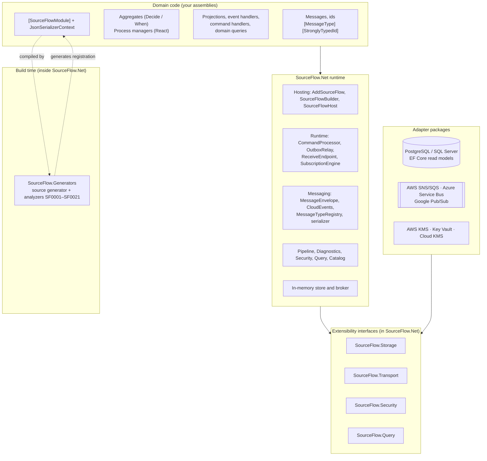
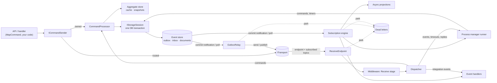

# 01 — Architecture Overview

SourceFlow.Net v3 is a library, not a server. A service references one core package, writes its domain as pure functions, and composes storage and broker adapters at startup. This document describes how the pieces fit together as built in 3.0.0: the layers, the single core package with its extensibility interfaces, the runtime components that run inside every service, and the package map.

Rationale lives in [Design 01 — Architecture Overview](../../Design/01-Architecture-Overview.md) and [ADR-027](../../ADRs/ADR-027-single-core-package-with-extensibility-spis-and-categorised-adapters.md). This page describes what the code does.

---

## Layers



| Layer | What lives there | Depends on |
|-------|------------------|------------|
| Domain code | Records and pure methods, using only the `SourceFlow` and `SourceFlow.Workflows` namespaces | `SourceFlow.Net` only |
| Generator | Compile-time discovery and code generation; analyzers that enforce the programming model | Roslyn (never loaded at run time) |
| Core runtime | The engine that runs commands, relays the outbox, receives messages and drives subscriptions | BCL and `Microsoft.Extensions.*` |
| SPIs | Interfaces and records that adapters implement | — (part of the core) |
| Adapters | Databases, brokers and key services | `SourceFlow.Net` and their own SDK; never each other |

The architecture tests in `tests/Architecture` enforce these rules: the core references no adapter, adapters do not reference each other, and domain code needs nothing but `SourceFlow.Net`.

---

## One core package, extensibility interfaces and adapters

[ADR-027](../../ADRs/ADR-027-single-core-package-with-extensibility-spis-and-categorised-adapters.md) puts the contracts, the runtime, the in-memory adapters, the extensibility interfaces and the generator into one package, `SourceFlow.Net`. One reference gives a domain assembly everything it can use, and the namespace rule keeps it free of infrastructure.

The core package depends on the BCL, `Microsoft.Extensions.*` (DependencyInjection, Hosting, Logging and Options abstractions, Caching.Memory, Compliance redaction, HealthChecks) and `System.IO.Hashing`. It has no database driver, cloud SDK or OpenTelemetry SDK.

Each concern has one namespace of interfaces and one slot on `SourceFlowBuilder`:

| Concern | Namespace | Main types | Builder slot | Implemented by |
|---------|-----------|------------|--------------|----------------|
| Persistence | `SourceFlow.Storage` | `IEventStore`, `IEventLogReader`, `IStorageSessionFactory` / `IStorageSession`, `IOutboxStore`, `ICheckpointStore`, `ILeaseManager`, `IDeadLetterStore`, `ISnapshotStore`, `IDocumentReader`, `IStoreNotifications`; optional `IStoreRetention`, `IStoreMonitor`, `INodeRegistry`, `ISchemaStore`, `IDocumentAdmin`, `ICollectionAliases`. Grouped in the `StoragePorts` record | `UseStorage(...)` | `InMemoryStore` (core), `SourceFlow.Storage.PostgreSQL`, `SourceFlow.Storage.SqlServer` |
| Broker | `SourceFlow.Transport` | `ITransport`, `ITransportReceiver`, `ReceivedMessage`, `TransportCapabilities`, `TransportTopology`, `ITransportProbe`, `ITopologyDescriber` | `UseTransport(...)` | `InMemoryBroker` (core), `SourceFlow.Cloud.Aws`, `.Azure`, `.Gcp` |
| Security | `SourceFlow.Security` | `IKeyProvider`, `IPersonalDataKeyStore`, `IPersonalDataEraser` | `Security(s => ...)` | `LocalKeyProvider` (core, development), cloud KMS providers |
| Querying | `SourceFlow.Query` | `IQueryEngine`, `IQueryService`, `IAggregateReader`, `IReadModelResolver` | DI registration of `IQueryEngine` | In-memory interpreter (core), PostgreSQL and SQL Server compilers |
| Pipeline | `SourceFlow.Pipeline` | `IMessageMiddleware`, `MessageContext`, `ErrorClassifier` | `UseMiddleware(...)`, `Errors(...)` | Your code |
| Telemetry | `SourceFlow.Diagnostics` | `ActivitySource` and `Meter` named `SourceFlow`, `SourceFlowTelemetry` constants | — | Any OpenTelemetry SDK |

The inbox has no interface of its own: it is part of `IStorageSession` (`InboxSeenAsync`, `RecordInbox`), so an inbox row is always written in the same transaction as the effects it guards. Adapters prove they are substitutable by passing the storage and transport conformance kits in `SourceFlow.Testing`.

---

## Runtime components

Everything below runs inside the service process. One `SourceFlowRuntime` per host holds the shared state: the runtime model, routing table, options, storage ports, transport, serializer, middleware pipeline, error classifier, metrics and clock.

| Component | Type | Responsibility | Details |
|-----------|------|----------------|---------|
| Runtime model | `RuntimeModel` (built by `SourceFlowModelBuilder`) | The frozen model of every module: messages, aggregates, command owners and handlers, process managers, projections, event handlers, domain queries | [02](02-Command-Flow.md) |
| Type registry | `MessageTypeRegistry` | `(name, version)` ↔ CLR type ↔ JSON metadata ↔ upcaster chain; the deserialization allow-list | [04](04-Messaging-Pipeline-and-Middleware.md) |
| Routing table | `RoutingTable` (built by `RoutingBuilder`) | Endpoint, remote command routes, publications, subscriptions, ordering | [02](02-Command-Flow.md) |
| Command sender | `ICommandSender` | Sends a command to its single owner: the local processor or the remote endpoint | [02](02-Command-Flow.md) |
| Command processor | `CommandProcessor` | Inbox check, load, decide, append, outbox, inline projections and commit in one storage session; re-decides on conflict | [02](02-Command-Flow.md) |
| Aggregate store | internal, with `AggregateCache` and a background snapshot writer | Loads state from cache, snapshot and stream tail; writes snapshots after commit | [05](05-Event-Store-and-Persistence.md) |
| Middleware pipeline | `MessagePipeline` | Composes user middleware per stage | [04](04-Messaging-Pipeline-and-Middleware.md) |
| Outbox relay | `OutboxRelay` | Leases outbox partitions, publishes due rows in per-key order, retries and parks | [03](03-Event-Flow.md) |
| Receive endpoint | `ReceiveEndpoint` with an internal dispatcher | One receiver for the service endpoint; per-key workers; retries, delayed retries and parking; settles after commit | [04](04-Messaging-Pipeline-and-Middleware.md) |
| Subscription engine | internal | Reads the commit-ordered log per subscription partition under fenced leases; drives async projections, process managers and event handlers | [03](03-Event-Flow.md), [06](06-Projections-and-Read-Models.md) |
| Process manager runner | internal | Correlate, load state, react, save state, queue commands and timers in one transaction | [09](09-Process-Managers-and-Workflows.md) |
| Timers | outbox rows of kind `OutboxKind.Scheduled` | Durable delayed delivery to the service's own endpoint | [03](03-Event-Flow.md) |
| Read-model generations | `IReadModelResolver` | Blue/green projection generations behind aliases | [06](06-Projections-and-Read-Models.md) |
| Dead-letter ingestor | internal | Moves messages from the broker's native DLQ into the dead-letter store | [04](04-Messaging-Pipeline-and-Middleware.md) |
| Monitor | `SourceFlowMonitor` | Samples outbox backlog, dead letters, subscription lag, horizon, process managers and leases for gauges and health checks | [Observability](../Observability-and-Performance.md) |
| Operator APIs | `IDeadLetterManager`, `ISubscriptionAdmin` | List, replay, discard and purge dead letters; see and skip stalled partitions | [04](04-Messaging-Pipeline-and-Middleware.md) |
| Query side | `IQueryService`, `IAggregateReader` | SFQL and SQL-syntax queries, temporal aggregate reads, consistency tokens | [08](08-Query-Side-and-SFQL.md) |
| Host | `SourceFlowHost` (`IHostedService`, `IHealthCheck`) | Startup checks, provisioning, background loops, graceful shutdown | below |

### Component diagram



Two properties are visible in the diagram:

- **Every outbound message goes through the outbox**, written in the same transaction as the events that caused it. A command sent inside a handler joins the handler's transaction; a routed command sent from an API call is written in a session of its own ([02](02-Command-Flow.md#remote-routing)). Only the outbox relay sends to the transport (ARCH-09).
- **Every inbound message goes through one receiver** on the service endpoint. Commands, timers, rejection replies and subscribed events are told apart by envelope `type`, not by separate listeners.

---

## Hosting lifecycle

`services.AddSourceFlow(sf => ...)` builds and validates the runtime model and routing table immediately (duplicate names, missing JSON metadata, missing upcasters, commands with no owner or route, owned-and-routed commands, unknown projections). It registers options with `ValidateOnStart`, the runtime services and one hosted service, `SourceFlowHost`.

```mermaid
sequenceDiagram
    autonumber
    participant H as Generic host
    participant SH as SourceFlowHost
    participant T as ITransport
    participant S as Storage
    H->>SH: StartAsync
    SH->>T: ProvisionAsync(topology, mode)
    SH->>S: register schemas (SchemaRegistration)
    SH->>SH: check domain queries and workflow versions
    SH->>S: subscribe to commit notifications
    alt Receiver role
        SH->>T: CreateReceiverAsync(endpoint, subscribed topics, filters)
        SH->>SH: start receive loop (+ dead-letter ingestor if the broker has a native DLQ)
    end
    alt Relay role
        SH->>SH: start outbox relay loop (+ retention loop)
    end
    alt Subscriptions role and something to subscribe
        SH->>S: node heartbeat (fair share)
        SH->>SH: start subscription loop
    end
    SH->>SH: start monitor; ready = true
```

The host is an `IHostedLifecycleService`. In `StoppingAsync`, before any hosted service stops, it reports not ready, stops receiving and starts draining: queued received messages are released for another instance at once. `StopAsync` then works to one deadline, `ShutdownTimeout` in all: it cancels its loops, releases its outbox partition leases and subscription leases (so another node takes over at once instead of after `LeaseTtl`), leaves the node registry, lets in-flight received messages finish (cancelling them when the time is up) and flushes pending snapshots. Unfinished work is never lost: outbox rows stay until they are published, and unsettled messages are redelivered by the broker.

The relay and subscription loops wake on the store's commit notification (for example PostgreSQL `LISTEN/NOTIFY`) and fall back to polling every `PollInterval`. The fallback uses the system clock, so a fake business clock in tests never stops them.

### Roles

`sf.Roles` selects which background work an instance runs, so API and worker instances can scale separately from the same code:

| `SourceFlowRoles` | Runs |
|-------------------|------|
| `Api` (0) | Nothing in the background; the instance only sends commands (local commands are still processed in-request) |
| `Receiver` | The receive endpoint and the dead-letter ingestor |
| `Relay` | The outbox relay and retention cleanup |
| `Subscriptions` | Async projections, local process managers and event handlers |
| `All` (default) | Everything |

Work is shared between instances with fenced leases: outbox partitions (`OutboxPartitions`) and subscription partitions (`SubscriptionPartitions`). With a node registry in the store, each node takes at most its fair share of subscription leases and gives back one lease per pass when a node joins.

---

## Package map

All packages target `net10.0` and are versioned together. Projects live under `src/<Category>/<Package>/`.

| Category | Package | Contents |
|----------|---------|----------|
| Core | `SourceFlow.Net` | Domain contracts, runtime, in-memory adapters, extensibility interfaces, telemetry, health checks, schema catalog, query engine front end, workflow runtime types, v2 migration support. Bundles the generator and analyzers. [README](../SourceFlow.Net-README.md) |
| Core (build only) | `SourceFlow.Generators` | Roslyn source generator, analyzers and the SF0010 code fix (`netstandard2.0`, packed into `SourceFlow.Net`, never a separate package) |
| Storage | `SourceFlow.Storage.PostgreSQL` | Every storage port, schema migrator, row-level security, partitioned events, SFQL compiler. [README](../SourceFlow.Storage.PostgreSQL-README.md) |
| Storage | `SourceFlow.Storage.SqlServer` | Every storage port on SQL Server, SFQL T-SQL compiler. [README](../SourceFlow.Storage.SqlServer-README.md) |
| Storage | `SourceFlow.Storage.EntityFrameworkCore` | Session projections that write EF Core read models in the projection transaction. [README](../SourceFlow.Storage.EntityFrameworkCore-README.md) |
| Cloud | `SourceFlow.Cloud.Aws` | SNS/SQS transport and provisioner, AWS KMS key provider. [README](../SourceFlow.Cloud.Aws-README.md) |
| Cloud | `SourceFlow.Cloud.Azure` | Service Bus transport and provisioner, Key Vault key provider. [README](../SourceFlow.Cloud.Azure-README.md) |
| Cloud | `SourceFlow.Cloud.Gcp` | Pub/Sub transport and provisioner, Cloud KMS key provider. [README](../SourceFlow.Cloud.Gcp-README.md) |
| Hosting | `SourceFlow.AspNetCore` | `MapCommand<T>()`, the per-service query API and domain query endpoints. [README](../SourceFlow.AspNetCore-README.md) |
| Tooling | `SourceFlow.Testing` | Specs, `SourceFlowTestHost`, chaos injector, storage and transport conformance kits. [README](../SourceFlow.Testing-README.md) |
| Tooling | `SourceFlow.Tool` | The `dotnet sourceflow` CLI. [README](../SourceFlow.Tool-README.md) |
| Workflows | `SourceFlow.Studio`, `SourceFlow.Studio.Wasm` | The workflow DSL core and its WebAssembly build for SourceFlow Studio. [README](../SourceFlow.Studio-README.md) |

---

## Delivery guarantees at a glance

| Path | Guarantee | Mechanism | Detail |
|------|-----------|-----------|--------|
| Local `SendAsync` → aggregate | Atomic; effectively once with an idempotency key | One transaction; inbox keyed by the message id | [02](02-Command-Flow.md) |
| Command → remote owner | At-least-once delivery, effectively-once effect | Outbox → broker → owner's inbox | [02](02-Command-Flow.md) |
| Event → inline projection | Atomic with the append | Same transaction | [03](03-Event-Flow.md) |
| Event → async projection, process manager, event handler (same database) | Exactly-once effect in the store, per-stream order | Checkpoint committed with the effects, fenced leases | [03](03-Event-Flow.md) |
| Integration event → subscribing service | At-least-once delivery, effectively once per consumer | Outbox → topic → per-service subscription → inbox per consumer | [03](03-Event-Flow.md) |
| External side effect in an event handler | At-least-once | Make it idempotent with `EventContext.EventId` | [03](03-Event-Flow.md) |
| Timer | At-least-once, at or after the due time | Outbox row with a delivery time | [03](03-Event-Flow.md) |

---

## Extension points

| To add | Implement | Register with |
|--------|-----------|---------------|
| A database | The `SourceFlow.Storage` ports; pass the storage conformance kit | `sf.UseStorage(sp => new StoragePorts(...))` |
| A broker | `ITransport` and `ITransportReceiver`; pass the transport conformance kit | `sf.UseTransport(sp => ...)` |
| A key service | `IKeyProvider` | `sf.Security(s => s.UseKeyProvider(...))` |
| A query engine | `IQueryEngine` | DI |
| Cross-cutting behaviour | `IMessageMiddleware` | `sf.UseMiddleware(...)` |
| Exception policy | rules on `ErrorClassifier` | `sf.Errors(...)` |
| Audit and tenancy | `IActorAccessor`, `ITenantResolver` | DI |
| Chaos testing | `IFaultInjector` | DI |

---

## Related documentation

- [02 Command Flow](02-Command-Flow.md), [03 Event Flow](03-Event-Flow.md), [04 Messaging Pipeline and Middleware](04-Messaging-Pipeline-and-Middleware.md)
- [05 Event Store and Persistence](05-Event-Store-and-Persistence.md), [06 Projections and Read Models](06-Projections-and-Read-Models.md), [07 Cloud Transports](07-Cloud-Transports.md), [08 Query Side and SFQL](08-Query-Side-and-SFQL.md), [09 Process Managers and Workflows](09-Process-Managers-and-Workflows.md), [10 Security and Multi-Tenancy](10-Security-and-Multi-Tenancy.md)
- [SourceFlow.Net README](../SourceFlow.Net-README.md)
- Design: [01 Architecture Overview](../../Design/01-Architecture-Overview.md); ADRs [002](../../ADRs/ADR-002-event-sourcing-replaces-command-sourcing.md), [004](../../ADRs/ADR-004-source-generation-instead-of-reflection.md), [006](../../ADRs/ADR-006-transactional-outbox-and-inbox-for-effectively-once.md), [007](../../ADRs/ADR-007-single-command-ownership-route-local-xor-remote.md), [027](../../ADRs/ADR-027-single-core-package-with-extensibility-spis-and-categorised-adapters.md)
