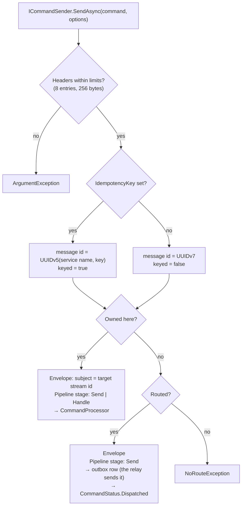
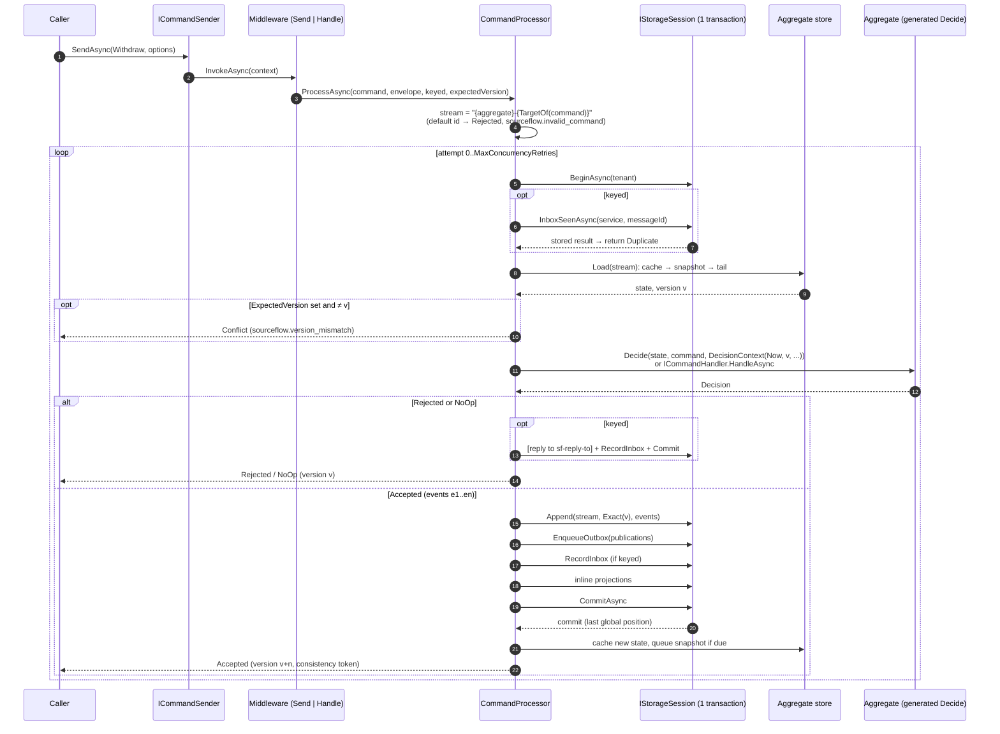
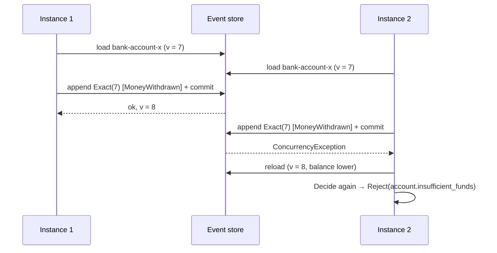
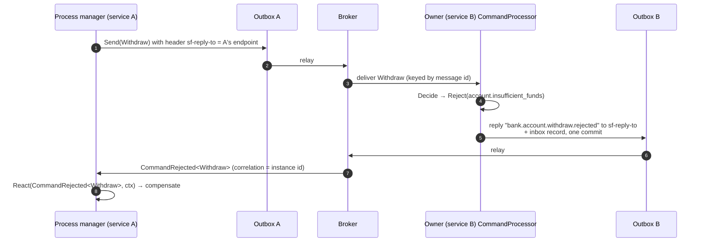
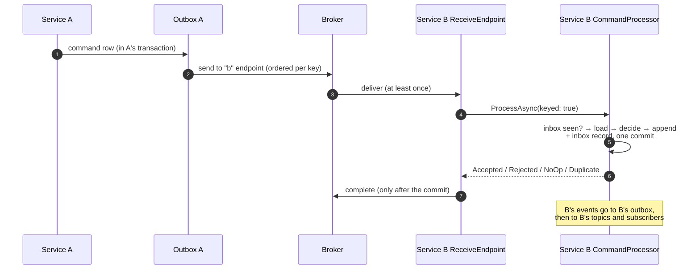

# 02 — Command Flow

This document follows a command from the moment it is sent (in process or over HTTP) to committed events and a `CommandResult`. It covers the routing decision, local handling (load, decide, append), optimistic concurrency with automatic re-decide, idempotency by message id, rejections and rejection replies, remote routing, and the result with its consistency token.

Design rationale: [Design 03 §5](../../Design/03-Domain-Programming-Model.md#5-command-processing), [ADR-003](../../ADRs/ADR-003-aggregates-as-pure-deciders-decide-evolve.md), [ADR-006](../../ADRs/ADR-006-transactional-outbox-and-inbox-for-effectively-once.md), [ADR-007](../../ADRs/ADR-007-single-command-ownership-route-local-xor-remote.md), [ADR-008](../../ADRs/ADR-008-optimistic-concurrency-with-automatic-re-decide.md), [ADR-018](../../ADRs/ADR-018-business-rejections-are-values-not-exceptions.md).

---

## The moving parts

| Part | Type | Role |
|------|------|------|
| Sender | `ICommandSender` | The single entry point; decides local or remote |
| Ownership | `RuntimeModel.CommandOwners`, `RuntimeModel.CommandHandlers` | Which aggregate decides each command, and whether an `ICommandHandler` does it |
| Routes | `RoutingTable.Commands` (`CommandRoute(Endpoint, ReplyOnReject)`) | The remote owner of each routed command |
| Pipeline | `MessagePipeline` | User middleware for the `Send` and `Handle` stages |
| Processor | `CommandProcessor` | One attempt = one storage session: inbox check, load, decide, append, outbox, inbox, inline projections, commit |
| Aggregate store | internal, with `AggregateCache` | Loads state from the cache, a snapshot and the stream tail |
| Session | `IStorageSession` (from `IStorageSessionFactory.BeginAsync(tenant)`) | One database transaction |
| Generated code | `IAggregateRuntime<TSelf, TId>` | `TargetOf`, `Decide` and `Evolve` switches |

Commands reach the processor from three places:

1. **`ICommandSender.SendAsync`** in your code, in an `IEventHandler`, or through `SourceFlow.AspNetCore`'s `MapCommand<T>()`.
2. **The receive endpoint**, for a command another service (or this service's own process manager) sent through the broker.
3. **Process managers**, whose commands are written to the outbox and arrive through route 2, even when this service owns them.

---

## The routing decision

A command type is owned (it has a `Decide` or an `ICommandHandler` in a registered module) or routed (`r.Command<T>().To(endpoint)`), never both and never neither. Routing is validated when `AddSourceFlow` runs, so the decision at send time is a dictionary lookup.



The envelope is created before the pipeline runs: logical type and version from the registry, `source` = the service name, correlation id from `SendOptions.CorrelationId` (or the message id, starting a new conversation), tenant from `ITenantResolver` (or `DefaultTenant`), actor from `IActorAccessor`, W3C trace context from a `create {type}` span, and the user headers. Each send gets its own DI scope; middleware and command handlers resolve from it.

---

## Local handling



### 1. Target stream

The generated `TargetOf` returns the command's target id (the single member of the aggregate's id type, or the one marked `[AggregateId]`). The stream id is `{aggregate name}-{id.ToStreamSegment()}`, for example `bank-account-0193a1f2...`. A default id never reaches storage: the result is `Rejected` with `sourceflow.invalid_command`.

### 2. Load

The aggregate store folds the stream into state, starting from `Initial`:

1. **Cache** (when `SourceFlowOptions.AggregateCache` is not `Off`): the last committed state and version of the stream in this process.
   - `ReadTail` starts from the cached state and reads only the events after it (usually none).
   - `Optimistic` skips the tail read and relies on the append's version check. A rejection or no-op decided on cached state appends nothing, so nothing would catch a stale cache; the processor therefore reads one event past the cached version and, if there is one, re-decides on fresh state. The shortcut is never used when `ExpectedVersion` is set.
2. **Snapshot** (when the aggregate has `SnapshotEvery > 0` and the stored snapshot's schema hash matches): deserialized state at a version.
3. **Tail**: events after that version, read in pages of 512, each decrypted (personal data), deserialized through the allow-list and upcast to the latest version, then applied with the generated `Evolve`.

An event type that is not registered fails the load loudly (`UnknownMessageTypeException`) rather than silently skipping history.

### 3. Decide

The processor builds a `DecisionContext` (`Now` from `TimeProvider`, the loaded `Version`, the command id, correlation id and headers) and calls the generated `Decide` switch, or the registered `ICommandHandler` resolved from the message scope. `Decide` is pure, so running it again is always safe.

### 4. Append and commit

For an accepted decision, every event gets its own envelope: a UUIDv7 id, the decision time as its time, the stream id as subject, the stream version, and causation and correlation from the command. Then, inside the one session:

| Step | What is written |
|------|-----------------|
| Personal data | `[PersonalData]` members are encrypted per subject when personal-data encryption is on |
| `Append(stream, ExpectedVersion.Exact(v), events)` | The events; the first write of the transaction |
| Publications | For each `Publish<TEvent>()` route matching an event: the mapped integration event (or the event itself for `AsIs()`) as an outbox row to the topic, keyed by `OrderedBy` or the stream id |
| Inbox | `(service name, message id) → Accepted, new version` when keyed |
| Inline projections | Each inline projection applies the new events in the same transaction |
| Commit | All of the above atomically |

Every outbox row's body is checked against the transport's `MaxBodyBytes` before it is queued, so an oversized message fails the command with `MessageTooLargeException` instead of being parked later.

After the commit, the processor caches the new state (when the cache is on) and queues a snapshot when the append crossed a multiple of `SnapshotEvery`. Snapshots are written by a background writer outside the command transaction; a dropped snapshot only makes a later load longer.

No side effect happens before the commit: the outbox relay publishes the rows only after they are committed ([03 Event Flow](03-Event-Flow.md)).

---

## Optimistic concurrency and automatic re-decide

Two instances can decide on the same stream at once. The append is conditional on the version the state was loaded at; the loser's commit fails with `ConcurrencyException`, and the processor:

1. drops the cached state for the stream,
2. counts `sourceflow.eventstore.concurrency_conflicts`,
3. waits a jittered backoff (no wait before the first retry, then `min(200 ms, 2^attempt ms × [0.5, 1.5))`),
4. starts a new attempt with a new session, reloads and decides again.



After `MaxConcurrencyRetries` re-decides (default 5, so up to six attempts) the result is `Conflict` with `sourceflow.concurrency_conflict`. Because `Decide` is pure and the attempt's session was never committed, nothing from a losing attempt leaks.

For a received command, a `Conflict` after all re-decides is turned into a transient failure, so the receive endpoint retries the message (immediately, then with delayed retries) instead of acknowledging it.

---

## Idempotency by message id

The inbox makes a command take effect once even when it is sent or delivered more than once ([ADR-006](../../ADRs/ADR-006-transactional-outbox-and-inbox-for-effectively-once.md)).

| Source | Keyed? | Message id |
|--------|--------|------------|
| `SendAsync` with `SendOptions.IdempotencyKey` | yes | `MessageIds.FromKey(serviceName, key)`: a UUIDv5, so the same key always maps to the same id |
| `SendAsync` without a key | no | a new UUIDv7 |
| Received from the broker | always | the envelope's id |
| Process manager reaction | always (it arrives through the broker) | the id given to `Reaction.Send(command, messageId)`, otherwise a new UUIDv7 per reaction |

For a keyed command, the inbox consumer is the service name. The processor checks `(consumer, message id)` at the start of each attempt and returns the stored result (`Duplicate`, with the original version, error code and consistency token). It records the result in the same transaction as the effect, so a duplicate and its original can never both commit: if two copies race, the second commit fails with a duplicate-key error and the processor returns the first one's stored result.

Rejections and no-ops are recorded too, so a retried request that was rejected stays rejected without re-running `Decide`.

Inbox rows are kept for `InboxRetention` (default 14 days, checked at startup against the broker's message retention) and then purged by the relay role. A redelivery older than that is not detected. See the [Message Idempotency Guide](../Message-Idempotency-Guide.md).

---

## Caller-side optimistic checks

`SendOptions.ExpectedVersion` (from an HTTP `If-Match` header with `MapCommand<T>()`) asserts the version the caller last saw. When it does not match the loaded version, the processor returns `Conflict` with `sourceflow.version_mismatch` at once, without deciding or re-deciding. Over HTTP this becomes `412 Precondition Failed`.

---

## Rejections

A rejection is a returned value, `Decision.Reject(error)`. It appends nothing and is never retried: the result is `Rejected` with the `Error` (code and message). Over HTTP it becomes a `422` problem details response whose `title` is the error code.

### Reply on reject

A process manager that sends a command needs to know when the owner rejects it, to compensate. The owner sends a `CommandRejected<TCommand>` reply:



| Rule | Detail |
|------|--------|
| When the header is set | On commands a process manager sends, if the command is owned by this service, or routed with `.ReplyOnReject()`, **and** this service registered `CommandRejected<TCommand>` (a process manager reacts to it) |
| Header | `sf-reply-to` (`CommandReplies.ReplyToHeader`) holds the sender's endpoint. It never propagates to messages caused by the command |
| Reply type | `{command type}.rejected` with the command's version, for example `bank.account.withdraw.rejected.v1`. The body is `{ "command": <the command as received>, "error": { "code", "message" } }`, so the owner needs no JSON metadata for it |
| Atomicity | The reply is an outbox row committed with the inbox record of the rejection: it is sent exactly when the rejection is recorded |
| Correlation | The reply carries the command's correlation id, which is the process instance id |

---

## Remote routing

### Sending

```csharp
sf.Routing(r => r.Command<RequestStatement>().To("notifications"));
```

| Sent from | Path | Result |
|-----------|------|--------|
| `ICommandSender.SendAsync` from an API call | Pipeline (`Send` stage), then an outbox row committed in a session of its own, relayed later | `Dispatched` once the row is committed. The relay applies payload protection and retries; a body over the transport's limit fails the send with `MessageTooLargeException` |
| `ICommandSender.SendAsync` inside a handler (event handler, command handler) | Pipeline (`Send` stage), then an outbox row in the **handler's own session**, committed with its work and its inbox entry | `Dispatched`. Sent only if the handler commits. The message id is derived from the handled message's id and the send's ordinal, so a redelivery sends the same ids and the owner's inbox drops them |
| A process manager reaction | Outbox row (`OutboxKind.Send`) committed with the process state, relayed later | Part of the reaction's transaction; effectively once |

A sender must have the command's message type registered (for example through a contracts-only module, see the [README](../SourceFlow.Net-README.md#modules-and-the-source-generator)). The sender does not need the owner's aggregate, and must not register it: a command owned and routed in the same service fails startup.

### Handling at the owner



The owner runs the same `CommandProcessor` as for a local command, always keyed by the message id. The owning service appends, sequences and can replay its own streams. The receive endpoint maps the result to an outcome:

| Result | Outcome | Settlement |
|--------|---------|------------|
| `Accepted`, `NoOp` | `Completed` | complete |
| `Rejected` | `Rejected` | complete (no retry) |
| `Duplicate` | `Duplicate` | complete |
| `Conflict` | transient failure | immediate retries, then delayed retries, then parked |

---

## Results and consistency

`CommandResult(Status, Version, Error, Token)`:

| Status | `Version` | `Error` | `Token` | HTTP (`MapCommand<T>()`) |
|--------|-----------|---------|---------|--------------------------|
| `Accepted` | new stream version | — | position of the last event | 200, `ETag`, `SourceFlow-Consistency` |
| `NoOp` | current version | — | none | 200, `ETag` |
| `Duplicate` | original version | original error code, if any | original token | 200, `ETag`, `SourceFlow-Consistency` |
| `Rejected` | current version | the rejection | none | 422 problem details |
| `Conflict` | current version or none | `sourceflow.version_mismatch` or `sourceflow.concurrency_conflict` | none | 412 (`If-Match`) or 409 |
| `Dispatched` | none | — | none | 202 |

The `ConsistencyToken` is the global position of the last event written, plus the tenant when it is not the default: `{commit}:{sequence}` or `{commit}:{sequence}@{tenant}`. Inline projections are already up to date when the command returns. For async read models, pass the token to the query side (`at_least(@token)`) to wait until the read model has caught up with this write ([08 Query Side](08-Query-Side-and-SFQL.md)).

---

## Failure behaviour

| Failure | Effect | Recovery |
|---------|--------|----------|
| Process dies before the commit | Nothing was written | The caller retries; the broker redelivers a received command |
| Process dies after the commit, before the caller gets the result | Events and outbox rows are committed | A retry with the same idempotency key (or a redelivered message) returns `Duplicate`. A retry without a key decides again on the new state; send commands that may be retried with an idempotency key |
| Broker down | Local commands still succeed; publications wait in the outbox | The relay publishes in order when the broker is back |
| Concurrent writers | One append per version wins | The loser re-decides automatically |
| A `Decide` throws | The attempt's session is discarded | The exception reaches the caller, or the receive endpoint classifies it (retry or park) |

The chaos suite exercises these points through `IFaultInjector` (`session.beforeCommit`, `session.afterCommitBeforeAck`).

---

## Telemetry

Each command produces a `handle {CommandType}` span with the aggregate type, stream id, outcome and number of concurrency retries, plus `sourceflow.eventstore.load` and `sourceflow.eventstore.append` child spans. Metrics: `sourceflow.command.duration` (by command type and outcome, including `failed` for exceptions), `sourceflow.eventstore.append.duration`, `sourceflow.eventstore.append.events`, `sourceflow.aggregate.load.events`, `sourceflow.aggregate.cache.hits`, `sourceflow.eventstore.concurrency_conflicts` and `sourceflow.inbox.duplicates`.

---

## Extension points

| Need | Use |
|------|-----|
| A decision that needs I/O | `ICommandHandler<TCommand, TAggregate>` |
| Validation, auditing or enrichment around sends | `IMessageMiddleware` on `PipelineStage.Send` / `Handle` |
| Actor and tenant on every command | `IActorAccessor`, `ITenantResolver` |
| Faster loads of hot streams | `SourceFlowOptions.AggregateCache`, `[Aggregate(SnapshotEvery = n)]` |
| HTTP endpoints | `MapCommand<T>()` in `SourceFlow.AspNetCore` |

---

## Related documentation

- [01 Architecture Overview](01-Architecture-Overview.md), [03 Event Flow](03-Event-Flow.md), [04 Messaging Pipeline and Middleware](04-Messaging-Pipeline-and-Middleware.md), [05 Event Store and Persistence](05-Event-Store-and-Persistence.md)
- [SourceFlow.Net README: sending commands](../SourceFlow.Net-README.md#sending-commands), [SourceFlow.AspNetCore README](../SourceFlow.AspNetCore-README.md), [Message Idempotency Guide](../Message-Idempotency-Guide.md)
- Design: [03 Domain Programming Model](../../Design/03-Domain-Programming-Model.md), [04 Messaging Pipeline](../../Design/04-Messaging-Pipeline.md)
