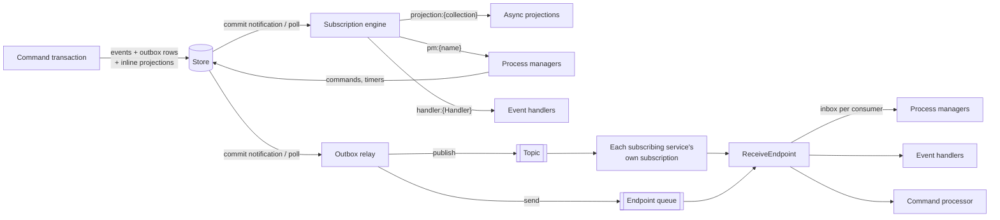
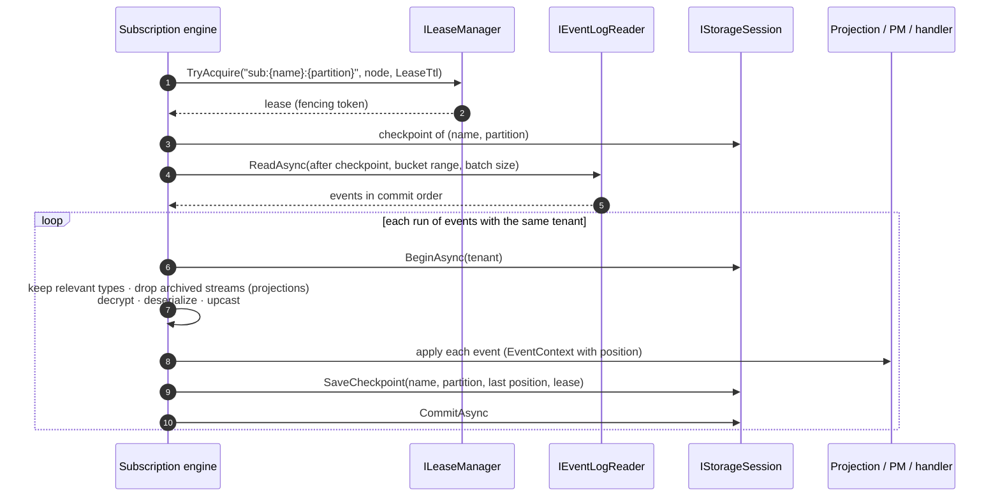
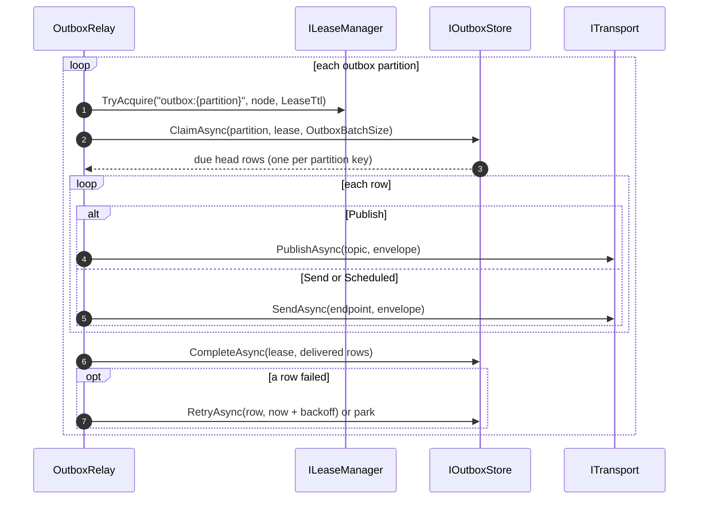
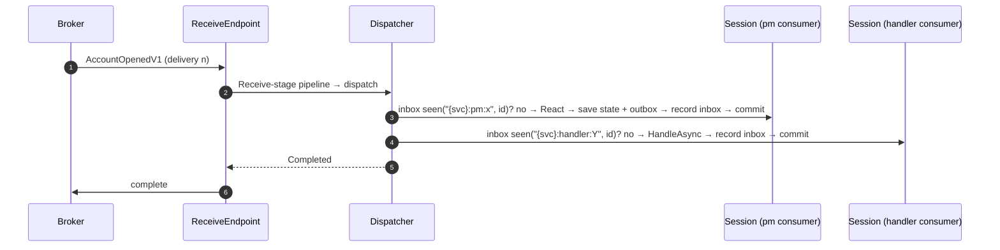

# 03 — Event Flow

This document follows events after the command transaction commits: how they get a place in the global log, how inline and async projections see them, how subscriptions track their progress, how integration events leave through the outbox and arrive at other services through the inbox, how process managers react, and how durable timers fire.

Design rationale: [Design 04](../../Design/04-Messaging-Pipeline.md), [Design 06](../../Design/06-Projections-and-Subscriptions.md), [ADR-006](../../ADRs/ADR-006-transactional-outbox-and-inbox-for-effectively-once.md), [ADR-010](../../ADRs/ADR-010-commit-ordered-global-position-for-gap-free.md), [ADR-016](../../ADRs/ADR-016-projections-inline-or-async-with-partitioned-fenced.md), [ADR-020](../../ADRs/ADR-020-process-managers-with-durable-state-and-timers.md).

---

## The big picture

Domain events never leave the service by themselves. Inside the service they are read from the log by subscriptions; outside it they travel only as outbox rows that a publication route created.

---

## Global position

Every committed event has a `GlobalPosition(Commit, Sequence)`: a commit-ordered position in the service's log, compared lexicographically, printed as `{commit}:{sequence}`. Events of one transaction share the commit component and are numbered by sequence. The store decides what the commit component is (a transaction id on PostgreSQL, a row version on SQL Server, a commit counter in memory); see [05 Event Store and Persistence](05-Event-Store-and-Persistence.md).

`IEventLogReader` reads the log **below the safe horizon**: every position at or below the horizon is final, and no transaction still in flight can later commit an event behind it ([ADR-010](../../ADRs/ADR-010-commit-ordered-global-position-for-gap-free.md)). A subscription that advances its checkpoint therefore never skips an event that commits late.

The log is also divided into 1,024 **buckets** by a hash of `tenant/stream id`. All events of one stream fall in one bucket, so they always reach the same subscription partition, in order.

The position of the last event a command wrote is returned to the caller as its consistency token ([02 Command Flow](02-Command-Flow.md#results-and-consistency)).

---

## Inline projections

A projection configured `Inline()` runs inside the command transaction, after the append and before the commit. It sees each new event with an `EventContext` whose stream, version, time, correlation and causation are final; its `Position` is `GlobalPosition.Start`, because the position is only known at commit. Its writes commit or roll back with the events, so the read model is always exactly as new as the stream (read-your-writes), at the cost of making the command slower and requiring the read model to be in the same database.

---

## Async subscriptions

Everything else that consumes local events runs in the subscription engine. Each subscription is a durable reader of the log with its own checkpoint per partition:

| Subscription name | Created for | Default failure policy |
|-------------------|-------------|------------------------|
| `projection:{collection}` | Each async projection generation (for example `projection:account-summary@1`) | `Stop` |
| `pm:{process name}` | Each process manager that reacts to at least one `IEvent` type | `Park` |
| `handler:{handler class name}` | Each `IEventHandler<TEvent>` whose `TEvent` is an `IEvent` | `Park` |

Each subscription has `SubscriptionPartitions` partitions (a power of two, default 1). A partition owns a contiguous range of buckets.

### One pass of a partition

| Property | How |
|----------|-----|
| Exactly-once effect in the same database | The effects (documents, process state, outbox rows) and the checkpoint commit in one transaction |
| No split brain | The checkpoint write is fenced by the lease token; a node that lost its lease cannot commit (`LeaseLostException`), and it stops working that partition |
| Per-stream order | One stream is in one bucket, so in one partition, read in commit order |
| Tenant isolation | Each transaction holds events of one tenant; batches are split into consecutive runs per tenant, keeping commit order |
| Adaptive batches | A partition starts at `min(100, SubscriptionBatchSize)` events and doubles while batches come back full (catching up, rebuilding), then drops back |
| Fair sharing | With a node registry, a node takes at most `ceil(leases / live nodes)` partitions and releases one lease per pass when it holds too many |
| Wake-up | Commit notifications from the store, with `PollInterval` as the fallback |

### Failure handling

When a batch fails, the engine applies its events one at a time to isolate the poison event, retrying each up to `ImmediateRetries` more times (stopping early for an exception classified as permanent). Then the subscription's policy decides:

| Policy | Behaviour |
|--------|-----------|
| `Stop` (projections) | The partition halts at the event and retries with backoff (1 s, doubling, capped at 5 minutes). Other partitions continue. `sourceflow.subscription.stalled` reports 1 until the code is fixed or an operator skips the event with `ISubscriptionAdmin.SkipAsync` (audited) or `dotnet sourceflow projection skip` |
| `Park` (process managers, handlers) | The event is stored as a dead letter (reason `SubscriptionFailed`, or `UnknownMessageType`), and the checkpoint moves past it, so the partition does not stall |

Change a projection's policy with `p.Add<TProjection>().OnFailure(SubscriptionFailurePolicy.Park)`. Projection rebuilds, blue/green generations and read-model storage are covered in [06 Projections and Read Models](06-Projections-and-Read-Models.md).

---

## Publication through the outbox

A `Publish<TEvent>()` route turns a domain event into an outbox row **inside the command transaction**: the mapped integration event (or the event itself for `AsIs()`), the destination topic, and a partition key (`OrderedBy`, default the stream id). The outbox partition is a hash of the partition key modulo `OutboxPartitions`.

The `OutboxRelay` runs on instances with the `Relay` role:

| Rule | Detail |
|------|--------|
| Only committed rows | The relay reads rows only after their transaction commits; nothing is published for a rolled-back command |
| Per-key order | A claim returns only the head row of each partition key, so a later row never overtakes an earlier one, even across retries |
| Retry | A failed row is retried after `min(300 s, 2^attempt s)`; its key is blocked until then, other keys continue |
| Park | After `OutboxMaxAttempts` attempts, or at once for a permanent error (for example a missing destination), the row moves to dead letters (`Exhausted` or `OutboxPublishFailed`) and is removed from the outbox |
| Duplicates | A crash between publishing and deleting a row publishes it again; receivers' inboxes absorb the duplicate |
| Scale | Leases spread partitions over relay instances; graceful shutdown releases them for the next instance |

The relay span is `send {destination}` (a producer span parented on the envelope's trace context), with the `sourceflow.outbox.dispatch.duration` histogram and `messaging.client.sent.messages`. `sourceflow.outbox.age` and the `sourceflow.outbox` health check watch the backlog.

---

## Receiving remote events

A service that subscribes to a topic gets its **own** subscription to it; instances of that service compete for the messages, and every subscribing service gets a copy ([07 Cloud Transports](07-Cloud-Transports.md)). Subscribed events arrive at the same receive endpoint as commands and timers. Where the broker cannot filter natively, the endpoint evaluates the subscription's CloudEvents SQL filter on receipt and completes non-matching events without handling them.

A received integration event (or timeout, or rejection reply) is not appended to the receiving service's store. The dispatcher hands it to every consumer that handles its type, **each in its own transaction with its own inbox entry**:

| Consumer | Inbox consumer name |
|----------|---------------------|
| Process manager | `{service}:pm:{process name}` |
| Event handler | `{service}:handler:{handler class name}` |

If one consumer fails, the message is retried, and only the consumers without an inbox entry run again. Handlers that call external systems still run at least once (the inbox row is written after the handler returns), so make them idempotent with `EventContext.EventId`, as the welcome handler of the Bank domain the tests use ([`tests/Fixtures/Bank/Bank.Notifications`](../../../../tests/Fixtures/Bank/Bank.Notifications)) does with an idempotency key.

---

## Process-manager reactions

Process managers react to local events (through their `pm:` subscription) and to messages from the broker (integration events, their own timeouts, `CommandRejected<T>` replies). Either way, one reaction is one transaction:

1. Correlate the message to an instance: the generated `CorrelateBy` first, then the envelope correlation id (the instance id that every command and timer the instance sends carries). A message that correlates to nothing is skipped.
2. Load the instance state, or `Initial` for a new instance. A completed instance ignores the message.
3. Call `React` with a `ReactionContext` (`Id`, `Now`, `MessageId`, `IsNew`).
4. Unless the reaction is `Ignore`: save the new state with an optimistic version check, queue each command as an outbox row (to this service's endpoint when owned here, else to the routed endpoint, with `sf-reply-to` when a rejection reply is expected), and queue each scheduled message as a timer.
5. Record the inbox entry or checkpoint and commit.

Commands from a process manager reach their owner through the broker even when the owner is the same service, so they get the owner's inbox and full retry handling. Details, including DSL workflows and versioning: [09 Process Managers and Workflows](09-Process-Managers-and-Workflows.md).

---

## Durable timers

`Reaction.Schedule(message, deliverAt)` writes an outbox row of kind `OutboxKind.Scheduled` addressed to the service's own endpoint, with a delivery time. The relay claims a row only when it is due, then sends it like any other message; the receive endpoint dispatches the `ITimeout` to the process manager, correlated by the instance id.

| Property | Value |
|----------|-------|
| Durability | Timers are rows in the store; they survive restarts and failovers |
| Precision | At or after `deliverAt`, typically within `PollInterval` |
| Delivery | At least once; the instance's inbox entry makes the reaction effectively once |
| Cancelling | There is no cancel call: a reaction ignores a timeout whose stage no longer matches, as `MoneyTransfer` does |
| Clock | Due times use the registered `TimeProvider`, so tests can move time forward |

---

## Guarantees summary

| Path | Guarantee |
|------|-----------|
| Event → inline projection | Atomic with the append |
| Event → async projection, local process manager, local event handler | Exactly-once effect on the store, per-stream order; external side effects at least once |
| Event → publication | Published at least once, in per-key order, only after commit |
| Integration event → each subscribing service | At-least-once delivery, effectively once per consumer through the inbox |
| Timer | At least once, at or after its due time |

---

## Extension points

| Need | Use |
|------|-----|
| A read model | `IDocumentProjection<TDocument, TKey>`, `ISessionProjection<TUnitOfWork>` |
| A side effect | `IEventHandler<TEvent>` (idempotent by `EventId`) |
| Coordination across aggregates or services | A process manager, or a DSL workflow |
| A public contract | `IIntegrationEvent` + `Publish<TEvent>().As<TContract>(map).To(topic)` |
| Parallelism | `SubscriptionPartitions`, `OutboxPartitions` |
| Operations | `IDeadLetterManager`, `ISubscriptionAdmin`, `dotnet sourceflow dlq` and `projection` commands |

---

## Related documentation

- [01 Architecture Overview](01-Architecture-Overview.md), [02 Command Flow](02-Command-Flow.md), [04 Messaging Pipeline and Middleware](04-Messaging-Pipeline-and-Middleware.md)
- [05 Event Store and Persistence](05-Event-Store-and-Persistence.md), [06 Projections and Read Models](06-Projections-and-Read-Models.md), [07 Cloud Transports](07-Cloud-Transports.md), [09 Process Managers and Workflows](09-Process-Managers-and-Workflows.md)
- [Message Idempotency Guide](../Message-Idempotency-Guide.md), [Observability and Performance](../Observability-and-Performance.md)
