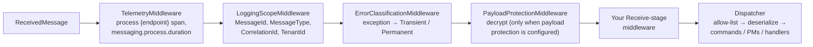
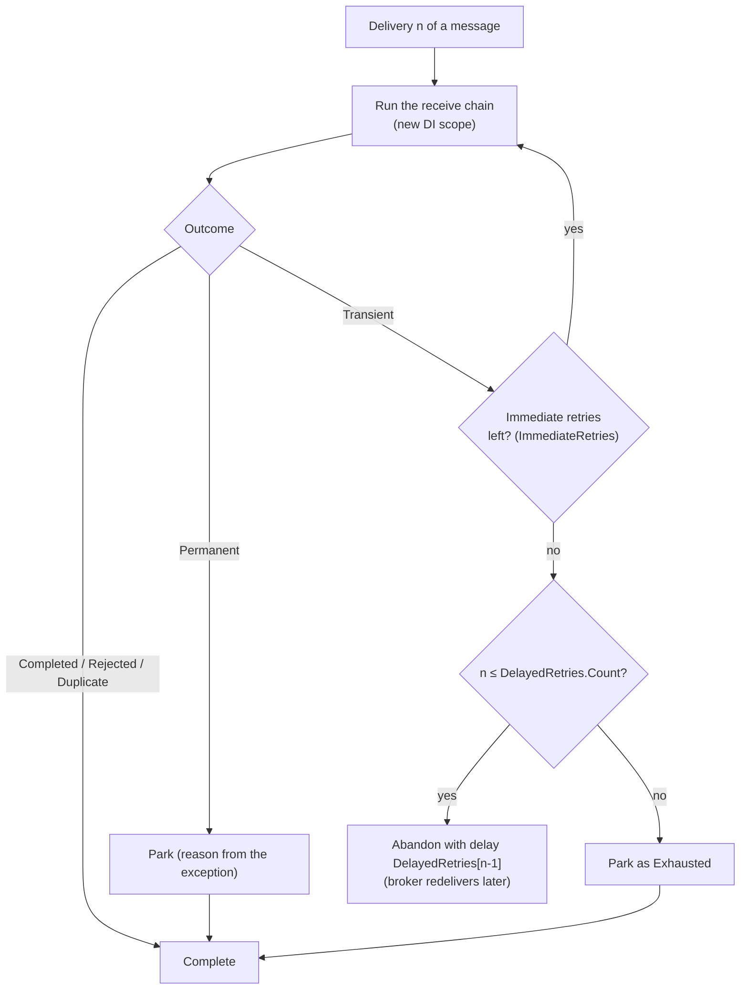

# 04 — Messaging Pipeline and Middleware

Every message SourceFlow handles, whether a command sent in process, an outbox row, a message on the wire or a dead letter, travels in one envelope, is serialized one way, and passes through one middleware abstraction. This document describes the envelope and its CloudEvents mapping, serialization and the type registry, the middleware stages, and how received messages are retried, backed off and parked.

Design rationale: [Design 04 — Messaging Pipeline](../../Design/04-Messaging-Pipeline.md), [ADR-005](../../ADRs/ADR-005-logical-message-type-names-and-registry.md), [ADR-011](../../ADRs/ADR-011-cloudevents-envelope-and-w3c-trace-context.md), [ADR-012](../../ADRs/ADR-012-one-middleware-abstraction-for-all-stages.md), [ADR-013](../../ADRs/ADR-013-use-platform-libraries-delete-bespoke-equivalents.md).

---

## The envelope

`MessageEnvelope` (namespace `SourceFlow.Messaging`) is an immutable record. Your message records carry only business data; everything else is here.

| Envelope property | CloudEvents attribute | Notes |
|-------------------|-----------------------|-------|
| `MessageId` | `id` | UUIDv7 for new messages; UUIDv5 for idempotency keys. The inbox key |
| `Source` | `source` | The producing service, written as `urn:sourceflow:{service}` |
| `Type` + `TypeVersion` | `type` | `{name}.v{version}`, for example `bank.account.deposited.v1` |
| — | `specversion` | `1.0` |
| `Time` | `time` | Creation time; the decision time for events (round-trip `O` format) |
| `ContentType` | `datacontenttype` | `application/json` |
| `Subject` | `subject` | The stream id for events; the target stream for locally owned commands |
| `CorrelationId` | `sfcorrelationid` | The conversation; a process manager's instance id on what it sends |
| `CausationId` | `sfcausationid` | The message that caused this one |
| `PartitionKey` | `sfpartitionkey` | The ordering key; `EffectivePartitionKey` falls back to `Subject` |
| `StreamVersion` | `sfstreamversion` | Events only |
| `TenantId` | `sftenant` | `MessageEnvelope.DefaultTenant` (`"-"`) in single-tenant deployments |
| `Actor` | `sfactor` | Who caused it (`IActorAccessor`), for audit |
| `Protection` | `sfenc` | The protection scheme when the body is encrypted |
| `TraceParent`, `TraceState` | `traceparent`, `tracestate` | W3C trace context |
| `Headers` | `sfheaders` | User headers as one JSON object attribute |
| `Body` | data | The serialized, possibly encrypted payload |

### Binary and structured mode

`CloudEvents.ToAttributes` maps an envelope to binary-mode attributes for transports that carry headers; the body travels as the message data. When a broker allows fewer attributes than needed (SQS allows 10), optional attributes move, in name order, into one `sfext` JSON attribute until the budget fits; the required attributes (`id`, `source`, `specversion`, `type`, `time`, `datacontenttype`) never move. `CloudEvents.ToStructured` writes the whole event as one `application/cloudevents+json` document (JSON bodies as `data`, others as `data_base64`). Both modes round-trip losslessly, and every transport is tested for it by the conformance kit.

Decoding is strict: a missing required attribute, a malformed value or a duplicated JSON property raises `FormatException`, and nothing else, so a crafted message cannot stop a receiver. Each transport decides how a malformed message is dead-lettered ([07 Cloud Transports](07-Cloud-Transports.md)).

### How envelopes are created

`SourceFlowRuntime.CreateEnvelope` builds the envelope of every new message, optionally from the message that caused it:

| Property | Value |
|----------|-------|
| `MessageId` | Given (idempotency key, deterministic process-manager send) or a new UUIDv7 from the `TimeProvider` |
| `CorrelationId` | Given, else the cause's, else the message's own id (it starts a conversation) |
| `CausationId` | The cause's message id |
| `TenantId` | Given, else the cause's, else `ITenantResolver.TenantId`, else `DefaultTenant` |
| `Actor` | The cause's, else `IActorAccessor.Actor` |
| Trace context | From a new `create {type}` producer span, else the current activity, else the cause's |
| `Headers` | Given, else the cause's user headers without reserved ones (`sf-reply-to` never propagates) |

### Limits

| Limit | Value | Enforcement |
|-------|-------|-------------|
| User headers | At most 8 (`EnvelopeLimits.MaxHeaders`), name and value at most 256 bytes UTF-8 each (`MaxHeaderBytes`) | `ArgumentException` when a command is sent |
| Body | The transport's `TransportCapabilities.MaxBodyBytes` | `MessageTooLargeException` before the outbox row is written, so the command fails instead of the row being parked later |

### Message ids

`MessageIds` creates the ids:

| Method | Id |
|--------|----|
| `MessageIds.New(TimeProvider)` | A time-ordered UUIDv7 |
| `MessageIds.FromKey(scope, key)` | A UUIDv5 of `{scope}\n{key}` in the SourceFlow namespace UUID. `ICommandSender` uses the service name as the scope, so one key always maps to the same id in one service |
| `MessageIds.Derive(source, discriminator)` | A UUIDv5 derived from another id, for deterministic re-sends |

---

## Serialization and the type registry

### Serializer

`IMessageSerializer` turns a message into body bytes for a registered `MessageTypeInfo` and back. The only implementation in 3.0.0 is `SystemTextJsonMessageSerializer`:

- metadata comes only from the modules' source-generated `JsonSerializerContext`s (combined into one resolver), plus the generated converters of strongly typed ids, so there is no reflection;
- camelCase property and dictionary-key names, strict number handling, duplicate properties rejected, a maximum depth of 64;
- it writes to an `IBufferWriter<byte>` and reads from a `ReadOnlySequence<byte>`;
- a body that is the JSON literal `null` is a `JsonException`;
- a message whose CLR type does not match the registered type is refused.

### Registry

`MessageTypeRegistry` is built once at startup from the modules' `AddMessage<T>(name, version)` and `AddUpcaster<...>` registrations, then frozen:

| `MessageTypeInfo` member | Meaning |
|--------------------------|---------|
| `Name`, `Version` | The logical type |
| `Kind` | `Command`, `Event`, `IntegrationEvent`, `Timeout` or `Reply`, from the interface the type implements |
| `ClrType`, `JsonTypeInfo` | The CLR type and its source-generated metadata |
| `UpcastsTo` | The next version, when an upcaster is registered |
| `CloudEventType` | `{name}.v{version}` |

The registry is an **allow-list**. A stored or received envelope is looked up by `(type, version)` before any deserialization; an unknown pair raises `UnknownMessageTypeException`, which is permanent (the message is parked as `UnknownMessageType`, never instantiated). Storage reads are upcast to the latest version through the chain (`UpcastToLatest`, at most 64 steps); wire messages are deserialized as their own version and never upcast.

Building the registry fails startup when a name is invalid, a version is below 1, a CLR type or a `(name, version)` pair is registered twice with different meanings, a type has no JSON metadata, an upcaster does not go from one version to the next of the same name, or an event has consecutive versions without an upcaster between them.

---

## Middleware

### The abstraction

```csharp
public interface IMessageMiddleware
{
    ValueTask InvokeAsync(MessageContext context, MessageDelegate next);
}

public delegate ValueTask MessageDelegate(MessageContext context);
```

A middleware calls `next(context)` to continue, or returns without calling it to short-circuit. Registration:

```csharp
sf.UseMiddleware(
    factory: sp => new TenantGuardMiddleware(sp.GetRequiredService<ITenantDirectory>()),
    stages: PipelineStage.Send | PipelineStage.Receive,
    filter: ctx => ctx.Envelope.TenantId != MessageEnvelope.DefaultTenant);
```

| Aspect | Behaviour |
|--------|-----------|
| Order | Registration order, outermost first |
| Composition | `MessagePipeline` selects the registrations for a stage once and caches the list |
| Filter | Evaluated per message; a registration whose filter returns false is skipped |
| Lifetime | The factory runs per message with the message's DI scope (`context.Services`); return a shared instance from it to make a middleware a singleton |

`MessageContext`:

| Member | Meaning |
|--------|---------|
| `Stage` | The stage flags of this invocation |
| `Envelope` | The envelope; settable, and what the next step uses |
| `Message`, `TypeInfo` | The payload and its registered type, once known: set before the pipeline for sends (`TypeInfo` for local sends only), and by the dispatcher on receive |
| `Services` | The per-message DI scope |
| `Session` | The storage session in transactional stages (not set by the 3.0.0 runtime) |
| `Activity` | The current span (set by the receive telemetry middleware) |
| `CancellationToken` | Cancellation |
| `Outcome` | The `HandlingOutcome` set by the terminal step or the error classifier |
| `Exception` | The exception behind a failed outcome |
| `Result` | The `CommandResult` of a locally handled command |
| `Items` | A per-message bag for middleware |

### Stages

`PipelineStage` is a flags enum: `Send`, `Handle`, `Receive`, `Publish`, `Project`, `All`. A registration runs for an invocation when its stages overlap the invocation's stage. In 3.0.0 the runtime invokes the pipeline at three points:

| Invocation stage | When | Terminal step | Exceptions |
|------------------|------|---------------|------------|
| `Send` | `ICommandSender.SendAsync` for a **routed** command, and every command sent inside a handler | The outbox row for the owner's endpoint (the relay sends it); the send returns `Dispatched` | Propagate to the caller |
| `Send \| Handle` | `ICommandSender.SendAsync` for a **locally owned** command | `CommandProcessor.ProcessAsync`; sets `Result` | Propagate to the caller |
| `Receive` | Every message delivered to the service endpoint | The dispatcher: registry lookup, deserialization, then the command processor, process managers and event handlers | Classified into an outcome (below) |

`Publish` and `Project` are accepted in registrations, but no runtime path invokes middleware for them in 3.0.0: outbox publishing and subscription applies run without user middleware. A middleware that short-circuits a local send must set `context.Result`; otherwise `SendAsync` throws `InvalidOperationException` ("A middleware short-circuited the send without setting a result.").

### The receive chain



The four built-ins run only on the receive path, outside your middleware. Two consequences:

- Your middleware sees the **decrypted** envelope, but not yet the deserialized message (`Message` is set by the dispatcher, so it is available after `next` returns).
- An exception from the dispatcher passes through your middleware before the classifier catches it. After a normal return, `context.Outcome` is `Completed`, `Rejected` or `Duplicate`. The end-to-end tests count deliveries and duplicates this way:

```csharp
private sealed class TallyMiddleware(ReceiveTally tally, string service) : IMessageMiddleware
{
    public async ValueTask InvokeAsync(MessageContext context, MessageDelegate next)
    {
        await next(context);
        tally.Add(service, CloudEvents.FormatType(context.Envelope.Type, context.Envelope.TypeVersion),
            context.Outcome == HandlingOutcome.Duplicate);
    }
}

sf.UseMiddleware(_ => new TallyMiddleware(received, "notifications"), PipelineStage.Receive);
```

---

## Handling outcomes

`HandlingOutcome` is what the terminal step or the classifier reports for a received message, and it decides how the message is settled with the broker:

| Outcome | Set when | Settlement |
|---------|----------|------------|
| `Completed` | Handled; every consumer committed | Complete (acknowledge) |
| `Rejected` | A command was rejected by its `Decide` (a business outcome) | Complete; never retried |
| `Duplicate` | The inbox had already recorded this message for the consumer | Complete |
| `Transient` | An exception classified as transient | Retry: immediately, then delayed, then park |
| `Permanent` | An exception classified as permanent | Park at once, then complete |

Messages are settled only **after** the handler's transaction committed. A crash between the commit and the acknowledgement causes a redelivery that the inbox absorbs.

### Error classification

`ErrorClassifier` maps an exception (an `AggregateException` with one inner exception is unwrapped) to `Transient` or `Permanent`. Rules are checked newest first; anything no rule matches is **transient**.

| Default rule | Outcome |
|--------------|---------|
| `TransportException` with `IsTransient = true` (for example `TransportUnavailableException`, `TransportThrottledException`) | Transient |
| `TransportException` with `IsTransient = false` (for example `DestinationNotFoundException`) | Permanent |
| `KeyProviderException` with `IsTransient` true / false | Transient / Permanent |
| `UnknownMessageTypeException`, `JsonException`, `InvalidCommandException`, `NotSupportedException`, `FormatException`, `ArgumentException`, `InvalidCastException` | Permanent |
| `PermanentException` (throw it from your code) | Permanent |
| `DecryptionFailedException`, `ProtectionRequiredException` | Permanent |
| Anything else (timeouts, database errors, `ConcurrencyException`, ...) | Transient |

Add or override rules; later rules win:

```csharp
sf.Errors(e => e
    .Treat<PaymentGatewayUnavailableException>(HandlingOutcome.Transient)
    .Treat<InvalidPaymentDataException>(HandlingOutcome.Permanent));
```

`Treat<T>` accepts only `Transient` or `Permanent`. The outbox relay and the subscription engine use the same classifier.

---

## Retries, backoff and parking



| Mechanism | Default | Notes |
|-----------|---------|-------|
| Immediate retries | `ImmediateRetries = 3` | In process, back to back, each with a fresh DI scope |
| Delayed retries | `DelayedRetries = [10 s, 1 min, 10 min, 1 h]` | The message is abandoned with the delay; the broker redelivers it (native delay where the transport has it) |
| Parking | after the last delayed retry, or at once when permanent | The message is written to the dead-letter store, then completed at the broker |
| Broker backstop | max deliveries = `1 + DelayedRetries.Count + 2` | The topology gives the endpoint's native dead-letter queue a delivery limit above the runtime's own budget; it only catches messages that crashed the process before they could be parked |
| Dead-letter ingestion | `IngestBrokerDeadLetters = true`, every `DeadLetterIngestInterval` (30 s) | Moves native DLQ messages into the dead-letter store, so there is one place to look |
| Lock renewal | every `ReceiveLockDuration / 2` | Keeps the message locked while its handler runs; a lost lock means a redelivery the inbox absorbs |

The receive endpoint also guarantees **per-key order and backpressure**: messages are dispatched to `ReceiveConcurrency` workers by a hash of the partition key (or the message id when there is none), so one key is handled one message at a time in arrival order, and each worker has a bounded channel of `PrefetchPerWorker` messages. On shutdown it stops receiving and waits up to `ShutdownTimeout` for in-flight messages; anything unsettled is redelivered after its lock expires.

### Park reasons

| Source | `DeadLetter.Source` | Reasons |
|--------|---------------------|---------|
| Receive endpoint | `receive` | `UnknownMessageType`, `DeserializationFailed`, `NoRoute`, `DecryptionFailed`, `ProtectionRequired`, `PermanentFailure` (permanent), `Exhausted` (transient retries used up) |
| Outbox relay | `outbox` | `OutboxPublishFailed` (permanent), `Exhausted` (`OutboxMaxAttempts` reached) |
| Subscription | `subscription` | `SubscriptionFailed`, `UnknownMessageType` (Park policy); `Skipped` (an operator skipped a stalled event) |
| Broker DLQ | `broker-dlq` | The broker's reason, or `BrokerDeadLetter` |

`NoRoute` applies only when a `NoRouteException` is classified as permanent; it is an `InvalidOperationException`, which is transient by default. Add `e.Treat<NoRouteException>(HandlingOutcome.Permanent)` to park misrouted commands without retries.

### Dead letters

A `DeadLetter` keeps the full original envelope, the consumer, the destination a replay sends to, the reason, the exception type, message and chain, the attempt count, the first-failure and parking times, and a status (`Parked`, `Replayed`, `Discarded`). With `LogPayloads = true`, the receive endpoint also logs the payload of each message it parks (at `Debug` level), with `[PersonalData]` and `[Secret]` members redacted.

| Operation | API | CLI |
|-----------|-----|-----|
| List and filter (consumer, reason, status, type, time) | `IDeadLetterManager.ListAsync(DeadLetterQuery)` | `dotnet sourceflow dlq list` |
| Show one | `GetAsync(id)` | `dlq show` |
| Replay to the original destination, keeping the message id (the inbox still deduplicates) | `ReplayAsync(id, note)` | `dlq replay` |
| Discard with a reason (audited) | `DiscardAsync(id, reason)` | `dlq discard` |
| Purge resolved entries older than a cutoff (parked ones are kept) | `PurgeAsync(resolvedBefore)` | `dlq purge` |

Replayed and discarded entries are purged after `DeadLetterRetention` (30 days); parked ones are never purged automatically. Metrics: `sourceflow.deadletter.parked`, `.replayed`, `.discarded` and the `sourceflow.deadletter.count` gauge. See the [SourceFlow.Tool README](../SourceFlow.Tool-README.md).

---

## Fault points

For chaos testing, register an `IFaultInjector`. The runtime calls it at these points (`FaultPoints`); an injector may throw (a crash), delay (a stall) or return:

| Point | Meaning |
|-------|---------|
| `session.beforeCommit` | A command's session is complete and about to commit |
| `session.afterCommitBeforeAck` | A command committed and the result has not reached the caller |
| `reaction.beforeCommit` | A process manager or event handler reacted to a received message and is about to commit |
| `relay.afterPublishBeforeDelete` | The relay published rows and has not deleted them |
| `subscription.afterApplyBeforeCommit` | A subscription applied a batch and has not committed it with the checkpoint |
| `lease.beforeRenew` | A node is about to renew a lease it owns |
| `receiver.beforeComplete` | A received message was handled and committed and is about to be completed at the broker |

`SourceFlow.Testing` provides a `ChaosInjector` built on this interface.

---

## Telemetry in the pipeline

| Where | Span | Kind | Metrics |
|-------|------|------|---------|
| Envelope creation | `create {type}` | Producer | — |
| Outbox relay | `send {destination}` (parent: the envelope's trace context) | Producer | `messaging.client.sent.messages`, `sourceflow.outbox.dispatch.duration` |
| Receive | `process {endpoint}` | Consumer | `messaging.client.consumed.messages`, `messaging.process.duration` (with `error.type` on failure) |
| Retries and parking | — | — | `sourceflow.retry.attempts` (by stage and kind), `sourceflow.deadletter.parked` |

By default the `process` span starts a new trace and **links** to the producer's span, so a redelivery days later does not grow the original trace. Set `SourceFlowOptions.Telemetry.ParentBasedOnMessage = true` to make it a child instead, for one trace from the HTTP request in the sending service to the handler here. See [Observability and Performance](../Observability-and-Performance.md) and the [OpenTelemetry guide](../../guides/opentelemetry.md).

---

## Extension points

| Need | Use |
|------|-----|
| Cross-cutting behaviour on sends and receives | `IMessageMiddleware` with `sf.UseMiddleware(factory, stages, filter)` |
| Domain-specific failure policy | `sf.Errors(e => e.Treat<T>(...))`, `PermanentException` |
| Another wire format | `IMessageSerializer` (only System.Text.Json ships in 3.0.0) |
| Payload encryption | `sf.Security(s => s.Use...().Protect(...))`; see the [Security and Compliance Guide](../Security-and-Compliance-Guide.md) |
| Operating on failures | `IDeadLetterManager`, `ISubscriptionAdmin`, `dotnet sourceflow dlq` |
| Fault injection | `IFaultInjector` |

---

## Related documentation

- [01 Architecture Overview](01-Architecture-Overview.md), [02 Command Flow](02-Command-Flow.md), [03 Event Flow](03-Event-Flow.md), [07 Cloud Transports](07-Cloud-Transports.md), [10 Security and Multi-Tenancy](10-Security-and-Multi-Tenancy.md)
- [SourceFlow.Net README: middleware](../SourceFlow.Net-README.md#middleware-and-error-classification), [Message Idempotency Guide](../Message-Idempotency-Guide.md)
- Design: [04 Messaging Pipeline](../../Design/04-Messaging-Pipeline.md), [08 Observability](../../Design/08-Observability.md)
