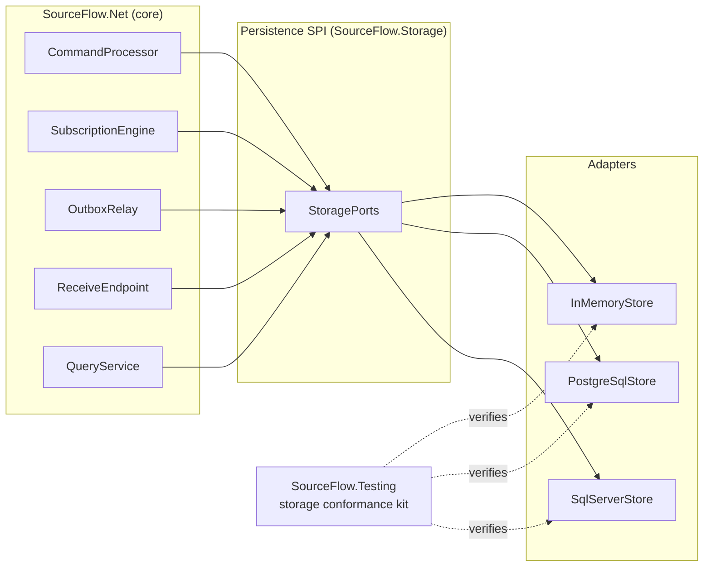
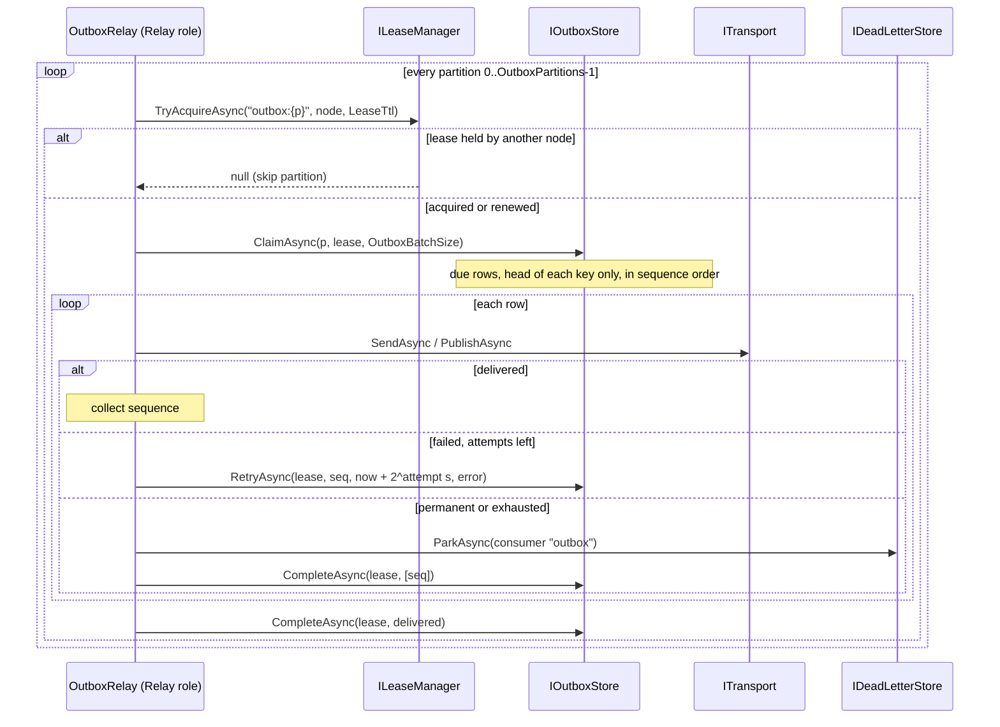

# 05 — Event Store and Persistence

This document explains how SourceFlow.Net v3 stores events and everything that must commit with them: the persistence SPI defined by the core, streams and versions, the commit-ordered global log, the storage session (the unit of work), snapshots, the outbox and its relay, the inbox, leases, the document store, the in-memory implementation, and the storage conformance kit that every adapter must pass. It ends with what it takes to write a new storage adapter.

The rationale is in [design doc 05](../../Design/05-Event-Store-and-Persistence.md) and ADRs [006](../../ADRs/ADR-006-transactional-outbox-and-inbox-for-effectively-once.md), [008](../../ADRs/ADR-008-optimistic-concurrency-with-automatic-re-decide.md), [009](../../ADRs/ADR-009-event-store-on-adonet-postgresql-first.md), [010](../../ADRs/ADR-010-commit-ordered-global-position-for-gap-free.md) and [028](../../ADRs/ADR-028-postgresql-payload-columns-and-adapter-refinements.md). This page describes the system as built. Package-level usage is in [SourceFlow.Storage.PostgreSQL](../SourceFlow.Storage.PostgreSQL-README.md) and [SourceFlow.Storage.SqlServer](../SourceFlow.Storage.SqlServer-README.md).

## Contents

- [What the persistence layer is for](#what-the-persistence-layer-is-for)
- [The persistence SPI](#the-persistence-spi)
- [Value types](#value-types)
- [The storage session](#the-storage-session)
- [Appending to a stream](#appending-to-a-stream)
- [Loading an aggregate: cache, snapshot, tail](#loading-an-aggregate-cache-snapshot-tail)
- [The global log and the safe horizon](#the-global-log-and-the-safe-horizon)
- [Commit notifications](#commit-notifications)
- [The outbox and the relay](#the-outbox-and-the-relay)
- [The inbox](#the-inbox)
- [Leases and fencing](#leases-and-fencing)
- [Documents, process state and dead letters](#documents-process-state-and-dead-letters)
- [Stream lifecycle and retention](#stream-lifecycle-and-retention)
- [The in-memory store](#the-in-memory-store)
- [The storage conformance kit](#the-storage-conformance-kit)
- [Writing a storage adapter](#writing-a-storage-adapter)
- [Guarantees and failure behaviour](#guarantees-and-failure-behaviour)
- [Related documents](#related-documents)

## What the persistence layer is for

v3 is event-sourced: an aggregate's state is the fold of its events, and the events are the source of truth. The persistence layer has to:

- append a command's events to one stream **atomically with** everything the command caused: outbound messages (outbox), the record that the command was processed (inbox), inline read models;
- detect concurrent writers to the same stream (optimistic concurrency) without locking for the whole decision;
- give subscriptions a **global, gap-free order** that later commits can never change, so a checkpoint never skips an event;
- let many nodes share work safely (leases with fencing), and let read models commit with their checkpoints;
- do all of this in as few database round trips as possible.

The core defines this as a set of small interfaces (the persistence SPI). Adapters implement them for one database. The runtime (command processor, subscription engine, outbox relay, receive endpoint) uses only the interfaces.



## The persistence SPI

The interfaces live in the `SourceFlow.Storage` namespace of the core package ([`src/Core/SourceFlow.Net/Storage/Ports.cs`](../../../../src/Core/SourceFlow.Net/Storage/Ports.cs)). An adapter hands them to the runtime as one `StoragePorts` record through the builder's storage slot:

```csharp
public SourceFlowBuilder UseStorage(Func<IServiceProvider, StoragePorts> factory);
```

`UsePostgreSql`, `UseSqlServer` and `UseInMemoryStorage` are thin wrappers around it.

### Required ports

| Port | Responsibility |
|------|----------------|
| `IEventStore` | Read a stream (`ReadStreamAsync`), get its info (`GetStreamInfoAsync`), archive it (`ArchiveStreamAsync`), soft-delete it (`DeleteStreamAsync`), and find archived streams in a set (`GetArchivedStreamsAsync`, with a default implementation). Every call takes the tenant id. |
| `IEventLogReader` | Read the global log after a position, filtered to a bucket range, below the safe horizon (`ReadAsync`), and report the horizon (`GetSafeHorizonAsync`). |
| `IStorageSessionFactory` | Begin a session (`BeginAsync(tenantId, ct)`): one database transaction scoped to a tenant. |
| `ICheckpointStore` | Read a subscription partition's last committed position. |
| `ILeaseManager` | Acquire or renew a fenced lease (`TryAcquireAsync`), release it (`ReleaseAsync`). |
| `IOutboxStore` | Claim due rows of a partition (`ClaimAsync`), delete delivered rows (`CompleteAsync`), reschedule a failed row (`RetryAsync`), count rows (`CountAsync`). Every call is fenced by the partition lease. |
| `IDeadLetterStore` | Park a message, query parked messages, get one, change its status with an audit note. |
| `ISnapshotStore` | Get, save and delete a stream's snapshot (outside the command transaction). |
| `IDocumentReader` | Read read-model documents outside a session (`GetAsync`, `ListAsync`). |
| `IStoreNotifications` | Call back after every commit (`Subscribe(Action onCommit)`). |

### Optional ports

The runtime degrades gracefully when an adapter leaves these out (`StoragePorts` init properties):

| Port | Without it |
|------|-----------|
| `IStoreRetention` (`Retention`) | No inbox or dead-letter cleanup. |
| `IStoreMonitor` (`Monitor`) | The store health check only reads the log horizon; gauges such as outbox age and horizon age are not reported. |
| `IPersonalDataKeyStore` (`PersonalData`) | Personal-data encryption (crypto-shredding) cannot be enabled. |
| `IDocumentAdmin` (`DocumentAdmin`) | Retired read-model generations are not dropped; `projection drop` fails. |
| `ICollectionAliases` (`Aliases`) | No blue/green rebuilds: every projection reads and writes its first generation. |
| `ISchemaStore` (`Schemas`) | Schemas are not registered at startup. |
| `INodeRegistry` (`Nodes`) | No lease fair-share: a node takes every free lease. |

The in-memory, PostgreSQL and SQL Server adapters implement all of them.

### The session interfaces

`IStorageSession` is the unit of work; `IDocumentSession` (its `Documents` property) writes read models inside it. Both are described in [The storage session](#the-storage-session).

## Value types

| Type | Shape | Notes |
|------|-------|-------|
| `StreamId` | text, at most 200 characters, `{aggregate}-{segment}` | Validated at construction. `AggregateKey` is the text after the last dash. |
| `StreamVersion` | `long`; `StreamVersion.None` is 0, the first event is 1 | Contiguous per stream. |
| `ExpectedVersion` | `Any`, `NoStream`, `StreamExists`, `Exact(v)` | The append's precondition. |
| `GlobalPosition` | `(ulong Commit, ulong Sequence)`, compared lexicographically; `GlobalPosition.Start` is `(0, 0)` | PostgreSQL `(tx_id, seq)`; SQL Server `(rowversion, seq)`; in-memory `(commit number, index in commit)`. |
| Bucket | 0–1023: `xxHash32(tenant + '/' + stream) & 1023` (`Buckets.Of`) | Computed by the client at append. Fixes the stream-to-partition mapping and spreads tenants. |
| `BucketRange` | inclusive `(Low, High)`; `Buckets.Range(partition, partitions)` | A subscription partition reads one range. `partitions` is a power of two up to 1024. |

The records that cross the SPI (`EventToAppend`, `StoredEvent`, `StreamSlice`, `StreamInfo`, `LogBatch`, `CommitResult`, `OutboxMessage`, `OutboxRecord`, `InboxResult`, `InboxEntry`, `LeaseToken`, `ProcessState`, `StoredDocument`, `Snapshot`, `DeadLetter`) are in [`Records.cs`](../../../../src/Core/SourceFlow.Net/Storage/Records.cs). An event stores its payload (`Data`, the serializer's exact bytes), its `EventMetadata` (correlation, causation, source, actor, W3C trace context, user headers), its decision time (`CreatedAt`, the command's `ctx.Now`) and its DCB tags.

## The storage session

A session is **one database transaction** scoped to one tenant. The command processor opens one per command attempt; the subscription engine opens one per batch and tenant; the receive pipeline opens one per consumer of a received message.

```csharp
public interface IStorageSession : IAsyncDisposable
{
    string TenantId { get; }
    ValueTask<StreamSlice> ReadStreamAsync(StreamId stream, StreamVersion fromInclusive, int maxCount, CancellationToken ct);
    void Append(StreamId stream, string streamType, ExpectedVersion expected, IReadOnlyList<EventToAppend> events);
    void EnqueueOutbox(OutboxMessage message);
    ValueTask<InboxEntry?> InboxSeenAsync(string consumer, MessageId messageId, CancellationToken ct);
    void RecordInbox(string consumer, MessageId messageId, InboxResult result);
    void SaveCheckpoint(string subscription, int partition, GlobalPosition position, LeaseToken lease);
    ValueTask<ProcessState?> LoadProcessStateAsync(string processType, string processId, CancellationToken ct);
    void SaveProcessState(string processType, string processId, long expectedVersion, ReadOnlyMemory<byte> state, bool completed);
    IDocumentSession Documents { get; }
    DbConnection? Connection { get; }
    DbTransaction? Transaction { get; }
    ValueTask FlushAsync(CancellationToken ct);
    ValueTask<CommitResult> CommitAsync(CancellationToken ct);
}
```

**Write-behind.** `Append`, `EnqueueOutbox`, `RecordInbox`, `SaveCheckpoint`, `SaveProcessState` and the document writes are queued in memory and sent together by `CommitAsync`. Only reads that are needed before deciding (the stream, the inbox check, process state, documents) go to the server during the session. On PostgreSQL the whole write side, including `COMMIT`, is one `NpgsqlBatch`: one round trip. Disposing a session without committing rolls everything back.

**Two rules every session enforces:**

- **ES-R1: the stream append is the first write.** `Append` after any other queued write throws `InvalidOperationException`. The reason is ordering: the transaction must acquire its id (on PostgreSQL, its `xid8`) under the stream's row lock, so that per-stream order equals global order (see [the safe horizon](#the-global-log-and-the-safe-horizon)).
- **ES-R2: one stream per session.** A second `Append` to a different stream throws. A command changes one aggregate, its consistency boundary. Bulk operations such as the v2 import use one session per stream.

**Reading your own writes.** `Documents.GetAsync` and `GetManyAsync` see the session's queued document writes.

**Writing through the connection.** `Connection` and `Transaction` expose the underlying ADO.NET objects (null in memory) for EF Core and custom SQL. `FlushAsync` sends the writes queued so far, the append first, without committing; call it before writing through `Connection`, so the append stays the first write. Session projections (EF Core) do this automatically.

**Failures at commit.** Conditional writes are checked inside the batch; the first failure rolls the whole transaction back, including outbox, inbox, documents and checkpoints, and surfaces as:

| Exception | Raised when |
|-----------|-------------|
| `ConcurrencyException` | The stream is not at the expected version, a duplicate event id was appended, or process state is not at the expected version. |
| `StreamClosedException` | The stream is deleted or archived. |
| `LeaseLostException` | A checkpoint's lease is no longer held with that token, or it expired. |
| `DuplicateMessageException` | The inbox already has `(consumer, message id)`. |

A command commit, end to end:

```mermaid
sequenceDiagram
    participant C as CommandProcessor
    participant S as IStorageSession
    participant DB as Database

    C->>S: BeginAsync(tenant)
    opt keyed command
        C->>S: InboxSeenAsync(service, messageId)
        S->>DB: SELECT inbox
    end
    C->>S: ReadStreamAsync(stream, v+1, …) after cache or snapshot
    S->>DB: SELECT events of the stream
    Note over C: Decide(state, command) → events
    C->>S: Append(stream, type, Exact(v), events)
    C->>S: EnqueueOutbox(publications)
    C->>S: RecordInbox(service, messageId, Accepted)
    C->>S: inline projections (Documents.Upsert / EF unit of work)
    C->>S: CommitAsync()
    S->>DB: append CTE, outbox, inbox, documents, COMMIT (one batch)
    alt version conflict
        DB-->>S: check failed, batch aborted
        S-->>C: ConcurrencyException
        Note over C: reload and re-decide (up to MaxConcurrencyRetries)
    else committed
        DB-->>S: new version, last position
        S-->>C: CommitResult
        S-)S: notify subscribers (in process; NOTIFY after commit)
    end
```

## Appending to a stream

`Append(stream, streamType, expected, events)` queues one append; every `ExpectedVersion` becomes a single atomic statement against the `streams` row (the concurrency anchor), followed by the event inserts:

| Expected | Meaning | Statement (PostgreSQL) |
|----------|---------|------------------------|
| `Exact(v)` | The stream is at version `v`. `Exact(StreamVersion.None)` is the same as `NoStream` | `UPDATE streams SET version = version + n WHERE version = v AND NOT is_deleted AND NOT is_archived` |
| `NoStream` | The stream must not exist | `INSERT … ON CONFLICT DO NOTHING` |
| `StreamExists` | Any version, but it must exist | `UPDATE … WHERE NOT is_deleted AND NOT is_archived` |
| `Any` | Create or append | `INSERT … ON CONFLICT DO UPDATE … WHERE NOT is_deleted AND NOT is_archived` |

Each statement takes the stream row lock and applies to the committed version it then observes, so it is always a compare-and-set on an observed version. Events get contiguous versions `base + 1 … base + n`. The append never reads the stream history to find the next version: its cost is O(events appended).

The command processor always appends with `Exact(v)`, where `v` is the version it decided on. On `ConcurrencyException` it drops any cached state, waits a jittered backoff (capped at 200 ms) and re-decides on fresh state, up to `SourceFlowOptions.MaxConcurrencyRetries` (5) times; after that the result is `CommandStatus.Conflict`. The storage layer itself never retries ([ADR-008](../../ADRs/ADR-008-optimistic-concurrency-with-automatic-re-decide.md)). A caller-side check (`SendOptions.ExpectedVersion`, HTTP `If-Match`) is compared with the loaded version before deciding and returns `Conflict` without retrying.

## Loading an aggregate: cache, snapshot, tail

```text
Load(stream):
  if the aggregate cache has (state, v):                 start = (state, v)
  elif a snapshot exists and its schema hash matches:    start = (snapshot state, snapshot version)
  else:                                                  start = (Initial, 0)
  read the stream after start.v, in pages, inside the session
  state = fold(Evolve, start.state, upcast(deserialize(tail)))
```

### Snapshots

- An aggregate opts in with `[Aggregate("name", SnapshotEvery = 100, SnapshotVersion = 1)]`.
- After a commit that crosses a multiple of `SnapshotEvery`, the new state is queued to a bounded background writer and saved **outside** the command transaction through `ISnapshotStore.SaveAsync`. A lost snapshot is harmless; it is a cache.
- The queue holds `SourceFlowOptions.SnapshotQueueCapacity` (1,024) entries; when full, the oldest is dropped, so commands never wait on snapshot I/O. Drops and failed writes count in `sourceflow.snapshot.dropped`.
- A snapshot carries a schema hash of `SnapshotVersion` and the generated state-shape fingerprint. A shape change, or a `SnapshotVersion` bump, invalidates older snapshots automatically. Bump `SnapshotVersion` when `When` logic changes without the shape changing.
- Stores never replace a newer snapshot with an older one (SCK-52).
- Turn snapshots on when `sourceflow.aggregate.load.events` is high for an aggregate type. On PostgreSQL a 1,000-event load drops from 9.5 ms to about 3 ms with snapshots ([perf baseline](../../implementation/perf-baseline.md)).

### The aggregate cache

`SourceFlowOptions.AggregateCache` turns on an in-process, size-limited cache (`AggregateCacheSize`, 10,000 states) of `(state, version)` per stream:

| Mode | Behaviour |
|------|-----------|
| `Off` (default) | Every command loads from the snapshot and the stream. |
| `ReadTail` | Start from the cached state and read the tail after it (usually no rows). |
| `Optimistic` | Skip the tail read and rely on the append's version check. A stale entry causes a conflict, a reload and a re-decide. A rejection or no-op decided on cached state is confirmed against the tail first, and a command with an expected version never takes the shortcut. Best with stream affinity (partition-keyed routing). |

Optimistic concurrency makes both modes correct by construction: a decision on stale state can never commit.

## The global log and the safe horizon

Subscriptions (projections, process managers, event handlers) read one log of every event in commit order. An identity column is not enough for that: a sequence value is assigned at insert but becomes visible at commit, so a reader can see position 12 committed while 11 is still in flight, move its checkpoint past 11 and lose it forever ([ADR-010](../../ADRs/ADR-010-commit-ordered-global-position-for-gap-free.md)).

SourceFlow reads only below a **safe horizon**: a position at or below which no new event can ever appear.

| Adapter | Position | Horizon |
|---------|----------|---------|
| PostgreSQL | `(tx_id, seq)`, `tx_id = pg_current_xact_id()` of the writing transaction | Every `tx_id < pg_snapshot_xmin(pg_current_snapshot())` has finished; reported as `(xmin − 1, max)` |
| SQL Server | `(rowversion, seq)` | Every `rv < MIN_ACTIVE_ROWVERSION()` is committed; reported as `(min − 1, max)` |
| In-memory | `(commit number, index in commit)` | Commits are atomic under one lock; the horizon is the last commit |

`IEventLogReader.ReadAsync(after, buckets, maxCount)` returns a `LogBatch`: the events after `after` (exclusive), in commit order, in the bucket range, below the horizon, plus the horizon itself. The horizon is **inclusive**: every position at or below `LogBatch.Horizon` is final.

**Per-stream order equals global order.** If append B commits version `k+1` after append A committed `k`, then A's position is lower than B's:

1. Every append is a compare-and-set on an observed version, so B observed A's committed version `k`.
2. A transaction id is assigned when a transaction first writes. ES-R1 makes the stream write the first write, so B's id was assigned after B observed A's commit, while A's id was assigned before A committed.
3. Transaction ids are monotonic, so `tx_id(A) < tx_id(B)`.

Without ES-R1, B could take an id early by writing something else first, wait on A's row lock, and commit with a lower id than A. That is why the session enforces ES-R1 and the conformance kit tests it (SCK-06, SCK-25).

**Operational consequence.** A long-running *writing* transaction anywhere in the database holds the horizon back. It delays subscriptions; it never corrupts them. `sourceflow.subscription.horizon_age` (from `IStoreMonitor.GetHorizonAgeAsync`) reports the age of the oldest in-progress writing transaction, and the subscriptions health check turns `Degraded` after `Health.HorizonAgeDegraded` (30 s).

## Commit notifications

`IStoreNotifications.Subscribe(onCommit)` wakes the subscription engine and the outbox relay after commits, so they need not poll tightly:

- Every adapter signals in-process subscribers right after each local commit.
- PostgreSQL also sends one `NOTIFY` per burst of commits, after the commit and outside the transaction, and keeps a `LISTEN` connection that relays other processes' commits.
- SQL Server has no `LISTEN`; other processes poll.

A notification is a hint, never a correctness mechanism. When none arrives, workers poll every `SourceFlowOptions.PollInterval` (1 s).

## The outbox and the relay

Every outbound message (integration events, commands to other endpoints, scheduled messages) is queued with `EnqueueOutbox` in the session that caused it, so it commits atomically with the events ([ADR-006](../../ADRs/ADR-006-transactional-outbox-and-inbox-for-effectively-once.md)). An `OutboxMessage` carries the envelope, the destination (endpoint or topic), the `OutboxKind` (`Send`, `Publish`, `Scheduled`), the earliest delivery time and the partition: `OutboxPartitioning.PartitionOf(envelope.EffectivePartitionKey, OutboxPartitions)`. The effective key is the envelope's partition key, or else its subject (the stream id); rows without a key go to partition 0 and are unordered.



- **Head of key.** Only the oldest row of each partition key is claimable, so per-key order holds even when the head fails and is retried. A failed head blocks only its own key.
- **Fenced.** `ClaimAsync`, `CompleteAsync` and `RetryAsync` check the partition lease inside the statement; a stale lease raises `LeaseLostException` and the relay stops working that partition. No `SELECT … FOR UPDATE SKIP LOCKED` is needed, because one relay owns a partition.
- **Due time.** `deliver_at` is compared with the host's `TimeProvider` (business time, like timers); leases use the database clock.
- **Retries.** Exponential backoff of 2^attempt seconds, capped at 5 minutes. After `OutboxMaxAttempts` (10), or at once for a permanent error, the row is parked as a dead letter (reason `Exhausted` or `OutboxPublishFailed`) and removed.
- **Outbox age.** A retry moves `deliver_at`, so stores keep `first_due_at` (`OutboxRecord.FirstDueAt`) and `sourceflow.outbox.age` keeps growing during a broker outage.
- **At least once.** Rows are deleted after the broker acknowledges; a crash in between sends them again with the same message id. The consumer's inbox absorbs the copy.

## The inbox

`InboxSeenAsync(consumer, messageId)` and `RecordInbox(consumer, messageId, result)` give consumers effectively-once processing. The inbox row commits in the same transaction as the consumer's effects; a concurrent duplicate fails the commit on the `(consumer, message_id)` key with `DuplicateMessageException` and rolls back. A second `RecordInbox` for the same key in one session throws at once. `InboxResult` stores the outcome (`CommandStatus`, stream version, error code, position) so a repeated command returns its original result.

Who uses the inbox, consumer names, idempotency keys and retention are covered in the [Message Idempotency Guide](../Message-Idempotency-Guide.md).

## Leases and fencing

Work that must have a single owner (an outbox partition, a subscription partition) is guarded by a lease:

```csharp
ValueTask<LeaseToken?> TryAcquireAsync(string name, string owner, TimeSpan ttl, CancellationToken ct);
ValueTask ReleaseAsync(LeaseToken lease, CancellationToken ct);
```

- `TryAcquireAsync` acquires a free or expired lease, or renews one this owner holds; it returns null when another owner holds it.
- The `LeaseToken.Token` is a **fencing token**. It stays the same while one owner renews and increases every time ownership changes.
- Expiry uses the **database clock**, so instance clock skew cannot break it.
- Every write that depends on ownership carries the token: checkpoint saves (`SaveCheckpoint(…, lease)`) and every outbox claim, completion and retry. The store checks `owner`, `token` and `expires_at > now()` in the same statement. A paused former owner (a GC pause, a network partition) that wakes after a new owner took over fails with `LeaseLostException`, and its whole transaction, read-model writes included, rolls back.
- Names: `outbox:{partition}` and `sub:{subscription}:{partition}`.
- TTL: `SourceFlowOptions.LeaseTtl` (30 s), which must exceed `PollInterval`; leases are renewed on every pass. Failover time is about one TTL. On graceful shutdown a node releases its leases so others take over at once.

`INodeRegistry` adds fair-share: nodes heartbeat every `NodeHeartbeatInterval` (10 s) into a shared table, and each takes at most `ceil(leases / live nodes)` subscription leases, releasing one per pass when above its share. See [Architecture/06](06-Projections-and-Read-Models.md#partitions-leases-and-fair-share).

## Documents, process state and dead letters

### Documents

The document store holds read models as JSON documents keyed by `(tenant, collection, id)`, each with a version:

| Interface | Members |
|-----------|---------|
| `IDocumentSession` (inside a session) | `GetAsync`, `GetManyAsync` (one read for many ids), `Upsert(collection, id, version, data)`, `Delete(collection, id)` |
| `IDocumentReader` (outside a session) | `GetAsync(tenant, collection, id)`, `ListAsync(tenant, collection, maxCount)` ordered by id |
| `IDocumentAdmin` | `DropCollectionAsync(collection)` across tenants |

An upsert older than the stored version is ignored (an at-least-once guard). The document projection engine adds the read-side guard and batching on top; see [Architecture/06](06-Projections-and-Read-Models.md). Collections are named per read-model generation (`account-summary@1`), and `ICollectionAliases` records which generation serves reads.

### Process state

`LoadProcessStateAsync` and `SaveProcessState(type, id, expectedVersion, state, completed)` persist process-manager state with optimistic concurrency: expected version 0 creates the instance, and a mismatch fails the commit with `ConcurrencyException`. Process state commits with the commands and timers the reaction queued in the outbox. See [Architecture/09](09-Process-Managers-and-Workflows.md).

### Dead letters

`IDeadLetterStore` keeps parked messages with the full original envelope, the destination (for replay), the error type, message and detail, the attempt count and a status (`Parked`, `Replayed`, `Discarded`) with an audit note. Messages are parked by the receive endpoint (`receive`), subscriptions with the Park policy (`subscription`) and the outbox relay (`outbox`). `dotnet sourceflow dlq …` operates on them; see [Architecture/04](04-Messaging-Pipeline-and-Middleware.md).

## Stream lifecycle and retention

| Operation | Effect |
|-----------|--------|
| `DeleteStreamAsync` | Soft delete: the stream is marked deleted and rejects appends (`StreamClosedException`). Event rows are never hard-deleted, because that would break projections and audit. |
| `ArchiveStreamAsync` | The stream rejects appends, stays loadable, and is left out of projection subscriptions and of SFQL `from events` (unless `include_archived = true`). Archiving is permanent. On PostgreSQL with `PartitionEvents`, partitions that hold only archived or deleted streams can be detached. |
| Right to erasure | Crypto-shredding of `[PersonalData]` members, not deletion; see [Architecture/10](10-Security-and-Multi-Tenancy.md). |
| `IStoreRetention.PurgeInboxAsync` | Deletes inbox rows processed before a time, in bounded batches. |
| `IStoreRetention.PurgeDeadLettersAsync` | Deletes replayed or discarded dead letters resolved before a time; parked ones are kept. |

The host's `Relay` role runs retention every `RetentionInterval` (1 hour) with `InboxRetention` (7 days), `DeadLetterRetention` (30 days) and `RetentionBatchSize` (5,000). Outbox rows are deleted on delivery.

## The in-memory store

`InMemoryStore` (`SourceFlow.Storage.InMemory`) is a complete, transactional implementation of every port, and the reference that database adapters are compared against. It passes the whole conformance kit, including the cases that need clock control.

```csharp
builder.Services.AddSourceFlow(sf =>
{
    sf.ServiceName = "accounts";
    sf.AddModule<AccountsModule>();
    sf.UseInMemoryStorage();          // or UseInMemoryStorage(sharedStore) to share one store
});
```

- Commits are atomic under one lock; positions are `(commit number, index in commit)`.
- It takes an optional `TimeProvider`, so tests can move time for timers, leases and retention.
- `CommitCount` counts commits; `Faults` injects failures for chaos and conformance tests.
- `Connection` and `Transaction` are null, so EF Core projections cannot run on it.
- It is the default for `SourceFlowTestHost` (see [SourceFlow.Testing](../SourceFlow.Testing-README.md)). It is not durable: use it for development and tests only.

## The storage conformance kit

`SourceFlow.Testing.Conformance.StorageConformance` ([source](../../../../src/Tooling/SourceFlow.Testing/Conformance/StorageConformance.cs)) is the executable contract of the SPI. An adapter is done only when every mandatory case passes. A test supplies an `IStorageFixture` (every port of one fresh, isolated store, plus clock control when available) and runs each `ConformanceCase<IStorageFixture>`:

```csharp
using SourceFlow.Testing.Conformance;

public sealed class MyStoreConformanceTests
{
    public static TheoryData<string> CaseIds => new(StorageConformance.Cases.Select(c => c.Id));

    [Theory]
    [MemberData(nameof(CaseIds))]
    public async Task Sck(string id)
    {
        ConformanceCase<IStorageFixture> @case = StorageConformance.Cases.Single(c => c.Id == id);
        if (@case.RequiresClockControl)
        {
            Assert.Skip("Leases use the database clock.");
        }

        await using var fixture = new MyStoreFixture(await CreateFreshStoreAsync());
        await @case.Run(fixture, TestContext.Current.CancellationToken);
    }
}
```

That is the shape of the SQL Server and PostgreSQL suites in [`tests/Storage/SourceFlow.Storage.Tests`](../../../../tests/Storage/SourceFlow.Storage.Tests).

| Cases | Area |
|-------|------|
| SCK-01..19 | Appends for every `ExpectedVersion`, conflicts roll back every queued write, ES-R1, ES-R2, duplicate event ids, contiguous versions, stream reads, metadata, tags, decision time, deleted and archived streams, not-found semantics, 1 MB payloads, Unicode |
| SCK-21..27 | Commit-order log reads, bucket filtering, in-flight writes invisible below the horizon, gap-freedom under concurrent writers with a checkpointing reader, per-stream order, notifications after commit |
| SCK-29..37 | Outbox atomicity, head-of-key claims, failure blocking and first due time, lease fencing, future rows; inbox results and duplicates; batched retention |
| SCK-38..45 | Fenced checkpoints (valid, stale token, expired), checkpoint and documents atomic, lease acquire, renew, steal and release |
| SCK-46..58 | Process state, dead letters, snapshots, tenancy of streams and documents, document versions and read-your-writes |
| SCK-73..76 | Read-model aliases (claim, request, compare-and-set race) and the active-workflow monitor |

Cases flagged `RequiresClockControl` (SCK-33, 40, 44) need a store whose clock the fixture can move; database adapters whose leases use the database clock skip them. The repository adds adapter-specific cases (PostgreSQL SCK-20 one round trip, SCK-28 `LISTEN` loss, SCK-65..72 partitioned events, SCK-M migrations) and a linearisability property test of appends and the outbox (SCK-L01, [`tests/Shared/StorageLinearizability.cs`](../../../../tests/Shared/StorageLinearizability.cs)). `PersonalDataKeyStoreConformance` covers `IPersonalDataKeyStore`.

## Writing a storage adapter

1. **Implement the ports** on one store class, as `PostgreSqlStore` and `SqlServerStore` do, and expose them as `StoragePorts`:

    ```csharp
    public Runtime.StoragePorts ToPorts() =>
        new(this, this, this, this, this, this, this, this, this, this)
        {
            Retention = this, Nodes = this, Schemas = this, DocumentAdmin = this, Aliases = this, Monitor = this, PersonalData = this,
        };
    ```

2. **Add a builder extension** that validates options, registers the store as a singleton, migrates or verifies the schema in an `IHostedLifecycleService.StartingAsync` (so nothing starts against a missing schema), and calls `builder.UseStorage(sp => sp.GetRequiredService<MyStore>().ToPorts())`.
3. **Sessions.** One transaction per session. Queue writes; send the append first; enforce ES-R1 and ES-R2 with `InvalidOperationException`; check conditional writes inside the transaction and map failures to `ConcurrencyException`, `StreamClosedException`, `LeaseLostException` and `DuplicateMessageException`; roll back everything on the first failure; never retry. Implement `FlushAsync`, and expose `Connection` and `Transaction` if the database is relational.
4. **Appends.** Make every `ExpectedVersion` a single compare-and-set on the stream row. Compute buckets with `Buckets.Of(tenant, stream)`. Store payloads byte for byte.
5. **The global log.** Find your database's equivalent of "the oldest in-flight writer" and read strictly below it, in a total order that later commits cannot change. Report the horizon inclusively. This is the hardest part; SCK-23, 24 and 25 will tell you if it is wrong.
6. **Leases.** Use the database clock, and increment the token on every ownership change. Fence checkpoint and outbox writes in the same statement.
7. **Outbox.** Claim only the head row per partition key, due by the host's `TimeProvider`; keep the first due time across retries.
8. **Documents and snapshots.** Ignore writes older than the stored version; never replace a newer snapshot.
9. **Tenancy.** Scope every tenant table by `tenant_id` (streams, events, snapshots, documents, process state, subject streams).
10. **Schema.** Ship versioned, checksummed migrations with a lock against concurrent migrators, and a verify mode.
11. **Run the kit** and the end-to-end Bank scenarios against it. The transport side has the equivalent rule ([ADR-014](../../ADRs/ADR-014-transport-spi-and-conformance-kit-parity-required.md)).

Read models in the adapter's database can also be served to EF Core or custom SQL by registering an `IProjectionUnitOfWork<TUnitOfWork>`; see [Architecture/06](06-Projections-and-Read-Models.md#session-projections-ef-core-and-custom).

## Guarantees and failure behaviour

| Situation | Behaviour |
|-----------|-----------|
| Two commands race on one stream | One commits; the other gets `ConcurrencyException` and is re-decided on fresh state. |
| A command fails after deciding | Nothing is appended; no outbox, inbox or inline read-model write survives. |
| Crash after commit, before the response | The events and messages are durable. A keyed retry returns `Duplicate` with the original result. |
| Broker down | Commands still commit; the outbox grows and drains when the broker returns, in per-key order. |
| A writer transaction runs long | Subscriptions pause at the horizon and resume; no event is skipped. `horizon_age` grows. |
| A subscription node pauses past its lease | Another node takes over with a higher token; the paused node's commit fails with `LeaseLostException`. |
| Snapshot write fails or is dropped | Loads read more events; nothing else changes. |
| Database unavailable | Commands fail; subscriptions and the relay retry on their next pass; the store health check reports it. |

## Related documents

- [Architecture/06 Projections and Read Models](06-Projections-and-Read-Models.md)
- [Architecture/02 Command Flow](02-Command-Flow.md), [03 Event Flow](03-Event-Flow.md), [04 Messaging Pipeline and Middleware](04-Messaging-Pipeline-and-Middleware.md)
- [Architecture/10 Security and Multi-Tenancy](10-Security-and-Multi-Tenancy.md)
- [SourceFlow.Storage.PostgreSQL](../SourceFlow.Storage.PostgreSQL-README.md), [SourceFlow.Storage.SqlServer](../SourceFlow.Storage.SqlServer-README.md), [Message Idempotency Guide](../Message-Idempotency-Guide.md)
- Design: [doc 05](../../Design/05-Event-Store-and-Persistence.md), [doc 09](../../Design/09-Performance-and-Scalability.md), [doc 11](../../Design/11-Testing-and-Quality.md)
- ADRs: [ADR-006](../../ADRs/ADR-006-transactional-outbox-and-inbox-for-effectively-once.md), [ADR-008](../../ADRs/ADR-008-optimistic-concurrency-with-automatic-re-decide.md), [ADR-009](../../ADRs/ADR-009-event-store-on-adonet-postgresql-first.md), [ADR-010](../../ADRs/ADR-010-commit-ordered-global-position-for-gap-free.md), [ADR-027](../../ADRs/ADR-027-single-core-package-with-extensibility-spis-and-categorised-adapters.md), [ADR-028](../../ADRs/ADR-028-postgresql-payload-columns-and-adapter-refinements.md)
