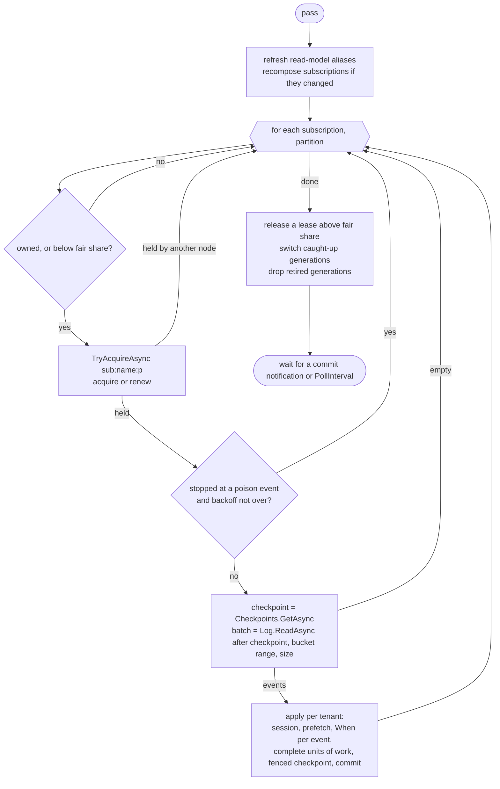
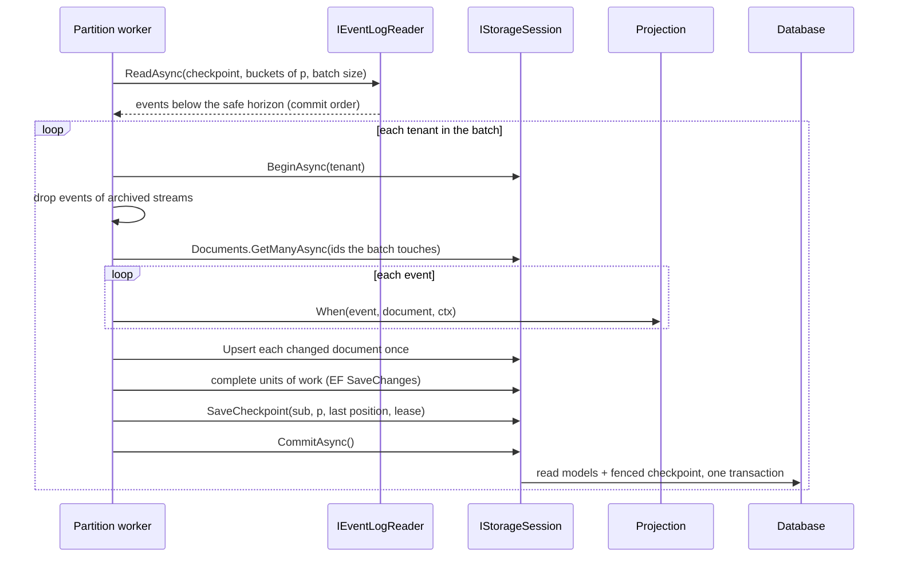
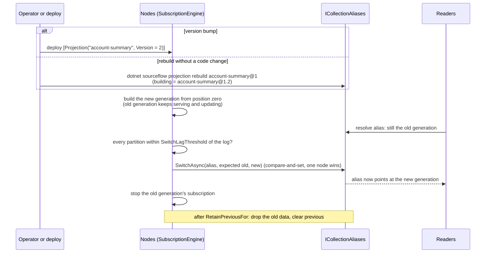

# 06 — Projections and Read Models

Projections turn the event log into read models: documents or relational rows shaped for queries. This document explains how SourceFlow.Net v3 runs them as built: inline in the command transaction or asynchronously on the subscription engine, document and EF Core projections, partitioned and fenced subscriptions, checkpoints, failure policies, blue/green rebuilds behind forward-only aliases, catch-up and lag, and how readers find the right generation.

The rationale is in [design doc 06](../../Design/06-Projections-and-Subscriptions.md), [ADR-016](../../ADRs/ADR-016-projections-inline-or-async-with-partitioned-fenced.md) and [ADR-032](../../ADRs/ADR-032-blue-green-read-model-generations-behind-forward-only-aliases.md). The storage underneath (sessions, the global log, leases, the document store) is in [Architecture/05](05-Event-Store-and-Persistence.md).

## Contents

- [Subscribers and their sources](#subscribers-and-their-sources)
- [Defining a projection](#defining-a-projection)
- [Inline or async](#inline-or-async)
- [The subscription engine](#the-subscription-engine)
- [Partitions, leases and fair-share](#partitions-leases-and-fair-share)
- [Checkpoints and consistency](#checkpoints-and-consistency)
- [Session projections: EF Core and custom](#session-projections-ef-core-and-custom)
- [Failures and poison events](#failures-and-poison-events)
- [Blue/green rebuilds](#bluegreen-rebuilds)
- [Catch-up, lag and read-your-writes](#catch-up-lag-and-read-your-writes)
- [Reading read models](#reading-read-models)
- [Extension points](#extension-points)
- [Guarantees](#guarantees)
- [Related documents](#related-documents)

## Subscribers and their sources

Everything that reacts to this service's own events reads the commit-ordered global log through the **subscription engine**. Events from other services arrive through the **receive pipeline** instead, deduplicated by the inbox ([Architecture/04](04-Messaging-Pipeline-and-Middleware.md)).

| Subscriber | Subscription name | Mode | Default failure policy |
|------------|-------------------|------|------------------------|
| Document projection (`IDocumentProjection<TDocument, TKey>`) | `projection:{name}@{version}[.{n}]` | Inline or async | `Stop` |
| Session projection, for example EF Core (`IEfProjection<TDbContext>`) | `projection:{name}@{version}[.{n}]` | Inline or async | `Stop` |
| Process manager reacting to local events | `pm:{name}` | Async | `Park` |
| `IEventHandler<T>` for local events | `handler:{name}` | Async | `Park` |

Process managers and event handlers have their own subscriptions and checkpoints; no projection rebuild ever touches them. Replays are therefore free of side effects by construction.

## Defining a projection

### Document projections

A document projection maintains one JSON document per key. The account summary of the Bank domain the tests use ([`tests/Fixtures/Bank/Bank.Accounts/AccountSummary.cs`](../../../../tests/Fixtures/Bank/Bank.Accounts/AccountSummary.cs)); the TravelBooking sample's `booking-summary` and `hotel-rooms` projections ([`Bookings.cs`](../../../../samples/TravelBooking/Bookings/Bookings.cs), [`Hotels.cs`](../../../../samples/TravelBooking/Hotels/Hotels.cs)) have the same shape:

```csharp
public sealed record AccountSummary(AccountId Id, string Holder, decimal Balance, [property: Queryable] AccountStatus Status, long Version);

[Projection("account-summary")]
public sealed partial class AccountSummaryProjection : IDocumentProjection<AccountSummary, AccountId>
{
    private static AccountSummary When(AccountOpened e, AccountSummary? current, EventContext ctx)
    {
        return new AccountSummary(e.AccountId, e.Holder, e.InitialDeposit, AccountStatus.Open, ctx.StreamVersion.Value);
    }

    private static AccountSummary? When(MoneyDeposited e, AccountSummary? current, EventContext ctx)
    {
        return current is null ? null : current with { Balance = e.BalanceAfter, Version = ctx.StreamVersion.Value };
    }

    private static AccountSummary? When(AccountClosed e, AccountSummary? current, EventContext ctx)
    {
        return current is null ? null : current with { Status = AccountStatus.Closed, Version = ctx.StreamVersion.Value };
    }
}
```

- `[Projection("account-summary", Version = 1)]` names the projection; `Version` defaults to 1, and bumping it starts a blue/green rebuild.
- Each `When(TEvent, TDocument?, EventContext)` returns the new document, or null to delete it. Projections are pure functions of events.
- The source generator emits the dispatch (`IDocumentProjectionRuntime<…>`) and the module registers the projection. The document type must be in the module's JSON context.
- **Keys.** For each event the generator finds the document key: a static `KeyOf(TEvent) → TKey` method if present; otherwise the event's single public property of type `TKey`; otherwise the aggregate key of the event's stream (the text after the last dash of the stream id).
- `EventContext` carries the event id, stream id and version, global position, timestamp, correlation and causation ids, and tenant.

Unit-test a document projection with `ProjectionSpec<TProjection, TDocument, TKey>` from [SourceFlow.Testing](../SourceFlow.Testing-README.md).

### Session projections

A session projection writes through a unit of work bound to the storage session's connection and transaction, for example an EF Core `DbContext`. See [Session projections](#session-projections-ef-core-and-custom) and [SourceFlow.Storage.EntityFrameworkCore](../SourceFlow.Storage.EntityFrameworkCore-README.md).

### Choosing the mode

Modules register projections; the host chooses how each runs:

```csharp
builder.Services.AddSourceFlow(sf =>
{
    sf.ServiceName = "bank";
    sf.AddModule<AccountsModule>();
    sf.Projections(p =>
    {
        p.Add<AccountSummaryProjection>().Inline();                                   // read-your-writes
        p.Add<AccountActivityProjection>().Async().OnFailure(SubscriptionFailurePolicy.Park);
        p.Remove<LegacyAccountReportProjection>();                                    // leave out a module's old version
    });
    sf.UsePostgreSql(connectionString);
});
```

A projection not mentioned in `Projections(…)` runs **async** with the `Stop` policy. Configuring a projection that no module registers fails at startup, as does registering two projections with the same name: a service runs one version of each projection.

## Inline or async

| | Inline | Async |
|-|--------|-------|
| Runs | In the command's transaction, after the append (ES-R1) | On the subscription engine, in a subscription batch |
| Consistency | Read-your-writes: the read model commits with the events | Eventual; measured as lag |
| `ctx.Position` | `GlobalPosition.Start` (unknown before commit) | The event's global position |
| On failure | The command fails; nothing is appended | Retried; `Stop` or `Park` policy |
| Write latency | Adds to every command | None |
| Rebuilds | Always writes its first generation; not blue/green | Blue/green generations |
| Scales by | — | Partitions (`SubscriptionPartitions`) |

Both modes run the same `When` code; the mode is a registration choice ([ADR-016](../../ADRs/ADR-016-projections-inline-or-async-with-partitioned-fenced.md)). Inline projections write through the command's session, so they always live in the event store's database. Keep them small and fast. To rebuild an inline projection, make it async for the rebuild.

## The subscription engine

`SubscriptionEngine` runs on nodes with the `Subscriptions` role. Each pass visits every subscription partition this node may own:



One batch of one partition, in detail:



- **Safe horizon.** The log returns only events below the safe horizon, in commit order, so a checkpoint never skips an event that commits late ([Architecture/05](05-Event-Store-and-Persistence.md#the-global-log-and-the-safe-horizon)).
- **Adaptive batches.** Each partition starts at 100 events, doubles while batches come back full (catching up, rebuilding), and drops back to 100 when caught up. `SubscriptionBatchSize` (1,000) is the maximum.
- **Per tenant.** A batch is applied in one session per tenant, each with its own checkpoint save.
- **Archived streams** are left out of every projection subscription, so a rebuild produces the same documents as the live projection (one lookup per batch and tenant, only for relevant events).
- **Batch-aware documents.** Document projections load every document the batch touches in one `GetManyAsync`, apply the events in memory, and write each changed document once (a multi-row upsert on PostgreSQL). Rebuild cost is O(batches), not O(events): 32,654 events/s on one PostgreSQL partition in the [baseline](../../implementation/perf-baseline.md).
- **Upcasting.** Events are deserialized and upcast to the latest version before `When` runs.
- **Wake-ups.** The engine waits for a commit notification (in-process, and `LISTEN`/`NOTIFY` on PostgreSQL) or `PollInterval`. On PostgreSQL, event-to-projection latency was p95 14.8 ms in the baseline.

## Partitions, leases and fair-share

Every event carries a bucket, `xxHash32(tenant + '/' + stream) & 1023`, computed at append. A subscription with `P` partitions (`SubscriptionPartitions`, a power of two from 1 to 1024, default 1) gives partition `p` the bucket range `Buckets.Range(p, P)`.

- **Per-stream order is preserved**: a stream always lands in one bucket and so one partition, and per-stream order equals log order.
- **Order across streams is not guaranteed between partitions.** A projection that needs a global order across streams (running totals, for example) uses `P = 1`.
- **One owner per partition.** Each `(subscription, partition)` is a lease named `sub:{subscription}:{partition}`. Every checkpoint save carries the lease's fencing token; a node that lost its lease (GC pause, network partition) cannot commit, and its whole batch rolls back with `LeaseLostException`.
- **Fair-share.** Nodes heartbeat into the store (`INodeRegistry`, every `NodeHeartbeatInterval`, 10 s; live for three intervals). Each node takes at most `ceil(total leases / live nodes)` subscription leases and, when above its share because a node joined, releases one lease per pass, so rebalancing is gradual. On graceful shutdown a node releases its leases and leaves the registry, so the others take over at once; otherwise failover takes about `LeaseTtl` (30 s).

### Changing the partition count

```bash
dotnet sourceflow projection repartition projection:account-summary@1 --from 1 --to 4
```

Every new partition's checkpoint is set to the **minimum** of the old checkpoints; then set `SubscriptionPartitions = 4` and restart. Events between the minimum and each old position are applied again, which is safe only for idempotent projections. Document projections keyed by their stream are guarded automatically (below); for other projections the command requires `--idempotent` to confirm a version guard. The alternative is a blue/green rebuild.

## Checkpoints and consistency

A checkpoint is the last committed `GlobalPosition` of one subscription partition (`ICheckpointStore.GetAsync`). It is saved with `IStorageSession.SaveCheckpoint(subscription, partition, position, lease)` in the same transaction as the batch's writes.

| Read model location | Guarantee | How |
|---------------------|-----------|-----|
| Same database as the events (documents, EF Core, custom SQL on the session) | Exactly-once effect | Read-model writes and the fenced checkpoint commit together |
| Another system (search index, another database), written from an `IEventHandler<T>` | At least once | Guard writes by version (`WHERE version < @incoming`) and key external calls with `EventContext.EventId` |

**The DC-2 guard.** Re-applying an event to a document that already reflects it would double-count incremental projections (`count += 1`). Document projections therefore guard **on read**: documents are stored with a version, and when the document id equals the event stream's aggregate key and the stored version is at least `ctx.StreamVersion`, the event is skipped. For such documents the stored version follows the stream version; documents keyed by something else (fed by many streams) store a write count instead and are not guarded, so give them their own idempotency if they can see re-applied events (repartitioning or in-place replays). The store adds a write-side guard as well: an upsert older than the stored version is ignored.

EF Core and custom projections get `ctx.StreamVersion` and `ctx.Position`, and `IdempotentUpsert.UpsertAsync` for version-guarded EF writes.

## Session projections: EF Core and custom

`ISessionProjection<TUnitOfWork>` is the core abstraction for read models written through something other than the document store. A storage package registers an `IProjectionUnitOfWork<TUnitOfWork>`:

```csharp
public interface IProjectionUnitOfWork<TUnitOfWork> where TUnitOfWork : class
{
    ValueTask<TUnitOfWork> BeginAsync(IStorageSession session, IServiceProvider services, CancellationToken cancellationToken);
    ValueTask CompleteAsync(TUnitOfWork unitOfWork, CancellationToken cancellationToken);
}
```

- Before creating the first unit of work in a session, the engine calls `IStorageSession.FlushAsync`, so the queued append is sent first (ES-R1) and a conflict surfaces before any read-model write.
- `BeginAsync` creates the unit of work on `session.Connection` and `session.Transaction`; one per session and unit-of-work type (per generation, for stores that keep generations apart).
- `CompleteAsync` flushes it (`SaveChangesAsync` for EF Core) before the session commits the checkpoint or the command.
- A session projection whose unit of work is not registered fails at startup with a message naming the missing registration.
- A unit-of-work factory that also implements `IProjectionGenerationStore` with `SeparatesGenerations = true` takes part in blue/green rebuilds: the engine sets the scoped `ProjectionTarget.Generation` before `BeginAsync`, and calls `DropGenerationAsync` for retired generations. `SourceFlow.Storage.EntityFrameworkCore` does this with a schema per generation.

## Failures and poison events

When a batch fails, the engine isolates the failing event: it applies the batch's events one by one, each with up to `ImmediateRetries` (3) immediate retries, stopping early for errors classified as permanent. What happens to an event that still fails depends on the subscription's policy:

| Policy | Behaviour | Default for |
|--------|-----------|-------------|
| `Stop` | The partition halts at the event; other partitions and subscriptions continue. It retries with backoff (1 s, doubling, capped at 5 minutes). `sourceflow.subscription.stalled` is 1 for that partition, and the `sourceflow.subscriptions` health check turns unhealthy after `Health.StalledUnhealthy` (5 min). Fix the code and redeploy, or skip the event. | Projections, where correctness matters more than freshness |
| `Park` | The event is copied to dead letters (consumer = the subscription name, source `subscription`), the checkpoint moves past it, and work continues. | Process managers and event handlers |

Skipping a stopped event is an audited operator action:

```bash
dotnet sourceflow projection skip projection:account-summary@1 --partition 0 --reason "TICKET-123: malformed legacy event"
```

Inside the service it goes through `ISubscriptionAdmin.SkipAsync`, which also clears the stall; the skipped event is recorded in dead letters as discarded. `ISubscriptionAdmin.Stalls` lists the stopped partitions. Nothing is ever silently swallowed: every failure is retried, stops the partition, or is parked, and each case is visible in metrics.

A lost lease (`LeaseLostException`) is not a failure of the event: the worker drops the batch and stops working that partition; the new owner continues from the last committed checkpoint.

## Blue/green rebuilds

A read model is rebuilt by building a new **generation** beside the one that serves reads, then switching reads to it once it has caught up ([ADR-032](../../ADRs/ADR-032-blue-green-read-model-generations-behind-forward-only-aliases.md)). Readers never see an empty or half-built read model.

### Generations and aliases

- The first build of version *v* is `{name}@{v}` (collection `account-summary@2`); a rebuild of the same version is `{name}@{v}.{n}` with *n* from 2 (`account-summary@1.2`). `ReadModelGeneration` parses and orders them: by version, then number.
- Each generation has its own subscription, `projection:{generation}`, with its own checkpoints and leases.
- One alias row per projection name (`ICollectionAliases`, the `collection_aliases` table) holds `target` (serving reads), `previous` (retired by the last switch) and `building` (a requested rebuild). Every change is a compare-and-set, so concurrent nodes switch an alias exactly once.

### The lifecycle



What each node runs, per async projection: at most two generations, the one serving reads (if it is this code's version) and one being built. The build target is the requested rebuild, or this code's first generation when the alias points at an older version or no alias exists yet. A node whose code is **older** than the alias target runs nothing for that projection, so during a rolling deploy old nodes keep the old generation current until the switch and then retire it within one poll interval.

| Setting | Default | Meaning |
|---------|---------|---------|
| `SourceFlowOptions.SwitchLagThreshold` | 100 | The new generation takes over when every partition is at most this many events behind the log. 0 waits until it is fully caught up. |
| `SourceFlowOptions.RetainPreviousFor` | 7 days | How long the retired generation's data is kept (checked every `RetentionInterval`). |

During the overlap an old-version node reads the new generation's documents with its old document type. Additive document changes are safe; for incompatible ones, finish the rollout first and set `SwitchLagThreshold` to 0.

### Operator commands

| Command | Effect |
|---------|--------|
| `projection rebuild <name@version>` | Request a new generation of the serving version; the service builds it and switches. |
| `projection rebuild <name@version> --in-place` | Drop the generation's documents and reset its checkpoints, so it replays into the same collection (readers see it refill). Stop other nodes' subscriptions first. |
| `projection generations [--format text\|json]` | List each alias: serving, building and retired generations. |
| `projection switch <name> <generation> --reason …` | Point reads at a retained generation (a rollback). Nodes on a newer version then build again. |
| `projection drop <generation>` | Delete a retired generation's documents now. Refuses the serving and the building generation. |

See [SourceFlow.Tool](../SourceFlow.Tool-README.md).

### Which projections take part

| Projection | Blue/green |
|------------|------------|
| Async document projection | Yes, when the store implements `ICollectionAliases` (in-memory, PostgreSQL, SQL Server) |
| Async EF Core projection with a schema per generation (`IGenerationSchemaContext`) | Yes; retired schemas are dropped |
| Async EF Core projection with a shared schema, custom session projections without `IProjectionGenerationStore` | No; they keep one generation |
| Inline projections | No; they always write their first generation |

## Catch-up, lag and read-your-writes

| Signal | Meaning |
|--------|---------|
| `sourceflow.subscription.lag` (events; subscription, partition) | Events between the checkpoint and the head, counted up to a cap |
| `sourceflow.subscription.lag_time` (seconds) | Age of the oldest unprocessed event: the primary freshness signal |
| `sourceflow.subscription.horizon_age` (seconds) | Age of the oldest in-progress writing transaction holding the safe horizon back |
| `sourceflow.subscription.batch.duration` | Apply-and-commit time per batch |
| `sourceflow.subscription.stalled` (0/1) | The partition is halted by the `Stop` policy |
| `sourceflow.lease.owned` | Leases held by this node |
| Span `project {subscription}` | One per batch, with the subscription, partition and batch size |

The gauges are sampled every `MonitorInterval` (15 s). The `sourceflow.subscriptions` health check is degraded when `lag_time` exceeds `Health.LagTimeDegraded` (30 s) or the horizon is held longer than `Health.HorizonAgeDegraded` (30 s). See [Observability and Performance](../Observability-and-Performance.md).

**Read-your-writes with async projections.** An accepted command returns a `ConsistencyToken` (the position of its last event; HTTP responses carry it as `SourceFlow-Consistency`). A query with `consistency = at_least(@token)` waits until the read model has caught up to that position before it runs. Inline projections need no token. See [Architecture/08](08-Query-Side-and-SFQL.md).

**In tests.** `SourceFlowTestHost.WaitForIdleAsync()` waits until subscriptions and the outbox are idle; `SourceFlowHost.SubscriptionsCaughtUpAsync` reports whether every partition reached the horizon.

## Reading read models

Readers should go through the alias, so they follow blue/green switches:

- **Typed queries:** `IQueryService.ReadModel<TDocument>()` with `Where`, `OrderBy` and `ToListAsync`:

    ```csharp
    IReadOnlyList<AccountSummary> rows = await queries.ReadModel<AccountSummary>()
        .Where(s => s.Balance < 100m && s.Status == AccountStatus.Open)
        .OrderBy(s => s.Holder)
        .ToListAsync(cancellationToken: ct);
    ```

- **SFQL and domain queries:** `from readmodel "account-summary" | where …`, compiled to SQL on PostgreSQL and SQL Server ([Architecture/08](08-Query-Side-and-SFQL.md)). `[Queryable]` fields can be indexed.
- **Direct document reads:** resolve the serving generation, then read by id:

    ```csharp
    ReadModelGeneration generation = await resolver.ResolveAsync("account-summary", ct);   // IReadModelResolver
    StoredDocument? document = await documents.GetAsync(tenantId, generation.Collection, accountId.ToStreamSegment(), ct);   // IDocumentReader
    ```

    `IDocumentReader` is `StoragePorts.Documents` (resolve `StoragePorts` from the container). The stored id is the projection's formatted key: `ToStreamSegment()` for a strongly typed id. `StoredDocument.Data` is the document's JSON; `Version` its version.
- **EF Core read models:** resolve the generation with `IReadModelResolver` and open a context for its schema with `EfSessionContextFactory<T>.CreateForGeneration` ([SourceFlow.Storage.EntityFrameworkCore](../SourceFlow.Storage.EntityFrameworkCore-README.md#reading-the-read-model)).

## Extension points

| Extension | How |
|-----------|-----|
| A new kind of read-model store in the event database | Implement `IProjectionUnitOfWork<TUnitOfWork>` (and `IProjectionGenerationStore` for blue/green) and write projections as `ISessionProjection<TUnitOfWork>`. |
| Read models outside the event database | `IEventHandler<T>` with version-guarded, idempotent writes (`Park` policy by default). |
| Failure policy per projection | `Projections(p => p.Add<T>().OnFailure(SubscriptionFailurePolicy.Park))`. |
| Throughput | `SubscriptionPartitions`, `SubscriptionBatchSize`, more nodes (fair-share). |
| Freshness versus polling cost | `PollInterval` (notifications make it a fallback on PostgreSQL). |
| Rebuild cut-over | `SwitchLagThreshold`, `RetainPreviousFor`. |

## Guarantees

| Guarantee | Holds when |
|-----------|-----------|
| No event is skipped by a subscription | Always: reads stay below the safe horizon and checkpoints are positions in a total commit order |
| Per-stream order | Always: a stream maps to one partition and per-stream order equals log order |
| Read-model writes exactly once in effect | The read model is in the event store's database (documents, EF Core, session SQL) |
| One writer per partition | Always: fenced leases; a stale owner's commit fails |
| Inline read model consistent with the events | Always: same transaction |
| Rebuilds re-run no side effects | Always: process managers and handlers are never part of a rebuild |
| Readers never see a half-built generation | Up to the `SwitchLagThreshold` window, for blue/green participants |
| Order across streams | Only with one partition |

## Related documents

- [Architecture/05 Event Store and Persistence](05-Event-Store-and-Persistence.md), [Architecture/08 Query Side and SFQL](08-Query-Side-and-SFQL.md), [Architecture/09 Process Managers and Workflows](09-Process-Managers-and-Workflows.md)
- [SourceFlow.Storage.EntityFrameworkCore](../SourceFlow.Storage.EntityFrameworkCore-README.md), [SourceFlow.Storage.PostgreSQL](../SourceFlow.Storage.PostgreSQL-README.md), [Message Idempotency Guide](../Message-Idempotency-Guide.md)
- Design: [doc 06](../../Design/06-Projections-and-Subscriptions.md), [doc 05 §10](../../Design/05-Event-Store-and-Persistence.md#10-read-model-stores), [doc 08](../../Design/08-Observability.md)
- ADRs: [ADR-010](../../ADRs/ADR-010-commit-ordered-global-position-for-gap-free.md), [ADR-016](../../ADRs/ADR-016-projections-inline-or-async-with-partitioned-fenced.md), [ADR-020](../../ADRs/ADR-020-process-managers-with-durable-state-and-timers.md), [ADR-032](../../ADRs/ADR-032-blue-green-read-model-generations-behind-forward-only-aliases.md)
