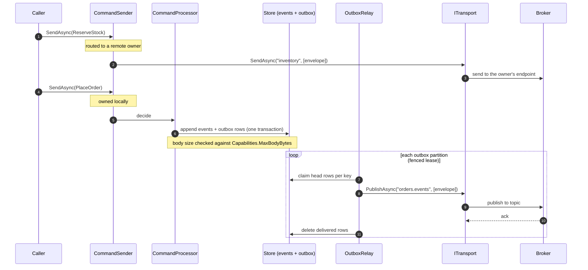
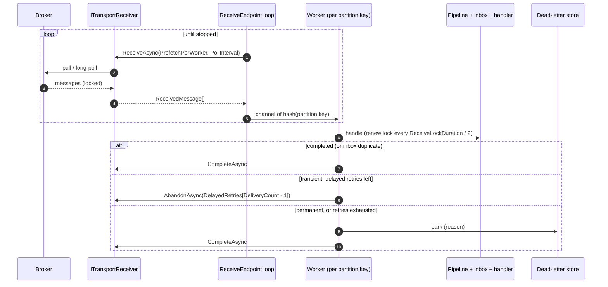
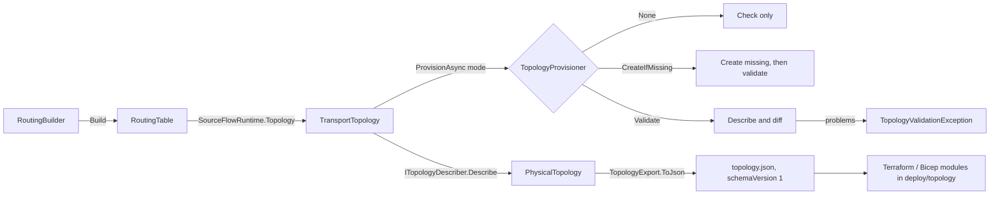
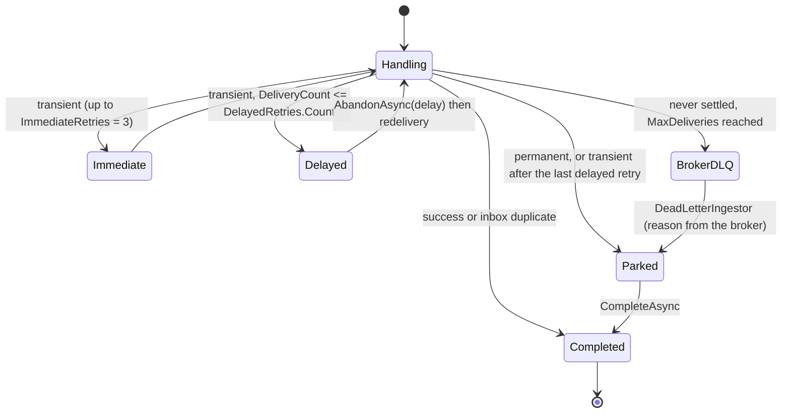

# 07 Cloud Transports

A transport connects SourceFlow services through a message broker. In v3 a transport is deliberately thin: it moves bytes and headers, settles messages, and creates or checks broker resources. Everything else (retries, the inbox, parking, payload protection, telemetry, per-key ordering inside an instance, backpressure) is core behaviour, written once and identical on every broker. That is what lets AWS SNS/SQS, Azure Service Bus, Google Pub/Sub and the in-memory broker pass the same 45 conformance cases.

This document describes the transport SPI as built, how each cloud maps the SourceFlow model, and how the core drives a transport. Rationale is in [design doc 07](../../Design/07-Cloud-Transports.md), [ADR-014](../../ADRs/ADR-014-transport-spi-and-conformance-kit-parity-required.md), [ADR-017](../../ADRs/ADR-017-provisioning-modes-and-topology-as-data.md) and [ADR-033](../../ADRs/ADR-033-final-transport-spi-pull-receivers-and-the-in-memory-reference-broker.md).

## Contents

- [The model: endpoints, topics, subscriptions](#the-model-endpoints-topics-subscriptions)
- [The transport SPI](#the-transport-spi)
- [How the core uses a transport](#how-the-core-uses-a-transport)
- [Provider mappings](#provider-mappings)
- [Topology as data and provisioning](#topology-as-data-and-provisioning)
- [Ordering and partitioning](#ordering-and-partitioning)
- [Acknowledgement, locks and renewal](#acknowledgement-locks-and-renewal)
- [Retries, backoff and parking](#retries-backoff-and-parking)
- [Message size and the wire format](#message-size-and-the-wire-format)
- [Subscription filters](#subscription-filters)
- [Errors](#errors)
- [The in-memory reference broker](#the-in-memory-reference-broker)
- [Guarantees and failure behaviour](#guarantees-and-failure-behaviour)
- [Writing a new transport adapter](#writing-a-new-transport-adapter)
- [Links](#links)

## The model: endpoints, topics, subscriptions

Routing (see [04 Messaging Pipeline and Middleware](04-Messaging-Pipeline-and-Middleware.md)) uses logical names only. A transport maps them to physical resources.

| Logical element | Meaning | Owned by |
|-----------------|---------|----------|
| Endpoint | A service's single input. It receives commands sent to the service **and** the events of every topic it subscribes to. | The service (default name: the service name; `RoutingBuilder.Endpoint(name)` overrides it) |
| Topic | A publication channel for integration events | The publishing service |
| Subscription | Fan-out from a topic to one subscribing service's endpoint. One per service; instances of the service compete. | The subscribing service |
| Dead-letter backstop | The broker's own dead-letter queue for the endpoint | The service |

```csharp
sf.Routing(r =>
{
    r.Command<ReserveStock>().To("inventory").ReplyOnReject();   // remote endpoint
    r.Publish<OrderPlaced>().AsIs().To("orders.events");         // topic, via the outbox
    r.Subscribe("payments.events", s => s.Only<PaymentCaptured>());
    r.OrderedEndpoint();                                         // optional broker ordering
});
```

One endpoint and one receiver per service instance fixes the v2 defect where events and commands shared a queue and two listeners competed (GAP-02); one subscription per subscribing service fixes the v2 Google Cloud fan-out (GAP-13).

## The transport SPI

The SPI lives in the core package, namespace `SourceFlow.Transport` ([`Transport.cs`](../../../../src/Core/SourceFlow.Net/Transport/Transport.cs), [`Topology.cs`](../../../../src/Core/SourceFlow.Net/Transport/Topology.cs)). It is pull-based: the receive loop, per-key workers, bounded channels and settlement policy stay in the core, so backpressure, ordering and shutdown are identical on every broker.

```mermaid
classDiagram
    class ITransport {
        <<interface>>
        +string SystemName
        +TransportCapabilities Capabilities
        +SendAsync(endpoint, messages, ct)
        +PublishAsync(topic, messages, ct)
        +CreateReceiverAsync(ReceiverOptions, ct) ITransportReceiver
        +CreateDeadLetterReceiverAsync(endpoint, ct) ITransportReceiver
        +ProvisionAsync(TransportTopology, ProvisioningMode, ct)
    }
    class ITransportReceiver {
        <<interface>>
        +ReceiveAsync(maxMessages, wait, ct) IReadOnlyList~ReceivedMessage~
        +DisposeAsync()
    }
    class ReceivedMessage {
        <<abstract>>
        +MessageEnvelope Envelope
        +int DeliveryCount
        +string? DeadLetterReason
        +CompleteAsync(ct)
        +AbandonAsync(delay, ct)
        +RenewAsync(ct)
        +DeadLetterAsync(reason, ct)
    }
    class ITopologyDescriber {
        <<interface>>
        +Describe(TransportTopology) PhysicalTopology
    }
    class ITransportProbe {
        <<interface>>
        +ProbeAsync(endpoint, ct)
    }
    class TopologyProvisioner {
        <<abstract>>
        +ProvisionAsync(topology, mode, ct)
        #CreateAsync(topology, ct)
        #ValidateAsync(topology, ct) IReadOnlyList~TopologyProblem~
        +Check(topology)$
    }
    ITransport --> ITransportReceiver : creates
    ITransportReceiver --> ReceivedMessage : yields
    ITransport ..> TopologyProvisioner : delegates provisioning
    AwsTransport ..|> ITransport
    AzureTransport ..|> ITransport
    GcpTransport ..|> ITransport
    InMemoryTransport ..|> ITransport
    AwsTransport ..|> ITopologyDescriber
    AwsTransport ..|> ITransportProbe
```



| Type | Role |
|------|------|
| `ITransport` | Send commands to an endpoint, publish events to a topic (both in order, in batches of at most `MaxBatchSize`), create receivers, provision. |
| `ITransportReceiver` | `ReceiveAsync(maxMessages, wait)` returns up to `maxMessages`, waiting at most `wait` for the first. Disposing stops receiving and releases unsettled messages for redelivery. |
| `ReceivedMessage` | A delivered message, settled exactly once after the handler commits. `DeadLetterReason` is set on messages read from a dead-letter queue. |
| `ReceiverOptions` | `Endpoint`, `SubscribedTopics`, `Filters` (CESQL per topic) and `LockDuration` (default 30 s). |
| `TransportCapabilities` | `MaxBodyBytes`, `MaxAttributes`, `MaxRetention`, `NativeDelay`, `MaxDelay`, `OrderedDelivery`, `NativeDeadLetter`, `SubscriptionFilters`, `MaxBatchSize`, `Deduplication`, `DeduplicationWindow`, `MaxLockDuration`. The core uses them for size checks, client-side filtering and whether to run the dead-letter ingestor. |
| `TransportTopology` | `Endpoint`, `PublishedTopics`, `SubscribedTopics`, `SendEndpoints`, `OrderedEndpoint`, `OrderedTopics`, `MaxDeliveries` (default 10 on the record; the runtime sets the retry budget plus two), `Filters`. |
| `ProvisioningMode` | `None`, `Validate`, `CreateIfMissing`. |
| `TopologyProvisioner` | Shared mode behaviour: `Check` the topology, then create what is missing and/or report every difference. |
| `ITopologyDescriber` | Names the physical resources a topology needs from the options alone (no broker call), as `PhysicalTopology` / `PhysicalResource`. |
| `ITransportProbe` | A cheap describe call for the `sourceflow.transport` health check. |
| Errors | `TransportException` (`IsTransient`, `RetryAfter`), `TransportUnavailableException`, `TransportThrottledException`, `DestinationNotFoundException`, `TransportSendException` (`Failures`, `Sent`), `TopologyValidationException` (`Problems`). |

The implementations:

| Transport | Package | `SystemName` | Registration |
|-----------|---------|--------------|--------------|
| `AwsTransport` | [SourceFlow.Cloud.Aws](../SourceFlow.Cloud.Aws-README.md) | `aws_sqs` | `sf.UseAwsTransport(o => …)` |
| `AzureTransport` | [SourceFlow.Cloud.Azure](../SourceFlow.Cloud.Azure-README.md) | `servicebus` | `sf.UseAzureTransport(o => …)` |
| `GcpTransport` | [SourceFlow.Cloud.Gcp](../SourceFlow.Cloud.Gcp-README.md) | `gcp_pubsub` | `sf.UseGcpTransport(o => …)` |
| `InMemoryTransport` | SourceFlow.Net (core) | `sourceflow.inmemory` | `sf.UseInMemoryTransport(broker?)` |

Any of them can also be registered with `sf.UseTransport(sp => …)`. A service has exactly one transport.

## How the core uses a transport

| Core component | SPI calls | When |
|----------------|-----------|------|
| `SourceFlowHost` | `ProvisionAsync(runtime.Topology(), mode)` | Once at startup, before anything else starts |
| `OutboxRelay` | `PublishAsync` / `SendAsync`, one row per call, in key order | Integration events, and commands written in a transaction (process managers, workflows, replies) |
| `ReceiveEndpoint` | `CreateReceiverAsync`, `ReceiveAsync`, then `RenewAsync`, `CompleteAsync`, `AbandonAsync` | On instances with the `Receiver` role |
| `DeadLetterIngestor` | `CreateDeadLetterReceiverAsync`, `ReceiveAsync(10, 0)`, `CompleteAsync` | On receiver instances, when `NativeDeadLetter` and `IngestBrokerDeadLetters` are true |
| `DeadLetterManager` | `PublishAsync` / `SendAsync` | `dotnet sourceflow dlq replay` |
| `SourceFlowMonitor` | `ITransportProbe.ProbeAsync(endpoint)` | The transport health check, cached for `HealthThresholds.TransportCacheDuration` (30 s) |
| CLI `topology export` / `validate` | `ITopologyDescriber.Describe`, `ProvisionAsync(…, Validate)` | Operator commands run inside the service |

### Sending: commands and events



The outbox decouples the command's commit from the broker: a broker outage never fails a command whose events are already committed (chaos test CH-07). See [05 Event Store and Persistence](05-Event-Store-and-Persistence.md) for the outbox itself.

### Receiving



## Provider mappings

| Concern | AWS (SNS + SQS) | Azure Service Bus | Google Pub/Sub | In memory |
|---------|-----------------|-------------------|----------------|-----------|
| Endpoint | SQS queue `{p}{endpoint}` (`.fifo` when ordered) | Queue `{p}{endpoint}` (sessions when ordered) | Topic `{p}{endpoint}+in` + subscription `{p}{endpoint}`, plus the topic subscriptions; one receiver pulls them all | Queue with competing consumers |
| Topic | SNS topic `{p}{topic}` (`.fifo` when ordered) | Topic `{p}{topic}` | Topic `{p}{topic}` | In-process fan-out |
| Subscription | SNS→SQS, `RawMessageDelivery=true`, queue policy for the topic | Subscription `{p}{endpoint}`, `ForwardTo` the queue | Subscription `{p}{endpoint}~{topic}` | Subscriber list |
| Remote command | `SendMessageBatch` to the owner's queue | Send to the owner's queue | Publish to the owner's `+in` topic | Enqueue |
| Ordering | `MessageGroupId` = partition key; FIFO topic ↔ FIFO queue enforced | `SessionId` = partition key; session receiver | `OrderingKey` = partition key; message ordering on the subscriptions | One in-flight message per key |
| Native filter | SNS filter policy on `ce_type` | Correlation rules / SQL `LIKE` rules on `cloudEvents:type` | Filter on `attributes.ce-type` (≤ 256 bytes) | CESQL |
| Lock | Visibility timeout | Peek-lock (queue `LockDuration`, renewed beyond it) | Ack deadline | Lock with expiry |
| Native delay (`MaxDelay`) | `ChangeMessageVisibility` (12 h) | Scheduled copy, or held session (1 h) | `ModifyAckDeadline` (10 min) | Timer (12 h) |
| Native dead letter | Redrive policy to `{p}{endpoint}-dlq`, `maxReceiveCount` | Built-in `$DeadLetterQueue`, `MaxDeliveryCount` | Dead-letter policy to `{p}{endpoint}+dlq` (5..100), receiver enforces the exact limit | Dead-letter list |
| Attributes | `ce_*` String attributes, budget 10, overflow `ce_sfext` | `cloudEvents:*` application properties, budget 64 | `ce-*` attributes, budget 100, values over 1,024 bytes chunked | 10 (overflow `sfext`) |
| `MaxBodyBytes` | 180 KiB (text or base64) | 192 KiB | 9 MiB | 1 MiB |
| `MaxBatchSize` | 10 | 100 | 100 | 10 |
| Broker deduplication | Not declared (FIFO drops a re-sent id for 5 min) | Opt-in `DuplicateDetectionWindow` | Not declared | Faults can duplicate |
| `MaxLockDuration` | 12 h | 12 h | 10 min | 12 h |
| Emulator | LocalStack 3.8 | Service Bus emulator 2.0.1 | Pub/Sub emulator | — |

`{p}` is the transport's `NamePrefix`. Names are deterministic and not pluggable: every service and every infrastructure-as-code module computes the same name (`AwsNaming`, `AzureNaming`, `GcpNaming`). Per-cloud detail is in each package README.

## Topology as data and provisioning



- `SourceFlowRuntime.Topology()` derives the topology from routing: the endpoint (ordered or not), published topics (`OrderedTopics`), subscribed topics with their CESQL filters, remote endpoints, and `MaxDeliveries = 1 + DelayedRetries.Count + 2` (7 by default).
- `TopologyProvisioner.Check` runs in every mode, `None` included: names are present and logical (not URLs or ARNs), the delivery limit is at least 1, ordered topics are published, filters belong to subscribed topics and parse. A bad topology fails startup before any broker call.
- `CreateIfMissing` creates only what is missing and never changes an existing resource; differences are reported, so drift from infrastructure as code is visible rather than silently overwritten. A resource created concurrently by another instance is accepted.
- `Validate` reports **every** difference at once, typed by `TopologyProblemKind`: `MissingEndpoint`, `MissingTopic`, `MissingSubscription`, `OrderingMismatch`, `MissingDeadLetter`, `FilterDrift`, `Misconfigured`.
- With `SourceFlowBuilder.Provisioning` unset, the mode is `CreateIfMissing` in Development, with the in-memory transport, or without a host environment, and `Validate` elsewhere (`ServiceCollectionExtensions.DefaultProvisioning`). Production therefore needs describe permissions only.
- `dotnet sourceflow topology export [--format json|text] [--output file]` writes `TopologyExport.ToJson(runtime.TopologyDocument())`: the logical topology, the CloudEvents types per topic and endpoint, and each physical resource with `kind`, `name`, `logical`, `role` (`endpoint`, `dead-letter`, `topic`, `subscription`, `rule`, `remote-endpoint`), `owned` and provider `properties`. Subscribed topics belong to their publisher and remote endpoints to their service, so they are `owned: false`. The JSON Schema is [`deploy/topology/topology.schema.json`](../../../../deploy/topology/README.md).
- `dotnet sourceflow topology validate` runs `Validate` on demand.

## Ordering and partitioning

Ordering has two layers.

1. **Inside an instance (always).** `ReceiveEndpoint` dispatches each received message to one of `ReceiveConcurrency` workers by a hash of its partition key (or its message id), through bounded channels of `PrefetchPerWorker`. A key is therefore handled by one worker, in arrival order. The outbox relay likewise publishes per key in sequence order and never lets a later row of a key overtake a failed head.
2. **Across instances (opt-in).** `RoutingBuilder.OrderedEndpoint()` and `OrderedTopic(topic)` ask the broker to keep per-key order across competing consumers: FIFO message groups on AWS, sessions on Azure, ordering keys plus ordered subscriptions on Pub/Sub. `OrderedTopic` on a topic the service does not publish fails at startup, because a topic's ordering belongs to its publisher.

The partition key is the envelope's `EffectivePartitionKey`: the stream id for events by default, or the `OrderedBy(key)` of a publication. On every broker a message without a key is its own group or session, so it never blocks others. Ordered delivery serialises a key across the whole service, so throughput per key is bounded by one handler at a time; spread load over many keys. Ordering is fixed when a resource is created (FIFO-ness, sessions, message ordering), so a change means new resources, and `Validate` reports the mismatch until then.

## Acknowledgement, locks and renewal

| Operation | Core behaviour | AWS | Azure | Google Cloud |
|-----------|----------------|-----|-------|--------------|
| Lock on receipt | `ReceiveLockDuration` (30 s) | `VisibilityTimeout` | Queue `LockDuration`, renewed by the receiver up to its own lock | Ack deadline set to the lock |
| Renew | Every `ReceiveLockDuration / 2` while the handler runs | `ChangeMessageVisibility` | `RenewMessageLockAsync` | `ModifyAckDeadline` |
| Complete | After the handler commits (RX-R3) | `DeleteMessage` | `CompleteMessageAsync` | `Acknowledge` |
| Abandon with delay | Delayed retry | `ChangeMessageVisibility(delay)` | Scheduled copy + complete; on sessions, hold then abandon | `ModifyAckDeadline(delay)` |
| Dead letter | Backstop path only | Copy with `sf_reason` to `-dlq`, delete | `DeadLetterMessageAsync(reason)` | Publish copy with `sf-reason` to `+dlq`, ack |
| Release on dispose | Graceful stop (RX-R6) | Visibility 0 | Abandon | Ack deadline 0 (1 s when ordered) |

Rules every transport follows (ADR-033):

- A settlement after a lost lock is ignored: the message was, or will be, redelivered, and the inbox absorbs the duplicate.
- `RenewAsync` on a lost lock throws a non-transient `TransportException`; the core logs it and lets the redelivery happen.
- A receiver never auto-extends a lease on its own beyond what the core asked for, so a process that dies holding a message releases it when the lock expires (TCK-22). This is why the Google Cloud receiver uses synchronous pull rather than streaming pull with automatic lease extension.
- On shutdown the host stops receiving, waits for in-flight handlers, then disposes the receiver, which releases what is still unsettled. Nothing is acknowledged that was not completed (TCK-44).

## Retries, backoff and parking



| Stage | Policy |
|-------|--------|
| SDK | Each transport's client retries first (`MaxSdkRetries`, `MaxRetries`, `MaxRpcRetries`; default 3). |
| Receive, immediate | `ImmediateRetries` (3) in-process retries of a transient failure. |
| Receive, delayed | `DelayedRetries` (10 s, 1 min, 10 min, 1 h) through `AbandonAsync(delay)`, indexed by `DeliveryCount`. A delay longer than the broker's `MaxDelay` is capped at it (1 hour on Service Bus, 10 minutes on Pub/Sub). |
| Receive, parked | Permanent failures (`UnknownMessageType`, `DeserializationFailed`, `NoRoute`, `DecryptionFailed`, `ProtectionRequired`, other permanent errors) and exhausted transient ones (`Exhausted`) are written to the dead-letter store, then the message is completed. |
| Broker backstop | `MaxDeliveries = 1 + DelayedRetries.Count + 2` deliveries before the broker dead-letters a message nobody settled (crash loops, poison messages that kill the process). The `DeadLetterIngestor` drains the broker queue every `DeadLetterIngestInterval` (30 s) when empty, without waiting while messages arrive, and backs off from 1 s up to the interval after a broker error. It completes a broker message only after parking it, so a crash parks it twice at worst, never loses it. |
| Outbox | A failed row backs off `2^attempt` seconds (at most 300 s) without letting later rows of its key overtake; it is parked after `OutboxMaxAttempts` (10) or at once on a permanent error such as `DestinationNotFoundException`. |
| Replay | `dotnet sourceflow dlq replay` re-sends a parked message to its endpoint or topic with the same message id, so the inbox still protects. |

Error classification is core: `TransportException.IsTransient` decides transient versus permanent ([04 Messaging Pipeline and Middleware](04-Messaging-Pipeline-and-Middleware.md)).

## Message size and the wire format

Every transport uses CloudEvents binary mode: attributes travel as native message attributes and the body travels byte for byte (AWS uses base64 when SQS cannot carry the bytes as text, marked by `sf_body`). `CloudEvents.ToAttributes(envelope, maxAttributes)` fills the broker's attribute budget and puts the remaining extensions in one `sfext` overflow attribute; `CloudEvents.FromAttributes` reverses it. The in-memory broker uses the strictest budget (10), so the overflow path runs in every test.

Size is enforced in three places:

1. When the core builds an outbox row (`SourceFlowRuntime.ToOutbox`), the body is checked against `Capabilities.MaxBodyBytes`, so an oversized event fails the command that produced it.
2. With payload protection on, the encrypted body is checked again at commit, because ciphertext and the wrapped key add bytes.
3. The transport refuses an oversized message before sending anything for it (`MessageTooLargeException` inside a `TransportSendException`), sends the rest of the batch, and reports failures per message.

There is no claim-check mechanism. Large payloads belong in your own storage, referenced from the message.

## Subscription filters

Filters are CloudEvents SQL (CESQL 1.0), parsed and evaluated by `CloudEventFilter`. Routing compiles `Only<T>()` to `type IN (…)` and ANDs it with `Where(…)`.

- `CloudEventFilter.ExactTypes` (`type = '…'`, `type IN (…)`, or an OR of those) and `TypePrefixes` (`type LIKE 'prefix%'`) are translated to the broker's native filter.
- Anything else is evaluated by the receiver for that topic with the same evaluator; non-matching events are acknowledged unseen. AWS and Azure find the topic from the `sf_topic` / `sf-topic` attribute; Pub/Sub knows it from the subscription.
- A transport without native filters declares `SubscriptionFilters = false`, and the core's `ReceiveEndpoint` filters instead.

Results are identical whichever side filters (TCK-26..28). A filter error never matches.

## Errors

| Exception | Transient | Raised when |
|-----------|-----------|-------------|
| `TransportUnavailableException` | yes | Network failures, 5xx, timeouts, credential refresh failures |
| `TransportThrottledException` | yes, with `RetryAfter` | Throttling (AWS: 1 s; Service Bus busy: 10 s; Pub/Sub: the server's `RetryInfo` or 1 s) |
| `TransportException` | as constructed | Other broker rejections (usually not transient) |
| `DestinationNotFoundException` | no | The endpoint or topic does not exist ("provision it or check the routing") |
| `TransportSendException` | only if every failure is transient | Part of a batch was not sent; `Failures` lists each message, `Sent` counts the rest |
| `TopologyValidationException` | — | `Validate` found differences; `Problems` lists them all |

## The in-memory reference broker

`InMemoryBroker` (namespace `SourceFlow.Transport.InMemory`) is both the development transport and the reference implementation the cloud transports are measured against ([ADR-033](../../ADRs/ADR-033-final-transport-spi-pull-receivers-and-the-in-memory-reference-broker.md)):

- Messages cross it in CloudEvents binary mode with a 10-attribute budget.
- Endpoints are queues with competing consumers, locks with expiry and renewal, a maximum delivery count and a dead-letter queue. Ordered endpoints deliver one message per key at a time.
- Topics fan out one copy to every subscribed endpoint whose CESQL filter matches.
- Delays and locks follow the broker's `TimeProvider`, so tests can move time.
- `Faults` (`InMemoryBrokerFaults`) injects outages, throttling, credential expiry, duplicates and dropped acknowledgements.
- `StrictDestinations` gives real-broker semantics for unknown destinations; it is off by default so tests can send to services that start later.
- Pass one broker to several services (`sf.UseInMemoryTransport(broker)`) to connect them in one process.

## Guarantees and failure behaviour

| Guarantee | How |
|-----------|-----|
| At-least-once delivery from every broker | Settle only after commit; release on dispose; redeliver after a lost lock |
| Effectively-once effects | The outbox (atomic with the events) and the per-consumer inbox; see the [Message Idempotency Guide](../Message-Idempotency-Guide.md) |
| No silent loss | Parking in the store; the broker DLQ backstop drained into the same store |
| Per-key order inside an instance | Partition-key workers and per-key outbox relay |
| Per-key order across instances | Opt-in broker ordering, validated at startup |
| Each service receives each event once | One subscription per subscribing service, instances compete |
| Drift is visible | `Validate` diff at startup and in `topology validate` |
| Options are honoured | Options validated at registration; every option maps to an SDK setting (GAP-03) |

Failure modes worth knowing:

- **Broker outage.** Commands keep succeeding (events go to the outbox); the outbox backlog grows and its health check degrades; the relay drains after recovery. Receivers log and retry every `PollInterval`; the same receiver recovers without a restart (TCK-32).
- **Process crash mid-handler.** The lock expires and the message is redelivered; if the handler had committed, the inbox absorbs it.
- **Crash after publish, before the outbox delete.** The row is published again; consumers' inboxes absorb it (CH-03).
- **Poison message that crashes the process.** It reaches `MaxDeliveries` and the broker dead-letters it; the ingestor parks it.

## Writing a new transport adapter

A new broker needs one class implementing `ITransport`, a receiver, a provisioner, and the conformance kit.

1. **Capabilities.** Declare honest limits in `TransportCapabilities`. Leave `OrderedDelivery`, `NativeDeadLetter` or `SubscriptionFilters` false if the broker cannot do them; the core falls back (client-side filtering, no ingestor).
2. **Wire mapping.** Encode with `CloudEvents.ToAttributes(envelope, Capabilities.MaxAttributes)` and decode with `CloudEvents.FromAttributes(attributes, body)`. Carry the body byte for byte. A message that does not decode is not a SourceFlow CloudEvent: leave it to the broker's dead-lettering, or move it there yourself.
3. **Send and publish.** Call `EnvelopeLimits.ValidateBody(envelope, Capabilities.MaxBodyBytes)` per message; collect refusals and per-entry broker failures as `SendFailure`s; send the rest in order in batches of at most `MaxBatchSize`; throw `TransportSendException` when anything failed. Throw the call's own error when nothing was sent. Set the broker's ordering key from `EffectivePartitionKey` (or the message id).
4. **Receiver.** Implement `ITransportReceiver.ReceiveAsync` with the broker's native pull, locking each message for `ReceiverOptions.LockDuration`. Subclass `ReceivedMessage`: `DeliveryCount` from the broker, `AbandonAsync(delay)` as a native delay capped at `MaxDelay`, `RenewAsync` throwing a non-transient `TransportException` on a lost lock, late settlements ignored. Track unsettled messages and release them in `DisposeAsync`.
5. **Filters.** For each subscribed topic, `CloudEventFilter.Parse` the filter; translate `ExactTypes` / `TypePrefixes` natively, and evaluate anything else with `Matches` in the receiver, completing non-matching events.
6. **Dead letters.** `CreateDeadLetterReceiverAsync` reads the native dead-letter queue and sets `DeadLetterReason`. `DeadLetterAsync(reason)` moves a message there.
7. **Provisioning.** Derive from `TopologyProvisioner` and implement `CreateAsync` (create only what is missing; tolerate "already exists") and `ValidateAsync` (return every `TopologyProblem`). Use `topology.MaxDeliveries` for the native delivery limit.
8. **Describe and probe.** Implement `ITopologyDescriber` (compute names from options; set `Owned`, `Role` from `PhysicalRoles`, and provider `Properties`) and `ITransportProbe` (one describe call on the endpoint).
9. **Errors.** Map SDK errors to `TransportUnavailableException`, `TransportThrottledException` (with `RetryAfter`), `DestinationNotFoundException` and non-transient `TransportException`, so the core classifies them.
10. **Registration.** Add an extension that validates options eagerly and calls `builder.UseTransport(...)`:

```csharp
public static class MyBrokerBuilderExtensions
{
    public static SourceFlowBuilder UseMyBrokerTransport(this SourceFlowBuilder builder, Action<MyBrokerOptions> configure)
    {
        ArgumentNullException.ThrowIfNull(builder);
        ArgumentNullException.ThrowIfNull(configure);
        var options = new MyBrokerOptions();
        configure(options);
        options.Validate();                                   // fail at startup, not on first send
        builder.Services.TryAddSingleton(_ => new MyBrokerTransport(options));
        return builder.UseTransport(sp => sp.GetRequiredService<MyBrokerTransport>());
    }
}
```

11. **Conformance.** Implement `ITransportFixture` (and `ITransportFaults` if the broker or its SDK pipeline can inject faults) and run `TransportConformance.Cases`. Parity means all 49 cases pass, with only fault-injection cases skipped on a real service. See [Cloud Integration Testing](../Cloud-Integration-Testing.md#running-a-transport-adapter-through-the-tck).

The three cloud packages are the best templates; `AwsTransport` and `AwsReceiver` are the most compact.

## Links

- Package READMEs: [AWS](../SourceFlow.Cloud.Aws-README.md), [Azure](../SourceFlow.Cloud.Azure-README.md), [Google Cloud](../SourceFlow.Cloud.Gcp-README.md)
- Testing: [Cloud Integration Testing](../Cloud-Integration-Testing.md)
- Related architecture: [01 Architecture Overview](01-Architecture-Overview.md), [04 Messaging Pipeline and Middleware](04-Messaging-Pipeline-and-Middleware.md), [05 Event Store and Persistence](05-Event-Store-and-Persistence.md), [10 Security and Multi-Tenancy](10-Security-and-Multi-Tenancy.md)
- Design: [07 Cloud Transports](../../Design/07-Cloud-Transports.md)
- ADRs: [ADR-011](../../ADRs/ADR-011-cloudevents-envelope-and-w3c-trace-context.md), [ADR-014](../../ADRs/ADR-014-transport-spi-and-conformance-kit-parity-required.md), [ADR-017](../../ADRs/ADR-017-provisioning-modes-and-topology-as-data.md), [ADR-033](../../ADRs/ADR-033-final-transport-spi-pull-receivers-and-the-in-memory-reference-broker.md)
- Source: [`src/Core/SourceFlow.Net/Transport`](../../../../src/Core/SourceFlow.Net/Transport), [`src/Cloud`](../../../../src/Cloud)
- Infrastructure as code: [`deploy/topology`](../../../../deploy/topology/README.md)
