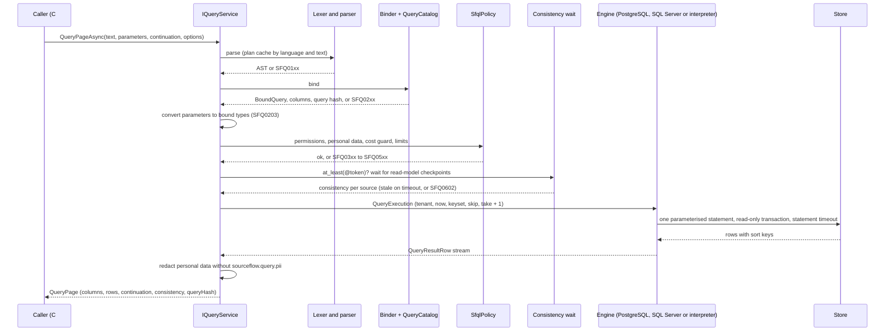

# 08 — Query Side and SFQL

The query side is how a SourceFlow service is **read**: its read models, its event log and the state of its aggregates.
Writes never go through it, and it never writes. Everything is addressed logically (event types, schema fields,
read-model names, aggregate names) and checked against the service's own schema catalog before anything runs. One
language, SFQL, has two syntaxes that parse into the same tree: a pipeline syntax built on CloudEvents SQL (CESQL)
predicates ([ADR-023](../../ADRs/ADR-023-sfql-query-language-with-cesql-predicates.md)) and a read-only SQL `SELECT`
subset ([ADR-026](../../ADRs/ADR-026-per-service-query-api-with-sql-syntax-and-injection-proof-compilation.md)). The
same pipeline serves the in-process API, the typed builder, named domain queries, the HTTP query API and the CLI.

This page describes the query side as built in 3.0. The full specification, with rationale, is
[design doc 14](../../Design/14-Query-Side-and-SFQL.md).

## Contents

- [Read models or event queries](#read-models-or-event-queries)
- [Moving parts](#moving-parts)
- [How a query runs](#how-a-query-runs)
- [SFQL](#sfql)
- [Sources](#sources)
- [Consistency](#consistency)
- [Schema catalog](#schema-catalog)
- [Named domain queries](#named-domain-queries)
- [Typed builder and temporal reads](#typed-builder-and-temporal-reads)
- [Security: permissions, tenants, personal data and injection](#security-permissions-tenants-personal-data-and-injection)
- [Compilers per database](#compilers-per-database)
- [Validate and explain](#validate-and-explain)
- [Limits and the cost guard](#limits-and-the-cost-guard)
- [Surfaces](#surfaces)
- [Guarantees and failure behaviour](#guarantees-and-failure-behaviour)
- [Extension points](#extension-points)
- [Diagnostics reference](#diagnostics-reference)
- [As built: differences from the design](#as-built-differences-from-the-design)
- [Links](#links)

## Read models or event queries

| | Read model (`from readmodel "…"`) | Event query (`from events …`, `from stream …`) | Aggregate state (`from aggregate … as of …`) |
|---|---|---|---|
| What it reads | Documents written by a projection ([06](06-Projections-and-Read-Models.md)) | The committed event log | One aggregate folded from its stream |
| Shape | Designed for the question; indexed `[Queryable]` fields | Envelope attributes plus the typed payload (`data`) | The aggregate's state record |
| Freshness | Eventual (or inline), with read-your-writes tokens | Below the safe horizon (monotonic) or latest | Strong |
| Cost | Cheap, predictable | Must be bounded (type and time, stream, correlation, …) | One stream read |
| Use it for | Screens, APIs, other services (through domain queries) | Audit, investigations, support, analytics on the service's own facts | "What did it look like at month end?" |

Rules that hold for all three:

- **Writes never read the query side.** `Decide`, `When` and `React` get state only from their own stream. Analyzer
  SF0015 reports `IQueryService` used inside aggregate, process-manager or projection code; SF0016 warns about it in a
  command handler.
- **A query sees only its own service.** The catalog contains the event types, read models and aggregates registered
  by the service's own modules (SFQ0204 for anything else). Facts from other services become queryable once the service
  projects their integration events into its own read model.
- **Other services and UIs use named domain queries**, which are versioned contracts. Ad-hoc SFQL is a permissioned
  capability for operators, analysts and the service's own tools.

## Moving parts

| Part | Type (namespace `SourceFlow.Query` unless noted) | Role |
|------|---------------------------------------------------|------|
| Query service | `IQueryService` (implemented by an internal `QueryService`, registered by `AddSourceFlow`) | The entry point: `QueryPageAsync`, `QueryAsync`, `ValidateAsync`, `ExplainAsync`, `ExecuteAsync` (domain queries), `Events<T>()`, `ReadModel<T>()`. |
| Options | `QueryOptions` | Per call: `Language` (`QueryLanguage.Sfql` or `Sql`), `Tenant`, `Permissions` (default `QueryPermissions.Service`, every permission), `PageSize`. |
| Lexer and parsers | `SourceFlow.Query.Language` (`SfqlParser.Parse(text, language, limits)`, AST types) | Text guard, tokens, recursive-descent parsers for both syntaxes into one AST. |
| Query catalog | `QueryCatalog` (`QueryEventType`, `QueryReadModel`, `QueryAggregate`, `QueryField`) | What can be queried, built from the runtime model and the serializer's `JsonTypeInfo`, with a fingerprint. |
| Binder | internal | Resolves names against the catalog, types expressions and parameters, rewrites renamed fields per version. |
| Policy | `SfqlPolicy`, `QueryPolicySettings`, `QueryLimits`, `QueryPermissions` | Permissions, personal data rules, the cost guard, offsets and limits. |
| Engines | `IQueryEngine`, `IQueryExplainer`; `PostgreSqlQueryEngine`, `SqlServerQueryEngine` (internal, registered by the storage packages); the in-memory interpreter | Run a bound query. The first engine whose `CanExecute` accepts the query runs it; otherwise the interpreter does. |
| Results | `QueryPage`, `QueryRow`, `QueryColumn`, `QuerySourceConsistency`, `QueryValidation`, `QueryPlan` | Pages with typed columns, consistency per source and a continuation token. |
| Errors | `QueryException`, `QueryDiagnostic`, `QueryCodes` | Diagnostics with code, line, column and length; never the caller's text. |
| Domain queries | `[DomainQuery]`, `IDomainQuery<TResult>`, `IDomainQueryRuntime<TSelf, TResult>`, `DomainQueryDescriptor` (namespace `SourceFlow`) | Named, versioned query contracts. |
| Temporal reads | `IAggregateReader`, `AsOf` | Aggregate state at a version or time, in process. |
| Schema catalog | `SourceFlow.Catalog.SchemaCatalog`, `JsonSchemaGenerator`, `SchemaCompatibility`, `AsyncApiExporter` | JSON Schemas per message, read model and process state; compatibility rules; AsyncAPI. |
| HTTP | `SourceFlow.AspNetCore` (`MapSourceFlowQueryApi`, `MapDomainQueries`) | The per-service query API. |
| CLI | `dotnet sourceflow query`, `schema`, `db index sync` | The same pipeline from a terminal, inside the service. |

## How a query runs



Details worth knowing:

- **Plan cache.** Parsed and bound plans are cached per `(language, text)`, up to 1,024 entries. The catalog is built
  once per service, lazily.
- **Paging.** The engine is asked for one row more than the page, to know whether there is a next page. The
  continuation token is base64url JSON holding the query hash, the catalog fingerprint, the rows still allowed by the
  query's limit and the typed sort keys of the last row. A token is rejected (SFQ0601) if the query text or the schema
  changed. Ordering is made total by appending each source's key, so pages are stable.
- **Redaction.** Personal-data columns are replaced by `"[redacted]"` unless the caller holds `sourceflow.query.pii`.
  Fields of an erased subject read `[erased]` (crypto-shredding, see [10](10-Security-and-Multi-Tenancy.md)).
- **Engine choice.** PostgreSQL and SQL Server compile `events`, `stream` and `readmodel` sources (with joins, grouping,
  subqueries). Aggregate folds and `schema` rows always run in the interpreter. The SQL Server compiler sends a
  construct it cannot express identically to the interpreter, which returns the same rows from the same store.

## SFQL

### Pipeline syntax

```text
from events of "bank.account.deposited"
| where data.amount >= @min and time >= ago(7d)
| project stream, time, amount = data.amount
| order by time desc
| take 100
```

A pipeline query is one source, any number of stages, and optional `options (...)`.

| Stage | Form | Notes |
|-------|------|-------|
| `where` | `where <expr>` | Before `summarize` it filters rows; after `summarize` it filters groups and may use aggregate names. |
| `project` | `project [name =] expr, …` | Output columns. Without it, the source's default columns. |
| `distinct` | `distinct [item, …]` | |
| `summarize` | `summarize [name =] agg(...), … [by item, …]` | Aggregates: `count`, `count_distinct`, `sum`, `avg`, `min`, `max`. After it, only grouping keys and aggregates are in scope. |
| `order by` | `order by expr [asc\|desc] [nulls first\|last], …` | A tiebreak on each source's key is appended. |
| `skip` | `skip <value>` | Only when every source is a read model (SFQ0409). |
| `take` | `take <value>` | At most `MaxRows`. |
| `join` | `join [kind = inner\|left] <readmodel\|events\|stream source> as <alias> on a.x = b.y [and …]` | Equality conditions only; an indexed key on at least one side. |
| `lookup` | `lookup readmodel "<name>" on key = <expr> as <alias>` | Shorthand for a left join on the read model's `id`. |

Options: `options (consistency = horizon | latest | eventual | at_least(@token), timeout = 2s, on_timeout = 'stale',
allow_scan = true, tenants = 'all', include_archived = true)`. An unknown option is SFQ0202.

### SQL syntax

```sql
SELECT c.segment, COUNT(*) AS accounts, SUM(a.balance) AS total
FROM readmodel."account-summary" a
JOIN readmodel."customer-profile" c ON c.id = a.customerId
WHERE a.status = 'Open'
GROUP BY c.segment
HAVING SUM(a.balance) > @minTotal
ORDER BY total DESC
LIMIT 20
```

One `SELECT [DISTINCT]` with `INNER` or `LEFT [OUTER]` joins, `WHERE`, `GROUP BY` and `HAVING`, `ORDER BY … NULLS
FIRST|LAST`, `LIMIT` and `OFFSET`, and `IN (SELECT …)` / `EXISTS (SELECT …)` subqueries (depth 1, no joins, grouping or
ordering inside). `"double quotes"` delimit identifiers and `'single quotes'` strings. Sources are named
`readmodel."name"`, `events`, `events."type"` and `stream(@s)`; `aggregate` and `schema` exist only in the pipeline
syntax.

There is no grammar production for anything that writes, changes schema, calls procedures, separates statements or
carries comments. `INSERT`, `UPDATE`, `DELETE`, `MERGE`, DDL, `EXEC`, `;`, `--`, `/* */`, `UNION`, `WITH` (CTEs),
`RIGHT`, `FULL` and `CROSS` joins are syntax errors (SFQ0102) that name the construct.

### Expressions (CESQL plus extensions)

Expressions follow CESQL v1: `NOT`, `AND`, `OR`, `XOR`, `=`, `!=`, `<>`, `<`, `<=`, `>`, `>=`, `+`, `-`, `*`, `/`, `%`,
`LIKE`, `IN (list)` and `EXISTS`. Because the event attributes are named like CloudEvents attributes, a CESQL filter
written for a subscription (`type LIKE 'bank.account.%' AND sfcorrelationid = '…'`) runs unchanged as a `where`. SFQL
adds:

| Extension | Examples |
|-----------|----------|
| Paths | `alias.field`, `data.amount`, `data.items[0].sku` |
| Parameters | `@min` (always a bound value) |
| Literals | durations `7d`, `12h`, `30m`, `15s`, `500ms`; `datetime('2026-01-31T23:59:59Z')`; `true`, `false`, `null` |
| Predicates | `x BETWEEN a AND b`, `x IS [NOT] NULL`, `has_tag('account:…')` |
| Conditionals and casts | `CASE WHEN … THEN … [ELSE …] END`, `cast(x as string\|integer\|decimal\|boolean\|timestamp\|uuid)`, `coalesce(a, b, …)` |
| Functions (allow-list) | `now()`, `ago(duration)`, `bin(timestamp, duration)`, `lower`, `upper`, `trim`, `length`, `concat`, `concat_ws`, `substring`, `left`, `right`, `abs`, `round`, `floor`, `ceiling`, `int`, `bool`, `string` |

Any other function is SFQ0102. Null and missing values follow CESQL: a comparison with a missing field is false,
`is null` is true for missing and JSON null, and aggregates ignore nulls (`count()` counts rows, `count(x)` non-null
values). Statically detectable type errors are SFQ0203. Text compares ordinally on every engine.

## Sources

### `events` — the global log

| Attribute | Type | Notes |
|-----------|------|-------|
| `id` | uuid | Event id (indexed) |
| `type`, `typeversion` | string, integer | Logical type and schema version |
| `source` | string | Producing service |
| `stream` (alias `subject`) | string | Stream id (indexed) |
| `aggregatekey` | string | The aggregate-id part of the stream; joins to read models keyed by aggregate id |
| `version` | integer | Stream version |
| `position` | position | Global commit-ordered position (opaque, comparable) |
| `time` | timestamp | Decision time |
| `sfcorrelationid`, `sfcausationid` | string | Correlation and causation (indexed) |
| `tenant` (alias `sftenant`) | string | Filtered implicitly |
| `tags` | array | DCB tags, through `has_tag()` |
| `data` | object | The payload; typed only after `of` narrows the types |

Default columns: `position, stream, version, type, typeversion, time, data`.

`from events` without `of` treats `data` as opaque: only `exists data.x` and projecting `data` are allowed (SFQ0201
otherwise). `of "t1", "t2"` types `data.x` from the listed types (SFQ0202 when a field is unknown or its types
conflict). Across versions of one type, the binder reads the old name of a field renamed with `[RenamedFrom]` for rows
of the old version. `version N` restricts to one version. Events of archived streams are left out unless
`include_archived = true`.

### `stream @id`

The events of one stream, in version order, with the same attributes, always at `latest` consistency.

### `readmodel "<name>"`

The documents of a document projection, by projection name, resolved through the read-model alias to the generation
that serves reads ([ADR-032](../../ADRs/ADR-032-blue-green-read-model-generations-behind-forward-only-aliases.md)).
Columns are `id` plus the document's fields. Fields marked `[Queryable]` on the document type can be indexed with
`dotnet sourceflow db index sync`.

### `aggregate "<name>" id @id [as of version @v | as of time @t]`

One row: the aggregate's state folded in process with its generated `Evolve`, from events up to the bound, plus
`version`. It is strongly consistent and needs `sourceflow.query.aggregates`.

```text
from aggregate "bank-account" id @id as of time datetime('2026-01-31T23:59:59Z')
```

### `schema [of "<type>"]`

Catalog introspection: one row per field with `type`, `version`, `field`, `fieldType`, `queryable` and `personalData`.

## Consistency

| Source | Default | Options |
|--------|---------|---------|
| `events` | `horizon`: only events below the safe horizon, so pages are monotonic and continuation tokens stable | `latest`: also committed events above the horizon, fresher but not monotonic across pages |
| `stream` | `latest` | |
| `readmodel` | `eventual`: whatever the projection has applied | `at_least(@token)` |
| `aggregate` | strong | |

Every command result carries a `ConsistencyToken`: the global position of its last event and the tenant, written as
`{commit}:{sequence}[@{tenant}]`. Command endpoints return it in the `SourceFlow-Consistency` header. A query that
must see that write waits for it:

```text
from readmodel "account-summary" | where id = @id
options (consistency = at_least(@token), timeout = 2s)
```

The wait polls, every 10 ms, the checkpoints of each **asynchronous** read model in the query, for every subscription
partition, against the token's position. Inline projections satisfy any token at once. Without `timeout` the wait is
`QueryPolicySettings.ConsistencyTimeout` (5 s), and it is capped at `MaxConsistencyTimeout` (30 s). When it runs out the
query fails with SFQ0602, or, with `on_timeout = 'stale'`, runs anyway and reports `stale = true` for that source.

Each result reports what was applied per source in `consistency.sources[]` (`source`, `level`, `stale`), for example
`{ "source": "readmodel.account-summary", "level": "at_least", "stale": false }`. In a join, each source keeps its own
level.

## Schema catalog

The schema catalog describes every message, read model and process state the service registers
([ADR-029](../../ADRs/ADR-029-schema-catalog-derived-from-serializer-metadata.md)). It is built at startup from the
serializer's source-generated `JsonTypeInfo`, so it describes exactly what is written, including custom naming policies
and converters. The SourceFlow source generator emits no schemas.

- `SourceFlow.Catalog.JsonSchemaGenerator` writes JSON Schema 2020-12 per type and version. Member attributes become
  extensions: `[Queryable]` (`x-sourceflow-queryable`), `[PersonalData]` (`x-sourceflow-personal-data`),
  `[RenamedFrom]` (`x-sourceflow-renamed-from`) and `[Tag]` (`x-sourceflow-tag`). Decimals are JSON numbers with
  `format: decimal`; strongly typed ids follow their backing type; enums are integers or strings as the serializer
  writes them.
- `SchemaCatalog.Build(RuntimeModel)` covers every message type and version (including `CommandRejected<T>` replies),
  every document projection's document (`readmodel`) and every process manager's state (`process-state`). The
  fingerprint of an entry is the SHA-256 of its canonical schema; it excludes the service, so services that share a
  contract register the same fingerprint.
- **Registration.** At startup the host registers the catalog through the optional `ISchemaStore` port (in memory, and
  the PostgreSQL `schemas` table). A changed fingerprint for a published `(type, version)` fails startup with
  `SchemaConflictException`. `SourceFlowOptions.SchemaRegistration` can be `Enforce` (default), `Warn` (log event 1107)
  or `Off`.
- **Compatibility in CI.** `dotnet sourceflow schema export --format lock` writes a lock file;
  `dotnet sourceflow schema check --baseline schemas.lock.json` compares the current catalog with it and exits 1 on a
  breaking change:

| Rule | Change | Verdict |
|------|--------|---------|
| SFC01 | Optional field added to a version | Allowed |
| SFC02 | Required field added to a version | Breaking |
| SFC03 | Field removed from a version | Breaking |
| SFC04 | Field type changed in a version | Breaking |
| SFC05 | Optional field became required | Breaking (required to optional is allowed) |
| SFC06 | New version renames a field with `[RenamedFrom]` | Allowed |
| SFC07 | New version drops or renames a field without `[RenamedFrom]` or an upcaster | Breaking |
| SFC08 | New event version without an upcaster from the previous one | Breaking |
| SFC09 | Published version removed | Breaking (allowed for read models) |
| SFC10 | `[Queryable]`, `[PersonalData]` or tag flags changed | Allowed, reported |

- **Export.** `schema export --format jsonschema` writes the raw schemas; `--format asyncapi` writes an AsyncAPI 3.0
  document (`AsyncApiExporter`) whose channels come from the topology.

The **query catalog** (`QueryCatalog.Build(RuntimeModel)`) is the queryable view of the same metadata: event types with
their versions and fields, read models and aggregates, each field with its type and flags. `GET /query/schema` and
`from schema` return it.

## Named domain queries

A domain query is a published, versioned query contract in the service's own vocabulary
([ADR-030](../../ADRs/ADR-030-domain-queries-bind-at-startup.md)):

```csharp
[DomainQuery("accounts.low-balance", 1)]
public sealed partial record LowBalanceAccounts(decimal Below) : IDomainQuery<LowBalanceAccount>
{
    public const string Sfql = """
        from readmodel "account-summary"
        | where status = 1 and balance < @below
        | project accountId = id, holder, balance
        | order by balance
        """;
}

public sealed record LowBalanceAccount(AccountId AccountId, string Holder, decimal Balance);
```

(From [`samples/Bank/Bank.Accounts/AccountSummary.cs`](../../../../samples/Bank/Bank.Accounts/AccountSummary.cs).) The
record's members are the parameters (camelCase, matching `@below`); a `const string Sfql` (or `Sql` for the SQL syntax)
holds the text; the result record's constructor parameters are matched to output columns ignoring case.

Checking happens in two stages:

1. **Build time.** The generator implements `IDomainQueryRuntime<TQuery, TResult>` (name, version, text, parameters,
   result columns, `ToParameters()`, a typed `Materialize`) and registers the query with the module. Analyzer SF0018
   checks what the compilation can decide alone: a name, `IDomainQuery<TResult>`, a top-level partial type, the text
   constant, a result constructor, and a member for every `@parameter`.
2. **Startup.** Before the host reports ready, it binds every domain query against the service's own catalog with the
   real parser and binder. A query that does not bind, has a parameter that is not a member, or a result column that is
   not an output fails startup with `DomainQueryException` ("SF0018: domain queries don't match this service's
   catalog: …"). A plain host start in a unit test catches it.

Run it in process with `await queries.ExecuteAsync(new LowBalanceAccounts(Below: 100m))` (all pages, typed rows), or over
HTTP with `GET /queries/accounts.low-balance/v1?below=100` after `app.MapDomainQueries()`. Over HTTP a domain query runs
with the read permissions whatever the caller holds (it is a contract), and still shows personal data only to a caller
with `sourceflow.query.pii`. A service that runs DSL workflows also gets a generated `<service>.workflow-instances` v1
domain query.

## Typed builder and temporal reads

`IQueryService.Events<TEvent>()` and `ReadModel<TDocument>()` build the same AST from a restricted LINQ expression
subset (there is no `IQueryable` provider). Every captured value becomes a parameter:

```csharp
IQueryService queries = services.GetRequiredService<IQueryService>();
decimal minimum = 100m;
AccountId account = ...;

EventQuery<MoneyDeposited> query = queries.Events<MoneyDeposited>().Since(TimeSpan.FromDays(1));
query.Where(e => e.Amount >= minimum && e.AccountId == account).OrderByDescending(e => e.Amount).Take(5);
IReadOnlyList<EventRecord<MoneyDeposited>> rows = await query.ToListAsync();

// query.ToSfql():
// from events of "bank.account.deposited" version 1 | where time >= ago(@p0)
// | where (data.amount >= @p1 and data.accountId = @p2) | project position, stream, version, time, data
// | order by data.amount desc | take @p3

IReadOnlyList<AccountSummary> low = await queries.ReadModel<AccountSummary>()
    .Where(s => s.Balance < 100m && s.Holder.StartsWith("A") && s.Status == AccountStatus.Open)
    .OrderBy(s => s.Holder)
    .ToListAsync();
```

`EventRecord<TEvent>` carries `Data`, `Stream`, `Version`, `Time` and `Position`. For a strongly consistent read of one
aggregate at a point in time, use `IAggregateReader.LoadAsync<TAggregate, TId>(id, AsOf.Version(n) | AsOf.Time(t))`,
which returns the state and its version.

## Security: permissions, tenants, personal data and injection

**Permissions** are strings on `QueryPermission`. In process the default is `QueryPermissions.Service` (all of them);
the HTTP API reads them from the caller's claims.

| Permission | Allows |
|------------|--------|
| `sourceflow.query.events` | `events` and `stream` sources |
| `sourceflow.query.readmodels` | `readmodel` sources |
| `sourceflow.query.aggregates` | `aggregate` sources |
| `sourceflow.query.schema` | `schema` source and `GET /query/schema` |
| `sourceflow.query.pii` | Personal data in clear text (otherwise `[redacted]`) |
| `sourceflow.query.scan` | `allow_scan = true` (override the cost guard) |
| `sourceflow.query.cross-tenant` | `tenants = 'all'` |
| `sourceflow.query.adhoc` | `POST /query` |
| `sourceflow.query.validate` | `POST /query/validate` |
| `sourceflow.query.explain` | `POST /query/explain` (reveals the physical statement: operators only) |

**Tenants.** Every source is filtered to the caller's tenant (`QueryOptions.Tenant`, or the ambient tenant), and joined
sources are equated on tenant. On PostgreSQL with row-level security the engine also sets the tenant for the
transaction, so the database enforces it again (ADR-022). `tenants = 'all'` uses the system (BYPASSRLS) data source and
needs `cross-tenant`.

**Personal data.** `[PersonalData]` fields are stored encrypted when payload protection is on, so they cannot be a
filter, sort, group or join key (SFQ0301); `count(x)` of one is allowed. In output they are decrypted in process and
redacted for callers without `pii`.

**Injection.** The query API is not a SQL pass-through. Defences, by construction:

| Rule | Defence |
|------|---------|
| No pass-through | Caller text is parsed into an AST by SourceFlow's grammar; SQL is generated from the AST. |
| Allow-list grammar | Only read constructs have productions; everything else is SFQ0102. |
| Only safe tokens reach SQL | Generated SQL contains fixed templates, identifiers from the service's own catalog (quoted), and placeholders. Every request value (literals, parameters, type and collection names, durations, `LIKE` patterns, `IN` lists, limits, keyset values) is a typed parameter. A property test checks that no request literal appears in the SQL text (QRY-60). |
| Catalog-only names | Unknown names are bind errors; system catalogs, SourceFlow's internal tables (`outbox`, `inbox`, `data_keys`) and other services' data are unreachable. |
| Function allow-list | Only the functions listed above. |
| Typed parameters | A parameter is one value of the bound type; a string is never re-parsed as query text. |
| Text guard | Invalid UTF-8, NUL and control characters, bidi overrides and isolates, and zero-width characters outside literals are SFQ0104; size, token and depth limits are SFQ0103. |
| Defence in depth | Read-only transaction, statement timeout, row-level security, limits, cost guard, rate and concurrency limits. |
| No reflection of input | Errors carry codes and positions, never the query or parameter values; HTTP responses are JSON only, with `nosniff` and a `default-src 'none'` CSP; CSV cells that look like formulas are neutralised. |

The injection corpus (OWASP payloads, stacked queries, comment tricks, Unicode controls, XSS in parameters and stored
data) runs against the in-memory and PostgreSQL engines and over HTTP, and the Bank query API is scanned nightly with
OWASP ZAP.

## Compilers per database

| Engine | Package | Runs | Notes |
|--------|---------|------|-------|
| `PostgreSqlQueryEngine` (`postgresql`) | `SourceFlow.Storage.PostgreSQL` | `events`, `stream`, `readmodel`, joins, grouping, distinct, subqueries | One parameterised statement per page (`$n` placeholders); `SET TRANSACTION READ ONLY` and `statement_timeout` = `QueryTimeout` (default 5 s, at most 30 s); the RLS tenant setting; the horizon predicate below `pg_snapshot_xmin`; per-version `CASE` for renamed fields; `COLLATE "C"` ordinal text; `NULLIF` for division by zero; keyset predicate outside a derived table. |
| `SqlServerQueryEngine` (`sqlserver`) | `SourceFlow.Storage.SqlServer` | The same sources | T-SQL with `@pN` placeholders; `Latin1_General_100_BIN2` ordinal text; positions as `(rowversion, seq)` below `MIN_ACTIVE_ROWVERSION()`; null ordering emulated with `CASE`; command timeout = `QueryTimeout`; runs on `SqlServerStorageOptions.QueryConnectionString` when set (for example a readable secondary). Unsupported constructs fall back to the interpreter. |
| Interpreter (`in-memory`) | `SourceFlow.Net` | Everything, including `aggregate` and `schema` | The reference semantics; a linear-time `LIKE` matcher; `MaxGroups` checked at run time (SFQ0408). |

Cross-provider equivalence tests run the same queries over the same data on the interpreter, PostgreSQL and SQL
Server, and pages are interchangeable between engines.

**Indexes.** `dotnet sourceflow db index sync [--apply]` (inside the service, PostgreSQL) creates and drops the
expression indexes for `[Queryable]` event fields (per event type) and read-model fields, from the catalog, so indexes
follow the schema and are never hand-written.

## Validate and explain

- `ValidateAsync` (CLI `query --validate`, `POST /query/validate`) parses, binds and policy-checks without running.
  `QueryValidation.IsValid`, `Diagnostics` (code, message, line, column, length) and `Columns`.
- `ExplainAsync` (CLI `query --explain`, `POST /query/explain`) also checks the policy, then returns a `QueryPlan`:
  `Columns`, `Sources` with the consistency each would use, `Engine`, `Statement` (the compiled SQL with placeholders
  only, or `null` for the interpreter), `ParameterCount` and `QueryHash`. Nothing runs.

```text
$ dotnet run --project samples/Bank/Bank.Api -- sourceflow query --explain 'from readmodel "account-summary" | where balance < @b' --param b=0
engine:     postgresql
columns:    id string, holder string, balance decimal, status integer, version integer
sources:    readmodel.account-summary (eventual)
parameters: ...
hash:       sha256:...
statement:
SELECT ...
```

## Limits and the cost guard

`QueryLimits` (inside `QueryPolicySettings.Limits`):

| Limit | Default | Hard cap |
|-------|---------|----------|
| `MaxTextLength` | 16 KB | 64 KB |
| `MaxTokens` | 4,000 | 16,000 |
| `MaxDepth` (expression nesting) | 32 | 64 |
| `MaxJoins` | 3 | 5 |
| `MaxSubqueries` | 2 | 4 |
| `MaxInItems` | 1,000 | 10,000 |
| `MaxParameters` | 100 | 500 |
| `MaxColumns` | 64 | 256 |
| `MaxGroupingKeys` | 8 | 32 |
| `MaxRows` (`take`/`LIMIT`) | 1,000 | 10,000 |
| `PageSize` | 100 | 1,000 |
| `MaxOffset` (read models only) | 10,000 | 100,000 |

`QueryPolicySettings`: `MaxTimeRange` 31 days, `ConsistencyTimeout` 5 s, `MaxConsistencyTimeout` 30 s, `MaxGroups`
10,000. The HTTP API adds its own body, depth, rate and concurrency limits
([SourceFlow.AspNetCore](../SourceFlow.AspNetCore-README.md#configuration-reference)).

The cost guard, at policy time:

| Rule | Code |
|------|------|
| An `events` source must be bounded by at least one of: `of` plus a time range of at most `MaxTimeRange`; a stream; a correlation or causation id; `has_tag`; a position range; an equality on a `[Queryable]` field | SFQ0401 (override: `allow_scan = true` plus `sourceflow.query.scan`) |
| A predicate on a non-`[Queryable]` `data` field with nothing that bounds the scan | SFQ0402 |
| More joins or subqueries than allowed | SFQ0404 |
| A join condition without an indexed key on at least one side (read-model `id`; event `id`, `stream`, `aggregatekey`, correlation or causation id; a `[Queryable]` field) | SFQ0405 (override as above) |
| A join of two `events` sources not both bounded | SFQ0406 |
| More groups than `MaxGroups` (at run time) | SFQ0408 |
| `skip`/`OFFSET` with an event source, or above `MaxOffset` | SFQ0409 |
| `take`/`LIMIT` above `MaxRows` | SFQ0103 |

To change settings, register your own instance before `AddSourceFlow` (the core uses `TryAddSingleton`):

```csharp
services.AddSingleton(QueryPolicySettings.Default with
{
    MaxTimeRange = TimeSpan.FromDays(7),
    Limits = QueryLimits.Default with { MaxJoins = 2 },
});
```

## Surfaces

| Surface | Package | How |
|---------|---------|-----|
| `IQueryService`, typed builder, domain queries | `SourceFlow.Net` | Inject `IQueryService`; in-process calls hold every permission unless you pass `QueryOptions.Permissions`. |
| HTTP query API | `SourceFlow.AspNetCore` | `AddSourceFlowQueryApi()`, then `MapSourceFlowQueryApi()` (`POST /query`, `/query/validate`, `/query/explain`, `GET /query/schema`) and `MapDomainQueries()` (`GET /queries`, `GET /queries/{name}/v{n}`). Startup fails without an authorization decision (SFQ0504). JSON, NDJSON or CSV. See the [SourceFlow.AspNetCore README](../SourceFlow.AspNetCore-README.md#the-per-service-query-api). |
| CLI | `SourceFlow.Tool` | `dotnet run --project <service> -- sourceflow query "<query>" [--sql] [--param n=v] [--validate] [--explain] [--format table\|json\|csv]`. See the [SourceFlow.Tool README](../SourceFlow.Tool-README.md#query). |
| Studio demo console | `samples/Studio` | Proxies `query`, `query/schema` and `query/validate` to the Bank service's query API. |

## Guarantees and failure behaviour

| Guarantee | How |
|-----------|-----|
| Queries never write | No write grammar; read-only transaction; engines read through the store's query paths only. |
| Results never cross tenants | Tenant predicates on every source and join; RLS on PostgreSQL when enabled. |
| Stable paging over the moving log | Default `horizon` consistency for events, total ordering, keyset continuations bound to query hash and catalog fingerprint. |
| Contracts fail early | Domain queries are bound at startup; schema changes are checked in CI and at startup. |
| Same answer everywhere | The interpreter is the reference; compilers are tested for equivalence. |

| Failure | Behaviour |
|---------|-----------|
| Invalid text, unknown name, type mismatch | `QueryException` with diagnostics (HTTP 400); nothing runs. |
| Missing permission | SFQ0501 (HTTP 403). |
| Unbounded or expensive query | SFQ04xx (HTTP 400) before any SQL is sent. |
| Statement timeout | `TimeoutException` (HTTP 504, `QueryTimeout`). |
| `at_least` wait times out | SFQ0602 (HTTP 504), or rows with `stale = true` when `on_timeout = 'stale'`. |
| Continuation from another query or schema | SFQ0601 (HTTP 409). |
| Database unavailable | The provider exception propagates (HTTP 500). |

## Extension points

- **`IQueryEngine` / `IQueryExplainer`.** A storage adapter registers an engine with
  `TryAddEnumerable(ServiceDescriptor.Singleton<IQueryEngine, …>)`. `CanExecute(BoundQuery)` decides per query;
  `ExecuteAsync(QueryExecution, ct)` returns rows with their sort keys, after the keyset, skipped and limited. Implement
  `IQueryExplainer` to show your statement in `explain`. Anything your engine refuses runs in the interpreter.
- **`QueryPolicySettings`.** Register your own instance to change limits and cost-guard settings.
- **`SourceFlowQueryApiOptions.Permissions` and `.Tenant`.** Map your identity provider's claims.
- **`ISchemaStore`.** Where the schema catalog is registered (in memory and PostgreSQL are provided).
- **`[Queryable]`, `[PersonalData]`, `[RenamedFrom]`, `[Tag]`.** Annotate message and document members to shape what can
  be queried, indexed and shown.

## Diagnostics reference

| Code | Meaning |
|------|---------|
| SFQ0101 | Syntax error, with position and expected tokens |
| SFQ0102 | Unsupported construct or statement (names the construct), or a function outside the allow-list |
| SFQ0103 | Request limit exceeded (text, tokens, depth, joins, `IN` list, parameters, rows, body) |
| SFQ0104 | Forbidden characters |
| SFQ0201 | `data` field on an un-narrowed `events` source |
| SFQ0202 | Unknown field, source or option, or incompatible types across versions |
| SFQ0203 | Type mismatch (including a parameter that cannot be converted) |
| SFQ0204 | Type not owned by this service |
| SFQ0205 | Ambiguous column in a multi-source query |
| SFQ0206 | Output neither aggregated nor grouped |
| SFQ0301 | Personal-data field used as a filter, sort, group or join key |
| SFQ0401 | Unbounded scan |
| SFQ0402 | Non-queryable field without a bounding predicate |
| SFQ0404 | Too many joins or subqueries |
| SFQ0405 | Join condition not on an indexed key |
| SFQ0406 | Join of two unbounded `events` sources |
| SFQ0408 | Too many result groups |
| SFQ0409 | `OFFSET`/`skip` not allowed or too large |
| SFQ0501 | Permission denied (names the permission) |
| SFQ0502 | Rate limit (HTTP API) |
| SFQ0503 | Concurrency limit (HTTP API) |
| SFQ0504 | Query API mapped without an authorization decision (startup) |
| SFQ0601 | Continuation token invalid for this query or schema |
| SFQ0602 | Consistency wait timed out |

`QueryCodes` also defines SFQ0403 (upcast row limit) and SFQ0407 (estimated cost ceiling); 3.0 does not report them.
Related analyzers: SF0015 and SF0016 (query service used on the write side), SF0018 (domain query shape and binding).

## As built: differences from the design

Design doc 14 is the specification; these are the places where 3.0 differs from it.

| Design doc 14 | As built |
|---------------|----------|
| Query settings through `sf.Query(q => …)`, including a read-replica connection | No `sf.Query`. Limits are `QueryPolicySettings` registered in DI. The statement timeout is `QueryTimeout` on the storage options. SQL Server has `QueryConnectionString` for a separate query connection; PostgreSQL queries use the store's data source (or the system data source for `tenants = 'all'`). |
| Domain queries bound at build time by SF0018 | Shape checked at build time, binding at startup (ADR-030). |
| Decimals as strings in schemas | Decimals are JSON numbers with `format: decimal` (ADR-029). In HTTP results they are still written as exact strings. |
| `… upcast` evaluates in process; SFQ0403 caps it | The keyword parses but does not change execution; SFQ0403 is not reported. |
| Optional `EXPLAIN` cost ceiling (SFQ0407) | Not built. |
| `sourceflow.query.*` span and metrics, slow-query log, `LogQueryParameters` | Not built. |
| Consistency timeout as HTTP 503 | HTTP 504. |
| Per-query authorization policy for domain queries | One policy on the `MapDomainQueries()` group. |
| `language = 'sfql/2'` option | No `language` option; the API's `language` field selects `sql` or the pipeline syntax. |

## Links

- [Design doc 14: Query side and SFQL](../../Design/14-Query-Side-and-SFQL.md)
- ADRs: [ADR-023 SFQL with CESQL predicates](../../ADRs/ADR-023-sfql-query-language-with-cesql-predicates.md),
  [ADR-026 per-service query API](../../ADRs/ADR-026-per-service-query-api-with-sql-syntax-and-injection-proof-compilation.md),
  [ADR-029 schema catalog](../../ADRs/ADR-029-schema-catalog-derived-from-serializer-metadata.md),
  [ADR-030 domain queries bind at startup](../../ADRs/ADR-030-domain-queries-bind-at-startup.md),
  [ADR-022 multi-tenancy](../../ADRs/ADR-022-conjoined-multi-tenancy-with-row-level-security.md),
  [ADR-032 read-model generations](../../ADRs/ADR-032-blue-green-read-model-generations-behind-forward-only-aliases.md).
- Architecture: [05 Event store and persistence](05-Event-Store-and-Persistence.md),
  [06 Projections and read models](06-Projections-and-Read-Models.md),
  [10 Security and multi-tenancy](10-Security-and-Multi-Tenancy.md).
- Packages: [SourceFlow.AspNetCore](../SourceFlow.AspNetCore-README.md), [SourceFlow.Tool](../SourceFlow.Tool-README.md),
  [SourceFlow.Storage.PostgreSQL](../SourceFlow.Storage.PostgreSQL-README.md),
  [SourceFlow.Storage.SqlServer](../SourceFlow.Storage.SqlServer-README.md).
- Source: [`src/Core/SourceFlow.Net/Query`](../../../../src/Core/SourceFlow.Net/Query),
  [`src/Core/SourceFlow.Net/Catalog`](../../../../src/Core/SourceFlow.Net/Catalog),
  [`src/Hosting/SourceFlow.AspNetCore/QueryApi.cs`](../../../../src/Hosting/SourceFlow.AspNetCore/QueryApi.cs).
