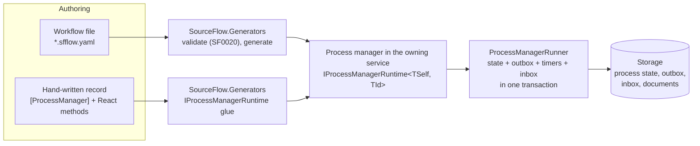
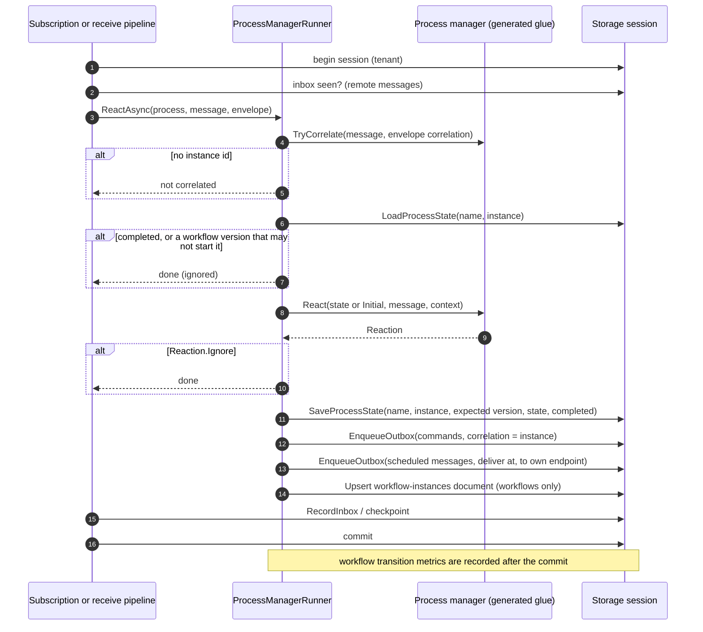
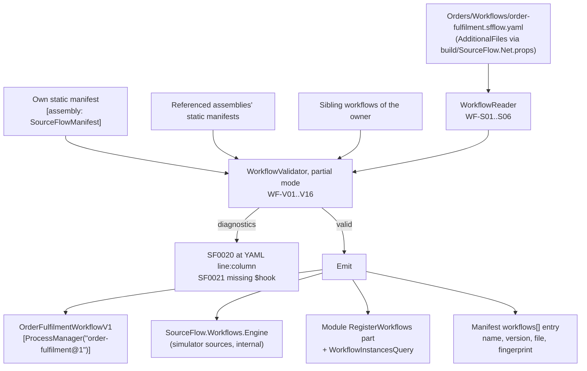
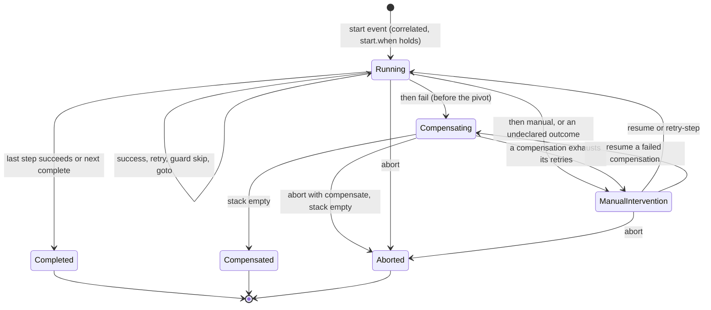
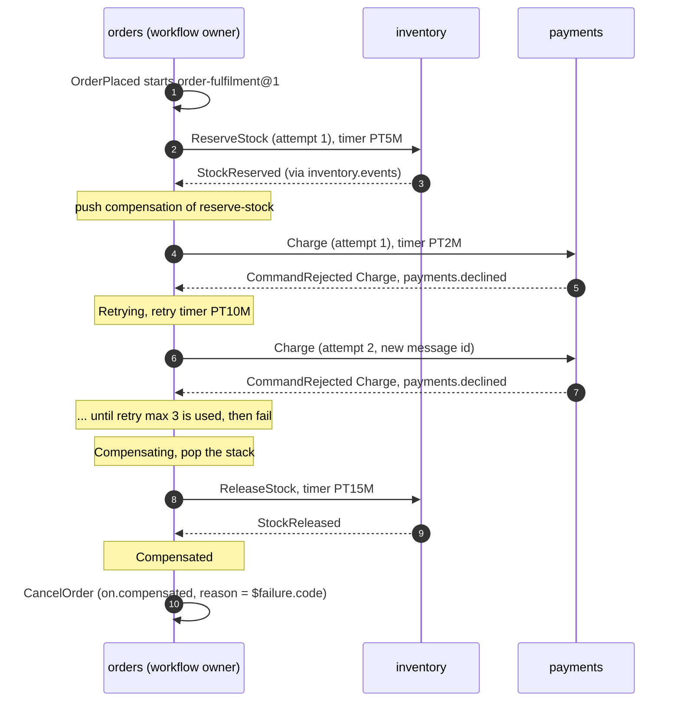
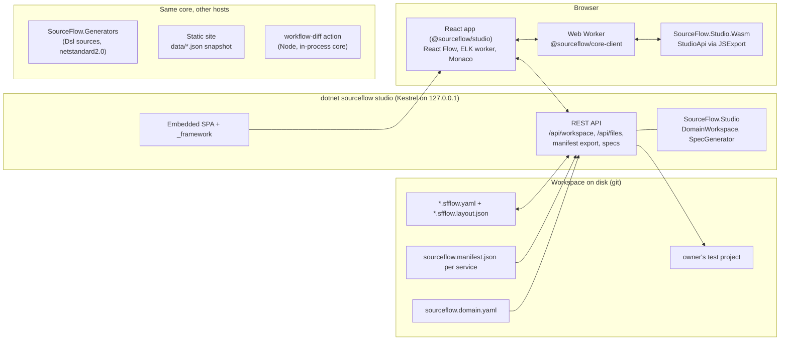

# 09 — Process Managers and Workflows

A process manager coordinates work that spans aggregates or services and takes time: it reacts to events, sends commands, sets timers, and keeps durable state between messages. In v3 it is the only runtime for long-running coordination. You can write one by hand in C#, or describe it as a workflow in YAML (`*.sfflow.yaml`) and let the source generator write it. Both run on the same runtime, with the same storage, outbox, inbox, timers, telemetry and tests.

This document explains the runtime ([ADR-020](../../ADRs/ADR-020-process-managers-with-durable-state-and-timers.md)), how a workflow is compiled into a process manager ([ADR-024](../../ADRs/ADR-024-workflow-dsl-compiled-to-process-managers.md)), what the generated engine does, how running instances are versioned, observed and operated, and how SourceFlow Studio is put together ([ADR-025](../../ADRs/ADR-025-studio-react-spa-with-shared-wasm-core.md)). For the tooling see the [SourceFlow Studio README](../SourceFlow.Studio-README.md); for the file format, the [workflows guide](../../guides/workflows.md) and the [DSL reference](../../guides/workflow-dsl-reference.md).



## 1. Moving parts

| Type | Package / namespace | Role |
|------|---------------------|------|
| `IProcessManager<TSelf, TId>` | `SourceFlow.Net`, `SourceFlow` | What you implement: a record with `static TSelf Initial`, `React` methods and optional `CorrelateBy` methods |
| `[ProcessManager("name")]` | `SourceFlow` | The process type name (for a workflow, `name@version`) |
| `IProcessManagerRuntime<TSelf, TId>` | `SourceFlow` | What the generator implements on your record: `ProcessName`, `HandledMessages`, `TryCorrelate`, and a single `React(IMessage, ReactionContext<TId>)` dispatch |
| `Reaction` | `SourceFlow` | The result of a reaction: new state, commands (with optional fixed message ids), scheduled messages, completion, workflow transitions |
| `ReactionContext<TId>` | `SourceFlow` | `Id`, `Now`, `MessageId`, `IsNew`, and `Serializer` (the service's JSON options) |
| `ITimeout` | `SourceFlow` | Marker for messages a process manager schedules to itself |
| `CommandRejected<TCommand>` | `SourceFlow` | The reply when a command the process manager sent is rejected ([ADR-018](../../ADRs/ADR-018-business-rejections-are-values-not-exceptions.md)) |
| `ProcessManagerDescriptor` | `SourceFlow.Runtime` | The registered process manager in the runtime model (`IsWorkflow` for generated workflows) |
| `ProcessManagerRunner` | internal | Runs one reaction inside a storage session |
| `MessageDispatcher`, `SubscriptionEngine` | internal | Deliver remote messages and local events to the runner |
| `ProcessManagerSpec<TProcess, TId>` | `SourceFlow.Testing` | Given/When/Then tests for hand-written process managers |
| `SourceFlow.Workflows.*` | `SourceFlow.Net` | Runtime types for generated workflows: `WorkflowStatus`, `WorkflowInstanceId`, `WorkflowTimer`, `WorkflowControl`, `WorkflowTransition`, `WorkflowInstanceSummary`, `WorkflowRuntime`, `IWorkflowHooks`, `WorkflowVersionRemovedException` |
| `WorkflowSpec` | `SourceFlow.Testing` | Outcome-by-outcome tests for generated workflows |

## 2. Hand-written process managers

The Bank sample's money transfer ([`samples/Bank/Bank.Transfers/Transfers.cs`](../../../../samples/Bank/Bank.Transfers/Transfers.cs)) withdraws from one account, deposits to another, fails on a rejection, and compensates on a timeout:

```csharp
[MessageType("bank.transfer.timed-out", 1)]
public sealed record TransferTimedOut(TransferId TransferId) : ITimeout;

[ProcessManager("money-transfer")]
public sealed partial record MoneyTransfer : IProcessManager<MoneyTransfer, TransferId>
{
    public static readonly TimeSpan Timeout = TimeSpan.FromMinutes(5);

    public static MoneyTransfer Initial { get; } = new();

    public TransferStage Stage { get; init; }
    public AccountId From { get; init; }
    public AccountId To { get; init; }
    public decimal Amount { get; init; }

    // The starting event says which instance it belongs to; later messages use the envelope correlation.
    public static TransferId CorrelateBy(TransferRequested e) => e.TransferId;

    public Reaction React(TransferRequested e, ReactionContext<TransferId> ctx) =>
        Reaction.Send(new Withdraw(e.From, e.Amount))
            .Schedule(new TransferTimedOut(e.TransferId), ctx.Now + Timeout)
            .AndBecome(this with { Stage = TransferStage.Withdrawing, From = e.From, To = e.To, Amount = e.Amount });

    public Reaction React(MoneyWithdrawn e, ReactionContext<TransferId> ctx) =>
        Stage == TransferStage.Withdrawing
            ? Reaction.Send(new Deposit(To, Amount)).AndBecome(this with { Stage = TransferStage.Depositing })
            : Reaction.Ignore;

    public Reaction React(MoneyDeposited e, ReactionContext<TransferId> ctx) =>
        Stage == TransferStage.Depositing
            ? Reaction.Send(new CompleteTransfer(ctx.Id)).AndComplete()
            : Reaction.Ignore;

    public Reaction React(CommandRejected<Withdraw> r, ReactionContext<TransferId> ctx) =>
        Stage == TransferStage.Withdrawing
            ? Reaction.Send(new FailTransfer(ctx.Id, r.Error.Code)).AndComplete()
            : Reaction.Ignore;

    public Reaction React(TransferTimedOut e, ReactionContext<TransferId> ctx) => Stage switch
    {
        TransferStage.Withdrawing => Reaction.Send(new FailTransfer(ctx.Id, "timeout")).AndComplete(),
        TransferStage.Depositing => Reaction.Send(new Deposit(From, Amount)).AndSend(new FailTransfer(ctx.Id, "timeout")).AndComplete(),
        _ => Reaction.Ignore,
    };
}
```

The state, the timeout and `CommandRejected<Withdraw>` must be in the module's JSON context (`[JsonSerializable(typeof(MoneyTransfer))]`, …). The generator registers the process manager in the module (`builder.AddProcessManager<MoneyTransfer, TransferId>()`) and lists it in the service manifest's `processManagers` with what it handles, sends and schedules. `React` and `CorrelateBy` must be pure; the analyzers enforce it (SF0009 for non-deterministic APIs; use `ctx.Now`).

**The `Reaction` API.** C# can't have a static and an instance method with the same signature, so chains start with a static entry point and continue with `And…` instance methods:

| Static | Instance | Effect |
|--------|----------|--------|
| `Reaction.Send(command)`, `Reaction.Send(command, messageId)` | `AndSend(command)`, `AndSend(command, messageId)` | Queue a command in the outbox (a fixed `messageId` makes re-sends idempotent at the owner's inbox) |
| `Reaction.Become(state)` | `AndBecome(state)` | The new state (must stay the same CLR type) |
| | `Schedule(message, deliverAt)` | Queue a message to this service, delivered at `deliverAt` |
| `Reaction.Complete()` | `AndComplete()` | Complete the instance |
| `Reaction.Ignore` | | Do nothing; nothing is saved |
| | `AndRecord(transition)` | Record a workflow transition (used by generated workflows) |

**Correlation.** For each message the runner asks the generated `TryCorrelate`: a `CorrelateBy` method for that message type wins; otherwise the envelope's `CorrelationId` is parsed as the instance id. Every command and timer a process manager queues carries the instance id as its correlation, so replies, rejection replies and timers find the instance without a `CorrelateBy`.

**Testing.** `ProcessManagerSpec` replays messages against one instance on a fixed clock (2026-01-01T00:00:00Z):

```csharp
var transfer = TransferId.Parse("0193a1b2-c3d4-7e5f-8a9b-0c1d2e3f4a5d");

new ProcessManagerSpec<MoneyTransfer, TransferId>(transfer)
    .Given(new TransferRequested(transfer, Account, Other, 5m), new MoneyWithdrawn(Account, 5m, 5m))
    .WhenTimeAdvances(MoneyTransfer.Timeout)
    .When(new TransferTimedOut(transfer))
    .ThenSends(new Deposit(Account, 5m), new FailTransfer(transfer, "timeout"))
    .ThenCompleted();
```

It also has `ThenSchedules(message, at)` and `ThenIgnored()`. See [SourceFlow.Testing](../SourceFlow.Testing-README.md).

## 3. The runtime: one reaction, one transaction

A process manager receives messages from two sources:

- **Local domain events** through the subscription engine, one subscription per process manager named `pm:{name}` (only when it handles at least one `IEvent`).
- **Remote messages** (integration events, `CommandRejected<T>` replies, scheduled timers, and events of other services) through the receive pipeline. The dispatcher runs each process manager that handles the message type as its own consumer, with its own inbox entry `{service}:pm:{name}`, so a redelivery re-runs only the consumers that failed.



**Commands.** Each command goes to its owner: the service's own endpoint when it owns the command, otherwise the routed endpoint ([ADR-007](../../ADRs/ADR-007-single-command-ownership-route-local-xor-remote.md); a command without either fails with `NoRouteException`). The runner asks for a rejection reply when the command is owned locally or its route has `ReplyOnReject()`, and the service has registered `CommandRejected<T>` for it. The owner then sends `CommandRejected<T>` back to the sender's endpoint with the same correlation.

**Timers.** `Schedule(message, deliverAt)` is a scheduled outbox row addressed to the service's own endpoint. The outbox relay delivers it when it falls due, and the receive pipeline hands it back to the process manager like any other message. Timers are durable: they survive restarts because they are rows in the same store.

### Guarantees and failure behaviour

| Concern | Behaviour |
|---------|-----------|
| Atomicity | New state, outbox commands, timers, the workflow read-model document and the inbox entry (or subscription checkpoint) commit together. A crash before the commit loses nothing; the message is delivered again |
| Concurrency | The state is saved with its expected version (optimistic concurrency). When another writer got there first the commit fails, nothing is written, and the message is processed again by the pipeline's retry or redelivery; workflow metrics are recorded only after a commit, so they count it once |
| Duplicates | The inbox drops a message already handled by that consumer. Commands with a fixed message id are deduplicated at the owner's inbox |
| Completion | A completed instance ignores every later message; its state is kept |
| State type | A reaction that returns a different CLR type than the process manager fails with `InvalidOperationException` |
| Infrastructure failures | Broker or database outages, and an owner service being down, are retried and parked by the messaging pipeline ([04 Messaging pipeline](04-Messaging-Pipeline-and-Middleware.md)). The process manager only sees business outcomes and time passing, which is why every wait in a workflow needs a timeout |

## 4. Workflows: compiled, not interpreted

A workflow is a state machine in YAML owned by one service. Rather than interpreting it at run time, the build turns it into an ordinary process manager in the owning service. The simulator that Studio runs in the browser is the very engine embedded in that process manager, so what you simulate is what runs; a differential property test checks the simulator against the generated process manager over 10,000 random outcome sequences per sample workflow.



### What the generator emits

| Generated | Detail |
|-----------|--------|
| `[ProcessManager("name@v")] public sealed partial record {Name}WorkflowV{v}` | In the module's namespace. Implements `IProcessManagerRuntime<…, WorkflowInstanceId>` and `IWorkflowState<…>`. Its only state is `string? State`, the engine state as JSON; `Status` reads it |
| `HandledMessages` | The start message, every awaited success and failure event, `CommandRejected<T>` for each command with `rejected:` failures, `WorkflowTimer` and `WorkflowControl` |
| `TryCorrelate` | The start message and awaited events that carry the instance key (the last segment of `start.correlate`, for example `orderId`) correlate by that member; `WorkflowTimer` and `WorkflowControl` by their `Instance`; anything else falls back to the envelope correlation |
| `React` | Passes the message to the engine: `Start`, `Receive`, `Rejected`, `Timer` or `Control`. The engine ignores what the instance isn't waiting for (a late event, a reply to an earlier attempt) |
| Commands | Built from the engine's field values through the service's JSON metadata (`ReactionContext.Serializer`), and sent with a deterministic id (`Reaction.AndSend(command, messageId)`) |
| Hooks | `private static partial object? {Name}(IReadOnlyDictionary<string, object?> data)` declarations for each `$hook` you implemented; a missing one is SF0021 |
| Engine | The simulator, model, guard evaluator and state JSON sources, injected once per assembly as internal types in `SourceFlow.Workflows.Engine` |
| `RegisterWorkflows` | `WorkflowRuntime.RegisterMessages`, each workflow's state resolver, `CommandRejected<T>` messages, `AddProcessManager<…, WorkflowInstanceId>()`, and `AddDomainQuery<WorkflowInstancesQuery, WorkflowInstanceSummary>()` |
| `WorkflowInstancesQuery(string Workflow)` | The domain query `<service>.workflow-instances` v1 (service = `SourceFlowServiceName`, else the workflows' `owner`) |

The instance id is a `WorkflowInstanceId`: the correlation value as a string. Its stream segment is `wf_` followed by the value's UTF-8 bytes in hex, so any value (a GUID, an order number) is valid.

A generated workflow is otherwise a normal process manager: it is subscribed, correlated, saved and completed by the same runner, and terminal statuses complete it. `ManualIntervention` is not terminal: the instance stays open for an operator.

### Engine state

The JSON in `State` is the simulator's `SimulationState`:

| Field | Meaning |
|-------|---------|
| Status | `Running`, `Completed`, `Compensating`, `Compensated`, `ManualIntervention`, `Aborted` (`SourceFlow.Workflows.WorkflowStatus`) |
| Step | The current step, or the step being compensated |
| Phase | `Awaiting` (the outcome of the current attempt) or `Retrying` (waiting for a retry delay) |
| Attempt | The current attempt (1-based) of the step or compensation |
| Retries | Retries used per outcome of the current step (each failure, the timeout, the compensation) |
| Attempts | The last attempt number used per step and per `compensate:{step}`, across re-entries |
| Compensation stack | Steps to undo, pushed on each success of a step that declares `compensate` |
| Data | The instance data (`data:` fields and captures) |
| Failure | `WorkflowFailure(Code, Message, Step)`, available as `$failure` in `on.compensated` |
| Timer | The one pending timer: kind (`timeout` or `retry`), step, attempt, due time |
| Flags | `Aborting` (compensating for an abort), `CompensationPending` (a compensation failed; resume continues it) |

### Execution semantics



| Situation | What the engine does |
|-----------|---------------------|
| Start event, no instance | Create the instance, bind `data`, enter the first step whose `when` holds (others are skipped) |
| Enter a step with `send` | Send the command with id `UUIDv5(SourceFlow namespace, "workflow/{name@v}/{instance}/{step}/{attempt}")`; schedule `WorkflowTimer(kind: timeout)` at `now + timeout.after` |
| Success event (and its `when` holds) | Capture into data, cancel the timer, push the compensation if declared, go to `next` (or `complete`) or the following step; after the last step, `Completed` and `on.completed` |
| Declared failure (rejection code or failure event) | If its `retry` has attempts left: re-send at once, or enter `Retrying` with a `WorkflowTimer(kind: retry)` after the backoff. Otherwise apply `then` |
| Undeclared rejection or failure event | `ManualIntervention`, with the failure recorded |
| Timeout of the current attempt | `timeout.retry` attempts left: re-send with the next attempt; otherwise `timeout.then` (default `fail`). Timers of older attempts are stale and ignored |
| `then: fail` | `Compensating`: pop the stack in reverse order, sending each compensation (id step part `compensate:{step}`) and awaiting its success with its own retry and timeout. Empty stack: `Compensated` and `on.compensated` |
| A compensation is rejected or times out with no retry left | `ManualIntervention` and `on.manual`; the rest of the stack is kept |
| `then: manual` | `ManualIntervention`, position kept |
| `then: { goto: step }` / `then: complete` | Continue at that step / end `Completed` |
| Any message for a finished instance | Ignored |

Business retries and timeout retries are counted separately. A re-sent attempt gets a new deterministic id, so the owner's inbox accepts it while a redelivery of the same attempt is dropped. A re-entered step (a `goto` loop such as `await-address-fix` → `create-shipment`, or an operator resume) continues its attempt numbering, so its ids and timers never repeat an earlier visit's. `on.completed` and `on.compensated` commands use the step part `on:completed` / `on:compensated` at attempt 1.

**The pivot.** A step marked `pivot: true` is the point of no return. At or after it, `then: fail` and `compensate` are invalid (WF-V07), so failures recover forward: wait for a correction, `goto` a step, or stop for an operator.

**Operator control.** `WorkflowControl(Workflow, Instance, Action, Step?, Reason?, Compensate)` is one shared message (`sourceflow.workflow.control`), with `Action` `resume`, `retry-step` or `abort`:

- `resume` continues a failed compensation, or re-enters the current (or given) step;
- `retry-step` re-sends the current step or compensation as a new attempt;
- `abort` ends the instance `Aborted`; with `Compensate`, it compensates first and ends `Aborted` without `on.compensated`.

`WorkflowControl` and `WorkflowTimer` implement `ITimeout`: process managers react to messages, not commands, so the CLI queues the control as a due scheduled outbox row for the owner's endpoint and it runs in the instance's own transaction.

### A run across services

The order-fulfilment workflow of [`samples/OrderFulfilment`](../../../../samples/OrderFulfilment), when the payment is declined until its business retries are used up:



The owner routes `ReserveStock`, `Charge` and `CreateShipment` with `ReplyOnReject()`, subscribes to the other services' event topics, and its module registers their contracts ([`Orders.cs`](../../../../samples/OrderFulfilment/Orders/Orders.cs)).

## 5. Versioning running instances

The process name includes the version (`order-fulfilment@1`). Changing the structure of a published workflow requires a new `version`: WF-V15 compares the workflow's structural fingerprint with the one the owner's manifest records (`workflows[].fingerprint`). Comments, the description and map-key order don't change the fingerprint.

Deploy both versions side by side, in the same module or in different modules and assemblies:

- **New instances start on the latest version.** The runner lets a workflow version create an instance only when it is the latest registered version of its name *and* no other registered version already has an instance for that correlation value. The second rule matters because a newly deployed version's subscription reads the log from the start and also sees the start events of instances v1 began.
- **In-flight instances finish on the version they started on**, because their state lives under that process name.
- **Removing a version is guarded at startup.** The host counts active (not completed) process instances across tenants through the store monitor. If a workflow name this service runs has active instances under a version that is no longer registered, startup fails with `WorkflowVersionRemovedException`. Adapters without a monitor skip the check and log warning 1402. Abort the remaining instances, or keep the version, to proceed. `dotnet sourceflow workflow list --name order-fulfilment --version 1` says when the version can go.

## 6. Observability

| Signal | Detail |
|--------|--------|
| `sourceflow.workflow.transitions` (counter) | Tags `workflow`, `version`, `kind` (`success`, `failure`, `retry`, `timeout`, `compensate`, `manual`, `complete`). Recorded after the commit, so a reaction retried after a conflict counts once. A business retry counts as `retry`; a retried timeout as `timeout` then `retry`; `failure` means no retry was left |
| `sourceflow.workflow.manual_intervention` (counter) | Tags `workflow`, `version`. Alert on any increase: the `SourceFlowWorkflowManualIntervention` rule in `deploy/observability/sourceflow-alerts.yaml` pages |
| `sourceflow.workflow.active` (observable gauge) | Unfinished instances, tags `workflow`, `version`, `status`, sampled by the monitor through `IStoreMonitor.CountActiveWorkflowsAsync` (implemented by the in-memory, PostgreSQL and SQL Server stores) |
| Span `workflow {name} {step}` | One per transition, child of the process manager's `react {process}` span, with `sourceflow.workflow.step`, `sourceflow.workflow.attempt` and `sourceflow.workflow.transition` |

**The `workflow-instances` read model.** Every reaction of a workflow upserts a `WorkflowInstanceSummary` document in collection `workflow-instances@1`, in the same transaction as the state: `workflow`, `workflowVersion`, `instance`, `status`, `step`, `attempt`, `failureCode`, `failureMessage`, `failureStep`, `pendingCompensations`, `startedAt`, `updatedAt`. It is in the service's query catalog when the service runs workflows, and the generated domain query returns one workflow's instances, newest first:

```csharp
IReadOnlyList<WorkflowInstanceSummary> rows =
    await services.GetRequiredService<IQueryService>().ExecuteAsync(new WorkflowInstancesQuery("order-fulfilment"));
```

The query binds at startup like every domain query (SF0018); see [08 Query side and SFQL](08-Query-Side-and-SFQL.md) and [Observability and performance](../Observability-and-Performance.md).

## 7. Operations

`dotnet sourceflow workflow` reads the read model and sends `WorkflowControl` messages. Run it inside the service (`dotnet run -- sourceflow workflow …`, which uses the service's storage and endpoint) or from the global tool with a store connection and `--endpoint`:

| Command | Does |
|---------|------|
| `list [--name] [--version] [--status] [--active] [--tenant] [--limit]` | Instances newest first (`--limit` default 100). With `--name` and `--version`, also whether that version can be removed |
| `show <name@v> <instance>` | Status, step, attempt, pending compensations, failure, start and update times |
| `resume <name@v> <instance> [--step] [--note]` | Needs `ManualIntervention` |
| `retry-step <name@v> <instance> [--note]` | Needs `ManualIntervention` |
| `abort <name@v> <instance> --reason [--compensate]` | Needs an unfinished instance |

The instance is the correlation value (for example the order id). The operator's user and machine name are recorded with the audit note or reason. Details and the store options are in [SourceFlow.Tool](../SourceFlow.Tool-README.md).

## 8. SourceFlow Studio architecture

Studio is a React single-page application whose workflow semantics come from the same C# sources the generator compiles, run as WebAssembly. Git is the store: there is no server database.



| Part | Technology | Notes |
|------|------------|-------|
| SPA | React 19, TypeScript, Vite, React Router, TanStack Query (host API), Zustand (UI state), Radix (dialogs) | `studio/app`, npm `@sourceflow/studio` |
| Graphs | React Flow (`@xyflow/react`) and elkjs in its own worker | Custom node and edge types; one pure SVG renderer shared with exports, the static site and the action |
| Editor | Monaco with monaco-yaml, loaded on first use | Completion and hover from `schemas/workflow-1.json`; markers from the core |
| Core | `SourceFlow.Studio.Wasm` (`browser-wasm`, trimmed, about 1.77 MB brotli) | `StudioApi`: `Version`, `Parse`, `Validate`, `SimulateStep`, `EnumeratePaths`, `ToMermaid`, `ToBpmn`, `GenerateSpecs`, `Graph`, `Sequence`; JSON in, envelope out, pure |
| Client | `@sourceflow/core-client` | Lazy Web Worker, LRU cache, `AbortSignal` cancellation by restarting the worker; an in-process variant for Node |
| Local host | `dotnet sourceflow studio` | Loopback bind, Host-header and Origin guards, strict CSP, writes only to workflow and layout files inside services' `workflows` folders, `--read-only` |
| Static | `sourceflow-studio build` | Read-only snapshot, hash routes, works from any folder |
| CI | `workflow-diff` action | Before/after SVGs and a PR comment with Mermaid |

**One semantics, several compilations.** The `src/Workflows/SourceFlow.Studio/Dsl/**` sources only use APIs available on `netstandard2.0`. They are compiled four ways: into `SourceFlow.Studio` (net10.0), into the generator (validation), into each workflow-owning service as `SourceFlow.Workflows.Engine` (execution), and into `SourceFlow.Studio.Wasm` (browser, Node). Golden files under `tests/workflow-golden` (diagnostics, paths, graphs, Mermaid, BPMN, specs) are checked byte for byte by both the .NET and the WebAssembly test runs.

**Why the shell needs no server semantics.** Validation runs in the worker on every keystroke; the host only reads and writes files and runs the two operations that touch the file system or a build (manifest export and writing specs). The browser never sends C# to the host: specs are generated on the host from the saved file.

## 9. Extension points

| Extension | How |
|-----------|-----|
| Custom C# logic in a workflow | `$hook` partial methods on the generated record; implement `IWorkflowHooks` so the purity analyzers check them |
| Logic the DSL can't express | Write a hand-written process manager beside the workflows; both run on the same runtime |
| Other services' contracts | Reference their assemblies and register their contracts modules in the owner's module |
| Your own tooling | Use `SourceFlow.Studio` (.NET) or `@sourceflow/core-client` (TypeScript) to validate, simulate, enumerate or export |
| Active-instance counts | Implement `IStoreMonitor.CountActiveProcessesAsync` and `CountActiveWorkflowsAsync` in a storage adapter for the version guard and the `active` gauge |
| Undeclared `Decide` outcomes | `[Emits]` and `[Rejects]` keep manifests exact |

## 10. Limits as built

- Instance data is JSON in the workflow state, so `personal: true` fields are not yet crypto-shredded in workflow state ([Security and multi-tenancy](10-Security-and-Multi-Tenancy.md)).
- One shared `WorkflowTimer` and one shared `WorkflowControl` message replace the per-workflow timeout and operator command types sketched in design doc 15 §5.5.
- At build time the validator runs in partial mode; cross-service rules for commands of services the owner doesn't reference run only in Studio or with the library.
- Studio's observe mode (live instance counts in the designer) is planned for Studio 1.1; today use the domain query, the CLI and the metrics.

## Links

- [SourceFlow Studio README](../SourceFlow.Studio-README.md), [workflows guide](../../guides/workflows.md), [DSL reference](../../guides/workflow-dsl-reference.md)
- Design: [doc 03 §6.1 Process managers](../../Design/03-Domain-Programming-Model.md#61-process-managers), [doc 15 Workflow DSL and Studio](../../Design/15-Workflow-DSL-and-Studio.md)
- ADRs: [ADR-020](../../ADRs/ADR-020-process-managers-with-durable-state-and-timers.md), [ADR-024](../../ADRs/ADR-024-workflow-dsl-compiled-to-process-managers.md), [ADR-025](../../ADRs/ADR-025-studio-react-spa-with-shared-wasm-core.md), [ADR-007](../../ADRs/ADR-007-single-command-ownership-route-local-xor-remote.md), [ADR-018](../../ADRs/ADR-018-business-rejections-are-values-not-exceptions.md)
- Related architecture: [04 Messaging pipeline and middleware](04-Messaging-Pipeline-and-Middleware.md), [05 Event store and persistence](05-Event-Store-and-Persistence.md), [08 Query side and SFQL](08-Query-Side-and-SFQL.md)
- Code: [`src/Core/SourceFlow.Net/Runtime/ProcessManagerRunner.cs`](../../../../src/Core/SourceFlow.Net/Runtime/ProcessManagerRunner.cs), [`src/Core/SourceFlow.Net/Workflows/Workflows.cs`](../../../../src/Core/SourceFlow.Net/Workflows/Workflows.cs), [`src/Core/SourceFlow.Generators/WorkflowPipeline.cs`](../../../../src/Core/SourceFlow.Generators/WorkflowPipeline.cs), [`src/Workflows/SourceFlow.Studio/Dsl/Simulation/WorkflowSimulator.cs`](../../../../src/Workflows/SourceFlow.Studio/Dsl/Simulation/WorkflowSimulator.cs)
- Samples: [`samples/Bank/Bank.Transfers`](../../../../samples/Bank/Bank.Transfers), [`samples/OrderFulfilment`](../../../../samples/OrderFulfilment)
