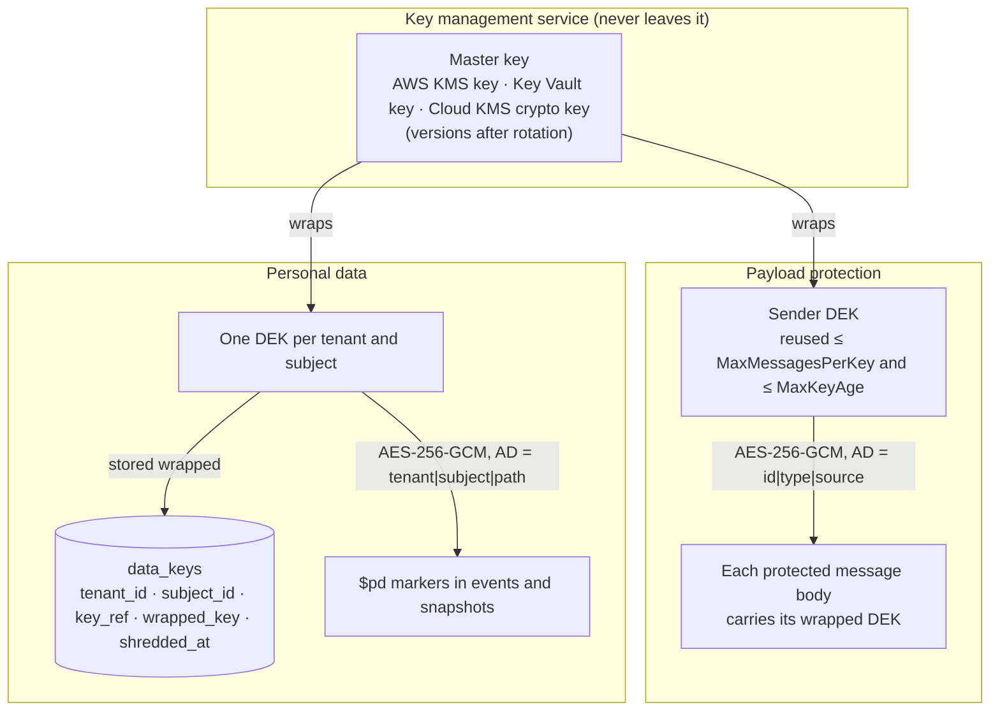
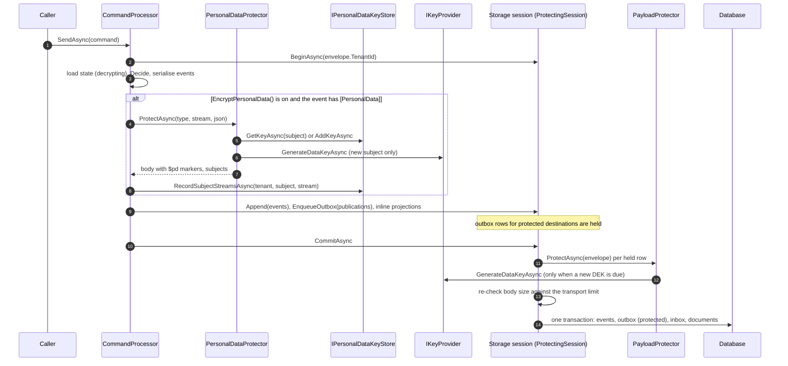
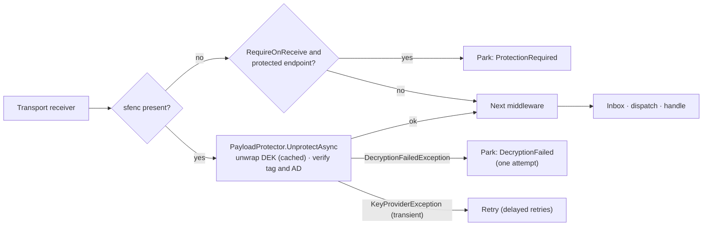
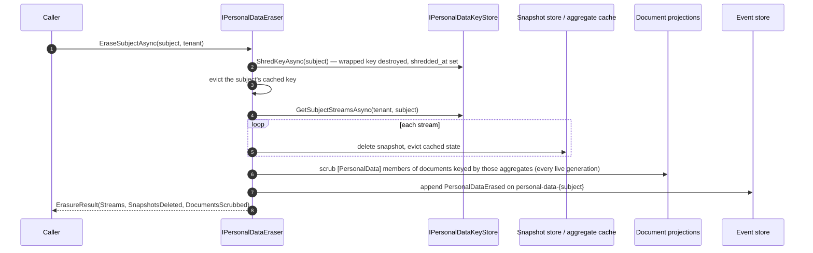
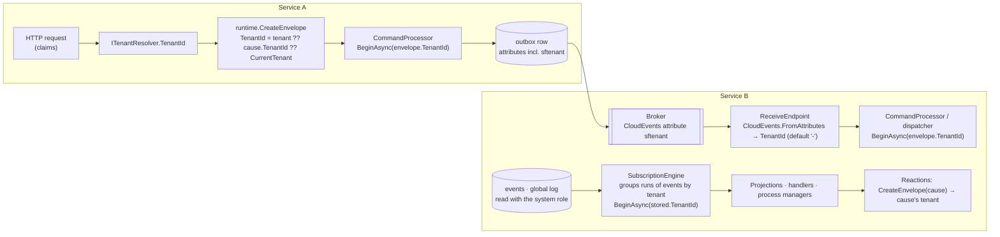
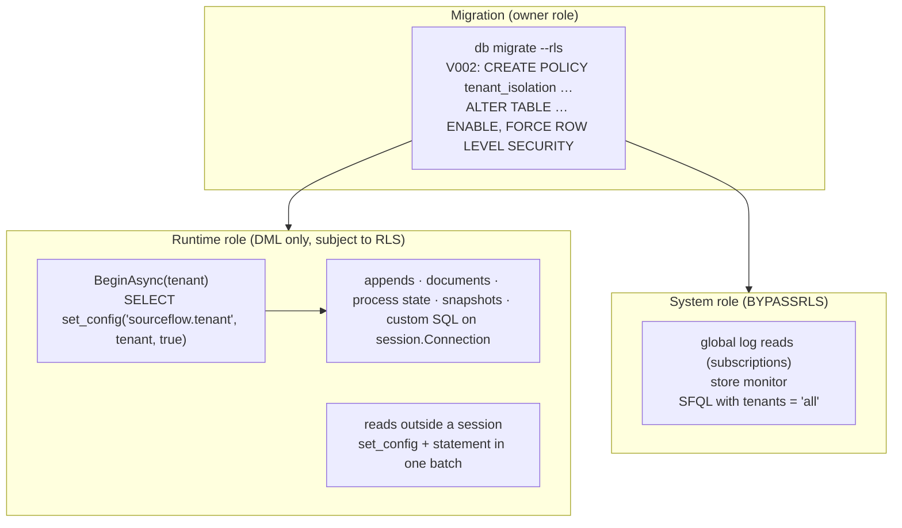
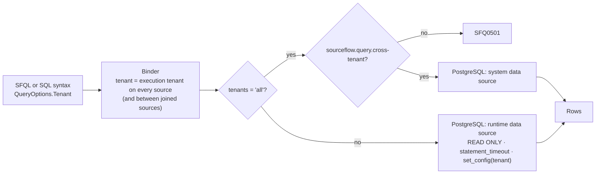

# 10. Security and multi-tenancy

This document describes how the security SPI, the data protection pipeline and conjoined multi-tenancy work inside
SourceFlow.Net v3.0.0, as built. For how to configure them, read the
[Security and Compliance Guide](../Security-and-Compliance-Guide.md). For the design rationale, read
[design doc 10](../../Design/10-Security-and-Compliance.md) and
[ADR-022](../../ADRs/ADR-022-conjoined-multi-tenancy-with-row-level-security.md).

## 1. What it is for

Two concerns share this document because they meet in the same places, the storage session and the message envelope:

- **Data protection.** Personal data in an immutable event log must be erasable, and message payloads must be unreadable
  in the outbox, the broker and on the wire. SourceFlow uses envelope encryption with keys held by a key management
  service, and erases data by destroying keys (crypto-shredding).
- **Multi-tenancy.** Many tenants share one schema (conjoined tenancy). Every tenant-scoped row carries a `tenant_id`, the
  tenant travels with every message, and on PostgreSQL row-level security enforces the boundary inside the database.

## 2. The moving parts

### 2.1 Security SPI (`SourceFlow.Security`, in `SourceFlow.Net`)

| Type | Role |
|------|------|
| `IKeyProvider` | The key management port: `GenerateDataKeyAsync` returns a `DataKey` (plaintext, wrapped form, key reference); `UnwrapDataKeyAsync(keyReference, wrapped)` returns the plaintext. `Name` appears in the `sfenc` attribute. |
| `DataKey` | A 256-bit data encryption key (DEK). Zeroes its plaintext on `Dispose`. |
| `KeyProviderException` | A key service failure. `IsTransient` decides retry versus park. |
| `LocalKeyProvider` | In-memory master keys with `Rotate()`, for tests and development. |
| `AwsKmsKeyProvider`, `AzureKeyVaultKeyProvider`, `GoogleKmsKeyProvider` | The cloud implementations, in `SourceFlow.Cloud.Aws`, `.Azure` and `.Gcp`. |
| `SecurityBuilder` | `sf.Security(s => …)`: `UseKeyProvider`, `Protect`, `EncryptPersonalData`, and the cloud `Use…Kms` extensions. |
| `PayloadProtector` | Message body encryption (AES-256-GCM, scheme `sf-aes256gcm-v1`). |
| `PayloadProtectionOptions` | Destinations, data key reuse limits, the receiver's key cache, `RequireOnReceive`. |
| `PersonalDataProtector` | Per-subject encryption of `[PersonalData]` members (`$pd` markers), decryption, scrubbing. |
| `IPersonalDataKeyStore` | Storage port for subject keys (`data_keys`) and the streams each subject's data lives in (`subject_streams`). Implemented by the in-memory, PostgreSQL and SQL Server stores. |
| `IPersonalDataEraser` | `EraseSubjectAsync(subjectId, tenantId)`; returns `ErasureResult`. |
| `PersonalDataErased` | The system event (`sourceflow.personal-data.erased`) appended on erasure. |
| `DecryptionFailedException`, `ProtectionRequiredException` | Permanent failures; the message is parked as `DecryptionFailed` or `ProtectionRequired`. |

Internal pieces: `ProtectingSessionFactory` (a storage session decorator that encrypts outbox rows at commit) and
`PayloadProtectionMiddleware` (the Receive-stage decryption). Neither is public; both are wired by `AddSourceFlow` when
`Protect(…)` is configured.

### 2.2 Classification and redaction

| Type | Role |
|------|------|
| `PersonalDataAttribute` (`Subject`) | Marks personal data and names its subject. A `DataClassificationAttribute`. |
| `SecretAttribute` | Marks secrets. A `DataClassificationAttribute`. |
| `SourceFlowTaxonomy` | `PersonalData`, `Secret` and `All` classifications in the `SourceFlow` taxonomy. |
| `SourceFlowBuilder.UseRedaction` | Configures `Microsoft.Extensions.Compliance.Redaction`; the default erases both classifications. |
| `SourceFlowOptions.LogPayloads` | Off by default. When on, parked payloads are logged with classified members redacted. |

### 2.3 Tenancy

| Type | Role |
|------|------|
| `ITenantResolver` (`SourceFlow.Runtime`) | The ambient tenant of the current operation; null means `SourceFlowOptions.DefaultTenant`. The default implementation always returns null. |
| `SourceFlowOptions.DefaultTenant` | The single-tenant default, `"-"` (`MessageEnvelope.DefaultTenant`). |
| `SourceFlowRuntime.CurrentTenant` | `Tenants.TenantId ?? Options.DefaultTenant`. |
| `MessageEnvelope.TenantId` | The tenant of a message; the CloudEvents extension attribute `sftenant`. |
| `IStorageSessionFactory.BeginAsync(tenantId, …)` | Every session is opened for one tenant (`IStorageSession.TenantId`). |
| `Buckets.Of(tenantId, stream)` | `xxHash32(tenant + '/' + stream) & 1023`: the bucket that fixes a stream's subscription partition. |
| `TenantIsolation` (`SourceFlow.Storage.PostgreSQL`) | `Runtime` (queries filter) or `RowLevelSecurity` (the database enforces it too). |
| `PostgreSqlStorageOptions.SystemConnectionString` / `SystemDataSource` | The `BYPASSRLS` connection for cross-tenant readers. |
| `QueryPermission.CrossTenant` | `sourceflow.query.cross-tenant`, needed for SFQL `options (tenants = 'all')`. |
| `IActorAccessor` | The actor recorded on new messages and dead-letter operations. |

## 3. The data protection pipeline

### 3.1 Key hierarchy



- The master key is the only key in the KMS. SourceFlow never sees it; it only asks the KMS to wrap and unwrap DEKs.
- **Payload DEKs** belong to the sending process. One is reused for at most `MaxMessagesPerKey` messages (default
  10,000) and `MaxKeyAge` (default 5 minutes), which keeps AES-GCM with random 96-bit nonces far inside its safe limit
  and costs one KMS call per key, not per message. Each message carries its wrapped DEK, so receivers need nothing but
  unwrap rights; they cache up to `UnwrappedKeyCacheSize` (256) unwrapped keys.
- **Subject DEKs** are created on first use and stored wrapped in `data_keys` ("first writer wins" when two nodes race).
  Unwrapped subject keys are cached (up to 10,000) in pinned memory and zeroed on eviction.
- **Rotation.** The key reference stored with each wrapped DEK names the master key version (the KMS ciphertext does for
  AWS and Google Cloud; the versioned key id does for Key Vault), so DEKs wrapped before a rotation still unwrap.

### 3.2 Write path



- Personal data is encrypted **after serialisation and before the append**, so only markers reach the database.
  `subject_streams` is written before the commit: an extra row after a failed commit is harmless, a missing row would
  leave a snapshot behind on erasure.
- Snapshots are written after the commit, in the background, and their state is encrypted the same way.
- Inline projections in the same session receive the **clear** event objects, so built-in document read models hold
  decrypted values (and are scrubbed on erasure, §3.4).
- Payload protection happens at `FlushAsync` or `CommitAsync` of the session. The outbox therefore stores the protected
  body, and the relay sends it as is. A key service failure at that point fails the command; nothing is committed.
- Publications are serialised from the domain event objects, not from the stored bodies. A domain event published
  `.AsIs()` carries its personal data in clear text (SF0013); integration events mapped with `.As(…)` are separate
  contracts.

### 3.3 Read paths

| Reader | Decrypts personal data | Notes |
|--------|------------------------|-------|
| Aggregate store (events and snapshots) | Yes | Erased members read as `"[erased]"`, 0, false or null |
| Aggregate cache | Holds decrypted state | Evicted on erasure |
| Subscriptions (projections, event handlers, process managers) | Yes | Events are opened before dispatch |
| `IAggregateReader` and the SFQL aggregate fold | Yes | |
| SFQL `from events` / `from stream` | **No** | Fields are returned as `$pd` markers |
| Read models | n/a | Hold whatever the projection wrote |

Protected messages are decrypted by the Receive-stage middleware before any other handling:



### 3.4 Erasure and its effects



| Where the data was | After erasure |
|--------------------|---------------|
| Events in the log | Unchanged bytes; the markers can no longer be decrypted and read as erased values |
| Snapshots | Deleted; rebuilt later from events, with erased values |
| Aggregate cache | Evicted |
| Built-in document read models | `[PersonalData]` members overwritten with erased values |
| Custom read models (EF Core, external stores) | Your projection handles `PersonalDataErased` |
| New writes for the subject | Stored as erased values; no new key is created |
| Projection rebuilds | Replay produces erased values |
| SFQL over read models | Returns the scrubbed values |
| Integration events already published | Out of reach; keep personal data out of them |

### 3.5 Crypto-shredding and tenants

Data keys belong to a tenant: `data_keys` is keyed by `(tenant_id, subject_id)` (PostgreSQL V006, SQL Server V002), and
`subject_streams` is tenant-scoped too (and covered by row-level security). Consequences:

- `EraseSubjectAsync(subject, tenantId)` shreds that tenant's key for the subject, deletes the snapshots and scrubs the
  documents of that tenant's streams. The same subject id in another tenant keeps its key and stays readable.
- The tenant is in each marker (`v2:{tenant}:{subject}:…`) and in the associated data, so a marker copied into another
  tenant's data does not decrypt there.
- Markers written before keys were per tenant (`v1:{subject}:…`, associated data `subject|path`) read with the key stored
  under the default tenant `-`, where the migration moved every existing key. Erasing a subject in the configured
  `DefaultTenant` also shreds that legacy key when the two differ.
- To erase a person everywhere, erase them in each tenant that holds their data.

### 3.6 Guarantees and failure behaviour

| Situation | Behaviour |
|-----------|-----------|
| No key provider with `Protect(…)` or `EncryptPersonalData()` | Startup fails |
| `EncryptPersonalData()` on a store without `IPersonalDataKeyStore` | Startup fails |
| Key service down while sending a protected message | The command fails; nothing is committed |
| Key service down while receiving | Transient: retried, then parked as `Exhausted` if it persists |
| Tampered or foreign protected message | `DecryptionFailedException`: parked as `DecryptionFailed`, never retried in a loop |
| Altered or moved `$pd` marker | `DecryptionFailedException` on read |
| Malformed personal data bytes (invalid UTF-8, lone surrogates) | Reported as `JsonException`, a permanent deserialisation failure, not a transient one (fuzzing finding F-03) |
| Erasure and the key service | Erasure makes no key service call: it destroys the wrapped key in the store |
| A failure after the key is shredded (snapshots or documents) | The subject is already unreadable; call `EraseSubjectAsync` again to finish the clean-up (shredding is idempotent) |
| Master key deleted in the KMS | Every value under it is unreadable: protect master keys with deletion protection |

## 4. Conjoined multi-tenancy

### 4.1 Data model

Every tenant-scoped table has `tenant_id text NOT NULL DEFAULT '-'` (the `subject_streams` column has no default) and
leads its key with it:

| Table | Key |
|-------|-----|
| `streams` | `(tenant_id, stream_id)` |
| `events` | unique `(tenant_id, stream_id, stream_version)`; `event_id` unique |
| `snapshots` | `(tenant_id, stream_id)` |
| `documents` | `(tenant_id, collection, id)` |
| `process_instances` | `(tenant_id, process_type, process_id)` |
| `subject_streams` | `(tenant_id, subject_id, stream_id)` |
| `data_keys` | `(tenant_id, subject_id)`; not covered by row-level security (read outside tenant sessions) |
| `schemas` | `(tenant_id, message_type, type_version)`; always `'-'`, schemas are code |

`outbox`, `inbox`, `checkpoints`, `leases`, `dead_letters`, `nodes` and `collection_aliases` hold no tenant column: they are keyed by globally unique message ids or by infrastructure names. A single-tenant service never
sees tenancy: everything runs under `'-'`.

The bucket of a stream is `xxHash32(tenant_id + '/' + stream_id) & 1023`, so the same stream id in two tenants is two
streams in (usually) different subscription partitions, and tenants spread across partitions.

### 4.2 How the tenant flows



The rules:

1. **New messages** take the explicit `tenant` argument if one is given, else the **cause's** tenant, else
   `CurrentTenant` (`ITenantResolver.TenantId ?? DefaultTenant`). A reaction to an event therefore stays in the event's
   tenant whatever the ambient context says.
2. **On the wire** the tenant is the CloudEvents attribute `sftenant`; a message without it is in the default tenant.
3. **On receive** the command processor and the message dispatcher open their session for `envelope.TenantId`. The
   resolver is not consulted.
4. **Subscriptions** read the global log across tenants and apply each run of same-tenant events in a session for that
   tenant, so projections, handlers and process managers write in the event's tenant.
5. **Reads** take the tenant explicitly: `IAggregateReader.LoadAsync(…, tenantId)`, `IPersonalDataEraser.EraseSubjectAsync
   (…, tenantId)`, `QueryOptions.Tenant`. Null means the ambient tenant (or `DefaultTenant` for erasure).
6. **Consistency tokens** carry the tenant (`ConsistencyToken.Tenant`).

`ITenantResolver` is resolved as a singleton, so an implementation reads an ambient context such as
`IHttpContextAccessor`; see the [guide](../Security-and-Compliance-Guide.md#2-a-secure-configuration-at-a-glance).

### 4.3 Isolation in the storage adapters

| Adapter | `TenantIsolation.Runtime` (every statement filters by tenant) | Row-level security |
|---------|-------------------------------------------------------------|--------------------|
| In-memory | Yes | n/a |
| PostgreSQL | Yes (default) | Yes, opt in |
| SQL Server | Yes | **Not in 3.0** |

### 4.4 PostgreSQL row-level security

With `PostgreSqlStorageOptions.TenantIsolation = TenantIsolation.RowLevelSecurity`:



**Policies.** Migration V002 creates one policy named `tenant_isolation` on `streams`, `events`, `snapshots`,
`documents`, `process_instances` and `subject_streams`:

```sql
CREATE POLICY tenant_isolation ON sourceflow.events
    USING (tenant_id = current_setting('sourceflow.tenant', true))
    WITH CHECK (tenant_id = current_setting('sourceflow.tenant', true));
```

The policies always exist; they take effect only where the migrator enables row-level security. With
`RowLevelSecurity`, the migrator runs `ENABLE ROW LEVEL SECURITY, FORCE ROW LEVEL SECURITY` on those tables. `FORCE`
makes the policies apply to the table owner too, so only superusers and `BYPASSRLS` roles skip them. With `Runtime`, it
disables them again. Partitions created by `PartitionEvents` get the same policy.

**Setting the tenant.** `set_config('sourceflow.tenant', tenant, true)` is transaction-local:

- A storage session sets it at `BeginAsync`, before any other statement, so custom SQL on `session.Connection` (EF Core
  projections, session projections) is scoped too. `set_config` writes nothing, so it allocates no transaction id and
  the commit-ordered global log is unaffected.
- A tenant-scoped read outside a session sends `set_config` and the statement in one batch, which is one implicit
  transaction. The setting never leaks to the next user of a pooled connection.
- A connection with no setting sees **no rows** (`current_setting(…, true)` is null).

**The system role.** Subscriptions read the global log across all tenants, so the store reads it, and the monitoring
queries, through `SystemConnectionString` or `SystemDataSource`: a role with `BYPASSRLS`. Options validation fails at
startup without one.

**Verification.** At startup the migrator checks that row-level security on the tenant tables matches the configured
`TenantIsolation`, and fails with "Row-level security must be … for TenantIsolation.…" otherwise. Re-running
`db migrate` with the other mode changes only the tables whose state differs.

**Roles in practice.**

| Role | Needs | Configured as |
|------|-------|---------------|
| Owner | DDL | runs `dotnet sourceflow db migrate --rls` |
| Runtime | DML on the SourceFlow tables (append-only `events` with `db script --grants`), no `BYPASSRLS` | `ConnectionString` / `DataSource` |
| System | DML and `BYPASSRLS` | `SystemConnectionString` / `SystemDataSource` |

The whole storage conformance kit, and the Bank transfer end-to-end scenario, run under row-level security through a
DML-only role in CI.

### 4.5 Tenant-scoped queries



- The tenant of a query is `QueryOptions.Tenant`, or the ambient tenant. Over HTTP it comes from
  `SourceFlowQueryApiOptions.Tenant` (default: the `sourceflow:tenant` or `tenant` claim).
- The binder adds the tenant predicate to every source, and between every pair of joined sources.
- `options (tenants = 'all')` needs `sourceflow.query.cross-tenant`. On PostgreSQL that query runs on the system data
  source; every other query runs in a read-only transaction on the runtime data source with the tenant set, so
  row-level security enforces the predicate a second time.
- The in-memory interpreter and the SQL Server compiler apply the predicate in the query.
- Named domain queries go through the same pipeline.

### 4.6 Guarantees and failure behaviour

| Situation | Behaviour |
|-----------|-----------|
| A query or custom SQL forgets the tenant predicate (PostgreSQL with RLS) | Sees only the session tenant's rows |
| A write with another tenant's `tenant_id` (PostgreSQL with RLS) | Rejected by `WITH CHECK` |
| A connection without `sourceflow.tenant` (PostgreSQL with RLS) | Sees no rows |
| Database RLS state differs from `TenantIsolation` | Startup fails |
| `RowLevelSecurity` without a system connection | Options validation fails at startup |
| A message without `sftenant` | Handled in the default tenant `'-'` |
| SQL Server or in-memory | Isolation depends on SourceFlow's own predicates only |

## 5. Extension points

| Extension | How |
|-----------|-----|
| A different key service (HSM, Vault, …) | Implement `IKeyProvider`; register with `s.UseKeyProvider(sp => …)`. Map throttling and outages to `KeyProviderException(isTransient: true)` and refusals to `isTransient: false`. |
| Key storage for a custom storage adapter | Implement `IPersonalDataKeyStore` and expose it as `StoragePorts.PersonalData`; check it with `PersonalDataKeyStoreConformance` in `SourceFlow.Testing`. |
| Tenant resolution | Register an `ITenantResolver`. |
| Actor resolution | Register an `IActorAccessor`. |
| Redaction | `sf.UseRedaction(r => …)` with any `Microsoft.Extensions.Compliance.Redaction` redactor. |
| Query permissions and tenant over HTTP | `SourceFlowQueryApiOptions.Permissions` and `.Tenant`. |
| Erasure in custom read models | Handle `PersonalDataErased` in the projection. |

## 6. Designed but not in 3.0

| Item | Where it is designed | Status |
|------|----------------------|--------|
| Database-per-tenant behind `ITenantResolver` | ADR-022 | 3.x |
| Per-tenant metric tags (bounded top-N) | ADR-022 consequences | Not built: SourceFlow metrics carry no tenant tag |
| Row-level security on SQL Server | doc 05 | Not in 3.0 |
| `sfsig` envelope signatures | doc 10 §1 | 3.x candidate |
| Periodic checksum job over `events` | doc 10 §1 | 3.x |
| SQL Server append-only grants script | security review O-3 | Open |
| Personal data encryption of workflow state | WP-S.5 deviation | Not in 3.0 |
| SFQL `from events` decrypting personal data in process | doc 14 §8 | Not built: markers are returned (doc 10 §4 as built) |

## 7. Related documents

- [Security and Compliance Guide](../Security-and-Compliance-Guide.md)
- [Event store and persistence](05-Event-Store-and-Persistence.md), [Projections and read models](06-Projections-and-Read-Models.md)
- [Messaging pipeline and middleware](04-Messaging-Pipeline-and-Middleware.md), [Cloud transports](07-Cloud-Transports.md)
- [Query side and SFQL](08-Query-Side-and-SFQL.md)
- [Design doc 10](../../Design/10-Security-and-Compliance.md), [design doc 05](../../Design/05-Event-Store-and-Persistence.md),
  [design doc 14](../../Design/14-Query-Side-and-SFQL.md)
- [ADR-022](../../ADRs/ADR-022-conjoined-multi-tenancy-with-row-level-security.md),
  [ADR-013](../../ADRs/ADR-013-use-platform-libraries-delete-bespoke-equivalents.md),
  [ADR-026](../../ADRs/ADR-026-per-service-query-api-with-sql-syntax-and-injection-proof-compilation.md)
- Source: [`src/Core/SourceFlow.Net/Security`](../../../../src/Core/SourceFlow.Net/Security),
  [`PostgreSqlStore.Tenancy.cs`](../../../../src/Storage/SourceFlow.Storage.PostgreSQL/PostgreSqlStore.Tenancy.cs),
  [`V002__tenant_policies.sql`](../../../../src/Storage/SourceFlow.Storage.PostgreSQL/Schema/V002__tenant_policies.sql)
