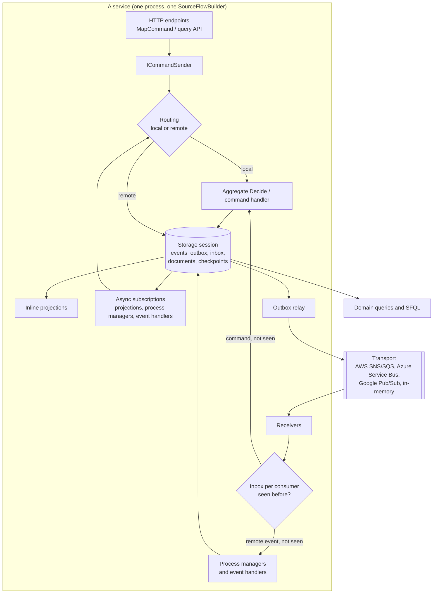

# SourceFlow.Net v3 architecture

These documents explain how SourceFlow.Net v3 works inside, as built: the components, how a command and an event move
through them, what is guaranteed, what happens when something fails, and where you can extend it. They are for developers
who want to understand the framework, operate it with confidence, or write an adapter for another database or broker.

For how to use each package, see the [package READMEs](../README.md#packages). For why it is designed this way, see the
[design documents](../../Design/README.md) and the [ADRs](../../ADRs/README.md).

## The big picture

- **One core package** (`SourceFlow.Net`) holds the programming model, the runtime and the service provider interfaces
  (SPIs). Adapters for databases and clouds implement the SPIs, and every adapter passes the same conformance kit
  ([ADR-027](../../ADRs/ADR-027-single-core-package-with-extensibility-spis-and-categorised-adapters.md),
  [ADR-014](../../ADRs/ADR-014-transport-spi-and-conformance-kit-parity-required.md)).
- **The source generator** turns your aggregates, handlers, projections, process managers, workflows and message types into
  a module that registers them without reflection.
- **Everything that changes state commits in one transaction** in the service's store: the events, the outbox messages that
  must leave, the inbox record of what arrived, and inline read models. This is what makes delivery effectively once.

## Documents

| # | Document | Read it to understand |
|---|----------|-----------------------|
| 01 | [Architecture overview](01-Architecture-Overview.md) | The layers, the packages, the runtime components and how they fit |
| 02 | [Command flow](02-Command-Flow.md) | A command from HTTP or `ICommandSender` to committed events: routing, decide, append, concurrency, rejections, remote owners |
| 03 | [Event flow](03-Event-Flow.md) | What happens after a commit: the global position, projections, subscriptions, publication, remote events, reactions, timers |
| 04 | [Messaging pipeline and middleware](04-Messaging-Pipeline-and-Middleware.md) | The envelope, serialization and the type registry, middleware stages, retries and parking |
| 05 | [Event store and persistence](05-Event-Store-and-Persistence.md) | The persistence SPI, streams and the global position, the storage session, the outbox relay, leases, writing a storage adapter |
| 06 | [Projections and read models](06-Projections-and-Read-Models.md) | Inline and async projections, documents, checkpoints, rebuilds, blue/green generations, EF Core |
| 07 | [Cloud transports](07-Cloud-Transports.md) | The transport SPI, how each cloud maps queues and topics, provisioning, acknowledgement, writing a transport adapter |
| 08 | [Query side and SFQL](08-Query-Side-and-SFQL.md) | Domain queries, the SFQL language and its compilers, the schema catalog, the query API |
| 09 | [Process managers and workflows](09-Process-Managers-and-Workflows.md) | Durable process state and timers, workflows compiled from YAML, versions, SourceFlow Studio |
| 10 | [Security and multi-tenancy](10-Security-and-Multi-Tenancy.md) | Personal-data encryption and crypto-shredding, key providers, tenancy with row-level security |

## Reading order

New to SourceFlow: 01, 02, 03, then whichever area you are working on. Writing an adapter: 01, 04, then 05 (storage) or 07
(transport), and the [testing toolkit](../SourceFlow.Testing-README.md) for the conformance kits.
