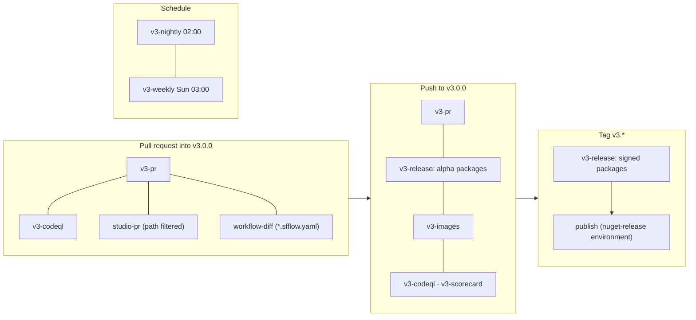
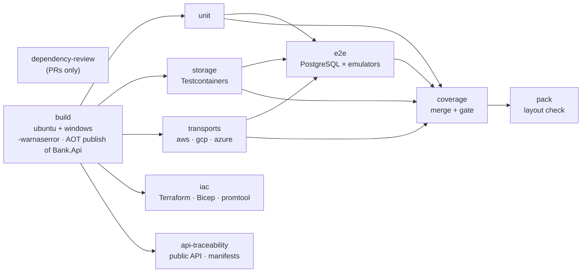

# GitHub Actions Setup

This document describes the continuous integration and delivery of SourceFlow.Net v3: every workflow under
[`.github/workflows`](../../../.github/workflows), what triggers it, its jobs, the secrets and variables it needs, the
quality gates, versioning, and how to run the same checks on your machine.

The plan behind it is [implementation plan 08](../implementation/08-CI-CD-and-Quality-Gates.md). Where this document and
the plan differ, this document describes the workflows as they are in the repository.

## Contents

1. [Workflows at a glance](#1-workflows-at-a-glance)
2. [Pull request checks (`v3-pr.yml`)](#2-pull-request-checks-v3-pryml)
3. [Studio checks (`studio-pr.yml` and `workflow-diff.yml`)](#3-studio-checks-studio-pryml-and-workflow-diffyml)
4. [Code scanning (`v3-codeql.yml` and `v3-scorecard.yml`)](#4-code-scanning-v3-codeqlyml-and-v3-scorecardyml)
5. [Release pipeline (`v3-release.yml`)](#5-release-pipeline-v3-releaseyml)
6. [Demo images (`v3-images.yml`)](#6-demo-images-v3-imagesyml)
7. [Nightly (`v3-nightly.yml`)](#7-nightly-v3-nightlyyml)
8. [Weekly fuzzing (`v3-weekly.yml`)](#8-weekly-fuzzing-v3-weeklyyml)
9. [v2 workflows](#9-v2-workflows)
10. [Secrets, variables and repository settings](#10-secrets-variables-and-repository-settings)
11. [Quality gates](#11-quality-gates)
12. [Versioning](#12-versioning)
13. [Running the checks locally](#13-running-the-checks-locally)
14. [Troubleshooting](#14-troubleshooting)

## 1. Workflows at a glance

| Workflow | Trigger | Purpose |
|----------|---------|---------|
| `v3-pr.yml` | PR into `v3.0.0`; push to `v3.0.0` | The required checks: build, unit, storage, transports, IaC, end to end, coverage, API approval, pack |
| `studio-pr.yml` | PR into or push to `v3.0.0` touching Studio, workflow or tool paths | Studio core client, app, action and Playwright tests |
| `workflow-diff.yml` | PR into `v3.0.0` changing `**/*.sfflow.yaml` | Before and after statecharts and a PR comment |
| `v3-codeql.yml` | PR into or push to `v3.0.0`; Mondays 05:17 UTC | CodeQL for C# (`security-extended`) |
| `v3-scorecard.yml` | Push to `v3.0.0`; Mondays 04:30 UTC; manual | OpenSSF Scorecard |
| `v3-release.yml` | Push to `v3.0.0`; tags `v3.*`; manual | Pack, SBOM, sign, attest, publish |
| `v3-images.yml` | Push to `v3.0.0` or `v3/**` touching the sample's inputs; manual | Bank API and Studio demo images on ghcr.io |
| `v3-nightly.yml` | Daily 02:00 UTC; manual | Database matrix, real cloud, chaos, load, relay latency, DAST, benchmarks |
| `v3-weekly.yml` | Sundays 03:00 UTC; manual | Coverage-guided fuzzing, 2 hours per target |
| `Master-Build.yml`, `Release-CI.yml`, `GCP-Build.yml`, `Master-CodeQL.yml`, `Release-CodeQL.yml` | v2 branches only | The v2 line (section 9) |



Every v3 workflow sets up .NET from [`global.json`](../../../global.json) (SDK `10.0.100`, `rollForward: latestFeature`),
which also opts `dotnet test` into Microsoft.Testing.Platform.

## 2. Pull request checks (`v3-pr.yml`)

Runs on every pull request into `v3.0.0` and every push to it. A newer run on the same ref cancels the older one.
Permissions: `contents: read`.



| Job | Runs on | What it does |
|-----|---------|--------------|
| `dependency-review` | ubuntu | `actions/dependency-review-action`; fails on new or updated dependencies with a moderate or worse vulnerability. Pull requests only. |
| `build (ubuntu)`, `build (windows)` | both | `dotnet restore` and `dotnet build SourceFlow.slnx -c Release -warnaserror`. On Linux also `dotnet publish samples/Bank/Bank.Api -p:SourceFlowAotCheck=true -warnaserror` (ARCH-06: the core and adapters stay AOT-clean). The project sets `PublishAot` itself when `SourceFlowAotCheck` is true: `-p:PublishAot=true` on the command line would also reach the `netstandard2.0` source generator, which cannot be AOT-compiled (NETSDK1207). |
| `unit` | ubuntu | `dotnet test --solution SourceFlow.slnx` excluding the traits `Requires=Docker`, `LocalStack`, `PubSubEmulator`, `ServiceBusEmulator`, `RealCloud`, `Terraform` and `Category=Chaos`, `Performance`. This includes unit, architecture, workflow golden and fuzz-seed tests and the in-memory storage and transport conformance kits. |
| `storage` | ubuntu | `tests/Storage/SourceFlow.Storage.Tests` with Testcontainers (PostgreSQL, PostgreSQL with row-level security, SQL Server), excluding `Category=Chaos`. |
| `transports (aws\|gcp\|azure)` | ubuntu | Starts the emulator from `.github/emulators/<name>` and waits for its health gate, then runs `tests/Cloud/SourceFlow.Cloud.Tests` filtered by `Cloud=Aws\|Gcp\|Azure`, excluding `RealCloud` and `Terraform`. |
| `iac` | ubuntu | `terraform fmt -check` over `deploy/topology/terraform`; `promtool check rules` over `deploy/observability/sourceflow-alerts.yaml`; the `Requires=Terraform` tests, which apply the Terraform modules to LocalStack and the Pub/Sub emulator, run every module's `terraform test`, and build the Bicep module. |
| `e2e` | ubuntu | Starts all three emulators, then runs `tests/EndToEnd/SourceFlow.EndToEnd.Tests` excluding `Chaos`, `Performance` and `RealCloud`: the Bank cross-service scenarios on PostgreSQL over every transport, the OrderFulfilment workflow scenarios, and the v2 bridge. |
| `coverage` | ubuntu | Downloads every job's Cobertura files, merges them with ReportGenerator, runs `tools/CoverageGate` against `tools/CoverageGate/thresholds.json`, and writes a summary to the job page. |
| `api-traceability` | ubuntu | Runs `Category=PublicApi` and `Category=Architecture` (public API approval files and ARCH-08 traceability), then `dotnet sourceflow manifest export --check` for the Bank sample and the four OrderFulfilment services (manifest drift). |
| `pack` | ubuntu | `dotnet pack SourceFlow.slnx -o artifacts`, then checks that `SourceFlow.Net` contains `analyzers/dotnet/cs/SourceFlow.Generators.dll` and that no package has a `lib/` folder other than `lib/net10.0/`. Uploads the packages as the `packages` artifact (nothing is published). |

Test runs share these arguments: `-c Release --no-build --ignore-exit-code 8 --coverage --coverage-output-format cobertura
--report-trx`. Exit code 8 means "this filter selected no tests in a project", which is expected for projects without
tests of that category. Every test job uploads its `TestResults` folder.

**Emulator environment.** The `transports` and `e2e` jobs set `AWS_ENDPOINT_URL=http://localhost:4566` (with test
credentials and `AWS_REGION=eu-west-1`), `PUBSUB_EMULATOR_HOST=localhost:8085`, `SERVICEBUS_EMULATOR_CONNECTION` and
`SERVICEBUS_EMULATOR_ADMIN_CONNECTION`. Tests use these when they are set and otherwise start the pinned images with
Testcontainers. `MSSQL_SA_PASSWORD` comes from the `EMULATOR_SA_PASSWORD` secret, with a fixed fallback for forks.

| Emulator | Compose file | Pinned image | Health gate |
|----------|--------------|--------------|-------------|
| LocalStack (SQS, SNS, KMS) | `.github/emulators/localstack/docker-compose.yml` | `localstack/localstack:3.8` | `/_localstack/health` reports sqs `available` |
| Pub/Sub | `.github/emulators/pubsub/docker-compose.yml` | `gcr.io/google.com/cloudsdktool/google-cloud-cli:590.0.1-emulators` | creating a topic succeeds |
| Service Bus | `.github/emulators/servicebus/docker-compose.yml` | `mcr.microsoft.com/azure-messaging/servicebus-emulator:2.0.1` + `azure-sql-edge:2.0.0` | `http://localhost:5300/health` |

See [Cloud integration testing](Cloud-Integration-Testing.md) for the tests themselves.

## 3. Studio checks (`studio-pr.yml` and `workflow-diff.yml`)

### `studio-pr.yml`

Triggered by pull requests into and pushes to `v3.0.0` that touch `studio/**`, `src/Workflows/**`,
`src/Tooling/SourceFlow.Tool/**`, `schemas/**`, `tests/workflow-golden/**`, `samples/OrderFulfilment/**`, the DSL
reference or either Studio workflow. One job, `core-client`, in `studio/` with Node 22.18 and npm:

| Step | Command |
|------|---------|
| Install | `npm ci` |
| Type check | `npm run typecheck` |
| WebAssembly core | `npm run build:wasm` (no `wasm-tools` workload needed) |
| Vitest: WASM-01..08, STU-UT, STU-CT, the static site build and the action | `npm test` |
| The `workflow-diff` action | `npm run build:action` |
| The app | `npm run build` |
| The local host | `dotnet build src/Tooling/SourceFlow.Tool -c Debug` |
| Playwright (Chromium) STU-E2E | `npx playwright install --with-deps chromium`, then `npm run e2e` |

Playwright traces are uploaded when the job fails.

### `workflow-diff.yml`

On a pull request into `v3.0.0` that changes `**/*.sfflow.yaml`, it builds the action and its WebAssembly core from the
same commit and runs `./studio/action`. The action draws every changed workflow's statechart before and after, writes
the SVGs to the `workflow-diff` artifact, and comments the changes with Mermaid diagrams. Permissions:
`contents: read`, `pull-requests: write`. Pull requests from forks get a read-only token, so the comment is skipped and
only the artifact is uploaded. See the [Studio README](SourceFlow.Studio-README.md).

## 4. Code scanning (`v3-codeql.yml` and `v3-scorecard.yml`)

- **`v3-codeql.yml`** builds `SourceFlow.slnx` and analyses C# with the `security-extended` query suite. Results go to
  the repository's code scanning alerts (`security-events: write`).
- **`v3-scorecard.yml`** runs `ossf/scorecard-action`, publishes the results and uploads SARIF to code scanning. The target
  score is 7 or more.

The CodeQL workflows use the advanced setup. If the repository's **default** CodeQL setup is enabled, GitHub rejects the
advanced workflow's upload: disable the default setup under Settings, Code security, Code scanning.

## 5. Release pipeline (`v3-release.yml`)

| Event | Version | Signing | Published to |
|-------|---------|---------|--------------|
| Push to `v3.0.0` | `3.0.0-alpha.<run number>` | When the certificate is configured; otherwise a warning | GitHub Packages |
| Tag `v3.0.0-rc.N` or another `v3.*` | the tag without its `v` | **Required**: the job fails without the certificate | GitHub Packages, then nuget.org and a GitHub release (after approval) |

Two jobs:

**`release`** (permissions `contents: write`, `packages: write`, `id-token: write`, `attestations: write`):

1. **Version.** From the tag, or `3.0.0-alpha.<run>` for a push.
2. **Studio.** Node 22.18, `npm ci`, `npm run build:wasm` and `npm run build` in `studio/`, so the `SourceFlow.Tool` package
   embeds the Studio web app and WebAssembly core (`sourceflow studio`).
3. **Build** with `-warnaserror -p:Version=…`. CI builds are deterministic, with `ContinuousIntegrationBuild`,
   `EmbedUntrackedSources` and SourceLink from `Directory.Build.props`.
4. **Unit tests**: `Category=Unit`, excluding `Requires=Docker`.
5. **Pack** with symbol packages (`.snupkg`).
6. **SBOM.** `dotnet-CycloneDX` (pinned `CYCLONEDX_VERSION`) writes one CycloneDX JSON SBOM per shipped package to
   `artifacts/sbom/<package>.cdx.json`.
7. **Author signing.** `dotnet nuget sign` with the certificate from `NUGET_SIGNING_CERTIFICATE`, a timestamp from
   `TIMESTAMPER`, then `dotnet nuget verify --all`.
8. **Provenance.** `actions/attest-build-provenance` attests every `.nupkg` (Sigstore, keyless).
9. **Upload** the `packages-<version>` artifact and push to GitHub Packages with `GITHUB_TOKEN`.

**`publish`** (tags only, environment `nuget-release`): downloads the artifact, pushes to nuget.org with `NUGET_API_KEY`,
and creates the GitHub release with generated notes, the packages, the symbol packages and the SBOMs (marked
pre-release when the version has a suffix).

Never create the tag `v3.0.0` while the branch `v3.0.0` exists: the names would be ambiguous. Pre-release tags such as
`v3.0.0-rc.1` are fine ([plan 02 §2](../implementation/02-Branching-Versioning-and-Repository-Layout.md#2-versioning-gitversion)).

What ships: every project under `src/` that is packable, which is `SourceFlow.Net` (with the generator inside),
`SourceFlow.Storage.PostgreSQL`, `.SqlServer`, `.EntityFrameworkCore`, `SourceFlow.Cloud.Aws`, `.Azure`, `.Gcp`,
`SourceFlow.AspNetCore`, `SourceFlow.Testing`, `SourceFlow.Studio` and the .NET tool `SourceFlow.Tool`. `SourceFlow.Generators`
(shipped inside `SourceFlow.Net`) and `SourceFlow.Studio.Wasm` (embedded in the tool) set `IsPackable` to false.

## 6. Demo images (`v3-images.yml`)

Builds two multi-architecture images (`linux/amd64`, `linux/arm64`) with Buildx and pushes them to
`ghcr.io/<owner>/…`:

| Image | Dockerfile |
|-------|------------|
| `sourceflow-bank-api` | `samples/Bank/Bank.Api/Dockerfile` |
| `sourceflow-studio-demo` | `samples/Studio/SourceFlow.Studio.Demo/Dockerfile` |

Tags: the branch name, the short commit SHA, and `v3-latest` (the tag [`docker-compose.yml`](../../../docker-compose.yml)
pulls by default). It runs on pushes to `v3.0.0` and `v3/**` that change `src/Core`, `src/Hosting`, the PostgreSQL
adapter, `samples`, the build props, `global.json`, `.dockerignore` or the workflow itself. Permissions:
`packages: write`, with `GITHUB_TOKEN`.

## 7. Nightly (`v3-nightly.yml`)

Daily at 02:00 UTC, and on demand. Every job checks out `v3.0.0`. Permissions: `contents: read`, `id-token: write` (OIDC
to the cloud sandboxes).

| Job | What it does |
|-----|--------------|
| `storage (<db>)` | The storage tests on PostgreSQL 15, 16, 17 and 17 with partitioned events, and on SQL Server 2022 and 2025. `SOURCEFLOW_TEST_DATABASE`, `SOURCEFLOW_TEST_POSTGRES_IMAGE` and `SOURCEFLOW_TEST_SQLSERVER_IMAGE` choose the image; `Provider=PostgreSQL\|SqlServer` filters the tests. |
| `component benchmarks` | `dotnet run -c Release --project benchmarks/SourceFlow.Benchmarks -- baseline`; uploads `benchmarks/baselines/*.json` and the BenchmarkDotNet results. No regression gate yet. |
| `real cloud (aws\|azure\|gcp)` | Only when the repository variable `SOURCEFLOW_REAL_CLOUD` is `true`. Signs in by OIDC (`aws-actions/configure-aws-credentials`, `azure/login`, `google-github-actions/auth`), then runs the transport conformance kit, the real KMS tests and the end-to-end scenarios against the real cloud. The job sets the environment variable `SOURCEFLOW_REAL_CLOUD` to the cloud name, which switches the tests from emulators to real resources. |
| `chaos` | `Category=Chaos` (CH-01..10 and the workflow chaos scenario). |
| `load test (tier M)` | `docker compose up -d --build --wait postgres bank-api`, then k6 (`grafana/k6:2.3.0`) runs `loadtest/k6/bank-tier-m.js` at 1,000 commands/s for 5 minutes. Reports only (`continue-on-error`): the hosted runner shares its CPUs between the service, PostgreSQL and k6. |
| `relay latency (emulators)` | `Category=Performance` on the three emulators (PERF-07: outbox commit to broker acknowledgement). |
| `dast (OWASP ZAP)` | Starts the Bank API and runs `zap-api-scan.py` against `deploy/dast/query-api.openapi.json` with `deploy/dast/zap-rules.tsv`. Fails on any medium or high finding; the report is uploaded. |
| `long-properties` | `Category=Property` with `CsCheck_Iter=50000`: the CsCheck property tests (snapshot fold equivalence, storage linearizability on every store, SFQL parameterisation on both SQL engines, workflow runtime against the simulator) run with many more iterations than in the PR gate. |

Not built from plan 08 §3: the sweeper for leftover cloud resources (the real-cloud tests delete their own prefixed
resources), and automatic issues for benchmark regressions.

## 8. Weekly fuzzing (`v3-weekly.yml`)

Sundays at 03:00 UTC, or on demand with a `seconds` input (default 7,200). One job per target, each with a 180-minute
timeout:

`cloudevents-binary`, `cloudevents-structured`, `aws-wire`, `gcp-wire`, `azure-wire`, `registry`, `protected-payload`,
`personal-data`, `sfql`, `sql`.

Each job builds `libfuzzer-dotnet` from source at the pinned `LIBFUZZER_DOTNET_REF`, installs `SharpFuzz.CommandLine`
(`SHARPFUZZ_VERSION`), publishes `fuzz/SourceFlow.Fuzz`, instruments the `SourceFlow.*` and `Bank.*` assemblies, writes
the seed corpus and dictionaries, and fuzzes with `SOURCEFLOW_FUZZ_TARGET` set. Findings are uploaded as
`fuzz-findings-<target>` when a job fails. Mutation testing and the licence report named in plan 08 are not part of this
workflow yet. See [`fuzz/README.md`](../../../fuzz/README.md).

## 9. v2 workflows

These run only on the v2 line and never on `v3.0.0`:

| Workflow | Trigger |
|----------|---------|
| `Master-Build.yml` | push to `master` |
| `Master-CodeQL.yml` | push to `master`; weekly |
| `Release-CI.yml` | push to `release` or `release/**`; tag `release-packages` (uses GitVersion, secrets `GH_Packages` and `NUGET_API_KEY`) |
| `Release-CodeQL.yml` | push to `release` or `release/**`; weekly |
| `GCP-Build.yml` | push to `gcp_cloud`; PR into `gcp_cloud` or `master` |

The v2 setup is described in the [legacy GitHub Actions guide](../../legacy-version/GitHub-Actions-Setup.md).

## 10. Secrets, variables and repository settings

### Secrets

| Name | Used by | Required |
|------|---------|----------|
| `GITHUB_TOKEN` | release (GitHub Packages, GitHub release), images (ghcr.io), workflow-diff | Automatic |
| `NUGET_SIGNING_CERTIFICATE` | `v3-release.yml`: the base64 PFX for author signing | For release tags |
| `NUGET_SIGNING_PASSWORD` | `v3-release.yml`: the PFX password | For release tags |
| `NUGET_API_KEY` | `v3-release.yml` `publish`, stored in the `nuget-release` environment | For nuget.org |
| `EMULATOR_SA_PASSWORD` | `v3-pr.yml`, `v3-nightly.yml`: SQL password of the Service Bus emulator's database | Optional (fallback built in) |

### Variables (nightly real-cloud and KMS runs)

| Name | Meaning |
|------|---------|
| `SOURCEFLOW_REAL_CLOUD` | `true` enables the `real cloud` jobs |
| `AWS_TEST_ROLE_ARN`, `AWS_TEST_REGION` | The IAM role assumed through OIDC, and its region |
| `AZURE_CLIENT_ID`, `AZURE_TENANT_ID`, `AZURE_SUBSCRIPTION_ID` | The federated identity for `azure/login` |
| `AZURE_SERVICEBUS_NAMESPACE` | The Service Bus namespace the tests use |
| `GCP_WIF_PROVIDER`, `GCP_TEST_SERVICE_ACCOUNT` | Workload Identity Federation provider and service account |
| `SOURCEFLOW_KMS_AWS_KEY`, `SOURCEFLOW_KMS_AZURE_KEY`, `SOURCEFLOW_KMS_GCP_KEY` | Keys for the real KMS tests; each provider's test is skipped when its variable is empty |

No long-lived cloud credential is stored: the cloud identities are federated with GitHub's OIDC token.

### Repository settings

- **Environment `nuget-release`** with required reviewers, holding `NUGET_API_KEY`.
- **Packages**: the workflows publish with `GITHUB_TOKEN`; the repository needs write access to its packages.
- **Code scanning**: default CodeQL setup disabled (section 4).
- **Branch protection on `v3.0.0`** (plan 08 §8): required checks `build (ubuntu)`, `build (windows)`, `unit`, `storage`,
  `transports (aws)`, `transports (gcp)`, `transports (azure)`, `e2e`, `coverage`, `api-traceability` and `codeql`;
  code-owner review; up-to-date branches; squash merge only; no force pushes. These are repository settings, not files,
  so check them in the repository.
- **Renovate**: [`renovate.json`](../../../renovate.json) opens weekly grouped PRs into `v3.0.0` for NuGet packages,
  container images and GitHub Actions, with a 14-day minimum release age. Image bumps for the emulators need a manual
  licence review.

## 11. Quality gates

| Gate | Where | As built |
|------|-------|----------|
| Zero build warnings, analyzers clean, AOT analysis clean | `build` | Enforced (`-warnaserror`, AOT publish of the Bank API) |
| Unit, conformance kits, emulator TCK and end-to-end tests green | `unit`, `storage`, `transports`, `e2e` | Enforced |
| Infrastructure as code valid | `iac` | Enforced |
| Public API approved, traceability, manifests without drift | `api-traceability` | Enforced |
| Packages contain the generator and only `net10.0` libraries | `pack` | Enforced |
| No vulnerable new dependencies | `dependency-review` | Enforced (moderate or worse) |
| Coverage thresholds per package | `coverage` | **Reports only**: every package in `thresholds.json` has `"enforce": false`, and the "no drop over 0.5 points" rule needs a baseline report the workflow does not pass yet |
| Micro-benchmark regressions | — | Not wired: benchmarks run nightly and upload results only |
| Nightly green, real-cloud TCK green, chaos green | `v3-nightly.yml` | Milestone and release sign-off, not merge |
| Studio tests green | `studio-pr.yml` | Enforced on Studio paths |
| Signed packages on release tags | `v3-release.yml` | Enforced |

Coverage targets (line / branch) from [`tools/CoverageGate/thresholds.json`](../../../tools/CoverageGate/thresholds.json):

| Package | Line | Branch |
|---------|------|--------|
| `SourceFlow.Net`, `SourceFlow.Generators`, `SourceFlow.Studio` | 90 % | 85 % |
| `SourceFlow.Storage.PostgreSQL`, `.SqlServer`, `SourceFlow.AspNetCore` | 90 % | 80 % |
| `SourceFlow.Testing`, `SourceFlow.Storage.EntityFrameworkCore`, `SourceFlow.Cloud.Aws`, `.Azure`, `.Gcp` | 85 % | 75 % |
| `SourceFlow.Tool` | 80 % | 70 % |

## 12. Versioning

[`GitVersion.yml`](../../../GitVersion.yml) carries the v3 branch rules:

| Branch | Rule | Label |
|--------|------|-------|
| `v3.0.0` | `v3`, regex `^v3\.0\.0$`, `increment: None` | `alpha` (to become `rc` at the release candidate) |
| `v3/<wp-id>-<slug>` | `v3-work`, regex `^v3/` | the branch name |
| `master`, `release`, `pre-release`, `develop`, pull requests, features | unchanged from v2 | — |

`next-version` is `3.0.0` and tags use the prefix `v` or `V`.

**What the v3 workflows actually use.** None of the v3 workflows runs GitVersion. `v3-release.yml` versions alpha
builds as `3.0.0-alpha.<run number>` and release builds from the tag. Other builds (PR packs, local builds) use the
fallback in [`Directory.Build.props`](../../../Directory.Build.props), `3.0.0-alpha.0`. GitVersion is still used by the
v2 `Release-CI.yml`.

## 13. Running the checks locally

Prerequisites: the .NET SDK from `global.json`, Docker, and for Studio Node 22.18 or later.

```bash
# build (as the build job)
dotnet build SourceFlow.slnx -c Release -warnaserror
dotnet publish samples/Bank/Bank.Api/Bank.Api.csproj -c Release -p:SourceFlowAotCheck=true -warnaserror   # needs the native toolchain

# unit job: no Docker needed
dotnet test --solution SourceFlow.slnx -c Release --no-build --ignore-exit-code 8 \
  --filter-not-trait "Requires=Docker" --filter-not-trait "Requires=LocalStack" \
  --filter-not-trait "Requires=PubSubEmulator" --filter-not-trait "Requires=ServiceBusEmulator" \
  --filter-not-trait "Requires=RealCloud" --filter-not-trait "Requires=Terraform" \
  --filter-not-trait "Category=Chaos" --filter-not-trait "Category=Performance"

# storage job: Testcontainers starts PostgreSQL and SQL Server
dotnet test --project tests/Storage/SourceFlow.Storage.Tests/SourceFlow.Storage.Tests.csproj -c Release \
  --ignore-exit-code 8 --filter-not-trait "Category=Chaos"

# one transport, against its emulator
docker compose -f .github/emulators/localstack/docker-compose.yml up -d
AWS_ENDPOINT_URL=http://localhost:4566 AWS_ACCESS_KEY_ID=test AWS_SECRET_ACCESS_KEY=test AWS_REGION=eu-west-1 \
  dotnet test --project tests/Cloud/SourceFlow.Cloud.Tests/SourceFlow.Cloud.Tests.csproj -c Release \
  --ignore-exit-code 8 --filter-trait "Cloud=Aws" --filter-not-trait "Requires=RealCloud" --filter-not-trait "Requires=Terraform"

# public API approval and architecture rules
dotnet test --solution SourceFlow.slnx -c Release --ignore-exit-code 8 \
  --filter-trait "Category=PublicApi" --filter-trait "Category=Architecture"

# pack and check the layout
dotnet pack SourceFlow.slnx -c Release -o artifacts
```

The emulator commands for Pub/Sub and Service Bus are in [`.github/emulators/README.md`](../../../.github/emulators/README.md)
(the Service Bus compose file needs `MSSQL_SA_PASSWORD`). Without the environment variables, the cloud tests start
the pinned images themselves through Testcontainers.

Studio:

```bash
cd studio
npm ci
npm run typecheck && npm run build:wasm && npm test && npm run build:action && npm run build
npx playwright install --with-deps chromium && npm run e2e
```

Fuzzing, in process and without extra tools:

```bash
dotnet run -c Release --project fuzz/SourceFlow.Fuzz -- mutate aws-wire 300
```

Coverage, as the `coverage` job does it:

```bash
dotnet tool install -g dotnet-reportgenerator-globaltool
reportgenerator -reports:"**/TestResults/**/*.cobertura.xml" -targetdir:coverage -reporttypes:Cobertura
dotnet run --project tools/CoverageGate/CoverageGate.csproj -c Release -- coverage/Cobertura.xml tools/CoverageGate/thresholds.json
```

`dotnet test` here runs on Microsoft.Testing.Platform, so filters use `--filter-trait`, `--filter-not-trait` and
`--filter-query`, not the VSTest `--filter` syntax. Repeated `--filter-trait` options are combined with OR.

## 14. Troubleshooting

| Symptom | Cause | Fix |
|---------|-------|-----|
| A test step "fails" with exit code 8 | The filter selected no tests in a project | Expected; the workflows pass `--ignore-exit-code 8` |
| `transports` times out at the health gate | The emulator image failed to start or is still pulling | Re-run; check the container logs. LocalStack, Pub/Sub and Service Bus images are pinned on purpose |
| LocalStack licence errors | A `latest` LocalStack image needs a licence | Keep the pinned `3.8` image; review licences before accepting Renovate bumps |
| Pub/Sub emulator image not found | The registry prunes `-emulators` tags after about a year | Re-pin `.github/emulators/pubsub/docker-compose.yml` to a current tag |
| Service Bus tests throttled or limited | The emulator allows at most 1 hour time to live, 10 deliveries and a 5-minute duplicate window | Keep the client's retries on; real-namespace behaviour is covered nightly |
| CodeQL upload rejected | The repository's default CodeQL setup conflicts with the advanced workflow | Disable the default setup |
| Release job fails at "Author signing" on a tag | `NUGET_SIGNING_CERTIFICATE` is missing | Add the certificate and password secrets |
| `publish` job waits | The `nuget-release` environment needs an approval | Approve the deployment |
| `api-traceability` fails on a manifest | A model change altered `sourceflow.manifest.json` | Run `dotnet sourceflow manifest export --project <host>` and commit the file |
| `api-traceability` fails on the public API | The approved API changed | Review and update `tests/Core/SourceFlow.Core.Tests/Contracts/Approved/*.approved.txt` |

## Related documents

- [Implementation plan 08: CI/CD and quality gates](../implementation/08-CI-CD-and-Quality-Gates.md)
- [Implementation plan 02: branching and versioning](../implementation/02-Branching-Versioning-and-Repository-Layout.md)
- [Security and Compliance Guide: supply chain](Security-and-Compliance-Guide.md#14-supply-chain)
- [Cloud integration testing](Cloud-Integration-Testing.md)
- [SourceFlow.Testing](SourceFlow.Testing-README.md), [SourceFlow.Tool](SourceFlow.Tool-README.md)
- [CONTRIBUTING.md](../../../CONTRIBUTING.md)
