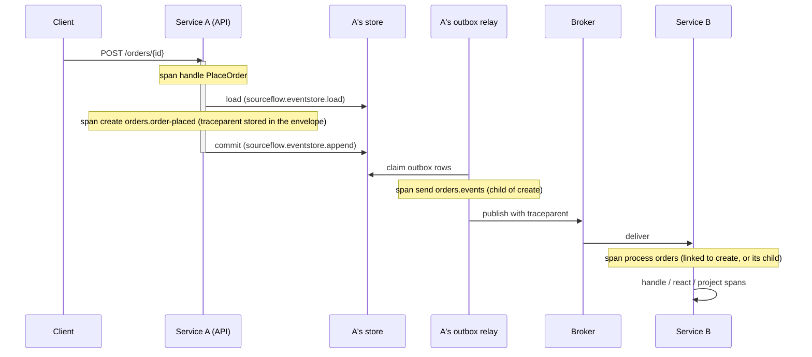

# Observability and Performance

SourceFlow.Net v3 emits traces, metrics and logs through the .NET platform APIs (`System.Diagnostics.ActivitySource`,
`System.Diagnostics.Metrics.Meter` and `Microsoft.Extensions.Logging`), so any OpenTelemetry SDK or logging provider can
collect them. Telemetry is always on: there is no switch to enable it, and with no listener a span costs a null check
and a metric update is a no-op ([ADR-019](../ADRs/ADR-019-telemetry-always-on-with-standard-semantic-conventions.md)).
This page lists every signal as built, the health checks, the dashboards and alerts shipped in the repository, and what
is known about performance: benchmarks, the load test, and the settings that tune throughput and latency.

For step-by-step OpenTelemetry wiring, read the [OpenTelemetry guide](../guides/opentelemetry.md). This page does not
repeat it.

## Contents

- [At a glance](#at-a-glance)
- [Subscribing](#subscribing)
- [Traces](#traces)
- [Metrics](#metrics)
- [Logs](#logs)
- [Health checks](#health-checks)
- [Service-level objectives](#service-level-objectives)
- [Dashboards and alerts](#dashboards-and-alerts)
- [Performance](#performance)
- [Tuning](#tuning)
- [Troubleshooting](#troubleshooting)
- [Links](#links)

## At a glance

| Signal | Name | Where it is defined |
|--------|------|---------------------|
| Traces | `ActivitySource` named `SourceFlow` (`SourceFlowTelemetry.ActivitySourceName`) | `src/Core/SourceFlow.Net/Diagnostics/SourceFlowTelemetry.cs` |
| Metrics | `Meter` named `SourceFlow` (`SourceFlowTelemetry.MeterName`), one instance per host | `SourceFlowMetrics`, `SourceFlowTelemetry.Catalogue` |
| Logs | Source-generated `[LoggerMessage]` methods, categories named after the runtime types (`SourceFlow.Runtime.CommandProcessor`, …) | `src/Core/SourceFlow.Net/Diagnostics/Log.cs` |
| Health | `AddHealthChecks().AddSourceFlow()`: seven checks tagged `sourceflow`, three of them also `ready` | `SourceFlowHealthChecks` |
| Dashboards and alerts | Grafana dashboard and Prometheus rules generated from the catalogue | [`deploy/observability`](../../../deploy/observability/README.md) |

The source and the meter report the package version and the telemetry schema URL of the pinned semantic conventions
(`https://opentelemetry.io/schemas/1.27.0`). SourceFlow depends on `System.Diagnostics` only; there is no SourceFlow
OpenTelemetry package, and the SDK stays your application's dependency.

## Subscribing

```csharp
using SourceFlow.Diagnostics;

builder.Services.AddOpenTelemetry()
    .ConfigureResource(r => r.AddService("bookings"))
    .WithTracing(t => t.AddSource(SourceFlowTelemetry.ActivitySourceName))   // "SourceFlow"
    .WithMetrics(m => m.AddMeter(SourceFlowTelemetry.MeterName))             // "SourceFlow"
    .UseOtlpExporter();                                                      // OTEL_EXPORTER_OTLP_ENDPOINT
```

This is what the TravelBooking sample's hosts do when `OTEL_EXPORTER_OTLP_ENDPOINT` is set
([`samples/TravelBooking/Shared/ServiceHost.cs`](../../../samples/TravelBooking/Shared/ServiceHost.cs)).
`docker compose up -d --build` at the repository root starts the Bookings and Hotels services with an Aspire dashboard at
<http://localhost:18888> that receives their traces and metrics: one trace follows a booking from the HTTP request through
both services and the broker.

Histogram bucket boundaries are declared on the instruments with `InstrumentAdvice<T>`, so you need no views:

| Buckets | Boundaries |
|---------|------------|
| Durations (seconds) | 0.0005, 0.001, 0.0025, 0.005, 0.01, 0.025, 0.05, 0.1, 0.25, 0.5, 1, 2.5, 5, 10 |
| Counts | 1, 2, 5, 10, 20, 50, 100, 200, 500, 1000 |

A view you add for an instrument overrides its advice.

## Traces

### Spans

| Span name | Kind | Started by | Attributes |
|-----------|------|-----------|------------|
| `handle {command type}` | Internal | `CommandProcessor`, for a command sent locally or received | `sourceflow.aggregate.type`, `sourceflow.stream.id`, `sourceflow.outcome`, `sourceflow.concurrency.retries` |
| `sourceflow.eventstore.load` | Client | Aggregate load | `sourceflow.load.source` (cache, snapshot or events), `sourceflow.load.events` |
| `sourceflow.eventstore.append` | Client | Session commit: events, outbox, inbox and inline projections in one transaction | `db.operation.name` = `append`, `sourceflow.events.count` |
| `create {message type}` | Producer | A message is created (command sent, event appended, integration event enqueued). Its context is stored in the envelope's `traceparent`. | `messaging.operation.type` = `create`, `sourceflow.message.type` |
| `send {destination}` | Producer | The outbox relay publishes a message | `messaging.system`, `messaging.operation.type` = `send`, `messaging.destination.name`, `messaging.message.id` |
| `process {consumer}` | Consumer | The receive pipeline handles one message | `messaging.operation.type` = `process`, `messaging.consumer.group.name`, `messaging.message.id`, `sourceflow.message.type`, `sourceflow.outcome` |
| `project {subscription}` | Consumer | One subscription batch (projection, process manager or event handler) | `sourceflow.subscription`, `sourceflow.partition`, `messaging.batch.message_count` |
| `react {process manager}` | Internal | A process manager reacts | `sourceflow.process.id`, `sourceflow.process.completed` |
| `workflow {name} {step}` | Internal | One DSL workflow transition | `sourceflow.workflow.step`, `sourceflow.workflow.attempt`, `sourceflow.workflow.transition` |

`sourceflow.outcome` on `handle` is one of `accepted`, `noop`, `rejected`, `conflict`, `duplicate`, `dispatched`, or
`failed` when the command threw. A failing `send` or `process` span has its status set to `Error` with the exception
type.

Stream ids, message ids and process ids appear only on spans and logs, never as metric tags, so metric cardinality stays
bounded.

### One message across two services



The `traceparent` and `tracestate` of the `create` span travel with the message as CloudEvents distributed-tracing
attributes. In the receiving service the `process` span starts a new trace that **links** to the `create` span, as the
messaging conventions recommend, so a redelivery or a replay days later does not grow the original trace. To get one
trace from the HTTP request in service A to the handler in service B, make it a child instead:

```csharp
builder.Services.AddSourceFlow(sf => sf.Configure(o => o.Telemetry.ParentBasedOnMessage = true));
```

### Semantic conventions

Attribute names follow the OpenTelemetry messaging semantic conventions pinned at **1.27.0**
(`SemanticConventions.PinnedVersion`), so a SourceFlow upgrade never renames what your dashboards query. Newer
conventions are opt-in through the standard variable `OTEL_SEMCONV_STABILITY_OPT_IN`:

| Value | Effect |
|-------|--------|
| unset, or no `messaging` entry | The pinned version. |
| `messaging` | The newest messaging conventions this release knows (`SemanticConventions.LatestVersion`). |
| `messaging/dup` | The newest conventions plus the deprecated names (spans also carry `messaging.operation`), for migrating dashboards. |

### Sampling

SourceFlow does not sample. Use a parent-based sampler in the services. In the Collector, a tail-sampling policy that
keeps every trace with `sourceflow.outcome` = `conflict` or `failed` keeps the interesting ones.

### Not built in 3.0

Design doc 08 also describes a `settle {destination}` span (complete, retry or dead-letter) and baggage propagation
(`PropagateBaggage`). Neither is built in this release. Query execution has no span or metrics of its own yet; doc 14 §11
describes the planned `sourceflow.query.*` signals.

## Metrics

Every instrument is listed in `SourceFlowTelemetry.Catalogue` with its kind, unit, description and the tags it may
carry. A test checks the catalogue against what a running host creates and records, and the dashboard and alerts are
generated from it.

### Commands, event store and aggregates

| Instrument | Kind | Unit | Tags | Meaning |
|------------|------|------|------|---------|
| `sourceflow.command.duration` | Histogram | s | `sourceflow.command.type`, `sourceflow.outcome` | Command processing duration. The write latency and availability SLOs are computed from it. |
| `sourceflow.eventstore.append.duration` | Histogram | s | none | Session commit duration. |
| `sourceflow.eventstore.append.events` | Histogram | {event} | `sourceflow.aggregate.type` | Events per append. |
| `sourceflow.eventstore.concurrency_conflicts` | Counter | {conflict} | `sourceflow.aggregate.type` | Optimistic concurrency conflicts. Shows hot streams. |
| `sourceflow.aggregate.load.events` | Histogram | {event} | `sourceflow.aggregate.type`, `sourceflow.load.source` | Events folded per aggregate load. Use it to decide on snapshots. |
| `sourceflow.aggregate.cache.hits` | Counter | {hit} | `sourceflow.aggregate.type`, `result` | Aggregate cache lookups by result: `hit`, `miss`, `stale`. |
| `sourceflow.snapshot.written` | Counter | {snapshot} | `sourceflow.aggregate.type` | Snapshots written in the background. |
| `sourceflow.snapshot.dropped` | Counter | {snapshot} | `sourceflow.aggregate.type` | Snapshots dropped because the queue was full or the write failed. Harmless once; sustained drops mean the queue or the store is too slow. |

### Outbox, inbox, retries and dead letters

| Instrument | Kind | Unit | Tags | Meaning |
|------------|------|------|------|---------|
| `sourceflow.outbox.pending` | Gauge | {message} | `sourceflow.partition` | Undelivered outbox messages per partition. |
| `sourceflow.outbox.age` | Gauge | s | `sourceflow.partition` | How long the oldest **due** outbox message has waited. Scheduled messages do not count before their time, and a retried message keeps its first due time. The delivery durability SLO. |
| `sourceflow.outbox.dispatch.duration` | Histogram | s | `messaging.system` | Outbox batch dispatch duration. |
| `sourceflow.inbox.duplicates` | Counter | {message} | `messaging.consumer.group.name` | Duplicates absorbed by the inbox (redeliveries, producer retries, repeated idempotency keys). |
| `sourceflow.retry.attempts` | Counter | {attempt} | `stage` (`publish`, `receive`), `retry.kind` (`immediate`, `delayed`) | Retry attempts. A rising rate is an instability signal. |
| `sourceflow.deadletter.parked` | Counter | {message} | `consumer`, `reason`, `sourceflow.message.type` | Messages parked to dead letters. Alert on any increase. |
| `sourceflow.deadletter.replayed` | Counter | {message} | `consumer` | Dead letters replayed by an operator. |
| `sourceflow.deadletter.discarded` | Counter | {message} | `consumer` | Dead letters discarded by an operator. |
| `sourceflow.deadletter.count` | Gauge | {message} | `consumer` | Parked dead letters per consumer: the operator backlog. |

### Subscriptions, process managers, leases and workflows

| Instrument | Kind | Unit | Tags | Meaning |
|------------|------|------|------|---------|
| `sourceflow.subscription.lag` | Gauge | {event} | `sourceflow.subscription`, `sourceflow.partition` | Events not yet processed per subscription partition. |
| `sourceflow.subscription.lag_time` | Gauge | s | `sourceflow.subscription`, `sourceflow.partition` | Age of the oldest unprocessed event. The read-model freshness SLO. |
| `sourceflow.subscription.horizon_age` | Gauge | s | none | How long the oldest writing transaction has held the subscription horizon back. A long transaction delays every subscription. |
| `sourceflow.subscription.stalled` | Gauge | {partition} | `sourceflow.subscription`, `sourceflow.partition` | Partitions halted at a failing event (Stop policy). |
| `sourceflow.subscription.batch.duration` | Histogram | s | `sourceflow.subscription` | Subscription batch duration: the cost of a projection. |
| `sourceflow.process.active` | Gauge | {instance} | `process.type` | Process-manager instances not completed, per type. |
| `sourceflow.lease.owned` | Gauge | {lease} | `lease.kind` | Subscription partition leases this node owns (per instance, so sum across instances). |
| `sourceflow.workflow.transitions` | Counter | {transition} | `workflow`, `version`, `kind` | Workflow transitions by kind: `success`, `failure`, `retry`, `timeout`, `compensate`, `manual`, `complete`. Recorded after the commit. |
| `sourceflow.workflow.active` | Gauge | {instance} | `workflow`, `version`, `status` | Workflow instances not finished, per version and status. |
| `sourceflow.workflow.manual_intervention` | Counter | {instance} | `workflow`, `version` | Instances that entered manual intervention. Alert on any. |

### Messaging (semantic-convention names)

| Instrument | Kind | Unit | Tags | Meaning |
|------------|------|------|------|---------|
| `messaging.client.sent.messages` | Counter | {message} | `messaging.system`, `messaging.destination.name`, `error.type` | Messages sent to the broker. |
| `messaging.client.consumed.messages` | Counter | {message} | `messaging.system`, `messaging.destination.name`, `messaging.consumer.group.name` | Messages received from the broker. |
| `messaging.process.duration` | Histogram | s | `messaging.system`, `messaging.destination.name`, `messaging.consumer.group.name`, `error.type` | Received message processing duration. |

`messaging.client.operation.duration` from the conventions is not built in this release.

### How gauges are sampled

Gauges come from one sampler per host, `SourceFlowMonitor`, which reads the store every
`SourceFlowOptions.MonitorInterval` (15 s by default): the outbox backlog per partition, parked dead letters per
consumer, events after each checkpoint, the horizon age, active process managers and workflow instances. A metrics
scrape never queries the store. The store readings come from the optional `IStoreMonitor` port, which the in-memory,
PostgreSQL and SQL Server stores implement; an adapter without it reports no store gauges. If a reading fails, the
monitor logs a warning (event 1212) and the gauges and health checks keep the last sample.

Store-side gauges have the same value on every instance, so dashboards take the `max`. `sourceflow.lease.owned` is per
instance, so dashboards sum it.

### Prometheus names

The generated dashboard and alerts use the names the OpenTelemetry Prometheus exporter and the Collector produce: dots
become underscores, a unit of seconds adds `_seconds`, counters end in `_total`, and histograms are read through
`_bucket`, `_sum` and `_count`. Tags become labels the same way. For example:

| Instrument | Prometheus series |
|------------|-------------------|
| `sourceflow.command.duration` | `sourceflow_command_duration_seconds_bucket`, `_sum`, `_count` |
| `sourceflow.deadletter.parked` | `sourceflow_deadletter_parked_total` |
| `sourceflow.outbox.age` | `sourceflow_outbox_age_seconds` |
| `sourceflow.subscription.stalled` | `sourceflow_subscription_stalled` (labels `sourceflow_subscription`, `sourceflow_partition`) |

The service is the `job` label, from `service.name`.

## Logs

All log statements are source-generated `[LoggerMessage]` methods, so a disabled level allocates nothing. Categories are
the full names of the runtime types: `SourceFlow.Runtime.CommandProcessor`, `SourceFlow.Runtime.OutboxRelay`,
`SourceFlow.Runtime.ReceiveEndpoint`, `SourceFlow.Runtime.SubscriptionEngine`, `SourceFlow.Runtime.SourceFlowMonitor`,
`SourceFlow.Runtime.DeadLetterIngestor`, `SourceFlow.Runtime.SubscriptionAdmin`, `SourceFlow.Hosting.SourceFlowHost`
and `SourceFlow.Security.PersonalDataEraser`. Filter them with the `SourceFlow` prefix:

```json
{ "Logging": { "LogLevel": { "Default": "Information", "SourceFlow": "Information", "SourceFlow.Runtime.CommandProcessor": "Warning" } } }
```

| Event id | Level | Message (template) |
|----------|-------|--------------------|
| 1001 | Debug | `Command {CommandType} on {StreamId}: {Outcome} at version {Version}` |
| 1002 | Information | `Concurrency conflict on {StreamId} (attempt {Attempt}); re-deciding` |
| 1003 | Warning | `Concurrency retries exhausted on {StreamId} after {Attempts} attempts` |
| 1101 | Warning | `Outbox dispatch to {Destination} failed (attempt {Attempt}); retrying at {RetryAt}` |
| 1102 | Error | `Outbox message {MessageId} to {Destination} parked after {Attempts} attempts` |
| 1103 | Error | `Outbox relay loop failed; continuing` |
| 1104 | Warning | `Retention cleanup failed; retrying at the next interval` |
| 1105 | Information | `Retention cleanup deleted {Inbox} inbox rows and {DeadLetters} resolved dead letters` |
| 1106 | Warning | `Node heartbeat failed; the lease fair share uses the last known node count` |
| 1107 | Warning | `Schema {Type} v{Version} changed without a new version (...)` (with `SchemaRegistration = Warn`) |
| 1108 | Debug | `Payload of parked message {MessageId}: {Payload}` (only with `LogPayloads`, redacted) |
| 1201 | Warning | `Message {MessageId} ({MessageType}) failed transiently on attempt {Attempt}; redelivering after {Delay}` |
| 1202 | Error | `Message {MessageId} ({MessageType}) parked: {Reason}` |
| 1203 | Error | `Receive loop for {Endpoint} failed; continuing` |
| 1210 | Warning | `Message {MessageId} was dead-lettered by the broker on {Endpoint} ({Reason}); parked for replay` |
| 1211 | Error | `Moving broker dead letters of {Endpoint} into the dead-letter store failed; retrying in {Delay}` |
| 1212 | Warning | `The monitor could not read {Reading}; the gauges and health checks that use it keep the last sample` |
| 1301 | Error | `Subscription {Subscription} partition {Partition} failed on event {EventId}; {Policy}` |
| 1302 | Warning | `Subscription {Subscription} partition {Partition} lost its lease` |
| 1303 | Warning | `Subscription {Subscription} partition {Partition} skipped event {EventId} at {Position}: {Reason}` |
| 1304 | Information | `Read model {Projection} switched from {Previous} to {Target}` |
| 1305 | Information | `Dropped retired read-model generation {Generation}` |
| 1401 | Information | `SourceFlow service {Service} started: {Modules} module(s), {Aggregates} aggregate(s), {Subscriptions} subscription(s)` |
| 1402 | Warning | `Workflow versions were not checked for active instances: the storage adapter has no monitor` |
| 1403 | Warning | `Outbox partition {Partition} lease was not released on stop; it expires after the lease TTL` |
| 1501 | Information | `Erased a subject: key destroyed, {Streams} stream(s), {Documents} document(s) scrubbed.` |
| 2301, 2302 | Information, Error | PostgreSQL partition maintenance: partitions created ahead, or creating them failed |
| 3401 | Warning | Azure Service Bus transport uses a connection string outside Development |

Payloads are never logged by default. `SourceFlowOptions.LogPayloads = true` logs the payload of a message that fails
permanently (event 1108) with `[PersonalData]` and `[Secret]` members redacted through
`Microsoft.Extensions.Compliance.Redaction`; configure the redactors with `sf.UseRedaction(...)`. See the
[Security and compliance guide](Security-and-Compliance-Guide.md).

## Health checks

```csharp
builder.Services.AddHealthChecks().AddSourceFlow();

app.MapHealthChecks("/health", new HealthCheckOptions { Predicate = _ => false });                                   // liveness
app.MapHealthChecks("/health/ready", new HealthCheckOptions { Predicate = c => c.Tags.Contains(SourceFlowHealthChecks.ReadyTag) });
app.MapHealthChecks("/health/sourceflow", new HealthCheckOptions { Predicate = c => c.Tags.Contains(SourceFlowHealthChecks.Tag) });
```

`AddSourceFlow(prefix = "sourceflow")` registers seven checks. Every check has the tag `sourceflow`; `ready`, `store`
and `transport` also have the tag `ready`. Keep liveness free of dependency checks, so that a database or broker outage
removes instances from the load balancer instead of restarting them.

| Check | Healthy | Degraded | Unhealthy |
|-------|---------|----------|-----------|
| `sourceflow.ready` | Startup done (validation, provisioning, schema registration, domain query binding) and receivers started | | Still starting, or startup failed |
| `sourceflow.store` | The store answers with the expected schema | Latency above `StoreLatencyDegraded` | Unreachable, or the schema does not match |
| `sourceflow.transport` | The broker answers for the service's endpoint, or the transport cannot be probed | The broker throttles | Unreachable |
| `sourceflow.outbox` | Oldest due message younger than `OutboxAgeDegraded` | From `OutboxAgeDegraded` | From `OutboxAgeUnhealthy` |
| `sourceflow.subscriptions` | Every partition current | A partition lags more than `LagTimeDegraded`, is stalled (retrying), or the horizon is held longer than `HorizonAgeDegraded` | A partition stalled for `StalledUnhealthy` |
| `sourceflow.leases` | The node owns its fair share, has no Subscriptions role, or there are no leases | Under its fair share for more than `UnderShareIntervals` heartbeat intervals | |
| `sourceflow.keys` | Payload protection is off, or the key service issues data keys (cached) | | The key service is down or refuses |

Each result carries data for diagnosis, for example `latencyMs`, `oldestAgeSeconds` and `pending`, `maxLagSeconds`,
`stalled` and `horizonAgeSeconds`, `owned` and `fairShare`.

Thresholds are `SourceFlowOptions.Health` (`HealthThresholds`), validated at startup (each "degraded" threshold must be
below its "unhealthy" one):

| Option | Default |
|--------|---------|
| `Health.StoreLatencyDegraded` | 250 ms |
| `Health.TransportCacheDuration` | 30 s (also how long the key check is cached) |
| `Health.OutboxAgeDegraded` | 10 s |
| `Health.OutboxAgeUnhealthy` | 5 min |
| `Health.LagTimeDegraded` | 30 s |
| `Health.HorizonAgeDegraded` | 30 s |
| `Health.StalledUnhealthy` | 5 min |
| `Health.UnderShareIntervals` | 2 |

```csharp
builder.Services.AddSourceFlow(sf => sf.Configure(o =>
{
    o.Health.LagTimeDegraded = TimeSpan.FromSeconds(10);
    o.Health.OutboxAgeUnhealthy = TimeSpan.FromMinutes(2);
}));
```

## Service-level objectives

Doc 08 §6 sets starting objectives. The generated alerts implement them.

| SLO | Indicator | Objective |
|-----|-----------|-----------|
| Write availability | `sourceflow.command.duration` count with `sourceflow.outcome` not `failed`, over the total | 99.9 % over 30 days (business rejections and conflicts count as successes) |
| Write latency | p99 of `sourceflow.command.duration` | < 50 ms |
| Read-model freshness | `sourceflow.subscription.lag_time` | < 5 s |
| Delivery durability | max `sourceflow.outbox.age` | < 60 s |
| Correctness | increase of `sourceflow.deadletter.parked` | 0: page on any |

## Dashboards and alerts

[`deploy/observability`](../../../deploy/observability/README.md) holds two generated files. Do not edit them by hand:
regenerate them with

```bash
dotnet sourceflow observability export --output deploy/observability
```

A test fails when the committed files differ from the generator, and CI runs `promtool check rules`.

**`sourceflow-dashboard.json`** is a Grafana dashboard. Its first row shows the objectives: write availability, p99
write latency, read-model freshness, delivery durability and parked messages in the last hour. Then one panel per
catalogue instrument, grouped: commands; event store and aggregates; outbox, inbox and retries; dead letters;
subscriptions; process managers and leases; workflows; messaging. Import it and choose your Prometheus data source; the
`Service` variable is the `job` label.

**`sourceflow-alerts.yaml`** holds the Prometheus alert rules:

| Alert | Expression (summary) | For | Severity |
|-------|----------------------|-----|----------|
| `SourceFlowDeadLetterParked` | any increase of `sourceflow_deadletter_parked_total` in 5 min | 0m | page |
| `SourceFlowSubscriptionStalled` | `sourceflow_subscription_stalled` > 0 | 5m | page |
| `SourceFlowOutboxDelayed` | max `sourceflow_outbox_age_seconds` > 60 | 5m | page |
| `SourceFlowReadModelsStale` | max `sourceflow_subscription_lag_time_seconds` > 5 | 10m | warning |
| `SourceFlowWriteLatency` | p99 of `sourceflow_command_duration_seconds` > 0.05 | 10m | warning |
| `SourceFlowWriteErrors` | share of commands with outcome `failed` > 0.1 % over 30 min | 30m | page |
| `SourceFlowHorizonHeld` | max `sourceflow_subscription_horizon_age_seconds` > 30 | 5m | warning |
| `SourceFlowWorkflowManualIntervention` | any increase of `sourceflow_workflow_manual_intervention_total` in 5 min | 0m | page |

Each alert's annotation names the CLI command that helps: `dotnet sourceflow dlq list`, `projection skip`,
`workflow list --status ManualIntervention` ([SourceFlow.Tool README](SourceFlow.Tool-README.md)).

If your pipeline names metrics differently (for example without unit suffixes), adjust the exporter or the generated
files. Without Prometheus, the Aspire dashboard shows the same metrics over OTLP.

## Performance

### How the hot path is built

The design rules are in [doc 09](../Design/09-Performance-and-Scalability.md): no reflection after startup (generated
dispatch, ADR-004), `ValueTask` on hot async APIs, `[LoggerMessage]` logging, pooled serialisation buffers, bounded
queues with backpressure, and one database round trip per command commit. With PostgreSQL the conditional writes are
asserted in SQL and the `COMMIT` rides in the same batch (SCK-20).

### Benchmarks

[`benchmarks/SourceFlow.Benchmarks`](../../../benchmarks/SourceFlow.Benchmarks) holds the BenchmarkDotNet suite and a
measurement harness. The PostgreSQL benchmarks start PostgreSQL 17 through Testcontainers, so Docker must be running.

```bash
dotnet run -c Release --project benchmarks/SourceFlow.Benchmarks -- bench --filter '*Command*'   # BenchmarkDotNet
dotnet run -c Release --project benchmarks/SourceFlow.Benchmarks -- measure                      # measurement harness
dotnet run -c Release --project benchmarks/SourceFlow.Benchmarks -- baseline                     # both; writes benchmarks/baselines/*.json
```

The baseline below is from [implementation/perf-baseline.md](../implementation/perf-baseline.md) and
[implementation/load-test-report.md](../implementation/load-test-report.md). It was recorded on a developer
workstation (Windows 11, .NET 10, PostgreSQL 17 in Docker), so treat the numbers as indicative.

| Id | Scenario | Target | Measured | Status |
|----|----------|--------|----------|--------|
| PERF-01 | In-process command, in-memory store, 1 event | p50 ≤ 20 µs, ≤ 2 KB/op | 4.4 µs, 6.2 KB/op | Time met; allocations above target |
| PERF-02 | Middleware overhead, 3 pass-through middleware | ≤ 1 µs, 0 B | +38 ns; 352 B | Time met; allocations above target |
| PERF-03 | PostgreSQL commit, 1/3/10 events plus outbox | p99 ≤ 10 ms, 1 round trip | mean 2.2 / 2.5 / 2.7 ms; 1 round trip | Met |
| PERF-04 | Load with 0/100/1,000 events | linear without snapshots, flat with | 2.1 → 3.4 → 9.5 ms without; 3.1 → 3.4 → 3.1 ms with | Met |
| PERF-05 | Document projection rebuild, one partition | ≥ 20,000 events/s | 32,654 events/s (adaptive batches up to 1,000) | Met |
| PERF-06 | Global log read | ≥ 50,000 events/s | about 148,000 events/s | Met |
| PERF-07 | Outbox commit to broker acknowledgement | p95 ≤ 250 ms | p95 138 ms (AWS, LocalStack), 85 ms (Pub/Sub emulator), 167 ms (Service Bus emulator) | Met |
| PERF-08 | Event to async projection (LISTEN/NOTIFY) | p95 ≤ 100 ms | p95 14.8 ms | Met |
| PERF-09 | Commands/s per 4-vCPU instance | ≥ 5,000/s | 1,000/s sustained with every SLO met; about 2,700/s peak, limited by a shared PostgreSQL | Not demonstrated yet |
| PERF-10 | Startup to ready (JIT) | ≤ 150 ms | 99–180 ms across runs | Borderline |

### Load test

[`loadtest/k6/travel-tier-m.js`](../../../loadtest/k6/travel-tier-m.js) drives the TravelBooking sample's Bookings
service at capacity tier M (1,000 commands/s: 60 % request a booking, each starting a trip-booking workflow, and 40 %
confirm one as the guest). Every 2 s it requests a booking and polls the `workflow-instances` read model until the room is
held, which measures one workflow step across both services and the broker, and it reads the Bookings service's
`/health/ready` every second. k6 exits non-zero when a threshold (an SLO) fails.

```bash
docker compose up -d --build --wait postgres localstack hotels bookings
docker run --rm -i --network sourceflow-demo_default \
  -e BOOKINGS_URL=http://bookings:8080 -e HOTELS_URL=http://hotels:8080 -e RATE=1000 -e DURATION=5m \
  grafana/k6:2.3.0 run - < loadtest/k6/travel-tier-m.js
```

The reference run, with the first version of the script against the single Bank service that the TravelBooking sample
replaced, met every SLO at 1,000 commands/s for 3 minutes (196,498 commands): 0 failures, p99 37.7 ms (p50
7.4 ms), read-model freshness p99 247 ms, and `/health/sourceflow` healthy in 180 of 180 samples. The API used about 1.8
of its 4 cores and PostgreSQL about 3.6. Above that rate the shared PostgreSQL saturated first; the service itself used
about 0.8 ms of CPU per command. Run k6 inside the Docker network, not against a published port, which measures the
desktop port forwarding. See [`loadtest/README.md`](../../../loadtest/README.md).

### Capacity planning

From [doc 09 §5](../Design/09-Performance-and-Scalability.md#5-capacity-model) (estimates):

| Tier | Peak commands/s | Event rows per day | Guidance |
|------|-----------------|--------------------|----------|
| S | 100 | about 2 M | One events table, defaults |
| M | 1,000 | about 19 M | `PartitionEvents` from day one, snapshots for long streams, 16 to 32 outbox partitions |
| L | 10,000 | about 194 M | Partitioned events, a database per service, several relay instances, a dedicated subscription node pool |

## Tuning

Every option below is a `SourceFlowOptions` property set with `sf.Configure(o => ...)` unless noted, and every option is
validated at startup: an invalid value fails startup instead of being ignored.

| Setting | Default | Turn it when |
|---------|---------|--------------|
| `PollInterval` | 1 s (10 ms to 10 min) | Subscriptions and the relay wait this long when no commit notification arrives. PostgreSQL uses LISTEN/NOTIFY, so lower it only for stores without notifications. Must be shorter than `LeaseTtl`. |
| `LeaseTtl` | 30 s | How quickly another node takes over a dead node's outbox and subscription partitions. Shorter means faster failover and more renewals. |
| `NodeHeartbeatInterval` | 10 s | Lease fair-share rebalancing. A node is live for three intervals. |
| `OutboxPartitions` | 16 (1–1024) | More parallel relay workers across instances. Per-key order is kept within a partition. Changing it changes partition assignment: tell the global CLI with `--outbox-partitions`. |
| `OutboxBatchSize` | 100 | Rows claimed per relay batch. |
| `OutboxMaxAttempts` | 10 | Dispatch attempts before an outbox row is parked. |
| `ReceiveConcurrency` | 2 × processor count (at least 2) | Concurrent receive workers per endpoint. Order is kept per partition key. |
| `PrefetchPerWorker` | 16 | Bounded channel size per receive worker. |
| `ReceiveLockDuration` | 30 s | Visibility timeout or lock on a received message; renewed at half this interval while the handler runs. |
| `ImmediateRetries` | 3 | In-process retries of a transient failure before a delayed retry. |
| `DelayedRetries` | 10 s, 1 min, 10 min, 1 h | The delayed retry schedule; exhausting it parks the message. |
| `SubscriptionBatchSize` | 1000 | The largest subscription batch. Batches start at 100 (or less), double while they come back full and drop back when caught up. |
| `SubscriptionPartitions` | 1 (a power of two) | Parallel workers per async subscription. Change it on a live system with `projection repartition`. |
| `SwitchLagThreshold` | 100 events | When a rebuilt read-model generation takes over reads. |
| `MaxConcurrencyRetries` | 5 | Re-decides after a concurrency conflict before the command returns `Conflict`. |
| `AggregateCache` | `Off` | `ReadTail` starts from the cached state and reads only the stream tail; `Optimistic` skips the tail read and relies on the append's version check (best with stream affinity). |
| `AggregateCacheSize` | 10,000 states | LRU size of the aggregate cache. |
| `[Aggregate(SnapshotEvery = N)]` | 0 (off) | Write a snapshot every N events. Turn it on when `sourceflow.aggregate.load.events` p95 grows. |
| `SnapshotQueueCapacity` | 1024 | Background snapshot queue; when full, the oldest is dropped. |
| `MonitorInterval` | 15 s | How often gauges and health checks sample the store. Each sample is a few aggregate queries. |
| `DeadLetterIngestInterval` | 30 s | How often the broker's native dead-letter queue is checked when empty. Every check is a broker call. |
| `InboxRetention`, `RetentionInterval`, `RetentionBatchSize` | 7 days, 1 h, 5000 | Inbox growth versus duplicate detection window. |
| `SourceFlowBuilder.Roles` | `All` | Split API pods (`Api`) from worker pods (`Receiver`, `Relay`, `Subscriptions`) and scale them on different signals. |
| `PostgreSqlStorageOptions.ListenConnectionString` | main connection | Point LISTEN at a direct connection when the main one goes through PgBouncer. |
| `PostgreSqlStorageOptions.PartitionEvents` | off | Monthly events partitions (tier M and above). |
| `PostgreSqlStorageOptions.QueryTimeout`, `SqlServerStorageOptions.QueryTimeout` | 5 s (at most 30 s) | Statement timeout for SFQL queries. |
| Connection pool (`Maximum Pool Size`) | provider default | Leave room under the server's `max_connections` for every instance; the store also holds connections for LISTEN and notifications. A pool larger than the server allows fails with `53300: too many clients`. |

### Hot streams

Optimistic concurrency retries when many writers hit one stream. `sourceflow.eventstore.concurrency_conflicts` by
`sourceflow.aggregate.type` shows where. In order:

1. Route a stream's commands to one instance (partition-keyed routing), so they are processed serially.
2. With that affinity, use `AggregateCache = AggregateCacheMode.Optimistic`, so the load costs nothing.
3. Revisit the aggregate boundary; a hot stream is usually a modelling problem.

### Other signals to act on

| Observation | Action |
|-------------|--------|
| `sourceflow.aggregate.load.events` p95 above about 200 | Turn on snapshots for that aggregate type (`SnapshotEvery`). |
| `sourceflow.subscription.lag_time` grows while `subscription.batch.duration` is high | Increase `SubscriptionPartitions`, or make the projection cheaper. |
| `sourceflow.outbox.age` grows with `messaging.client.sent.messages` errors | The broker is failing or throttling: check the `sourceflow.transport` check and the broker. |
| `sourceflow.subscription.horizon_age` above 30 s | A long write transaction is open (PostgreSQL: look in `pg_stat_activity`). |
| `sourceflow.snapshot.dropped` keeps rising | Raise `SnapshotQueueCapacity`, or snapshot less often. |
| `sourceflow.inbox.duplicates` spikes | Redeliveries after lock expiry: raise `ReceiveLockDuration` or speed up handlers. |

## Troubleshooting

| Symptom | Cause | Fix |
|---------|-------|-----|
| No SourceFlow spans | The source is not added | `AddSource(SourceFlowTelemetry.ActivitySourceName)`; check the exporter endpoint. |
| No SourceFlow metrics | The meter is not added | `AddMeter(SourceFlowTelemetry.MeterName)`. |
| Spans in service B are not in service A's trace | By design the `process` span links to the `create` span | Follow the link, or set `Telemetry.ParentBasedOnMessage = true`. |
| Gauges are missing | The store adapter does not implement `IStoreMonitor`, or the first sample has not been taken yet | Wait one `MonitorInterval`; check log event 1212. |
| Store gauges are multiplied in a dashboard | Every instance reports the same store values | Aggregate with `max`, not `sum`. |
| Dashboard panels are empty | Metric names differ from the OpenTelemetry Prometheus conventions | Configure the exporter to add unit and `_total` suffixes, or edit the generated queries. |
| `outbox.age` grows during a broker outage | Expected: commands keep succeeding and the outbox drains in order after recovery | Watch `SourceFlowOutboxDelayed`; fix the broker. |
| `/health/ready` flips to unhealthy under load | `sourceflow.store` latency above the threshold is only degraded; unhealthy means unreachable or a schema mismatch | Check `/health/sourceflow` for the failing check and its data. |
| Throughput stops near a few hundred commits per second on PostgreSQL | An older build sent NOTIFY inside the commit, which serialises commits | Use this release: notifications are sent after the commit. |

## Links

- [OpenTelemetry guide](../guides/opentelemetry.md): wiring, semantic conventions, testing your telemetry.
- [SourceFlow.AspNetCore README](SourceFlow.AspNetCore-README.md): mapping health checks.
- [SourceFlow.Tool README](SourceFlow.Tool-README.md): `observability export`, `dlq`, `projection`, `workflow`.
- [SourceFlow.Net README](SourceFlow.Net-README.md): `SourceFlowOptions`.
- [`deploy/observability`](../../../deploy/observability/README.md), [`loadtest`](../../../loadtest/README.md),
  [`benchmarks`](../../../benchmarks/SourceFlow.Benchmarks).
- Design: [doc 08 Observability](../Design/08-Observability.md),
  [doc 09 Performance and scalability](../Design/09-Performance-and-Scalability.md).
- ADRs: [ADR-019](../ADRs/ADR-019-telemetry-always-on-with-standard-semantic-conventions.md),
  [ADR-027](../ADRs/ADR-027-single-core-package-with-extensibility-spis-and-categorised-adapters.md).
- Reports: [perf-baseline.md](../implementation/perf-baseline.md), [load-test-report.md](../implementation/load-test-report.md).
