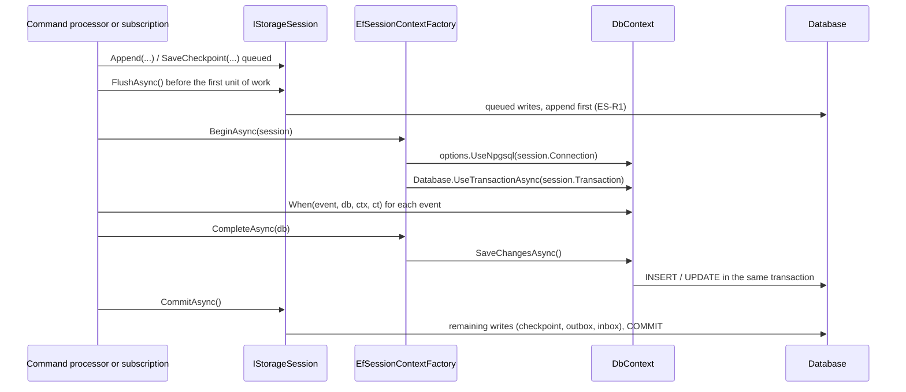

# SourceFlow.Storage.EntityFrameworkCore

Relational read models for SourceFlow.Net v3, written with Entity Framework Core. An EF Core projection receives a `DbContext` that is bound to the SourceFlow storage session: the **same connection and the same transaction** as the events it projects (inline) or as the subscription checkpoint (async). The read-model rows therefore commit or roll back together with the events or the checkpoint, with no distributed transaction and no dual write. Projections can also keep one database schema per read-model generation, so a relational read model is rebuilt blue/green like a document projection.

EF Core is used for read models only. The event store, outbox, inbox, checkpoints and leases are hand-written SQL in the storage adapters ([ADR-009](../ADRs/ADR-009-event-store-on-adonet-postgresql-first.md)).

## Contents

- [When to use it](#when-to-use-it)
- [Installation](#installation)
- [Quick start](#quick-start)
- [How it works](#how-it-works)
- [Idempotent writes](#idempotent-writes)
- [Schema per generation (blue/green)](#schema-per-generation-bluegreen)
- [Reading the read model](#reading-the-read-model)
- [API reference](#api-reference)
- [Limitations](#limitations)
- [Troubleshooting](#troubleshooting)
- [Related documents](#related-documents)

## When to use it

| Read model | Use |
|------------|-----|
| One JSON document per key, queried by id or with SFQL | A document projection (`IDocumentProjection<TDocument, TKey>`, in the core). No extra package. |
| Relational tables: joins, reporting, foreign keys, existing EF models | An EF Core projection (`IEfProjection<TDbContext>`, this package). |
| Any other SQL | A custom session projection: `ISessionProjection<TUnitOfWork>` with your own `IProjectionUnitOfWork<TUnitOfWork>`, or SQL on `IStorageSession.Connection`. |

EF Core projections need a relational storage adapter ([PostgreSQL](SourceFlow.Storage.PostgreSQL-README.md) or [SQL Server](SourceFlow.Storage.SqlServer-README.md)). The in-memory store has no connection.

## Installation

```bash
dotnet add package SourceFlow.Storage.EntityFrameworkCore
dotnet add package Npgsql.EntityFrameworkCore.PostgreSQL     # or Microsoft.EntityFrameworkCore.SqlServer
```

The package depends on `Microsoft.EntityFrameworkCore.Relational` and targets `net10.0`.

## Quick start

The example is the reporting read model used by the package's tests ([`tests/Storage/SourceFlow.Storage.Tests/EntityFrameworkCore/Reporting.cs`](../../../tests/Storage/SourceFlow.Storage.Tests/EntityFrameworkCore/Reporting.cs)): one row per bank account.

### 1. The entity and the context

```csharp
using Microsoft.EntityFrameworkCore;
using SourceFlow.Storage.EntityFrameworkCore;

public sealed class AccountActivity : IVersionedReadModel
{
    public Guid AccountId { get; set; }
    public string Holder { get; set; } = string.Empty;
    public decimal Balance { get; set; }
    public int Movements { get; set; }
    public long Version { get; set; }      // the source stream version the row reflects
}

public sealed class ReportingDbContext(DbContextOptions<ReportingDbContext> options) : DbContext(options)
{
    public DbSet<AccountActivity> Activity => Set<AccountActivity>();

    protected override void OnModelCreating(ModelBuilder modelBuilder)
    {
        modelBuilder.HasDefaultSchema("reporting");
        modelBuilder.Entity<AccountActivity>(e =>
        {
            e.ToTable("account_activity");
            e.HasKey(a => a.AccountId);
        });
    }
}
```

Create the `reporting` tables the way you manage any EF schema (EF migrations, or `GenerateCreateScript()` in a deployment step). In the shared-schema mode the package does not create them.

### 2. The projection

Mark the class `[Projection("name")]`, make it `partial`, implement `IEfProjection<TDbContext>`, and declare one `When` method per event. Each `When` takes the event, the context, the `EventContext` and a `CancellationToken`, and returns `ValueTask` or `Task`. The source generator emits the dispatch.

```csharp
using Bank.Accounts;
using SourceFlow;
using SourceFlow.Storage.EntityFrameworkCore;

[Projection("account-activity")]
public sealed partial class AccountActivityProjection : IEfProjection<ReportingDbContext>
{
    public async ValueTask When(AccountOpened e, ReportingDbContext db, EventContext ctx, CancellationToken ct)
    {
        await db.Activity.UpsertAsync(e.AccountId.Value, ctx.StreamVersion.Value,
            _ => new AccountActivity { AccountId = e.AccountId.Value, Holder = e.Holder, Balance = e.InitialDeposit }, ct);
    }

    public async ValueTask When(MoneyDeposited e, ReportingDbContext db, EventContext ctx, CancellationToken ct)
    {
        await db.Activity.UpsertAsync(e.AccountId.Value, ctx.StreamVersion.Value, row => Move(row, e.AccountId, e.BalanceAfter), ct);
    }

    public async Task When(MoneyWithdrawn e, ReportingDbContext db, EventContext ctx, CancellationToken ct)
    {
        await db.Activity.UpsertAsync(e.AccountId.Value, ctx.StreamVersion.Value, row => Move(row, e.AccountId, e.BalanceAfter), ct);
    }

    private static AccountActivity Move(AccountActivity? row, AccountId id, decimal balance)
    {
        row ??= new AccountActivity { AccountId = id.Value };
        row.Balance = balance;
        row.Movements++;
        return row;
    }
}

// The assembly's module registers the projection (generated).
[SourceFlowModule]
public sealed partial class ReportingModule;
```

### 3. Registration

```csharp
using SourceFlow.Hosting;
using SourceFlow.Storage.EntityFrameworkCore;
using SourceFlow.Storage.PostgreSQL;

builder.Services.AddSourceFlow(sf =>
{
    sf.ServiceName = "accounts";
    sf.AddModule<ContractsModule>();
    sf.AddModule<AccountsModule>();
    sf.AddModule<ReportingModule>();
    sf.Projections(p => p.Add<AccountActivityProjection>().Async());   // or .Inline()
    sf.UsePostgreSql(connectionString);
    sf.UseEntityFrameworkProjections<ReportingDbContext>(
        (options, connection) => options.UseNpgsql(connection),      // the provider, on the session's connection
        options => new ReportingDbContext(options));                  // how to create the context
});
```

`UseEntityFrameworkProjections<TDbContext>` registers an `EfSessionContextFactory<TDbContext>` as the `IProjectionUnitOfWork<TDbContext>` for that context type. The projection itself is registered by its module and configured inline or async like any projection. Without `Projections(...)` a projection runs async.

## How it works

EF Core projections are one kind of **session projection** (`ISessionProjection<TUnitOfWork>` in the core). A storage package supplies an `IProjectionUnitOfWork<TUnitOfWork>` that creates the unit of work on the session and completes it before the session commits. For EF Core the unit of work is the `DbContext`.



1. **One context per session.** The engine creates one `DbContext` per session and projection context type (per generation, with schema per generation), shared by every EF projection of that type in the batch.
2. **ES-R1 still holds.** Before creating the first unit of work, the engine calls `IStorageSession.FlushAsync`, which sends the queued stream append. EF writes therefore always follow the append, and a version conflict surfaces before any EF write.
3. **Same transaction.** The context is built on `session.Connection` and joins `session.Transaction` with `Database.UseTransactionAsync`. It does not own the connection.
4. **Saved once.** After every event of the batch (or of the command, inline) is applied, `CompleteAsync` calls `SaveChangesAsync`. Then the session commits the checkpoint (async) or the rest of the command (inline). A failure anywhere rolls everything back.
5. **Tenancy.** Under PostgreSQL row-level security, the session has already set `sourceflow.tenant`, so EF statements are tenant-scoped too.

### Inline or async

| Mode | Transaction | `ctx.Position` | Failure |
|------|-------------|----------------|---------|
| `Inline()` | The command's transaction, after the append | `GlobalPosition.Start` (the position is not known before commit) | Fails the command; nothing is appended |
| `Async()` (default) | A subscription batch, with the fenced checkpoint | The event's global position | Retried; by default the partition stops at a failing event (see [Architecture/06](Architecture/06-Projections-and-Read-Models.md#failures-and-poison-events)) |

Keep inline projections small: they add their `SaveChangesAsync` to the write latency of every command.

## Idempotent writes

Async projections that share the database with the events are exactly-once in effect: the rows and the checkpoint commit together, and a fenced lease stops two nodes from committing the same partition. Events can still be **re-applied** to rows that already reflect them, when:

- a subscription is repartitioned (every new partition starts at the minimum old checkpoint);
- a projection is replayed in place;
- a row is shared by events from several streams.

`IdempotentUpsert.UpsertAsync` makes such replays harmless. It loads the row by key, applies the change only when the incoming version is newer than the row's `IVersionedReadModel.Version`, and sets the version:

```csharp
bool applied = await db.Activity.UpsertAsync(
    e.AccountId.Value,                 // the primary key
    ctx.StreamVersion.Value,           // the version this event brings the row to
    row =>
    {
        row ??= new AccountActivity { AccountId = e.AccountId.Value };
        row.Balance = e.BalanceAfter;
        row.Movements++;
        return row;
    },
    ct);
```

`apply` receives the tracked row (null when absent) and returns the row to store; `UpsertAsync` adds it or copies its values, and returns false without calling `apply` when the stored row is as new or newer. For a row keyed by one stream, use `ctx.StreamVersion`. For a row fed by many streams, store and compare something monotonic for that row yourself, for example `ctx.Position`.

Tracked changes are saved once, at the end of the batch. Set-based statements (`ExecuteUpdateAsync`, `ExecuteDeleteAsync`) run immediately when called, so do not mix them with tracked changes to the same rows in one projection.

## Schema per generation (blue/green)

By default an EF projection writes one shared schema and does not take part in blue/green rebuilds: a projection version bump or `projection rebuild` has nowhere separate to build into. To rebuild relational read models blue/green ([ADR-032](../ADRs/ADR-032-blue-green-read-model-generations-behind-forward-only-aliases.md)), opt in to a schema per generation.

1. The context implements `IGenerationSchemaContext` and maps its tables with `HasDefaultSchema(Schema)`:

    ```csharp
    public sealed class ReportingDbContext(DbContextOptions<ReportingDbContext> options, string schema)
        : DbContext(options), IGenerationSchemaContext
    {
        public string Schema { get; } = schema;

        public DbSet<AccountActivity> Activity => Set<AccountActivity>();

        protected override void OnModelCreating(ModelBuilder modelBuilder)
        {
            modelBuilder.HasDefaultSchema(Schema);
            modelBuilder.Entity<AccountActivity>(e =>
            {
                e.ToTable("account_activity");
                e.HasKey(a => a.AccountId);
            });
        }
    }
    ```

2. Register with the overload whose `create` takes the schema:

    ```csharp
    sf.Projections(p => p.Add<AccountActivityProjection>().Async());
    sf.UseEntityFrameworkProjections<ReportingDbContext>(
        (options, connection) => options.UseNpgsql(connection),
        (options, schema) => new ReportingDbContext(options, schema),
        new EfGenerationOptions());   // optional: schema naming and DDL
    ```

What then happens:

- Each generation gets its own schema, by default `EfGenerations.DefaultSchema(generation)`: the projection name in lower case with every character outside `[a-z0-9_]` replaced by `_`, then `_v{version}`, then `_{number}` for a rebuild. `account-activity@2` maps to `account_activity_v2`; `account-activity@1.3` to `account_activity_v1_3`.
- On first use the factory creates the schema (`CreateSchemaSql`) and runs EF's own create script for the model inside the session's transaction. If the batch fails, the schema creation rolls back with it.
- The EF model is cached per schema (`GenerationModelCacheKeyFactory`), so each generation maps its own tables.
- The new generation builds from position zero beside the serving one, the alias switches when it has caught up (`SwitchLagThreshold`), and after `RetainPreviousFor` the retired generation's schema is dropped (`DropSchemaSql`).

`EfGenerationOptions`:

| Property | Default | Description |
|----------|---------|-------------|
| `Schema` | `EfGenerations.DefaultSchema` | `Func<ReadModelGeneration, string>`: the schema of a generation. Prefix it to keep services apart, for example `g => "reporting_" + EfGenerations.DefaultSchema(g)`. |
| `CreateSchemaSql` | `CREATE SCHEMA IF NOT EXISTS "s"` | The statement run before EF's create script. |
| `DropSchemaSql` | `DROP SCHEMA IF EXISTS "s" CASCADE` | The statement that drops a retired generation. |

The defaults are PostgreSQL syntax. On SQL Server, supply statements that work there. The schema name is a generated identifier, never user input.

Inline projections always write their first generation and are not rebuilt blue/green. To rebuild one, make it async for the rebuild.

## Reading the read model

In the shared-schema mode, read with any `DbContext` on your own connection.

With a schema per generation, resolve the generation that serves reads first, then open a context for its schema. `IReadModelResolver` follows the alias, so readers switch automatically when a rebuild takes over:

```csharp
using Npgsql;
using SourceFlow.Runtime;
using SourceFlow.Storage;
using SourceFlow.Storage.EntityFrameworkCore;

public sealed class AccountActivityReader(
    IReadModelResolver resolver,
    EfSessionContextFactory<ReportingDbContext> contexts,
    NpgsqlDataSource dataSource)
{
    public async Task<AccountActivity?> GetAsync(Guid accountId, CancellationToken ct)
    {
        ReadModelGeneration generation = await resolver.ResolveAsync("account-activity", ct);
        await using NpgsqlConnection connection = await dataSource.OpenConnectionAsync(ct);
        await using ReportingDbContext db = contexts.CreateForGeneration(connection, generation);
        return await db.Activity.AsNoTracking().SingleOrDefaultAsync(a => a.AccountId == accountId, ct);
    }
}
```

`EfSessionContextFactory<TDbContext>` is registered as a singleton by `UseEntityFrameworkProjections`. `CreateForGeneration` works only for a schema-per-generation factory; the caller owns and disposes the context. Before the first generation's schema exists, a read fails with an undefined-table error, which you can treat as "no data yet".

## API reference

| Type | Purpose |
|------|---------|
| `IEfProjection<TDbContext>` | Marker for an EF Core projection; extends `ISessionProjection<TDbContext>`. |
| `EfProjectionBuilderExtensions.UseEntityFrameworkProjections<TDbContext>(configure, create)` | Shared-schema registration. `configure`: `Action<DbContextOptionsBuilder<TDbContext>, DbConnection>`; `create`: `Func<DbContextOptions<TDbContext>, TDbContext>`. |
| `UseEntityFrameworkProjections<TDbContext>(configure, create, generations)` | Schema-per-generation registration. `create`: `Func<DbContextOptions<TDbContext>, string, TDbContext>`; `generations`: `EfGenerationOptions?`. |
| `EfSessionContextFactory<TDbContext>` | The unit-of-work factory. `CreateAsync(session, ct)`, `CreateAsync(session, generation, ct)`, `CreateForGeneration(connection, generation)`, `SchemaOf(generation)`, `SchemaPerGeneration`, and the static `PerGeneration(configure, create, generations)`. |
| `IGenerationSchemaContext` | `string Schema { get; }`: the schema a context maps its tables to. |
| `EfGenerationOptions`, `EfGenerations.DefaultSchema` | Schema naming and DDL for generations. |
| `GenerationModelCacheKeyFactory` | Caches EF models per context type and schema. |
| `IVersionedReadModel` | `long Version { get; set; }` on a read-model row. |
| `IdempotentUpsert.UpsertAsync<TEntity>(DbSet<TEntity>, object key, long version, Func<TEntity?, TEntity> apply, CancellationToken)` | The version-guarded upsert; returns false when the stored row is as new or newer. |

Core types used here: `ISessionProjection<TUnitOfWork>`, `IProjectionUnitOfWork<TUnitOfWork>`, `IProjectionGenerationStore`, `ProjectionTarget`, `ReadModelGeneration` (namespace `SourceFlow.Storage`), and `IReadModelResolver` (namespace `SourceFlow.Runtime`).

## Limitations

- **Relational stores only.** With the in-memory store, `CreateAsync` throws `InvalidOperationException` ("EF Core projections need a relational store"). Use document projections in in-memory tests, or run EF projection tests against PostgreSQL in a container, as the package's tests do.
- **Same database.** The context always runs on the session's connection, so the read-model tables live in the event store's database (any schema). To feed a read model in another database, use an `IEventHandler<T>` with version-guarded writes; it is at-least-once, not transactional with the checkpoint.
- **No mixed write styles on the same rows.** Tracked changes are saved at the end; set-based statements run immediately.
- **Inline projections are not blue/green.** They always write their first generation.
- **Blue/green needs the opt-in.** Shared-schema EF projections keep one schema and are not switched by version bumps or `projection rebuild`. `projection rebuild --in-place` and `projection drop` operate on document collections, not EF schemas.
- **One version per service.** Two registered projections with the same name fail at startup; leave an older module's version out with `Projections(p => p.Remove<T>())`.
- **Tested on PostgreSQL.** The package's tests (UT-EF-01..13, SCK-61..64) run on PostgreSQL. SQL Server works through the same session connection, but the schema-per-generation DDL defaults are PostgreSQL-only.
- **Schema evolution.** In the shared-schema mode, migrating the read-model tables is your job (EF migrations). With a schema per generation, a model change ships as a projection version bump: the new generation's tables are created from the new model.

## Troubleshooting

| Symptom | Cause | Fix |
|---------|-------|-----|
| Startup fails: `Projection X writes through ReportingDbContext, but no IProjectionUnitOfWork<ReportingDbContext> is registered … UseEntityFrameworkProjections<ReportingDbContext>(…)` | The projection's unit of work is not registered. | Call `UseEntityFrameworkProjections<TDbContext>`. |
| `EF Core projections need a relational store` | The service uses `UseInMemoryStorage()`. | Use `UsePostgreSql` or `UseSqlServer`. |
| `… must implement IGenerationSchemaContext and map its tables to the schema it is created with` | Schema-per-generation registration with a context that ignores the schema. | Implement `IGenerationSchemaContext` and call `HasDefaultSchema(Schema)`. |
| `… keeps a schema per generation, but no generation is being written` | A schema-per-generation context was created outside a projection unit of work. | Use `CreateForGeneration` for reads. |
| `Projection X is configured but not registered by any module` | The module that holds the projection is not added. | `sf.AddModule<ReportingModule>()`. |
| Counts double after a repartition | The projection increments without a version guard. | Use `UpsertAsync` with `ctx.StreamVersion`, and pass `--idempotent` to `projection repartition` only when that is true. |
| Readers see an empty table after a version bump | Reads open the old shared schema, or the new generation is still building. | Read through `IReadModelResolver` and `CreateForGeneration`. |

## Related documents

- [Architecture/06 Projections and Read Models](Architecture/06-Projections-and-Read-Models.md)
- [Architecture/05 Event Store and Persistence](Architecture/05-Event-Store-and-Persistence.md) (sessions, `FlushAsync`, ES-R1)
- [SourceFlow.Storage.PostgreSQL](SourceFlow.Storage.PostgreSQL-README.md), [SourceFlow.Storage.SqlServer](SourceFlow.Storage.SqlServer-README.md)
- Design: [doc 05 §10](../Design/05-Event-Store-and-Persistence.md#10-read-model-stores), [doc 06 §5–6](../Design/06-Projections-and-Subscriptions.md#5-consistency-of-async-projections)
- ADRs: [ADR-009](../ADRs/ADR-009-event-store-on-adonet-postgresql-first.md), [ADR-016](../ADRs/ADR-016-projections-inline-or-async-with-partitioned-fenced.md), [ADR-032](../ADRs/ADR-032-blue-green-read-model-generations-behind-forward-only-aliases.md)
