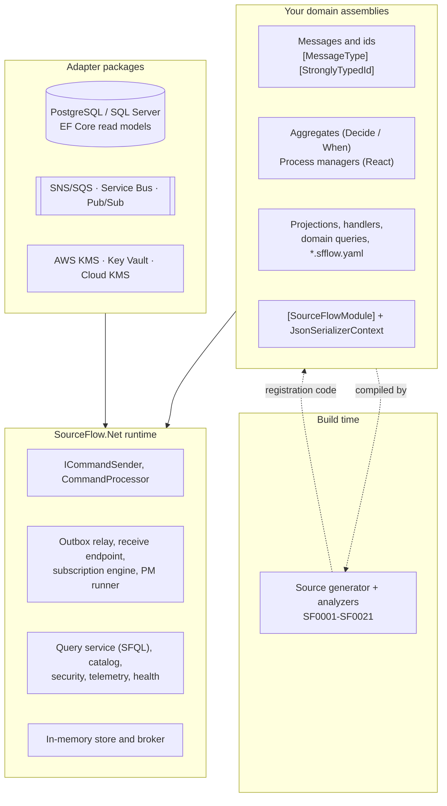
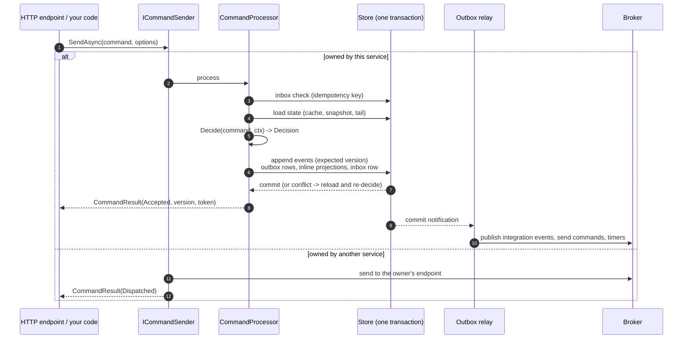
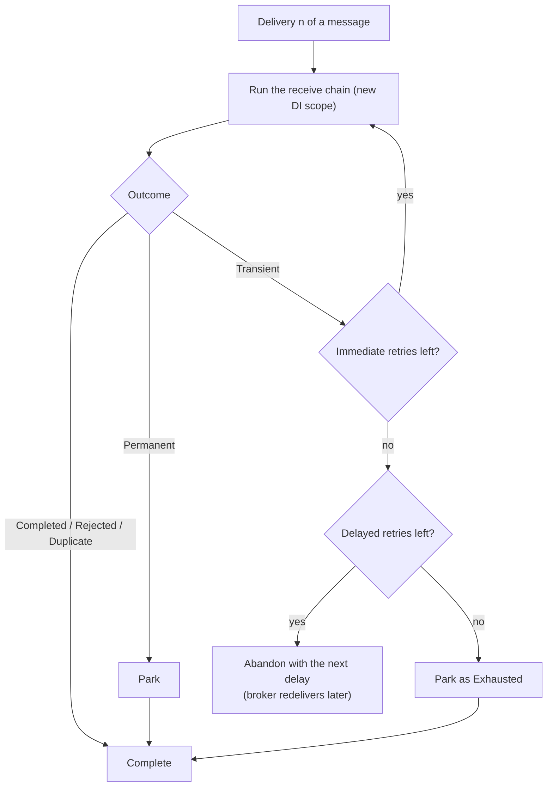

# SourceFlow.Net v3 - Complete Guide

This guide covers SourceFlow.Net v3.0.0 from first principles to a production service. Read it top to bottom to learn the
framework, or jump to a topic from the table of contents. Each section links to the package README, architecture document
or design record that covers the topic in more depth.

Every package targets .NET 10 (`net10.0`). The guide for v1 and v2 is in [docs/legacy-version/wiki.md](../../legacy-version/wiki.md).

---

## Table of Contents

1. [Introduction](#1-introduction)
2. [Core concepts](#2-core-concepts)
3. [Architecture overview](#3-architecture-overview)
4. [Getting started](#4-getting-started)
5. [The domain model in depth](#5-the-domain-model-in-depth)
6. [Routing and messaging between services](#6-routing-and-messaging-between-services)
7. [Persistence](#7-persistence)
8. [Projections and read models](#8-projections-and-read-models)
9. [Process managers and timers](#9-process-managers-and-timers)
10. [Workflows and SourceFlow Studio](#10-workflows-and-sourceflow-studio)
11. [The query side](#11-the-query-side)
12. [Cloud transports](#12-cloud-transports)
13. [Middleware, errors, retries and dead letters](#13-middleware-errors-retries-and-dead-letters)
14. [Security and compliance](#14-security-and-compliance)
15. [Observability](#15-observability)
16. [Testing](#16-testing)
17. [The command-line tool](#17-the-command-line-tool)
18. [Configuration reference](#18-configuration-reference)
19. [Performance and scaling](#19-performance-and-scaling)
20. [Migrating from v2](#20-migrating-from-v2)
21. [Best practices](#21-best-practices)
22. [Production checklist](#22-production-checklist)
23. [Troubleshooting](#23-troubleshooting)
24. [FAQ](#24-faq)
25. [Reference and community](#25-reference-and-community)

---

## 1. Introduction

SourceFlow.Net is a .NET 10 framework for building event-sourced, message-driven services with Domain-Driven Design (DDD)
and Command Query Responsibility Segregation (CQRS). It is a library, not a server: a service references one core package,
writes its domain as plain records and pure functions, and composes a database adapter and a message broker adapter at
startup.

### 1.1 Who it is for

- Teams building services whose state changes matter: finance, orders, inventory, bookings, case management, anything
  where "what happened, when and why" must be answerable.
- Teams running several services that talk through a broker (AWS SNS/SQS, Azure Service Bus or Google Pub/Sub) and need
  messages to have an effect exactly once even though brokers deliver at least once.
- Developers who want the patterns (aggregates, process managers, projections, outbox, inbox) without writing the
  plumbing, and without reflection or runtime magic they cannot read.

### 1.2 What you get

| Area | What SourceFlow.Net provides |
|------|------------------------------|
| Domain model | Aggregates as pure deciders (`Decide` and `When`), immutable messages with stable logical names, strongly typed UUIDv7 ids, rejections as values with stable codes |
| Code generation | A Roslyn source generator that wires every aggregate, process manager, projection, handler and query at compile time, plus 20 analyzers that enforce the programming model. No reflection in dispatch or registration |
| Persistence | An event store with gap-free, commit-ordered global positions, optimistic concurrency with automatic re-decide, snapshots and an opt-in state cache. Adapters for PostgreSQL and SQL Server, and a complete in-memory store |
| Messaging | Transactional outbox and inbox (always on), durable timers, retries, delayed retries and dead letters, CloudEvents on the wire. Transports for AWS, Azure and Google Cloud, and an in-memory broker |
| Read side | Inline and async projections, document and EF Core read models, blue/green rebuilds, consistency tokens for read-your-writes |
| Coordination | Hand-written process managers, and workflows written in a YAML DSL that compile to process managers, designed and simulated in SourceFlow Studio |
| Queries | SFQL, a query language in a pipeline syntax and a SQL `SELECT` subset, over events, streams, read models and aggregate state; named domain queries; a per-service HTTP query API that fails closed |
| Security | Per-subject encryption of personal data with crypto-shredding, payload encryption with AWS KMS, Azure Key Vault or Google Cloud KMS, log redaction, PostgreSQL row-level security |
| Operations | Health checks, OpenTelemetry traces and metrics, a generated Grafana dashboard and Prometheus alerts, and a CLI for migrations, dead letters, projections, queries, schemas, topology and workflows |
| Testing | Given/When/Then specs for aggregates, process managers, projections and workflows; an in-memory test host; chaos fault injection; storage and transport conformance kits |

### 1.3 What v3 changes from v2

v3 is a redesign, not an upgrade. v2 stored **commands** and the current state of entities, and replayed commands to
rebuild state. v3 stores **events**, the facts a decision produced, and rebuilds state from them
([ADR-002](../ADRs/ADR-002-event-sourcing-replaces-command-sourcing.md)). The main differences:

| v2 | v3 |
|----|----|
| `IEntity` with an `int` id, persisted whole | An aggregate state `record` rebuilt from its event stream, with a strongly typed id |
| `Saga<T>` and `IHandles<C>` that handle, mutate, persist and raise | Pure `Decide` methods on the aggregate, or an `ICommandHandler` when I/O is needed |
| `Aggregate<T>` facade that sends commands | `ICommandSender` |
| `View<T>` and `IProjectOn<E>` | Document, EF Core or custom projections; inline or async; checkpointed and rebuildable |
| Reflection and assembly scanning | A source generator; nothing is discovered at run time |
| Exceptions for business failures | `Decision.Reject(Error)` with a stable code |
| Several middleware abstractions, opt-in reliability | One `IMessageMiddleware`; outbox, inbox, retries and dead letters always on |
| Multi-targeted (netstandard2.0 to net10.0) | `net10.0` only |

The full list of additions, changes and removals is in the [changelog](Versions/v3.0.0/CHANGELOG.md). To move an existing
v2 service and its data, see [Migrating from v2](#20-migrating-from-v2) and the
[migration guide](../guides/migrating-from-v2.md).

### 1.4 Packages

| Package | Contents | README |
|---------|----------|--------|
| `SourceFlow.Net` | The core: domain contracts, runtime, in-memory store and broker, extensibility interfaces, telemetry, health checks, query engine, workflow runtime types, v2 migration support. Bundles the source generator and analyzers | [README](SourceFlow.Net-README.md) |
| `SourceFlow.Storage.PostgreSQL` | Every storage port on PostgreSQL 15+, migrator, row-level security, partitioned events, SFQL compiler | [README](SourceFlow.Storage.PostgreSQL-README.md) |
| `SourceFlow.Storage.SqlServer` | Every storage port on SQL Server, migrator, SFQL T-SQL compiler | [README](SourceFlow.Storage.SqlServer-README.md) |
| `SourceFlow.Storage.EntityFrameworkCore` | Projections that write EF Core read models in the projection transaction | [README](SourceFlow.Storage.EntityFrameworkCore-README.md) |
| `SourceFlow.Cloud.Aws` | SNS/SQS transport and provisioner, AWS KMS key provider, v2 wire bridge | [README](SourceFlow.Cloud.Aws-README.md) |
| `SourceFlow.Cloud.Azure` | Service Bus transport and provisioner, Key Vault key provider | [README](SourceFlow.Cloud.Azure-README.md) |
| `SourceFlow.Cloud.Gcp` | Pub/Sub transport and provisioner, Cloud KMS key provider | [README](SourceFlow.Cloud.Gcp-README.md) |
| `SourceFlow.AspNetCore` | `MapCommand<T>()` endpoints, the per-service query API and domain query endpoints | [README](SourceFlow.AspNetCore-README.md) |
| `SourceFlow.Testing` | Specs, the in-memory test host, the chaos injector, conformance kits | [README](SourceFlow.Testing-README.md) |
| `SourceFlow.Tool` | The `sourceflow` command line | [README](SourceFlow.Tool-README.md) |
| `SourceFlow.Studio` | The workflow DSL library (validate, simulate, enumerate paths, export, generate specs) behind SourceFlow Studio | [README](SourceFlow.Studio-README.md) |

Domain assemblies reference only `SourceFlow.Net` and use only the `SourceFlow` and `SourceFlow.Workflows` namespaces. There
is no separate abstractions package; the namespace rule and the architecture tests keep domain code free of infrastructure
([ADR-027](../ADRs/ADR-027-single-core-package-with-extensibility-spis-and-categorised-adapters.md)).

### 1.5 Conventions used in this guide

- Code samples come from the repository's sample (`samples/TravelBooking`), the domains its tests run against
  (`tests/Fixtures/Bank`, `tests/Fixtures/OrderFulfilment`) and the tests themselves (`tests/`), trimmed for length.
  `using` directives are shown when they matter.
- `sourceflow <command>` means the SourceFlow command line: the `SourceFlow.Tool` .NET tool (`dotnet sourceflow`), the
  repository build (`dotnet run --project src/Tooling/SourceFlow.Tool -- <command>`), or your service
  (`dotnet run -- sourceflow <command>`) ([section 17](#17-the-command-line-tool)).
- "The design" refers to the documents in [docs/v3.0.0/Design](../Design/README.md); where they differ from this guide,
  the code and this guide describe what shipped.

---

## 2. Core concepts

This section explains the ideas the rest of the guide builds on. If you know event sourcing and CQRS already, skim the
tables: several terms have a precise meaning in SourceFlow.Net.

### 2.1 Event sourcing

An event-sourced system stores what happened, not what is. Each change is recorded as an **event**: an immutable fact
such as `MoneyDeposited(AccountId, Amount, BalanceAfter)`. The current state of an account is the result of folding its
events in order.

Benefits:

- **Audit by construction.** The history is the data. Nothing is overwritten.
- **Temporal queries.** The state at any past version or time can be rebuilt (`IAggregateReader` with `AsOf`, or the SFQL
  `aggregate ... as of` source).
- **New read models from old data.** A projection added today can be built from every event ever written.
- **Integration.** Events are a natural source for messages to other services.

The cost is that you must design events carefully (they are a published schema of your own history) and version them when
they change. SourceFlow.Net gives every event a stable logical name and version, a schema catalog that detects breaking
changes, and upcasters for old versions.

### 2.2 CQRS

CQRS separates the **write side** (commands decided by aggregates, events appended to streams) from the **read side**
(projections that turn events into read models, and queries over them). Each side is shaped for its job: aggregates are
small consistency boundaries; read models are denormalised for the questions the UI or other services ask.

In SourceFlow.Net, a command is decided against an aggregate's state; the resulting events are appended atomically; and
projections, process managers and event handlers react to those events, either in the same transaction (inline) or
shortly after (async).

### 2.3 Messages: commands, events, integration events, timeouts and replies

Every message is an immutable `sealed record` that implements one marker interface and carries a `[MessageType(name, version)]`
attribute.

| Message | Interface | Meaning |
|---------|-----------|---------|
| Command | `ICommand<TAggregate>` | A request to change exactly one aggregate of type `TAggregate`. It may be accepted, rejected or be a no-op |
| Domain event | `IEvent` | An internal fact appended to an aggregate's stream. Private to the service unless explicitly published |
| Integration event | `IIntegrationEvent` | A public, versioned contract published to other services |
| Timeout | `ITimeout` | A message a process manager schedules to itself (a durable timer) |
| Rejection reply | `CommandRejected<TCommand>` | The reply a process manager receives when a command it sent was rejected |

Message metadata (id, correlation, causation, time, tenant, actor, trace context) is never a member of the record. It
travels in the **envelope** ([2.11](#211-the-envelope)).

### 2.4 Aggregates as pure deciders

An aggregate is a consistency boundary: everything inside one aggregate changes atomically, and invariants are checked
against its current state. In SourceFlow.Net an aggregate is a `sealed partial record` with two kinds of method
([ADR-003](../ADRs/ADR-003-aggregates-as-pure-deciders-decide-evolve.md)):

- **`Decide(command, context)`** looks at the current state and the command and returns a `Decision`: accept with events,
  reject with an error, or no-op. It is pure and synchronous: no I/O, no clock, no random numbers.
- **`When(event)`** returns the next state from the current state and one event (`this with { ... }`). It is pure and
  never assigns anything.

Because both are pure, the runtime can re-run `Decide` on fresh state after a concurrency conflict, tests need no mocks,
and the same code folds history in the aggregate store, in tests and in temporal queries.

### 2.5 Rejections are values

A business rule that says "no" is not an exception. `Decision.Reject(new Error("account.insufficient_funds", "..."))`
returns a value with a stable, dot-separated code that callers branch on: HTTP problem details carry it, process managers
receive it in `CommandRejected<T>`, and metrics count it as a successful outcome rather than an error
([ADR-018](../ADRs/ADR-018-business-rejections-are-values-not-exceptions.md)).

### 2.6 Streams, versions and global positions

| Term | Meaning |
|------|---------|
| Stream | The ordered events of one aggregate instance. Its id is `{aggregate name}-{id segment}`, for example `bank-account-0193a7a0...` |
| Stream version | The number of events in the stream. The first event is version 1; `StreamVersion.None` (0) means the stream does not exist |
| Expected version | The version a writer read before deciding. An append succeeds only if the stream is still at that version (optimistic concurrency) |
| Global position | A commit-ordered position across all streams, `{commit}:{sequence}`. Subscriptions read the global log in this order, and it is gap-free: a reader never skips an event that commits later with a lower position ([ADR-010](../ADRs/ADR-010-commit-ordered-global-position-for-gap-free.md)) |
| Safe horizon | The highest position below which no transaction is still writing. Subscriptions read up to it, which is what makes the log gap-free |
| Consistency token | The global position of a command's last event (plus the tenant), returned to the caller so a later query can wait until read models have caught up |

### 2.7 Process managers

A process manager coordinates work across several aggregates or services over time. It reacts to events, sends commands,
schedules durable timers and keeps its own state. Like an aggregate it is a record with pure methods (`React`), and the
runtime stores its state and its outgoing messages in one transaction. Workflows written in the YAML DSL compile to
process managers.

### 2.8 Projections and read models

A projection is a pure function from events to a read model. SourceFlow.Net has **document projections** (JSON documents
keyed by an id, stored by the storage adapter) and **session projections** (for example EF Core entities written in the
projection's transaction). Each runs **inline** (in the command's transaction, so a read immediately after the write sees
it) or **async** (in a checkpointed subscription over the global log, eventually consistent).

### 2.9 Services and command ownership

A **service** is one deployable unit with a `ServiceName`, its own database schema and its own input endpoint on the broker.
Every command type has exactly **one owner**: the service whose aggregate decides it. Another service that wants to send that
command **routes** it to the owner's endpoint. A command is either handled locally or routed, never both and never neither
([ADR-007](../ADRs/ADR-007-single-command-ownership-route-local-xor-remote.md)). Domain events leave a service only
through explicit **publications** to topics, and a service receives other services' events only through its own
**subscriptions**.

### 2.10 Effectively-once messaging

Brokers deliver at least once, and processes crash between steps. SourceFlow.Net makes every effect happen once anyway
([ADR-006](../ADRs/ADR-006-transactional-outbox-and-inbox-for-effectively-once.md)):

- **Outbox.** Every outgoing message (published event, command to another service, timer) is written as a row in the same
  database transaction as the events that caused it. A relay sends it later and deletes the row only after the broker
  acknowledged it. Nothing is sent for a transaction that rolled back, and nothing is lost if the process dies after commit.
- **Inbox.** Every received message is recorded per consumer, by message id, in the same transaction as its effects. A
  redelivery finds the row and is acknowledged without a second effect, returning the stored result.
- **Checkpoints.** Local subscriptions commit their position with their effects, so a restart resumes exactly after the
  last applied event.

Effects outside your database (an email, a payment gateway call) are at least once: make them idempotent, for example with
`DecisionContext.CommandId` or `EventContext.EventId` as the idempotency key. The
[Message Idempotency Guide](Message-Idempotency-Guide.md) covers the whole model.

### 2.11 The envelope

Every message travels in a `MessageEnvelope`. On the wire it is a CloudEvent in binary mode: the CloudEvents attributes
(`id`, `type`, `source`, `subject`, `time`) plus SourceFlow extensions such as `sfcorrelationid`, `sfcausationid` and
`sftenant`, with the record as the body. The CloudEvents `type` is `{name}.v{version}`, for example
`bank.account.deposited.v1`.

The logical names form a frozen **allow-list**: an envelope whose type and version are not registered is never
deserialised. It is parked as a dead letter with the reason `UnknownMessageType`.

---

## 3. Architecture overview

SourceFlow.Net v3 runs inside your service process. The domain is compiled into registration code by the generator; the
runtime executes it against the storage and transport adapters you chose.



### 3.1 The life of a command



### 3.2 Runtime components

| Component | Responsibility |
|-----------|----------------|
| `ICommandSender` | The single entry point for commands; sends each to its single owner |
| `CommandProcessor` | Inbox check, load, decide, append, outbox, inline projections and commit in one storage session; re-decides on conflict |
| Aggregate store | Loads state from the cache, a snapshot and the stream tail; writes snapshots after commit in the background |
| Outbox relay | Leases outbox partitions and publishes due rows in per-key order; retries and parks |
| Receive endpoint | One receiver on the service endpoint; per-key workers; retries, delayed retries and parking; settles after commit |
| Subscription engine | Reads the commit-ordered log per partition under fenced leases; drives async projections, process managers and event handlers |
| Process manager runner | Correlate, load state, react, save state, queue commands and timers in one transaction |
| Dead-letter ingestor | Moves messages from the broker's native dead-letter queue into the store's dead letters |
| Monitor | Samples outbox backlog, dead letters, lag, horizon, process managers and leases for gauges and health checks |
| Query service | SFQL and SQL-syntax queries, domain queries, temporal aggregate reads, consistency waits |
| `SourceFlowHost` | Startup validation, provisioning, background loops and graceful shutdown |

### 3.3 Delivery guarantees

| Path | Guarantee |
|------|-----------|
| Local `SendAsync` to an aggregate | Atomic; effectively once with an idempotency key |
| Command to a remote owner | At-least-once delivery, effectively-once effect (owner's inbox) |
| Event to an inline projection | Atomic with the append |
| Event to an async projection, process manager or event handler in the same service | Exactly-once effect in the store, per-stream order (checkpoint committed with the effects) |
| Integration event to a subscribing service | At-least-once delivery, effectively once per consumer |
| External side effect in an event handler | At least once: make it idempotent |
| Timer | At least once, at or after its due time |

The architecture is described in depth in [Architecture](Architecture/README.md), starting with the
[Architecture Overview](Architecture/01-Architecture-Overview.md), then [Command Flow](Architecture/02-Command-Flow.md)
and [Event Flow](Architecture/03-Event-Flow.md). Design rationale is in [Design 01](../Design/01-Architecture-Overview.md).

---

## 4. Getting started

This section builds a small Accounts service step by step: ids, messages, an aggregate, error codes, a read model, the
module, registration and HTTP endpoints. It runs first on the in-memory adapters and then on PostgreSQL. The code follows the
Accounts module of the Bank domain the tests use ([tests/Fixtures/Bank/Bank.Accounts](../../../tests/Fixtures/Bank/Bank.Accounts)),
trimmed down. For a complete application with two services and a workflow, run the demo ([4.12](#412-the-demo-docker-compose-up)).

### 4.1 Prerequisites

- The .NET 10 SDK.
- Docker, for PostgreSQL and the demo (optional for the in-memory steps).

### 4.2 Create the projects and add the packages

```bash
dotnet new classlib -n Accounts
dotnet new web -n Accounts.Api
dotnet add Accounts package SourceFlow.Net
dotnet add Accounts.Api reference Accounts
dotnet add Accounts.Api package SourceFlow.AspNetCore
dotnet add Accounts.Api package SourceFlow.Storage.PostgreSQL   # for 4.11
```

`SourceFlow.Net` brings the source generator and analyzers with it; there is nothing else to install. Keep the domain
(`Accounts`) free of infrastructure: it references only `SourceFlow.Net`.

To see what the generator writes, add this to the domain project file and look under `obj/<Configuration>/net10.0/generated/`
(see [Reading generated code](../guides/reading-generated-code.md)):

```xml
<PropertyGroup>
  <EmitCompilerGeneratedFiles>true</EmitCompilerGeneratedFiles>
</PropertyGroup>
```

### 4.3 The id

Ids are strongly typed and caller-assigned. A `readonly partial record struct` with one `Value` parameter and
`[StronglyTypedId]` gets `New()` (a time-ordered UUIDv7), parsing, formatting and a JSON converter from the generator
([ADR-015](../ADRs/ADR-015-strongly-typed-caller-assigned-ids-uuidv7-default.md)).

```csharp
using SourceFlow;

namespace Bank.Accounts;

[StronglyTypedId]
public readonly partial record struct AccountId(Guid Value);
```

### 4.4 Commands and events

```csharp
[MessageType("bank.account.open", 1)]
public sealed record OpenAccount(AccountId AccountId, string Holder, decimal InitialDeposit) : ICommand<BankAccount>;

[MessageType("bank.account.deposit", 1)]
public sealed record Deposit(AccountId AccountId, decimal Amount) : ICommand<BankAccount>;

[MessageType("bank.account.withdraw", 1)]
public sealed record Withdraw(AccountId AccountId, decimal Amount) : ICommand<BankAccount>;

[MessageType("bank.account.opened", 1)]
public sealed record AccountOpened(AccountId AccountId, [property: PersonalData] string Holder, decimal InitialDeposit, DateTimeOffset OpenedAt) : IEvent;

[MessageType("bank.account.deposited", 1)]
public sealed record MoneyDeposited([property: Queryable] AccountId AccountId, decimal Amount, decimal BalanceAfter) : IEvent;

[MessageType("bank.account.withdrawn", 1)]
public sealed record MoneyWithdrawn(AccountId AccountId, decimal Amount, decimal BalanceAfter) : IEvent;
```

- Each command targets its aggregate through its one member of the aggregate's id type (`AccountId` here).
- `[PersonalData]` marks the holder's name as personal data: it is redacted in logs and telemetry, and encrypted per data
  subject if you turn that on ([14.2](#142-personal-data-and-crypto-shredding)).
- `[Queryable]` makes `AccountId` filterable and indexed in SFQL queries over these events.

### 4.5 Error codes

Keep business errors as static fields so their codes never drift:

```csharp
public static class AccountErrors
{
    public static readonly Error InitialDepositRequired = new("account.initial_deposit_required", "An initial deposit is required.");
    public static readonly Error AlreadyOpen = new("account.already_open", "The account is already open.");
    public static readonly Error NotOpen = new("account.not_open", "The account is not open.");
    public static readonly Error AmountMustBePositive = new("account.amount_must_be_positive", "Amount must be positive.");
    public static readonly Error InsufficientFunds = new("account.insufficient_funds", "Insufficient funds.");
}
```

### 4.6 The aggregate

```csharp
public enum AccountStatus { None = 0, Open = 1, Closed = 2 }

[Aggregate("bank-account")]
public sealed partial record BankAccount : IAggregate<BankAccount, AccountId>
{
    public static BankAccount Initial { get; } = new();

    public AccountStatus Status { get; init; }
    public decimal Balance { get; init; }

    public Decision Decide(OpenAccount c, DecisionContext ctx) => Status switch
    {
        AccountStatus.None when c.InitialDeposit <= 0 => Decision.Reject(AccountErrors.InitialDepositRequired),
        AccountStatus.None => Decision.Accept(new AccountOpened(c.AccountId, c.Holder, c.InitialDeposit, ctx.Now)),
        _ => Decision.Reject(AccountErrors.AlreadyOpen),
    };

    public Decision Decide(Deposit c, DecisionContext ctx) => this switch
    {
        { Status: not AccountStatus.Open } => Decision.Reject(AccountErrors.NotOpen),
        _ when c.Amount <= 0 => Decision.Reject(AccountErrors.AmountMustBePositive),
        _ => Decision.Accept(new MoneyDeposited(c.AccountId, c.Amount, Balance + c.Amount)),
    };

    public Decision Decide(Withdraw c, DecisionContext ctx) => this switch
    {
        { Status: not AccountStatus.Open } => Decision.Reject(AccountErrors.NotOpen),
        _ when c.Amount <= 0 => Decision.Reject(AccountErrors.AmountMustBePositive),
        _ when c.Amount > Balance => Decision.Reject(AccountErrors.InsufficientFunds),
        _ => Decision.Accept(new MoneyWithdrawn(c.AccountId, c.Amount, Balance - c.Amount)),
    };

    private BankAccount When(AccountOpened e) => this with { Status = AccountStatus.Open, Balance = e.InitialDeposit };
    private BankAccount When(MoneyDeposited e) => this with { Balance = e.BalanceAfter };
    private BankAccount When(MoneyWithdrawn e) => this with { Balance = e.BalanceAfter };
}
```

Note what is absent: no repository, no event bookkeeping, no `DateTime.UtcNow` (the decision time is `ctx.Now`), no
exceptions for business rules. The generator writes the dispatch that calls these methods.

### 4.7 A read model

```csharp
public sealed record AccountSummary(AccountId Id, string Holder, decimal Balance, [property: Queryable] AccountStatus Status, long Version);

[Projection("account-summary")]
public sealed partial class AccountSummaryProjection : IDocumentProjection<AccountSummary, AccountId>
{
    private static AccountSummary When(AccountOpened e, AccountSummary? current, EventContext ctx)
        => new(e.AccountId, e.Holder, e.InitialDeposit, AccountStatus.Open, ctx.StreamVersion.Value);

    private static AccountSummary? When(MoneyDeposited e, AccountSummary? current, EventContext ctx)
        => current is null ? null : current with { Balance = e.BalanceAfter, Version = ctx.StreamVersion.Value };

    private static AccountSummary? When(MoneyWithdrawn e, AccountSummary? current, EventContext ctx)
        => current is null ? null : current with { Balance = e.BalanceAfter, Version = ctx.StreamVersion.Value };
}
```

The document key is the source stream's aggregate id, so each account has one summary document. Returning `null` deletes
the document.

### 4.8 The module and its JSON context

One `partial class` per assembly, marked `[SourceFlowModule]`, is filled in by the generator. Its JSON context lists every
message, document and state type, so serialisation needs no reflection. Analyzer SF0010 reports a missing type and offers a
code fix that adds the attribute.

```csharp
using System.Text.Json.Serialization;

[SourceFlowModule(typeof(AccountsJsonContext))]
public sealed partial class AccountsModule;

[JsonSerializable(typeof(OpenAccount))]
[JsonSerializable(typeof(Deposit))]
[JsonSerializable(typeof(Withdraw))]
[JsonSerializable(typeof(AccountOpened))]
[JsonSerializable(typeof(MoneyDeposited))]
[JsonSerializable(typeof(MoneyWithdrawn))]
[JsonSerializable(typeof(AccountSummary))]
[JsonSerializable(typeof(BankAccount))]
[JsonSourceGenerationOptions(PropertyNamingPolicy = JsonKnownNamingPolicy.CamelCase)]
public sealed partial class AccountsJsonContext : JsonSerializerContext;
```

### 4.9 Register the service and map HTTP endpoints

`Accounts.Api/Program.cs`, on the in-memory adapters:

```csharp
using Bank.Accounts;
using Microsoft.AspNetCore.Diagnostics.HealthChecks;
using SourceFlow.AspNetCore;
using SourceFlow.Hosting;

WebApplicationBuilder builder = WebApplication.CreateBuilder(args);

builder.Services.AddSourceFlow(sf =>
{
    sf.ServiceName = "accounts";
    sf.AddModule<AccountsModule>();
    sf.Projections(p => p.Add<AccountSummaryProjection>().Inline());   // read-your-writes
    sf.UseInMemoryStorage();
    sf.UseInMemoryTransport();
});

builder.Services.AddHealthChecks().AddSourceFlow();

WebApplication app = builder.Build();

app.MapHealthChecks("/health", new HealthCheckOptions { Predicate = _ => false });
app.MapHealthChecks("/health/ready", new HealthCheckOptions { Predicate = c => c.Tags.Contains(SourceFlowHealthChecks.ReadyTag) });

app.MapCommand<OpenAccount>("/accounts/{accountId}");
app.MapCommand<Deposit>("/accounts/{accountId}/deposits");
app.MapCommand<Withdraw>("/accounts/{accountId}/withdrawals");

app.Run();
```

`AddSourceFlow` validates the model at once: duplicate message names, missing JSON metadata, commands with no owner and
no route, and unknown projections all fail here, before the host starts. Options and topology are validated when the
host starts.

`MapCommand<T>(pattern)` maps `POST pattern` to one command. The JSON body is the command; route values fill members the
body does not have (`{accountId}` fills `accountId`).

```bash
dotnet run --project Accounts.Api

ID=0193a7a0-5b1e-7c3d-9e2f-1a2b3c4d5e6f
curl -i -X POST http://localhost:5000/accounts/$ID -H 'Content-Type: application/json' \
  -d '{ "holder": "Ada", "initialDeposit": 100 }'
# HTTP/1.1 200 OK
# ETag: "1"
# SourceFlow-Consistency: ...
# {"status":"Accepted","version":1,"error":null}

curl -i -X POST http://localhost:5000/accounts/$ID/withdrawals -H 'Content-Type: application/json' \
  -d '{ "amount": 500 }'
# HTTP/1.1 422 Unprocessable Entity   (problem details, title "account.insufficient_funds")
```

Use the port `dotnet run` prints. The full mapping of results to HTTP:

| `CommandStatus` | HTTP | Notes |
|-----------------|------|-------|
| `Accepted`, `NoOp`, `Duplicate` | `200 OK` | Body `{"status","version","error"}`, `ETag` with the stream version, `SourceFlow-Consistency` with the consistency token |
| `Dispatched` | `202 Accepted` | The command was routed to its owner in another service |
| `Rejected` | `422 Unprocessable Entity` | Problem details: `title` is the error code, `type` is `urn:sourceflow:error:<code>` |
| `Conflict` | `409 Conflict`, or `412 Precondition Failed` when the request had `If-Match` | Concurrency retries exhausted, or the expected version did not match |
| Malformed body or `If-Match` | `400 Bad Request` | Problem details, title `sourceflow.invalid_request` |

Request headers: `Idempotency-Key` becomes `SendOptions.IdempotencyKey` (a repeat returns the first result as `Duplicate`),
and `If-Match: "3"` becomes `SendOptions.ExpectedVersion`. `MapCommand` does not require an authorization policy; add one
with `.RequireAuthorization(...)`. See the [SourceFlow.AspNetCore README](SourceFlow.AspNetCore-README.md).

### 4.10 Sending commands from code

`ICommandSender` is the single entry point for commands, from an endpoint, a background job or an event handler:

```csharp
public sealed class AccountOpener(ICommandSender commands)
{
    public async Task<AccountId> OpenAsync(string holder, decimal deposit, string requestId, CancellationToken ct)
    {
        AccountId id = AccountId.New();
        CommandResult result = await commands.SendAsync(
            new OpenAccount(id, holder, deposit),
            new SendOptions { IdempotencyKey = "open-account:" + requestId },
            ct);

        result.ThrowIfNotAccepted();   // throws CommandFailedException unless IsSuccess
        return id;
    }
}
```

| `SendOptions` | Meaning |
|---------------|---------|
| `IdempotencyKey` | Becomes the message id (a UUIDv5 of the service name and the key) and turns on the inbox: a repeat returns the original result with status `Duplicate` |
| `ExpectedVersion` | A caller-side optimistic check; a mismatch returns `Conflict` with `sourceflow.version_mismatch` |
| `CorrelationId` | The conversation this command belongs to (default: the command's own id) |
| `Headers` | User headers carried in the envelope: at most 8, each name and value at most 256 bytes |

| `CommandResult` member | Meaning |
|------------------------|---------|
| `Status` | `Accepted`, `NoOp`, `Rejected`, `Conflict`, `Duplicate` or `Dispatched` |
| `Version` | The stream version after the command |
| `Error` | The `Error` for `Rejected` and `Conflict` (and the original error of a `Duplicate` of a failed request) |
| `Token` | The `ConsistencyToken` for read-your-writes queries |
| `IsSuccess` | True for `Accepted`, `NoOp`, `Duplicate` and `Dispatched` |

To read an aggregate's state directly (strongly consistent, optionally at a past version or time), use `IAggregateReader`:

```csharp
AggregateSnapshot<BankAccount> account = await aggregates.LoadAsync<BankAccount, AccountId>(id);
AggregateSnapshot<BankAccount> monthEnd = await aggregates.LoadAsync<BankAccount, AccountId>(
    id, AsOf.Time(new DateTimeOffset(2026, 1, 31, 23, 59, 59, TimeSpan.Zero)));
Console.WriteLine($"{account.State.Balance} at version {account.Version.Value}");
```

`AsOf.Latest` (the default), `AsOf.Version(n)` and `AsOf.Time(t)` select the point in history.

### 4.11 Moving to PostgreSQL

Start PostgreSQL 15 or later:

```bash
docker run -d --name sourceflow-pg -p 5432:5432 \
  -e POSTGRES_USER=sourceflow -e POSTGRES_PASSWORD=sourceflow -e POSTGRES_DB=accounts postgres:17-alpine
```

Replace the storage slot:

```csharp
using SourceFlow.Storage.PostgreSQL;

string connectionString = builder.Configuration.GetConnectionString("SourceFlow")
    ?? throw new InvalidOperationException("Set ConnectionStrings__SourceFlow.");

builder.Services.AddSourceFlow(sf =>
{
    sf.ServiceName = "accounts";
    sf.AddModule<AccountsModule>();
    sf.Projections(p => p.Add<AccountSummaryProjection>().Inline());
    sf.UsePostgreSql(connectionString, o => o.Schema = "accounts");
    sf.UseInMemoryTransport();
});
```

```bash
export ConnectionStrings__SourceFlow="Host=localhost;Port=5432;Username=sourceflow;Password=sourceflow;Database=accounts"
ASPNETCORE_ENVIRONMENT=Development dotnet run --project Accounts.Api
```

In the `Development` environment `AutoMigrate` defaults to on, so the schema is created at startup. Elsewhere the service
only verifies that the schema is installed and current, and fails with a message naming the command to run
([7.3](#73-postgresql)). The in-memory transport is fine while the service talks to no other service;
[section 12](#12-cloud-transports) adds a cloud transport.

### 4.12 The demo: `docker compose up`

The repository root has a compose file that runs the [TravelBooking sample](../../../samples/TravelBooking/README.md): a
domain split across two services, Bookings and Hotels, each on its own PostgreSQL schema, talking over Amazon SNS and SQS
(emulated by LocalStack), with the trip-booking workflow between them and SourceFlow Studio for its workspace:

```bash
docker compose up -d --build    # builds the images from this checkout
docker compose up -d            # or pulls the published images from ghcr.io
docker compose down -v          # stops the demo and deletes its data
```

| What | Where |
|------|-------|
| Bookings service (bookings, and the trip-booking workflow) | http://localhost:8080 |
| Hotels service (hotels and their rooms: holds, releases, confirmations) | http://localhost:8081 |
| SourceFlow Studio (read-only: domain map, statechart, simulation, paths) | http://localhost:5080 |
| Aspire dashboard (traces and metrics over OTLP) | http://localhost:18888 |
| PostgreSQL (`sourceflow` / `sourceflow`, database `travel`, a schema per service) | `localhost:55432` |
| LocalStack (SNS and SQS between the services) | `localhost:4566` |

Book a room and confirm it:

```bash
HOTEL=0193a7a0-0000-7000-8000-000000000001
BOOKING=0193a7a0-0000-7000-8000-0000000000b1

curl -X POST http://localhost:8081/hotels/$HOTEL -H 'Content-Type: application/json' -d '{ "name": "Seaview", "rooms": 1 }'
curl -X POST http://localhost:8080/bookings/$BOOKING -H 'Content-Type: application/json' \
  -d "{ \"hotelId\": \"$HOTEL\", \"guest\": \"Ada Lovelace\", \"nights\": 2 }"
curl -X POST http://localhost:8080/bookings/$BOOKING/confirm -H 'Content-Type: application/json' -d '{}'
```

Requesting the booking starts the workflow, which holds the room at the hotel; the guest's confirmation lets it confirm
the reservation (its point of no return) and the booking. `POST /bookings/{id}/cancel` cancels a booking before that,
and `POST http://localhost:8081/hotels/{hotel}/holds/{booking}/release` releases a hold as hotel staff. Follow the
workflow through the query API (`GET /queries` lists the named queries, among them `bookings.by-status` and the
generated `bookings.workflow-instances`; `POST /query` runs SFQL), in the Aspire dashboard, where one trace follows a
booking through both services and the broker, or with the CLI inside the service:

```bash
docker compose exec bookings sh -c 'dotnet Bookings.Api.dll sourceflow workflow list --name trip-booking'
```

`SOURCEFLOW_TAG` selects the image tag (default `v3-latest`) of the three images,
`ghcr.io/codeshayk/sourceflow-travel-bookings`, `-travel-hotels` and `-travel-studio`. The Studio on port 5080 is a
static site of the sample's workspace; to edit the workflow, run Studio locally
([10.7](#107-sourceflow-studio)). The demo's query endpoints have no authentication; never expose them. The
[sample's README](../../../samples/TravelBooking/README.md) walks through every outcome of the workflow.

### 4.13 Where to go next

| You want to | Read |
|-------------|------|
| Model a richer domain | [The domain model in depth](#5-the-domain-model-in-depth) |
| Split into several services | [Routing and messaging](#6-routing-and-messaging-between-services), [Cloud transports](#12-cloud-transports) |
| Coordinate a long-running process | [Process managers](#9-process-managers-and-timers), [Workflows](#10-workflows-and-sourceflow-studio) |
| Query your data | [The query side](#11-the-query-side) |
| Go to production | [Production checklist](#22-production-checklist) |

---

## 5. The domain model in depth

Design rationale: [Design 03, Domain Programming Model](../Design/03-Domain-Programming-Model.md). Full reference: the
[SourceFlow.Net README](SourceFlow.Net-README.md#the-domain-programming-model).

### 5.1 Decisions

`Decision` has three kinds (`DecisionKind`):

| Factory | Kind | Effect |
|---------|------|--------|
| `Decision.Accept(event)`, `Decision.Accept(e1, e2, ...)` | `Accepted` | The events are appended atomically. At least one event is required |
| `Decision.Reject(Error)` | `Rejected` | Nothing is appended; the caller gets `CommandStatus.Rejected` and the error |
| `Decision.NoOp` | `NoOp` | Nothing changes; the command is already satisfied |

Use `NoOp` for idempotent commands: closing an account that is already closed, placing an order that is already placed.
The caller still gets a success.

An `Error` has a stable dot-separated `Code`, a human-readable `Message` and optional `Details`. The runtime itself uses
three codes:

| Code | When | Status |
|------|------|--------|
| `sourceflow.invalid_command` | The command's target id is the default value (for example `Guid.Empty`) | `Rejected` |
| `sourceflow.version_mismatch` | `SendOptions.ExpectedVersion` did not match the stream | `Conflict` |
| `sourceflow.concurrency_conflict` | Re-decides after concurrency conflicts were exhausted | `Conflict` |

### 5.2 `DecisionContext`

Every `Decide` (and every command handler) receives a `DecisionContext`, fixed for the whole decision:

| Member | Meaning |
|--------|---------|
| `Now` | The decision time from the registered `TimeProvider`; recorded as the event time |
| `Version` | The stream version the state was loaded at; `StreamVersion.None` for a new stream |
| `IsNew` | True when the stream does not exist yet |
| `CommandId` | The command's message id; a natural idempotency key for external calls |
| `CorrelationId` | The conversation the command belongs to |
| `Headers` | User headers from the envelope (`SendOptions.Headers`) |

### 5.3 Aggregate rules

- A top-level `sealed partial record`, marked `[Aggregate(name)]`, implementing `IAggregate<TSelf, TId>` (SF0008 otherwise).
- `static TSelf Initial { get; }` is the state before the first event.
- `Decide` is synchronous and pure (SF0007, SF0009). Use `ctx.Now`, never `DateTime.UtcNow`, `Guid.NewGuid()` or `Random`.
- `When` returns `this with { ... }` and never assigns (SF0004). It may be private.
- Properties use `init`, never `set` (SF0008).
- `Evolve` ignores events the aggregate has no `When` for, so a stream may carry audit-only events. SF0005 warns when a
  `Decide` produces such an event, in case you forgot the `When`.
- The stream id is `{name}-{id segment}`, at most 200 characters.
- Aggregates are never DI services and are never mutated.

| `[Aggregate]` property | Default | Meaning |
|------------------------|---------|---------|
| `Name` (constructor) | required | The stream type name |
| `SnapshotEvery` | `0` (off) | Write a snapshot every N events ([7.6](#76-snapshots-and-the-aggregate-cache)) |
| `SnapshotVersion` | `1` | Bump to invalidate stored snapshots when `When` logic changes without the state's shape changing |

When a command has several members of the aggregate's id type, mark the target with `[AggregateId]`, or SF0003 reports an
error. In this command the aggregate is `Transfer` (keyed by `TransferId`), so `From` and `To` are just data:

```csharp
[MessageType("bank.transfer.request", 1)]
public sealed record RequestTransfer(TransferId TransferId, AccountId From, AccountId To, decimal Amount) : ICommand<Transfer>;
```

### 5.4 Command handlers: when a decision needs I/O

When a decision needs I/O (a payment gateway, a rate lookup), implement `ICommandHandler<TCommand, TAggregate>` instead of
a `Decide` method. From the OrderFulfilment services the tests use ([Payments.cs](../../../tests/Fixtures/OrderFulfilment/Payments/Payments.cs)):

```csharp
public sealed class ChargeHandler(IPaymentGateway gateway) : ICommandHandler<Charge, Payment>
{
    public async ValueTask<Decision> HandleAsync(Charge command, Payment state, DecisionContext context, CancellationToken cancellationToken)
    {
        if (state.PaymentId is not null)
        {
            return Decision.NoOp;   // captured already
        }

        if (command.Amount <= 0)
        {
            return Decision.Reject(new Error(PaymentErrors.InvalidAmount, "The amount must be positive."));
        }

        GatewayOutcome outcome = await gateway.CaptureAsync(command.OrderId.Value, command.Amount, context.CommandId.ToString(), cancellationToken);
        return outcome switch
        {
            GatewayOutcome.Approved => Decision.Accept(new PaymentCaptured(context.CommandId.Value, command.OrderId, command.Amount)),
            GatewayOutcome.FraudSuspected => Decision.Reject(new Error(PaymentErrors.FraudSuspected, "The payment gateway suspects fraud.")),
            _ => Decision.Reject(new Error(PaymentErrors.Declined, "The card was declined.")),
        };
    }
}
```

- The generator registers the handler; the runtime adds it to DI as scoped and resolves it from a per-message scope, so
  constructor dependencies have correct lifetimes.
- A command has a `Decide` or one handler, never both. Two handlers for one command fail startup.
- A handler can run more than once for one command (after a concurrency conflict, or a redelivered remote command). Make
  external calls idempotent, as above with `context.CommandId` as the gateway's idempotency key.
- Do not read the query side in a handler (SF0016): decisions must not depend on eventually consistent reads.

### 5.5 Event handlers: side effects

`IEventHandler<TEvent>` runs a side effect for an event or an integration event. It is resolved from a per-message scope
and runs **at least once**, so make it idempotent with `EventContext.EventId`. From the Notifications module of the Bank domain the tests use
([`tests/Fixtures/Bank/Bank.Notifications`](../../../tests/Fixtures/Bank/Bank.Notifications)):

```csharp
public sealed class AccountOpenedHandler(ICommandSender commands) : IEventHandler<AccountOpenedV1>
{
    public async ValueTask HandleAsync(AccountOpenedV1 @event, EventContext context, CancellationToken cancellationToken)
    {
        await commands.SendAsync(
            new SendWelcome(new CustomerId(@event.AccountId), @event.OpenedAt),
            new SendOptions { IdempotencyKey = "welcome:" + context.EventId },   // effectively once
            cancellationToken);
    }
}
```

`EventContext` carries `EventId`, `StreamId`, `StreamVersion`, `Position`, `Timestamp`, `CorrelationId`, `CausationId`,
`TenantId` and `AggregateKey`. Handlers of local domain events run in a subscription over the event log; handlers of
messages that arrive from the broker run in the receive endpoint with their own inbox entry.

### 5.6 Message names and versioning

`[MessageType(name, version)]` gives every message a stable logical name
([ADR-005](../ADRs/ADR-005-logical-message-type-names-and-registry.md)):

- Lowercase letters, digits, `.`, `-` and `_`; no leading, trailing or doubled dots. For example `bank.account.deposited`.
- The version starts at 1 (the default).
- A `(name, version)` pair is unique across every module in the deployment. A duplicate in one compilation is SF0002; a
  duplicate across assemblies fails startup.
- Names are what is stored and sent. You can rename or move a CLR type freely; you cannot rename a message.

**Compatible changes** keep the version. The schema catalog ([11.7](#117-the-schema-catalog)) compares each published
version with what is registered or with a committed lock file, and fails startup or CI on a breaking change.

**Breaking changes** need a new version and an `IUpcaster<TFrom, TTo>` from each version to the next. Keep the old record,
renamed, with its original attribute:

```csharp
[MessageType("bank.account.opened", 1)]
public sealed record AccountOpenedV1(AccountId AccountId, string Holder, decimal InitialDeposit, DateTimeOffset OpenedAt) : IEvent;

[MessageType("bank.account.opened", 2)]
public sealed record AccountOpened(AccountId AccountId, string GivenName, string FamilyName, decimal InitialDeposit, DateTimeOffset OpenedAt) : IEvent;

public sealed class AccountOpenedV1ToV2 : IUpcaster<AccountOpenedV1, AccountOpened>
{
    public AccountOpened Upcast(AccountOpenedV1 old)
    {
        string[] parts = old.Holder.Split(' ', 2);
        return new(old.AccountId, parts[0], parts.Length > 1 ? parts[1] : string.Empty, old.InitialDeposit, old.OpenedAt);
    }
}
```

- The generator registers upcasters in the module's assembly (they need a public parameterless constructor).
- An event with versions `n` and `n + 1` but no upcaster between them fails startup. Chains run in order.
- Upcasting applies to events **read from storage** (aggregate loads, subscriptions, `IAggregateReader`). Messages from
  other services are not upcast: integration contracts version through new types.
- Use `[RenamedFrom("old", Version = n)]` on a renamed member so SFQL queries keep working across versions.

### 5.7 Strongly typed ids

```csharp
[StronglyTypedId]                                            // Guid backing, UUIDv7 from New()
public readonly partial record struct AccountId(Guid Value);

[StronglyTypedId(Backing = IdBacking.String, MaxLength = 32)]
public readonly partial record struct Iban(string Value);

[StronglyTypedId(Backing = IdBacking.Int64)]
public readonly partial record struct LegacyNumber(long Value);
```

| Generated member | Notes |
|------------------|-------|
| `New()`, `New(TimeProvider)` | Guid ids only; UUIDv7 (time-ordered, index-friendly). Use `New(TimeProvider)` when tests control the clock |
| `Parse`, `TryParse` | The default value does not parse |
| `IsDefault` | The default value is never a valid command target (`sourceflow.invalid_command`) |
| `ToStreamSegment()` | The id as it appears in the stream id |
| `SourceFlowJsonConverter` | A nested JSON converter, registered by the module; ids travel as strings |

String-backed ids cannot contain a dash, whitespace or control characters, because the stream id is
`{aggregate}-{segment}` and the segment is the text after the last dash.

### 5.8 Member attributes

| Attribute | Effect |
|-----------|--------|
| `[PersonalData]` (optional `Subject = nameof(Member)`) | Redacted in logs and telemetry; encrypted per subject when personal-data encryption is on. Without `Subject` the event's stream is the subject. SF0011 checks the subject member exists |
| `[Secret]` | Always redacted |
| `[Queryable]` | Indexed and filterable in SFQL. No effect on a `[PersonalData]` member (SF0017) |
| `[RenamedFrom("old", Version = n)]` | Keeps queries stable across a member rename |
| `[AggregateId]` | Picks a command's target when it has several members of the id type |
| `[Emits(typeof(E))]`, `[Rejects("code")]` | Declares outcomes static analysis cannot see, so the service manifest is exact (SF0019) |
| `[Tag("name")]` | Declares a tag for dynamic consistency boundaries, planned for 3.1 ([ADR-021](../ADRs/ADR-021-dynamic-consistency-boundaries-dcb-in-3-1.md)) |

On positional records, target the property: `[property: PersonalData] string Holder`.

### 5.9 Modules

A module is the unit of registration. Mark one `partial class` per assembly with `[SourceFlowModule(typeof(JsonContext))]`
and add it with `sf.AddModule<TModule>()`. There is no assembly scanning: the module registers exactly what the generator
found at compile time ([ADR-004](../ADRs/ADR-004-source-generation-instead-of-reflection.md)). Adding the same module twice
is harmless.

| You write | The generator adds |
|-----------|--------------------|
| `[StronglyTypedId]` record struct | `New()`, parsing, formatting, `ToStreamSegment()`, a JSON converter |
| `[Aggregate]` record | `IAggregateRuntime<,>`: name, command lists, `Decide` and `Evolve` switches, `TargetOf` |
| `[ProcessManager]` record | `IProcessManagerRuntime<,>`: handled messages, `TryCorrelate`, a `React` switch |
| `[Projection]` document or session projection | Handled events, key selection and an `Apply` switch |
| `[DomainQuery]` record | Parameters, result columns, materialisation |
| `*.sfflow.yaml` workflow | A `[ProcessManager("name@v")]` record that runs the workflow engine |
| `[SourceFlowModule]` class | `ISourceFlowModule.Register`: JSON context, id converters, messages, replies, upcasters, aggregates, handlers, queries, process managers, projections, event handlers |
| (every compilation) | `[assembly: SourceFlowManifest(json)]`: the static service manifest SourceFlow Studio reads |

All generated dispatch is a `switch` over types, sorted for deterministic output.

**Contracts-only modules.** A service that only *sends* another service's command, or only *reads* its events, needs those
message types registered but not the aggregate that decides them. Implement `ISourceFlowModule` by hand, as the TravelBooking
sample does for the Hotels contract, which the Bookings service registers
([Hotels.cs](../../../samples/TravelBooking/Hotels/Hotels.cs)):

```csharp
public sealed class HotelsContractsModule : ISourceFlowModule
{
    public static string ModuleName => nameof(HotelsContractsModule);

    public static void Register(ISourceFlowModuleBuilder builder)
    {
        builder.AddMessage<ReserveRoom>("hotels.reserve-room", 1);              // the commands Bookings sends
        builder.AddMessage<ReleaseRoom>("hotels.release-room", 1);
        builder.AddMessage<ConfirmReservation>("hotels.confirm-reservation", 1);
        builder.AddMessage<RoomReserved>("hotels.room-reserved", 1);            // the events it awaits
        builder.AddMessage<RoomReleased>("hotels.room-released", 1);
        builder.AddMessage<ReservationConfirmed>("hotels.reservation-confirmed", 1);
        builder.AddJsonTypeInfoResolver(HotelsJsonContext.Default);
        builder.AddJsonConverter(new HotelId.SourceFlowJsonConverter());       // ids travel as strings
        builder.AddJsonConverter(new BookingId.SourceFlowJsonConverter());
    }
}
```

A hand-written module can also compose others: the TravelBooking `BookingsModule` calls
`BookingsDomainModule.Register(builder)` and `HotelsContractsModule.Register(builder)`
([Bookings.cs](../../../samples/TravelBooking/Bookings/Bookings.cs)).

### 5.10 Analyzer diagnostics

The analyzers run in the IDE and the build. Ids are stable and never reused (SF0012 is not assigned).

| Id | Severity | Meaning |
|----|----------|---------|
| SF0001 | Error | A type implements a SourceFlow message interface but has no `[MessageType]` |
| SF0002 | Error | Two types declare the same message name and version |
| SF0003 | Error | A command's target id member is missing or ambiguous |
| SF0004 | Error | A `When` method has side effects (async, or assigns state) |
| SF0005 | Warning | `Decide` produces an event the aggregate has no `When` for |
| SF0006 | Warning | A command targets an aggregate but has no `Decide`, handler or route (startup fails otherwise) |
| SF0007 | Error | `Decide` is not synchronous; use an `ICommandHandler` for I/O |
| SF0008 | Error | An aggregate or process manager has the wrong shape (must be a top-level `sealed partial record` with `init` properties) |
| SF0009 | Warning | A non-deterministic API (`DateTime.Now`, `Guid.NewGuid()`, `Random`, ...) in `Decide`, `When` or `React` |
| SF0010 | Error | A message, state, document or `CommandRejected<T>` type is missing from the module's JSON context (code fix available) |
| SF0011 | Error | `[PersonalData(Subject = "...")]` names no member of the event |
| SF0013 | Warning | `Publish<T>().AsIs()` publishes an event that holds `[PersonalData]` |
| SF0014 | Error | A command is handled in this compilation and also routed with `Command<T>().To(...)` |
| SF0015 | Error | `IQueryService` or `IAggregateReader` is used in `Decide`, `When`, `React` or projection code |
| SF0016 | Warning | A command handler reads through the query side |
| SF0017 | Warning | `[Queryable]` on a `[PersonalData]` member has no effect |
| SF0018 | Error | A `[DomainQuery]` is not valid |
| SF0019 | Warning | Static analysis cannot list a `Decide`'s events or rejection codes; declare `[Emits]` / `[Rejects]` |
| SF0020 | Error | A workflow (`*.sfflow.yaml`) fails DSL validation; reported at the YAML line |
| SF0021 | Error | A workflow `$hook` has no partial method implementation |

SF0006 and SF0014 are also enforced at startup, which catches what the analyzers cannot see (routes built from
non-constant expressions, aggregates in referenced assemblies).

---

## 6. Routing and messaging between services

A service talks to other services in exactly two ways: it **sends commands** to their owners, and it **publishes events**
that other services **subscribe** to. All of it is declared in `sf.Routing(...)`, validated when `AddSourceFlow` runs and
turned into broker resources when the host starts. Details: [Command Flow](Architecture/02-Command-Flow.md),
[Event Flow](Architecture/03-Event-Flow.md), [Cloud Transports](Architecture/07-Cloud-Transports.md).

### 6.1 The routing API

```csharp
sf.Routing(r =>
{
    r.Endpoint("accounts");                                    // input endpoint (default: the service name)
    r.OrderedEndpoint();                                       // per-partition-key order across instances

    r.Command<RequestStatement>().To("notifications");         // owned by another service
    r.Command<Charge>().To("payments").ReplyOnReject();        // the owner replies CommandRejected<Charge>

    r.Publish<AccountOpened>().As(AccountContracts.ToV1).To("accounts.events")   // map to a public contract
        .OrderedBy(e => e.AccountId);                          // ordering key (default: the stream id)
    r.Publish<AccountClosed>().AsIs().To("accounts.audit");    // publish the domain event unchanged
    r.OrderedTopic("accounts.events");                         // per-key order for every subscriber

    r.Subscribe("payments.events", s => s.Only<PaymentCaptured>());
    r.Subscribe("orders.events", s => s.Where("type LIKE 'orders.%' AND sftenant = 'eu'"));
});
```

| Method | Meaning |
|--------|---------|
| `Endpoint(name)` | The service's input queue for commands, timers, replies and subscribed events. Defaults to `ServiceName` |
| `OrderedEndpoint()` | Messages with the same partition key are delivered in order across instances (FIFO queues, sessions or ordering keys). Order inside one instance is always kept |
| `Command<T>().To(endpoint)` | Routes a command to its remote owner's endpoint |
| `.ReplyOnReject()` | The owner replies `CommandRejected<T>` when it rejects the command, so a process manager can react. Call it after `To` |
| `Publish<TEvent>().As<TContract>(map).To(topic)` | Maps a domain event to an `IIntegrationEvent` inside the command transaction and writes it to the outbox |
| `Publish<TEvent>().AsIs().To(topic)` | Publishes the domain event unchanged (SF0013 when it holds personal data) |
| `.OrderedBy(key)` | The partition key of the published message (default: the stream id) |
| `OrderedTopic(topic)` | Makes a topic this service publishes ordered; declaring it for a topic it does not publish fails startup |
| `Subscribe(topic, s => ...)` | This service's own subscription to a topic. `Only<T>()` restricts it to types; `Where(cesql)` filters with a CloudEvents SQL expression |

Names are logical (`accounts.events`), never a URL or an ARN; transports map them to physical resources. A subscription
filter runs on the broker where the broker can express it, otherwise on receipt, with identical results.

### 6.2 Commands: local or remote, never both

`ICommandSender.SendAsync` decides where a command goes:

- **Owned** (a `Decide` or a handler in this service's modules): processed in-request by the `CommandProcessor`, and the
  caller gets `Accepted`, `NoOp`, `Rejected` or `Conflict`.
- **Routed** (`Command<T>().To(...)`): written to the outbox for the owner's endpoint, and the caller gets `Dispatched`.
  The relay sends it, with payload protection and retries; the owner processes it with its inbox, so a redelivered
  command is decided once.
- **Inside a handler** (an event handler or a command handler): every command, owned or routed, joins the handler's
  transaction through the outbox and returns `Dispatched`. It is sent only if the handler commits, under an id derived
  from the handled message, so a redelivery sends the same ids.
- **Neither**: `NoRouteException`. **Both**: SF0014 at build time, or a startup failure.

Every outbound message goes through the outbox (ADR-006): routed commands, commands that handlers and process managers
send, events you publish and timers are all committed with the state change that caused them (or, for an API call, in a
session of their own) and sent by the relay. A dead-letter replay goes through it too.

### 6.3 Publishing: domain events stay private by default

Domain events (`IEvent`) are a service's internal history. They leave the service only through a `Publish` route. Prefer
mapping them to an **integration event** (`IIntegrationEvent`): a separate, deliberately small, versioned public contract.
The Bank domain the tests use ([`tests/Fixtures/Bank`](../../../tests/Fixtures/Bank)) maps `AccountOpened` (which holds the
holder's name) to an `AccountOpenedV1` without personal data:

```csharp
[MessageType("accounts.account-opened", 1)]
public sealed record AccountOpenedV1(Guid AccountId, DateTimeOffset OpenedAt) : IIntegrationEvent;

public static class AccountContracts
{
    public static AccountOpenedV1 ToV1(AccountOpened e) => new(e.AccountId.Value, e.OpenedAt);
}

// in the Accounts service
sf.Routing(r => r.Publish<AccountOpened>().As(AccountContracts.ToV1).To("accounts.events"));

// in the Notifications service
sf.Routing(r => r.Subscribe("accounts.events"));
```

The mapping runs inside the command transaction and the result is an outbox row: the integration event is published if
and only if the domain event was committed. `AsIs()` is convenient between services you own together (the TravelBooking
Hotels service publishes `RoomReserved`, `RoomReleased` and `ReservationConfirmed` as they are), but it couples
subscribers to your internal history.

Put integration events in a contracts assembly with its own module ([`Bank.Contracts`](../../../tests/Fixtures/Bank/Bank.Contracts/AccountContracts.cs)),
and register that module in both the publisher and every subscriber.

### 6.4 Subscriptions

Each subscribing service gets its **own** subscription to a topic: every service receives a copy, and the instances of
one service compete for messages. Subscribed events arrive on the same endpoint as commands and timers; the envelope
`type` tells them apart. The subscriber must register the message types it receives (a contracts module), or they are
parked as `UnknownMessageType`.

### 6.5 Rejections across services: `ReplyOnReject` and `CommandRejected<T>`

When a process manager sends a command and the owner rejects it, the process manager usually has to compensate. The owner
replies with `CommandRejected<TCommand>` (carrying the command and the `Error`) when:

- the command is owned by the same service, or routed with `.ReplyOnReject()`; **and**
- the sending service registered `CommandRejected<TCommand>` in its JSON context (a process manager reacts to it).

The reply is an outbox row committed with the owner's inbox record, so it is sent exactly when the rejection is recorded.
It carries the command's correlation id, which is the process instance id. On the wire its type is
`{command type}.rejected`, for example `bank.account.withdraw.rejected.v1`.

```csharp
// Bookings routes the commands its workflow sends, asking for rejection replies where it handles them
r.Command<ReserveRoom>().To("hotels").ReplyOnReject();
r.Command<ConfirmReservation>().To("hotels").ReplyOnReject();

// and lists the replies in its JSON context
[JsonSerializable(typeof(CommandRejected<ReserveRoom>))]
[JsonSerializable(typeof(CommandRejected<ConfirmReservation>))]
```

### 6.6 A multi-service example

The [TravelBooking sample](../../../samples/TravelBooking/README.md) runs two services, each in its own process with its
own PostgreSQL schema, over a cloud transport. Each service exposes an `Add...Service` extension that its host, the
design-time manifest export and the tests share:

```csharp
public static SourceFlowBuilder AddHotelsService(this SourceFlowBuilder sf)
{
    sf.ServiceName = "hotels";
    sf.AddModule<HotelsModule>();
    sf.Projections(p => p.Add<HotelRoomsProjection>().Inline());
    sf.Routing(r =>
    {
        r.Publish<RoomReserved>().AsIs().To("hotels.events");
        r.Publish<RoomReleased>().AsIs().To("hotels.events");
        r.Publish<ReservationConfirmed>().AsIs().To("hotels.events");
    });
    return sf;
}

public static SourceFlowBuilder AddBookingsService(this SourceFlowBuilder sf)
{
    sf.ServiceName = "bookings";
    sf.AddModule<BookingsModule>();   // its domain plus the Hotels contract module
    sf.Projections(p => p.Add<BookingSummaryProjection>().Inline());
    sf.Routing(r =>
    {
        r.Command<ReserveRoom>().To("hotels").ReplyOnReject();
        r.Command<ReleaseRoom>().To("hotels");
        r.Command<ConfirmReservation>().To("hotels").ReplyOnReject();
        r.Subscribe("hotels.events");
    });
    return sf;
}
```

Each host adds its service and the infrastructure both share
([ServiceHost.cs](../../../samples/TravelBooking/Shared/ServiceHost.cs)):

```csharp
// Bookings.Api/Program.cs (Hotels.Api is the same with AddHotelsService)
builder.Services.AddSourceFlow(sf => sf.AddBookingsService().UseInfrastructure(configuration));

// ServiceHost.UseInfrastructure: a schema per service, and the transport chosen by Transport:Kind
sf.UsePostgreSql(connectionString, o => o.Schema = sf.ServiceName);
sf.UseAwsTransport(o => o.Region = "eu-west-1");   // or UseAzureTransport, UseGcpTransport
```

### 6.7 Several services in one process

Modules from several bounded contexts can also run in one service, as the Bank domain the tests use does (Accounts,
Transfers and Notifications under `ServiceName = "bank"`). Commands between them are then local, events are read from the shared log,
and the in-memory transport is enough. Split them later by moving modules to new hosts and adding routes; the domain code
does not change.

---

## 7. Persistence

The storage adapter holds the event store and everything that must commit with it: outbox, inbox, checkpoints, leases,
process state, snapshots, documents, dead letters, schemas and data keys. One `IStorageSession` is one database
transaction. Details: [Event Store and Persistence](Architecture/05-Event-Store-and-Persistence.md) and
[Design 05](../Design/05-Event-Store-and-Persistence.md).

### 7.1 Choosing a store

| | In-memory | PostgreSQL | SQL Server |
|---|---|---|---|
| Package | core (`sf.UseInMemoryStorage()`) | `SourceFlow.Storage.PostgreSQL` | `SourceFlow.Storage.SqlServer` |
| Use for | Tests, prototypes, the reference semantics | Production; the reference database adapter | Production on SQL Server or Azure SQL |
| Commit | in process | One round trip (`NpgsqlBatch` ending in `COMMIT`) | One command batch, then `COMMIT` |
| Global position | in process | `(tx_id xid8, seq)` below `pg_snapshot_xmin` | `(rowversion, seq)` below `MIN_ACTIVE_ROWVERSION()` |
| Cross-node wake-up | n/a | `LISTEN`/`NOTIFY` | Polling at `PollInterval` |
| Tenant isolation | runtime filter | runtime filter or row-level security | runtime filter only |
| Partitioned events, `[Queryable]` index sync, CLI migrations, grants script | n/a | yes | not provided |
| SFQL compiler | interpreter | yes | yes |
| Conformance kit | every case | every case (with and without RLS) | every case except three that need a controllable store clock |

All three pass the storage conformance kit, so the runtime behaves the same on each. Data in the in-memory store does
not survive the process.

### 7.2 In-memory

```csharp
sf.UseInMemoryStorage();                 // a private store
sf.UseInMemoryStorage(sharedStore);      // share an InMemoryStore between hosts (tests)
```

`InMemoryStore` implements every storage port and takes an optional `TimeProvider`. It is the reference implementation
the conformance kit compares other adapters against, not a mock.

### 7.3 PostgreSQL

Requires PostgreSQL 15 or later. See the [PostgreSQL README](SourceFlow.Storage.PostgreSQL-README.md).

```csharp
sf.UsePostgreSql(connectionString, o =>
{
    o.Schema = "accounts";                       // one schema per service
    o.AutoMigrate = false;                       // production: migrate as a separate step
});

// or hand over a data source you own
sf.UsePostgreSql(o =>
{
    o.DataSource = dataSource;
    o.Schema = "accounts";
});
```

| `PostgreSqlStorageOptions` | Default | Meaning |
|----------------------------|---------|---------|
| `ConnectionString` / `DataSource` | required (one of them) | The connection, or an `NpgsqlDataSource` the application owns |
| `Schema` | `"sourceflow"` | The schema holding the SourceFlow tables; use one per service |
| `AutoMigrate` | `null` | `true` migrates at startup, `false` verifies; `null` means on in `Development`, off elsewhere |
| `ListenConnectionString` | `ConnectionString` | A separate connection for `LISTEN`, for deployments behind a transaction-pooling PgBouncer |
| `ListenReconnectDelay` | 2 s | Delay before the `LISTEN` connection reconnects; subscribers keep polling meanwhile |
| `NotificationChannel` | the schema name | The `LISTEN`/`NOTIFY` channel |
| `TenantIsolation` | `Runtime` | `Runtime` filters every query by tenant; `RowLevelSecurity` adds PostgreSQL row-level security |
| `SystemConnectionString` / `SystemDataSource` | the main connection | A `BYPASSRLS` connection for cross-tenant readers (the global log); required with `RowLevelSecurity` |
| `QueryTimeout` | 5 s | Statement timeout for SFQL queries (at most 30 s) |
| `PartitionEvents` | `false` | Partition `events` by month ([7.8](#78-retention-archiving-and-partitioning)) |
| `PartitionMonthsAhead` | 3 | Months of partitions kept ahead by the maintenance job |
| `PartitionMaintenanceInterval` | 1 hour | How often the maintenance job runs |

**Schema management.** The schema is a set of versioned, embedded SQL scripts (`V001` to `V006`) applied by
`PostgreSqlSchemaMigrator` under an advisory lock, in one transaction, recorded with SHA-256 checksums in
`{schema}.schema_history`. A newer schema than the package is accepted, so rolling upgrades work. At startup the adapter
migrates (`AutoMigrate`) or verifies; a missing or outdated schema stops the host with a `SchemaMigrationException` that
names the command to run.

| Situation | How to migrate |
|-----------|----------------|
| Development | Leave `AutoMigrate` null (on in `Development`) |
| Production migration job | `sourceflow db migrate --connection "<owner connection>" --schema accounts [--rls] [--partition-events]` |
| DBA review | `sourceflow db script --schema accounts [--from N] > migrate.sql` |
| Inside the service | `dotnet run --project <service> -- sourceflow db migrate` |
| From code | `await store.CreateMigrator().MigrateAsync()` on a resolved `PostgreSqlStore` |

**Least privilege.** Run migrations as the schema owner and the service as a DML-only role.
`sourceflow db script --schema accounts --grants accounts_app` prints the grants, including a revoke of `UPDATE`, `DELETE`
and `TRUNCATE` on `events`, so the runtime role cannot rewrite history.

**Tables.** `streams`, `events`, `outbox`, `inbox`, `checkpoints`, `leases`, `dead_letters`, `process_instances`,
`snapshots`, `documents`, `nodes`, `collection_aliases`, `subject_streams`, `schemas`, `data_keys` and `schema_history`.
Payload columns are `json` (kept byte for byte as written), envelope metadata `jsonb`.

### 7.4 SQL Server

See the [SQL Server README](SourceFlow.Storage.SqlServer-README.md).

```csharp
sf.UseSqlServer(connectionString, o =>
{
    o.Schema = "accounts";
    o.QueryConnectionString = readOnlyConnectionString;   // optional: ApplicationIntent=ReadOnly for SFQL
});
```

| `SqlServerStorageOptions` | Default | Meaning |
|---------------------------|---------|---------|
| `ConnectionString` | required | The connection string |
| `Schema` | `"sourceflow"` | The schema holding the SourceFlow tables |
| `AutoMigrate` | `null` | As for PostgreSQL |
| `QueryTimeout` | 5 s | Command timeout for SFQL queries (at most 30 s) |
| `QueryConnectionString` | `ConnectionString` | A read-only connection for SFQL queries |

The CLI's `db` commands drive the PostgreSQL migrator only. On SQL Server, migrate with `AutoMigrate = true`, with
`new SqlServerSchemaMigrator(ownerConnectionString, schema: "accounts").MigrateAsync(ct)` in a deployment step, or review
`migrator.Script(fromVersion: 0)`. There is no generated grants script: deny `UPDATE` and `DELETE` on `events` to the
runtime login yourself. Because SQL Server has no cross-node notification, other nodes notice new events at `PollInterval`.

### 7.5 Appends, concurrency and automatic re-decide

Every append carries the version the state was loaded at. If another writer appended first, the append fails with a
concurrency conflict, nothing is written, and the `CommandProcessor` **reloads the state and runs `Decide` again**, up to
`MaxConcurrencyRetries` (default 5) times ([ADR-008](../ADRs/ADR-008-optimistic-concurrency-with-automatic-re-decide.md)).
This is safe because `Decide` is pure. When retries are exhausted the caller gets `Conflict` with
`sourceflow.concurrency_conflict`.

A caller can instead pin the version it saw: `SendOptions.ExpectedVersion` (or `If-Match` over HTTP). Then there is no
re-decide: a mismatch returns `Conflict` with `sourceflow.version_mismatch` at once (HTTP 412). Use this when a human
looked at a specific version before deciding.

Inside one transaction the order is fixed: the stream append is written first, so a conflict is detected before any other
write (outbox, documents, inbox) of the same command.

### 7.6 Snapshots and the aggregate cache

Loading an aggregate folds its events. Two optional mechanisms make long streams cheap:

**Snapshots** (per aggregate):

```csharp
[Aggregate("bank-account", SnapshotEvery = 100)]
public sealed partial record BankAccount : IAggregate<BankAccount, AccountId> { /* ... */ }
```

- After a commit that crosses a multiple of `SnapshotEvery`, the state is queued and written in the background, outside
  the command transaction. A lost snapshot is harmless; it is a cache.
- The queue holds `SnapshotQueueCapacity` entries (default 1,024); when full, the oldest is dropped
  (`sourceflow.snapshot.dropped`). Pending snapshots are flushed on shutdown.
- A change in the state's shape invalidates old snapshots automatically. Bump `SnapshotVersion` when `When` logic changes
  without a shape change.
- Turn snapshots on only for aggregates whose loads fold many events: watch `sourceflow.aggregate.load.events`.

**The aggregate cache** (per service, off by default):

| `AggregateCache` | Behaviour |
|------------------|-----------|
| `Off` | Every load reads the snapshot and the tail from the store |
| `ReadTail` | Start from the cached state and read only the tail (usually zero rows) |
| `Optimistic` | Skip the tail read and rely on the append's version check; a stale entry causes a conflict, a reload and a re-decide. A rejection or no-op decided on a cached state is confirmed against the tail first, and a command with an expected version never takes the shortcut |

```csharp
sf.Configure(o =>
{
    o.AggregateCache = AggregateCacheMode.ReadTail;
    o.AggregateCacheSize = 50_000;   // states held (LRU)
});
```

`Optimistic` pays off when an ordered endpoint or partition-keyed routing gives each stream an affinity to one instance.
Lookups are counted in `sourceflow.aggregate.cache.hits` by result (hit, miss, stale).

### 7.7 The global log, horizon and notifications

Subscriptions read events in commit order through `IEventLogReader`, up to the **safe horizon**: the position below which
no transaction is still writing. This is what makes the log gap-free on a database where transactions commit out of
order. The consequence: a long-running write transaction holds the horizon back and delays every subscription. Watch
`sourceflow.subscription.horizon_age` (alert `SourceFlowHorizonHeld`) and keep transactions short.

The relay and subscription loops wake on the store's commit notification (PostgreSQL `LISTEN/NOTIFY`) and fall back to
polling every `PollInterval`.

### 7.8 Retention, archiving and partitioning

| Data | Retention |
|------|-----------|
| Events | Kept forever (they are the system of record). Archived streams are left out of projections and SFQL unless asked for |
| Processed inbox rows | `InboxRetention` (14 days); the deduplication window for redeliveries |
| Replayed and discarded dead letters | `DeadLetterRetention` (30 days); parked ones are never purged automatically |
| Retired read-model generations | `RetainPreviousFor` (7 days) |
| Cleanup | The relay role deletes in batches of `RetentionBatchSize` every `RetentionInterval` |

On PostgreSQL, `PartitionEvents = true` partitions `events` by month. The migrator converts an existing table in place
(no copy), a maintenance job keeps `PartitionMonthsAhead` months of partitions ready, and
`sourceflow db partitions list|ensure|detach` manages them. `detach` refuses a partition unless every stream in it is
archived or deleted; archive the detached table yourself (for example with `pg_dump -t`).

### 7.9 Writing your own adapter

A storage adapter implements the `SourceFlow.Storage` ports (grouped in `StoragePorts`) and registers with
`sf.UseStorage(sp => new StoragePorts(...))`. It is done when it passes the storage conformance kit in `SourceFlow.Testing`
([16.7](#167-conformance-kits)). See [Writing a storage adapter](Architecture/05-Event-Store-and-Persistence.md).

---

## 8. Projections and read models

Details: [Projections and Read Models](Architecture/06-Projections-and-Read-Models.md) and
[Design 06](../Design/06-Projections-and-Subscriptions.md).

### 8.1 Document projections

A document projection is a `partial class` marked `[Projection(name)]` implementing `IDocumentProjection<TDocument, TKey>`,
with one `When(TEvent e, TDocument? current, EventContext ctx)` method per event. Each returns the new document, or `null`
to delete it. The key comes from a `KeyOf(e)` method, a member of the key type, or the source stream's aggregate id. The
storage adapter keeps the documents (the `documents` table on PostgreSQL and SQL Server) with a version per document.

Mark document members `[Queryable]` to filter and index them in SFQL, and `[PersonalData]` so they are redacted in query
results and scrubbed on erasure.

### 8.2 Session projections and EF Core

A session projection writes through a unit of work created on the storage session, inside the same transaction. The
`SourceFlow.Storage.EntityFrameworkCore` package makes that unit of work a `DbContext`, so a projection can maintain
ordinary EF Core tables ([EF Core README](SourceFlow.Storage.EntityFrameworkCore-README.md)):

```csharp
[Projection("account-activity")]
public sealed partial class AccountActivityProjection : IEfProjection<ReportingDbContext>
{
    public async ValueTask When(AccountOpened e, ReportingDbContext db, EventContext ctx, CancellationToken ct)
        => await db.Activity.UpsertAsync(e.AccountId.Value, ctx.StreamVersion.Value,
            _ => new AccountActivity { AccountId = e.AccountId.Value, Holder = e.Holder, Balance = e.InitialDeposit }, ct);

    public async ValueTask When(MoneyDeposited e, ReportingDbContext db, EventContext ctx, CancellationToken ct)
        => await db.Activity.UpsertAsync(e.AccountId.Value, ctx.StreamVersion.Value, row => Move(row, e.AccountId, e.BalanceAfter), ct);

    private static AccountActivity Move(AccountActivity? row, AccountId id, decimal balance)
    {
        row ??= new AccountActivity { AccountId = id.Value };
        row.Balance = balance;
        row.Movements++;
        return row;
    }
}
```

```csharp
sf.AddModule<ReportingModule>();
sf.Projections(p => p.Add<AccountActivityProjection>().Async());
sf.UsePostgreSql(connectionString);
sf.UseEntityFrameworkProjections<ReportingDbContext>(
    (options, connection) => options.UseNpgsql(connection),   // the provider, on the session's connection
    options => new ReportingDbContext(options));
```

- The `DbContext` is created on the session's connection and joins its transaction; `SaveChangesAsync` runs once per batch
  before the session commits.
- `UpsertAsync` writes only when the incoming stream version is newer than the row's `Version` (`IVersionedReadModel`),
  which makes redelivery and repartitioning safe.
- You own the EF schema (migrations or a create script). Blue/green rebuilds can give each generation its own schema
  (`IGenerationSchemaContext`).

### 8.3 Inline or async

```csharp
sf.Projections(p =>
{
    p.Add<AccountSummaryProjection>().Inline();
    p.Add<BranchTotalsProjection>().Async().OnFailure(SubscriptionFailurePolicy.Park);
    p.Remove<OldSummaryProjection>();   // leave out a projection a module registers
});
```

| | Inline | Async (default) |
|---|---|---|
| Runs | In the command's transaction, after the append | In a subscription over the global log, in batches |
| Consistency | Read-your-writes; a query right after the command sees it | Eventual; typically milliseconds behind |
| Failure | Fails the command; nothing is appended | Retried; by default the partition stops at a failing event |
| Requires | The read model in the same database as the events | Nothing extra |
| Cost | Adds to command latency | Off the command path; batch-aware |
| Rebuild | Writes only its first generation | Blue/green generations |

Use inline sparingly, for the few read models that a user must see immediately after their own write. For the rest, use
async and consistency tokens ([8.6](#86-consistency-tokens-and-read-your-writes)).

### 8.4 Subscriptions, partitions and leases

Every async projection, every process manager that handles local events (`pm:{name}`) and every local event handler has
its own subscription with its own checkpoint. A subscription reads the log in batches (starting at 100 events and growing
to `SubscriptionBatchSize` while it catches up), applies them and commits the checkpoint with the effects.

`SubscriptionPartitions` (default 1, a power of two) splits each subscription by a hash of the stream, so several
instances can work on one projection in parallel while each stream stays in order. Each partition is owned under a
fenced lease (`LeaseTtl`); a node takes at most its fair share of leases, and hands one back per pass when a node joins.
A node that stalls past its lease cannot write: fencing rejects its checkpoint.

To change the partition count of an existing subscription, stop it and run
`sourceflow projection repartition <subscription> --from 1 --to 4`, then set `SubscriptionPartitions` and restart. Events
are re-applied from the minimum old checkpoint, so the projection must be version-guarded (built-in document projections
are).

### 8.5 Failures and poison events

| Policy | Behaviour | Default for |
|--------|-----------|-------------|
| `Stop` | Retry with backoff (1 s up to 5 min). The partition halts at the failing event; other partitions continue. `sourceflow.subscription.stalled` is 1 and health is degraded | Projections |
| `Park` | After the retry budget, the event is copied to dead letters, the checkpoint moves past it and work continues | Process managers and event handlers |

Nothing is silently skipped. For a stalled projection: fix the code and redeploy, or skip the event with
`sourceflow projection skip projection:account-summary@1 --partition 0 --reason "..."` (audited, recorded as a discarded
dead letter). The alert `SourceFlowSubscriptionStalled` pages when a partition stays stalled.

### 8.6 Consistency tokens and read-your-writes

Every `CommandResult` carries a `ConsistencyToken` (over HTTP, the `SourceFlow-Consistency` header). A query that must see
that write waits for it:

```text
from readmodel "account-summary" | where id = @id
options (consistency = at_least(@token), timeout = 2s)
```

The query waits until the projection's checkpoint for the token's partition has passed the token's position, or until the
timeout. Then it fails with SFQ0602 (HTTP 504), or returns with `stale = true` when you add `on_timeout = 'stale'`. Inline
projections satisfy any token immediately.

### 8.7 Rebuilds and generations (blue/green)

Read models can be rebuilt without downtime ([ADR-032](../ADRs/ADR-032-blue-green-read-model-generations-behind-forward-only-aliases.md)):

1. Bump the projection version, `[Projection("account-summary", Version = 2)]`, or request a new generation of the
   same version with `sourceflow projection rebuild account-summary@1` (which builds `account-summary@1.2`).
2. The service builds the new generation from position zero beside the serving one, which keeps serving reads and
   keeps updating.
3. When the new generation is within `SwitchLagThreshold` events (default 100) of the log, the alias switches to it in one
   compare-and-set. Reads (SFQL, domain queries, `IReadModelResolver`) follow the alias.
4. The previous generation is kept for `RetainPreviousFor` (7 days) for rollback with
   `sourceflow projection switch account-summary account-summary@1 --reason "..."`, then dropped.

`sourceflow projection generations` lists serving, building and previous generations. Rebuilds replay only projections:
process managers and event handlers keep their own checkpoints, so a rebuild never re-sends emails or commands.
`--in-place` instead drops a generation's documents and replays it in place (reads see an empty, growing read model).

### 8.8 Reading read models

| How | When |
|-----|------|
| Domain queries (`[DomainQuery]`) | A stable, versioned contract for UIs and other services ([11.4](#114-named-domain-queries)) |
| `IQueryService.ReadModel<T>()` | Typed, in-process queries |
| SFQL `from readmodel "name"` | Ad-hoc queries, the CLI and the query API |
| Your own EF Core `DbContext` | EF read models; resolve the serving generation with `IReadModelResolver` when using schema per generation |

---

## 9. Process managers and timers

A process manager coordinates a process that spans several aggregates or services and takes time: a money transfer, an
order's fulfilment, a subscription renewal. Details: [Process Managers and Workflows](Architecture/09-Process-Managers-and-Workflows.md).

### 9.1 A hand-written process manager

From the Bank domain the tests use ([Transfers.cs](../../../tests/Fixtures/Bank/Bank.Transfers/Transfers.cs)): move money from one account to
another, fail if the withdrawal is rejected, and compensate if the transfer times out after the withdrawal.

```csharp
[MessageType("bank.transfer.timed-out", 1)]
public sealed record TransferTimedOut(TransferId TransferId) : ITimeout;

public enum TransferStage { None = 0, Withdrawing = 1, Depositing = 2 }

[ProcessManager("money-transfer")]
public sealed partial record MoneyTransfer : IProcessManager<MoneyTransfer, TransferId>
{
    public static readonly TimeSpan Timeout = TimeSpan.FromMinutes(5);
    public static MoneyTransfer Initial { get; } = new();

    public TransferStage Stage { get; init; }
    public AccountId From { get; init; }
    public AccountId To { get; init; }
    public decimal Amount { get; init; }

    // Starting events name the instance.
    public static TransferId CorrelateBy(TransferRequested e) => e.TransferId;

    public Reaction React(TransferRequested e, ReactionContext<TransferId> ctx)
        => Reaction.Send(new Withdraw(e.From, e.Amount))
            .Schedule(new TransferTimedOut(e.TransferId), ctx.Now + Timeout)
            .AndBecome(this with { Stage = TransferStage.Withdrawing, From = e.From, To = e.To, Amount = e.Amount });

    public Reaction React(MoneyWithdrawn e, ReactionContext<TransferId> ctx)
        => Stage == TransferStage.Withdrawing
            ? Reaction.Send(new Deposit(To, Amount)).AndBecome(this with { Stage = TransferStage.Depositing })
            : Reaction.Ignore;

    public Reaction React(MoneyDeposited e, ReactionContext<TransferId> ctx)
        => Stage == TransferStage.Depositing
            ? Reaction.Send(new CompleteTransfer(ctx.Id)).AndComplete()
            : Reaction.Ignore;

    // The source account rejected the withdrawal (for example insufficient funds).
    public Reaction React(CommandRejected<Withdraw> r, ReactionContext<TransferId> ctx)
        => Stage == TransferStage.Withdrawing
            ? Reaction.Send(new FailTransfer(ctx.Id, r.Error.Code)).AndComplete()
            : Reaction.Ignore;

    // The timer fired: fail, compensating a withdrawal that already happened.
    public Reaction React(TransferTimedOut e, ReactionContext<TransferId> ctx) => Stage switch
    {
        TransferStage.Withdrawing => Reaction.Send(new FailTransfer(ctx.Id, "timeout")).AndComplete(),
        TransferStage.Depositing => Reaction.Send(new Deposit(From, Amount)).AndSend(new FailTransfer(ctx.Id, "timeout")).AndComplete(),
        _ => Reaction.Ignore,
    };
}
```

The `TransfersJsonContext` lists `MoneyTransfer` (its state), `TransferTimedOut` and `CommandRejected<Withdraw>`.

### 9.2 Reactions

| `Reaction` member | Meaning |
|-------------------|---------|
| `Reaction.Send(command)`, `Reaction.Send(command, messageId)` | Send a command through the outbox; a fixed `MessageId` makes re-sends idempotent at the owner |
| `Reaction.Become(state)` | Move to a new state (the same record type) |
| `Reaction.Complete()` | Complete the instance; later messages for it are ignored |
| `Reaction.Ignore` | Do nothing |
| `.AndSend(...)`, `.Schedule(message, deliverAt)`, `.AndBecome(...)`, `.AndComplete()` | Chain further effects |

`ReactionContext<TId>` carries the instance id (`Id`), the reaction time (`Now`), the message id (`MessageId`) and `IsNew`.

### 9.3 Correlation

A message reaches an instance through:

- a static `CorrelateBy(message)` method returning the id type (or a `string` that parses to it), used for the messages that
  start or identify an instance; or
- by default, the envelope's correlation id, which the runtime sets to the instance id on every command and timer the
  instance sends. That is how `MoneyWithdrawn`, the rejection reply and the timeout find their transfer without a
  `CorrelateBy`.

### 9.4 One reaction, one transaction

For each message the runner correlates, loads the instance state, calls `React`, and then in one transaction saves the
new state (with optimistic concurrency), writes the commands and timers to the outbox and records the inbox entry or
subscription checkpoint. A crash before the commit loses nothing: the message is delivered again. A completed instance
ignores every later message.

A process manager receives **local** events through its own subscription (`pm:{name}`) and **remote** messages
(integration events, replies, timers) through the receive endpoint with its own inbox entry.

### 9.5 Durable timers

`Schedule(message, deliverAt)` writes an outbox row addressed to the service's own endpoint with a delivery time. The relay
sends it when it falls due (using the transport's native delay where it has one), and the receive endpoint hands it back to
the process manager like any other message. Timers survive restarts because they are rows in the store; they are
delivered at least once, at or after their due time. To make a timer harmless after the fact, check the state in `React`,
as `MoneyTransfer` does with `Stage`.

### 9.6 Testing a process manager

```csharp
var transfer = TransferId.Parse("0193a1b2-c3d4-7e5f-8a9b-0c1d2e3f4a5d");
new ProcessManagerSpec<MoneyTransfer, TransferId>(transfer)
    .Given(new TransferRequested(transfer, from, to, 5m), new MoneyWithdrawn(from, 5m, 5m))
    .WhenTimeAdvances(MoneyTransfer.Timeout)
    .When(new TransferTimedOut(transfer))
    .ThenSends(new Deposit(from, 5m), new FailTransfer(transfer, "timeout"))
    .ThenCompleted();
```

See [Testing](#16-testing).

---

## 10. Workflows and SourceFlow Studio

A **workflow** is a long-running process that one service runs across several: it sends commands to their owners, waits
for their events, retries, times out, undoes what it did when a later step fails, and stops for an operator when it cannot
go on. You write it in YAML (`*.sfflow.yaml`). The build compiles it into a process manager in the service that owns it.
**SourceFlow Studio** draws it, checks it as you type, simulates it and generates its tests.

Guides: [Workflows and SourceFlow Studio](../guides/workflows.md) (walk-through) and the
[Workflow DSL reference](../guides/workflow-dsl-reference.md) (every key). Architecture:
[Process Managers and Workflows](Architecture/09-Process-Managers-and-Workflows.md). Design:
[Design 15](../Design/15-Workflow-DSL-and-Studio.md). Package: [SourceFlow.Studio README](SourceFlow.Studio-README.md).

### 10.1 When to use a workflow instead of a hand-written process manager

| Use a workflow when | Write a process manager when |
|---------------------|------------------------------|
| The process is a sequence of steps across services with success, failure, timeout and compensation at each step | The logic does not fit a step sequence (aggregations, dynamic fan-out, complex state) |
| You want a diagram, a simulator and generated path tests for free | You want full control in C# |
| Business people should be able to read and review it | The process is small and local |

Both run on the same runtime: a workflow **is** a generated process manager.

### 10.2 The domain workspace and service manifests

Studio and the validator see the whole domain through a workspace file, `sourceflow.domain.yaml`, which lists each
service and its manifest. From the TravelBooking sample
([sourceflow.domain.yaml](../../../samples/TravelBooking/sourceflow.domain.yaml)):

```yaml
domain: travel
description: A guest books a hotel room
services:
  - name: bookings
    manifest: Bookings/sourceflow.manifest.json
    workflows: Bookings/Workflows        # the workflows bookings owns
    tests: TravelBooking.Tests           # where Studio writes their specs
    module: Bookings.BookingsModule      # the module the specs register
  - name: hotels
    manifest: Hotels/sourceflow.manifest.json
```

A **service manifest** (`sourceflow.manifest.json`) says what a service owns and how it is wired: its messages and fields,
each command's events (`emits`) and rejection codes (`rejects`), its routes, publications and subscriptions. The generator
writes the static part into every assembly (`[assembly: SourceFlowManifest]`), finding `emits` and `rejects` in `Decide`
methods and command handlers; where it cannot, it warns (SF0019) and you declare them with `[Emits]` and `[Rejects]`. The
design-time export adds the routing configuration without starting the service:

```bash
dotnet run --project src/Tooling/SourceFlow.Tool -- manifest export \
  --project samples/TravelBooking/Bookings.Api \
  --output samples/TravelBooking/Bookings/sourceflow.manifest.json -- "--ConnectionStrings:SourceFlow=Host=localhost;Port=1"
```

Commit the manifests and run the export with `--check` in CI, so a manifest that no longer matches its service fails the
build.

### 10.3 Writing a workflow

The trip-booking workflow of the TravelBooking sample
([trip-booking.sfflow.yaml](../../../samples/TravelBooking/Bookings/Workflows/trip-booking.sfflow.yaml)): hold a room at
the hotel, wait for the guest to confirm, then confirm the reservation.

```yaml
sourceflow.workflow: 1
name: trip-booking
version: 1
owner: bookings                       # generated into the bookings service
description: Hold a room, wait for the guest, confirm with the hotel.

start:
  on: bookings.booking-requested.v1   # local domain event of the owner
  correlate: data.bookingId           # instance id; hotels' events carry it too
data:                                 # instance data (the guest's name is not kept)
  bookingId: { from: start.data.bookingId }
  hotelId:   { from: start.data.hotelId }
  nights:    { from: start.data.nights }

steps:
  - id: hold-room
    send:  { command: hotels.reserve-room.v1, map: { hotelId: $data.hotelId, bookingId: $data.bookingId, nights: $data.nights } }
    await:
      success: hotels.room-reserved.v1
      failure:
        - rejected: hotels.sold_out
          then: fail                  # nothing to undo yet: the booking is declined
        - rejected: hotels.unknown_hotel
          then: fail
    timeout: { after: PT1M, retry: { max: 2 }, then: fail }    # the hotels service is down: try twice more
    compensate:                       # undo the hold when a later step fails
      send:  { command: hotels.release-room.v1, map: { hotelId: $data.hotelId, bookingId: $data.bookingId } }
      await: { success: hotels.room-released.v1 }
      retry: { max: 5, backoff: exponential, initial: PT10S, cap: PT5M }
      timeout: { after: PT10M }

  - id: await-guest
    await:                            # no command: wait for the guest
      success: bookings.guest-confirmed.v1
      failure:
        - on: bookings.guest-cancelled.v1
          then: fail                  # release the hold, decline the booking
    timeout: { after: PT15M, then: fail }    # the hold lapses

  - id: confirm-reservation
    pivot: true                       # point of no return: the guest was told the booking stands
    send:  { command: hotels.confirm-reservation.v1, map: { hotelId: $data.hotelId, bookingId: $data.bookingId } }
    await:
      success: hotels.reservation-confirmed.v1
      failure:
        - rejected: hotels.hold_lost
          then: manual                # hotel staff released the hold: an operator rebooks the guest
    timeout: { after: PT1M, retry: { max: 3, backoff: exponential, initial: PT10S }, then: manual }

on:
  completed:   { send: { command: bookings.confirm-booking.v1, map: { bookingId: $data.bookingId } } }
  compensated: { send: { command: bookings.decline-booking.v1, map: { bookingId: $data.bookingId, reason: $failure.code } } }
  manual:      { alert: true }        # metric, structured log, and the instance waits for an operator
```

The workflow uses neither guards nor captures. A step with `when: "$data.nights > 14"` would be skipped for shorter
stays, and `capture: { roomNumber: event.data.roomNumber }` on a success would add a field from the awaited event to the
instance data. After a pivot, `then: { goto: step }` recovers forward instead of stopping for an operator.

The main concepts:

| Concept | Keys | Meaning |
|---------|------|---------|
| Start and correlation | `start.on`, `start.correlate` | The event that starts an instance and the field that names it; later events correlate by the same field |
| Instance data | `data` | Fields copied from the start event or typed with defaults; `capture` adds fields from awaited events |
| Step | `send`, `await`, `timeout` | Send a command (or nothing) and wait for its success event or one of its failures |
| Failures | `rejected: code`, `on: event` | A rejection code of the command (needs `ReplyOnReject()` on a remote route) or a failure event |
| Retries | `retry: { max, backoff, initial, cap }` | Business retries after a failure, or re-sends after a timeout; 1 to 20 attempts |
| Outcomes | `then: fail \| manual \| complete \| { goto: step }` | Compensate (before the pivot), stop for an operator, end, or continue elsewhere |
| Compensation | `compensate` | How to undo a step; compensations run in reverse order when a later step fails |
| Pivot | `pivot: true` | The point of no return; later failures must recover forward |
| Guard | `when` | A CESQL expression over `$data.*`; the step is skipped when it is false |
| End actions | `on.completed`, `on.compensated`, `on.manual` | Commands to send at the end, and an alert when an instance needs an operator |

Every wait needs a timeout (or an explicit `none` with a reason): a service that is down is only seen as time passing.
Durations are ISO 8601 (`PT30S`, `PT5M`, `P1D`).

### 10.4 Compilation and validation

The `SourceFlow.Net` package adds `*.sfflow.yaml` files to the build. The generator validates each workflow against its
own and the referenced static manifests and reports problems as **SF0020** at the YAML line and column (SF0021 for a
missing `$hook` implementation). It generates a `[ProcessManager("trip-booking@1")]` partial record (here
`TripBookingWorkflowV1`) that runs the shared workflow engine, registered by the owner's module. Cross-service rules for
services the owner does not reference run only in Studio or through the `SourceFlow.Studio` library.

Wiring rules for the owner:

- route every command the workflow sends, with `ReplyOnReject()` where the workflow handles `rejected:` failures;
- subscribe to the topics the awaited events are published on;
- register the other services' contract modules in the owner's module, and list the `CommandRejected<T>` replies in its
  JSON context.

The TravelBooking sample does all three in `AddBookingsService` and `BookingsModule`
([Bookings.cs](../../../samples/TravelBooking/Bookings/Bookings.cs)); see [6.6](#66-a-multi-service-example).

### 10.5 Testing workflows

`WorkflowSpec` drives a generated workflow in memory, outcome by outcome:

```csharp
var spec = WorkflowSpec.For<Bookings.TripBookingWorkflowV1, Bookings.BookingsModule>();
spec.Start("bookings.booking-requested.v1", """{"bookingId":"bdcbea6c-2dc6-58e2-8f01-846c12116012","hotelId":"71905a65-5f08-5214-94c5-0c0cdfe13aac","guest":"sample-guest","nights":1}""")
    .ThenSends("hotels.reserve-room.v1");
spec.Succeed("hotels.room-reserved.v1", """{"hotelId":"71905a65-5f08-5214-94c5-0c0cdfe13aac","bookingId":"bdcbea6c-2dc6-58e2-8f01-846c12116012","nights":1}""")
    .ThenSends();
spec.FireTimer()                                   // the guest doesn't confirm within 15 minutes
    .ThenSends("hotels.release-room.v1");
spec.Succeed("hotels.room-released.v1", """{"hotelId":"71905a65-5f08-5214-94c5-0c0cdfe13aac","bookingId":"bdcbea6c-2dc6-58e2-8f01-846c12116012"}""")
    .ThenSends("bookings.decline-booking.v1");
spec.ThenStatus(WorkflowStatus.Compensated);
```

Studio enumerates every path (retry loops at 0, 1 and the maximum), selects a minimal set that covers every transition and
end status, and writes one spec per path to `{tests}/Workflows/{Name}V{version}PathTests.cs`. The trip-booking
workflow has 27 paths, ending `Completed`, `Compensated` or `ManualIntervention`, and a minimal cover of 6
([TripBookingV1PathTests.cs](../../../samples/TravelBooking/TravelBooking.Tests/Workflows/TripBookingV1PathTests.cs)).
The end-to-end scenarios TB-E2E-01..06 run the same workflow between the two services as separate hosts.
Regenerate them after changing the workflow; Studio only overwrites files it generated.

### 10.6 Running and operating workflows

| Aspect | What you get |
|--------|--------------|
| Status | `Running`, `Compensating`, `ManualIntervention`, `Completed`, `Compensated`, `Aborted` |
| Read model | `workflow-instances@1` documents, written in the instance's transaction, and a generated `<service>.workflow-instances` domain query |
| Metrics | `sourceflow.workflow.transitions` (by kind), `sourceflow.workflow.active` (gauge), `sourceflow.workflow.manual_intervention` |
| Traces | A `workflow {name} {step}` span per transition |
| Alert | `SourceFlowWorkflowManualIntervention` pages when an instance needs an operator |
| Operator actions | `sourceflow workflow list`, `show`, `resume`, `retry-step`, `abort` |

```bash
# inside the owning service: the TravelBooking demo's Bookings container ($BOOKING as in 4.12)
docker compose exec bookings sh -c 'dotnet Bookings.Api.dll sourceflow workflow list --name trip-booking --status ManualIntervention'
docker compose exec bookings sh -c "dotnet Bookings.Api.dll sourceflow workflow abort trip-booking@1 $BOOKING --reason 'rebooked by phone'"
```

`resume` continues a stopped compensation or runs the current (or a given `--step`) step again; `retry-step` re-sends the
current step or compensation as a new attempt; `abort --reason "..." [--compensate]` ends an unfinished instance. The
actions are `WorkflowControl` messages queued in the owner's outbox, so they run in the instance's own transaction.

**Versions.** A structural change to a published workflow needs a new `version` (the validator compares structural
fingerprints). Deploy both versions: new instances start on the latest; running instances finish on the version they
started on. A service refuses to start when a version that still has active instances was removed
(`WorkflowVersionRemovedException`); `sourceflow workflow list --name trip-booking --version 1` tells you when it can go.

**Limits in 3.0.** Workflow instance data is JSON in the process state, so fields marked `personal: true` are not
crypto-shredded in workflow state yet. Studio's live "observe" mode is planned for Studio 1.1.

### 10.7 SourceFlow Studio

Run Studio locally on a workspace (it listens on `127.0.0.1` only):

```bash
dotnet run --project src/Tooling/SourceFlow.Tool -- studio --workspace samples/TravelBooking --open
dotnet run --project src/Tooling/SourceFlow.Tool -- studio --workspace samples/TravelBooking --read-only
```

The tool serves the Studio app and the WebAssembly core it embeds when they were built first (in `studio/`: `npm ci`,
`npm run build:wasm`, `npm run build`, with Node 22.18 or later); otherwise pass `--assets` and `--framework`.

| View | What it does |
|------|--------------|
| Domain map | The services, what they own, and who sends or publishes to whom |
| Statechart | The workflow, each transition kind drawn with its own line style, symbol and name; the pivot as a diamond |
| Swimlane | One path replayed as messages between the services |
| Editor | Visual editing and a YAML editor side by side; visual edits change only the characters they must, so comments and formatting survive |
| Diagnostics | The validator's findings, on the canvas, in the editor and in a panel |
| Simulation | Step an instance through outcomes and timers; watch its data, outbox, timers and compensation stack |
| Paths | Every path with coverage; replay paths and generate their specs into the owner's test project |
| Exports | The statechart as SVG or PNG; the workflow as Mermaid or BPMN 2.0 |

**A read-only static site** for a docs portal or GitHub Pages. The npm package `@sourceflow/studio` is not published yet;
from this repository, after building the app and the core:

```bash
node studio/app/bin/studio.mjs build --workspace samples/TravelBooking --out site
```

The `docker compose` demo ([4.12](#412-the-demo-docker-compose-up)) serves such a site for the TravelBooking workspace on
http://localhost:5080.

**Diagrams on pull requests.** The `workflow-diff` action comments on pull requests that change `*.sfflow.yaml` files with
the changes in words and before and after diagrams. Until it is published, use it from the repository
(`uses: ./studio/action`, after `npm ci`, `npm run build:wasm` and `npm run build:action` in `studio/`), as
`.github/workflows/workflow-diff.yml` does. See the [Studio README](SourceFlow.Studio-README.md#the-workflow-diff-github-action).

**From .NET code.** The `SourceFlow.Studio` library validates, simulates, enumerates paths, generates specs and exports
Mermaid and BPMN, for your own tooling.

---

## 11. The query side

Details: [Query Side and SFQL](Architecture/08-Query-Side-and-SFQL.md), [Design 14](../Design/14-Query-Side-and-SFQL.md),
[ADR-023](../ADRs/ADR-023-sfql-query-language-with-cesql-predicates.md),
[ADR-026](../ADRs/ADR-026-per-service-query-api-with-sql-syntax-and-injection-proof-compilation.md),
[ADR-030](../ADRs/ADR-030-domain-queries-bind-at-startup.md).

### 11.1 Read models or event queries

The main read path is still projections into read models shaped for the questions your users ask. SFQL adds a safe way to
ask questions you did not build a read model for: over the event log, a stream, a read model or an aggregate's state at a
point in time. Every service queries **its own** data only; other services read through its published events or its
named domain queries.

### 11.2 SFQL by example

SFQL has two syntaxes that parse into one tree, so binding, policy, compilation and security are identical for both.

**Pipeline syntax:**

```text
from events of "bank.account.deposited"
| where data.amount >= @min and time >= ago(7d)
| project stream, time, amount = data.amount
| order by time desc
| take 20
```

**SQL syntax** (a read-only `SELECT` subset):

```sql
SELECT id, holder, balance
FROM readmodel."account-summary"
WHERE balance < @below
ORDER BY balance
```

More examples:

```text
-- a read model, grouped
from readmodel "account-summary" | summarize n = count() by status

-- one stream, in version order (always latest consistency)
from stream @s

-- an aggregate's state at month end (strongly consistent, folded with the generated Evolve)
from aggregate "bank-account" id @id as of time datetime('2026-01-31T23:59:59Z')

-- a conversation across streams
from events | where sfcorrelationid = @cid

-- deposits per type and day
from events of "bank.account.deposited" | where time >= ago(7d)
| summarize total = sum(data.amount), n = count() by type, day = bin(time, 1d)

-- join events to a read model on the aggregate key
from events of "bank.account.deposited" as e | where e.time >= ago(1d)
| join kind=left readmodel "account-summary" as s on s.id = e.aggregatekey

-- read your own write
from readmodel "account-summary" | where id = @id
options (consistency = at_least(@token), timeout = 2s, on_timeout = 'stale')
```

| Source | Returns | Default consistency |
|--------|---------|---------------------|
| `events [of "type", ...] [version n]` | The global log: `id`, `type`, `typeversion`, `source`, `stream`, `aggregatekey`, `version`, `position`, `time`, `sfcorrelationid`, `sfcausationid`, `tenant`, `tags`, `data` | `horizon` (monotonic pages); `latest` on request |
| `stream @id` | One stream's events in version order | `latest` |
| `readmodel "name"` | A projection's documents (through the generation alias) plus `id`, `version`, `updatedAt` | `eventual`; `at_least(@token)` on request |
| `aggregate "name" id @id [as of version @v \| as of time @t]` | One row: the aggregate state | strong |
| `schema [of "type"]` | Catalog introspection | n/a |

Supported: filtering (CESQL semantics, `IN`, `BETWEEN`, `LIKE`, `IS NULL`, `EXISTS`), projection, `distinct`, grouping
with `count`, `sum`, `avg`, `min`, `max` and `having`, ordering with `nulls first/last`, `take`/`LIMIT`, `skip`/`OFFSET`
on read models only, inner and left joins on equalities (up to 3), `CASE`, `CAST`, `COALESCE` and allow-listed scalar
functions, and in the SQL syntax `IN (SELECT ...)` and `EXISTS (SELECT ...)` subqueries. Not supported, ever: anything
that writes, DDL, procedures, multiple statements or comments. The grammar has no production for them.

Values come only from parameters (`@name`) or literals, and both become bound parameters in the generated SQL. Caller text
is never spliced into SQL.

### 11.3 Running queries in process

```csharp
IQueryService queries = app.Services.GetRequiredService<IQueryService>();

// text queries, one page at a time
QueryPage page = await queries.QueryPageAsync(
    "from readmodel \"account-summary\" | where balance >= @min | project holder, balance | order by balance desc",
    new Dictionary<string, object?> { ["min"] = 250m });

// or every row as a stream
await foreach (QueryRow row in queries.QueryAsync("from stream @s", new Dictionary<string, object?> { ["s"] = streamId }))
{
    // ...
}

// typed builder over events and read models: compiled to parameterised SFQL
IReadOnlyList<EventRecord<MoneyDeposited>> deposits = await queries.Events<MoneyDeposited>()
    .Since(TimeSpan.FromDays(1))
    .Where(e => e.Amount >= 100m && e.AccountId == accountId)
    .OrderByDescending(e => e.Amount)
    .Take(5)
    .ToListAsync();

IReadOnlyList<AccountSummary> low = await queries.ReadModel<AccountSummary>()
    .Where(s => s.Balance < 100m && s.Status == AccountStatus.Open)
    .OrderBy(s => s.Holder)
    .ToListAsync();
```

`ValidateAsync` and `ExplainAsync` check a query or show its plan (engine, columns, consistency, the parameterised
statement) without running it. `QueryOptions` sets the language (`QueryLanguage`), page size, tenant and the
`QueryPermissions` of the caller; in process the default is the service's own identity.

Do not call `IQueryService` or `IAggregateReader` from `Decide`, `When`, `React` or projections (SF0015).

### 11.4 Named domain queries

A domain query is a named, versioned query contract: the stable way for other services and UIs to read a service's data.

```csharp
[DomainQuery("accounts.low-balance", 1)]
public sealed partial record LowBalanceAccounts(decimal Below) : IDomainQuery<LowBalanceAccount>
{
    public const string Sfql = """
        from readmodel "account-summary"
        | where status = 1 and balance < @below
        | project accountId = id, holder, balance
        | order by balance
        """;
}

public sealed record LowBalanceAccount(AccountId AccountId, string Holder, decimal Balance);
```

- The record's members are the parameters; the result record's members are the columns.
- The shape is checked at build time (SF0018); binding against the catalog happens at startup, so a domain query that no
  longer matches the schema fails the deployment, not a request.
- Run it in process with `await queries.ExecuteAsync(new LowBalanceAccounts(Below: 100m))`, or over HTTP at
  `GET /queries/accounts.low-balance/v1?below=100`.
- A domain query runs with the read permissions whatever the caller holds, but personal data is still shown in clear text
  only to callers holding `sourceflow.query.pii`.

### 11.5 The per-service query API

`SourceFlow.AspNetCore` exposes a read-only query API over the service's own data. It **fails closed**: startup fails
(SFQ0504) if the endpoints are mapped without an authorization decision.

```csharp
builder.Services.AddAuthentication().AddJwtBearer();
builder.Services.AddAuthorizationBuilder()
    .AddPolicy("sourceflow-query", p => p.RequireAuthenticatedUser());
builder.Services.AddSourceFlowQueryApi(o =>
{
    o.RequestsPerMinute = 120;
    o.ConcurrencyPerPrincipal = 4;
});

WebApplication app = builder.Build();
app.UseAuthentication();
app.UseAuthorization();

app.MapSourceFlowQueryApi("/query").RequireAuthorization("sourceflow-query");
app.MapDomainQueries("/queries").RequireAuthorization("sourceflow-query");
```

| Endpoint | Permission | Purpose |
|----------|------------|---------|
| `POST /query` | `sourceflow.query.adhoc` plus each source's permission | Run a query, one page |
| `POST /query/validate` | `sourceflow.query.validate` | Parse, bind and policy-check only |
| `POST /query/explain` | `sourceflow.query.explain` | The bound plan and parameterised statement, without running it |
| `GET /query/schema` | `sourceflow.query.schema` | The queryable sources and fields |
| `GET /queries`, `GET /queries/{name}/v{n}` | the group's policy | List and run domain queries |

The request body is `{ "query", "language": "sql" | (pipeline), "parameters", "pageSize", "continuation" }`. Responses are
JSON (default), NDJSON (`Accept: application/x-ndjson`) or CSV (`Accept: text/csv`, formula cells neutralised). Errors are
RFC 9457 problem details with diagnostic codes and positions; they never echo the query or its parameters.

**Permissions** come from the claims `permission`, `permissions`, `scope` and `scp` (values starting with
`sourceflow.query.`), or from your own `o.Permissions` function. The full list is on `QueryPermission`: `Adhoc`,
`Events`, `ReadModels`, `Aggregates`, `Schema`, `Validate`, `Explain`, `PersonalData` (`sourceflow.query.pii`), `Scan`
(allows `allow_scan`) and `CrossTenant`. The tenant comes from the `sourceflow:tenant` or `tenant` claim, or `o.Tenant`.
Personal data is redacted for callers without `sourceflow.query.pii`, and cannot be used as a join or grouping key.

`SourceFlowQueryApiOptions` defaults: `MaxBodyBytes` 64 KB, `MaxJsonDepth` 16, `RequestsPerMinute` 60,
`ConcurrencyPerPrincipal` 4, `ConcurrencyPerService` 32. See the [AspNetCore README](SourceFlow.AspNetCore-README.md#the-per-service-query-api).

### 11.6 Engines, limits and the cost guard

SFQL is storage-agnostic. The lexer, parsers, binder, policy and an interpreter live in the core (`SourceFlow.Query`),
behind the `IQueryEngine` SPI. The PostgreSQL and SQL Server packages add compilers that run `events`, `stream` and
`readmodel` queries (with joins, grouping, distinct and subqueries) as one parameterised SQL statement per page, in a
read-only transaction with a statement timeout. Everything else (aggregate state, schema, and constructs a compiler does
not support) runs in the in-core interpreter with identical results; cross-provider equivalence tests check this, and
continuation tokens are interchangeable between engines.

The cost guard rejects queries that would scan too much, at policy time:

| Rule | Code |
|------|------|
| An `events` query must be bounded: `of` plus a time range of at most 31 days, a stream, a correlation or causation id, a position range, or an equality on a `[Queryable]` field | SFQ0401 (override with `options (allow_scan = true)` and the `sourceflow.query.scan` permission) |
| A predicate on a non-`[Queryable]` `data` field with nothing that bounds the scan | SFQ0402 |
| Too many joins or subqueries | SFQ0404 |
| A join without an indexed key on at least one side | SFQ0405 |
| A join of two unbounded `events` sources | SFQ0406 |
| More than 10,000 groups | SFQ0408 |
| `skip`/`OFFSET` on an event source | SFQ0409 |

Results are keyset-paginated with an opaque continuation token (default page 100 rows, `take` at most 1,000). Limits are
`QueryPolicySettings` and `QueryLimits`; to change them register your own instance before `AddSourceFlow`:

```csharp
builder.Services.AddSingleton(QueryPolicySettings.Default with
{
    MaxTimeRange = TimeSpan.FromDays(7),
    Limits = QueryLimits.Default with { PageSize = 200, MaxRows = 2000 },
});
```

On PostgreSQL, `sourceflow db index sync --apply` (inside the service) creates the expression indexes for `[Queryable]`
event and read-model fields from the catalog, so query indexes follow the schema. SQL Server has no index sync yet.

### 11.7 The schema catalog

At startup the service builds a catalog of JSON Schemas (2020-12) for every message version, read-model document and
process state, derived from the serializer's source-generated metadata
([ADR-029](../ADRs/ADR-029-schema-catalog-derived-from-serializer-metadata.md)). It registers them in the store: a
**changed** schema for an already published `(type, version)` fails startup (`SchemaConflictException`), unless
`SchemaRegistration` is `Warn` or `Off`.

In CI, compare against a committed lock file:

```bash
dotnet run --project src/Accounts.Host -- sourceflow schema export --format lock --out schemas.lock.json
dotnet run --project src/Accounts.Host -- sourceflow schema check --baseline schemas.lock.json   # exit 1 on a breaking change
dotnet run --project src/Accounts.Host -- sourceflow schema export --format asyncapi --version 2.1.0 --out asyncapi.json
```

| Rule | Change | Verdict |
|------|--------|---------|
| SFC01 | Optional field added | Allowed |
| SFC02 | Required field added | Breaking |
| SFC03 | Field removed | Breaking |
| SFC04 | Field type changed | Breaking |
| SFC05 | Optional field became required | Breaking |
| SFC06 | New version renames a field with `[RenamedFrom]` | Allowed |
| SFC07 | New version drops or renames a field without `[RenamedFrom]` or an upcaster | Breaking |
| SFC08 | New event version without an upcaster from the previous one | Breaking |
| SFC09 | Published version removed | Breaking (allowed for read models) |
| SFC10 | `[Queryable]`, `[PersonalData]` or tag flags changed | Allowed, reported |

---

## 12. Cloud transports

A transport carries commands, published events, timers and rejection replies between services. All three cloud
transports implement the same SPI and pass the same 45-case transport conformance kit, so the runtime behaves the same on
each. Details: [Cloud Transports](Architecture/07-Cloud-Transports.md), [Design 07](../Design/07-Cloud-Transports.md),
[ADR-033](../ADRs/ADR-033-final-transport-spi-pull-receivers-and-the-in-memory-reference-broker.md).

### 12.1 The model

| Concept | Meaning |
|---------|---------|
| Endpoint | A service's single input. It receives commands sent to the service, its timers and rejection replies, and the events of every topic it subscribes to. One receiver per instance; instances compete |
| Topic | Where a service publishes events. Owned by the publishing service |
| Subscription | One per subscribing service per topic, delivering into its endpoint. Every service gets a copy |
| Native dead-letter queue | A backstop for messages that crashed the process before they could be parked; the dead-letter ingestor moves them into the store |

The effectively-once guarantee comes from the outbox and the inbox, not from the broker. A transport only has to deliver
at least once.

### 12.2 Setup

**AWS (SNS and SQS):**

```csharp
using SourceFlow.Cloud.Aws;

sf.UseAwsTransport(o =>
{
    o.Region = "eu-west-1";
    o.NamePrefix = "prod-";           // one account, several environments
});
builder.Services.AddHealthChecks().AddSourceFlow().AddSourceFlowAws();
```

Credentials come from the AWS SDK chain (environment, EKS IRSA, SSO, instance or container roles, shared files); set
`Profile` to choose a named profile. See the [AWS README](SourceFlow.Cloud.Aws-README.md).

**Azure Service Bus:**

```csharp
using SourceFlow.Cloud.Azure;

sf.UseAzureTransport(o =>
{
    o.FullyQualifiedNamespace = "contoso.servicebus.windows.net";   // DefaultAzureCredential (managed identity)
    o.NamePrefix = "prod-";
});
builder.Services.AddHealthChecks().AddSourceFlow().AddSourceFlowAzure();
```

Give exactly one of `FullyQualifiedNamespace` (with `Credential`, default `DefaultAzureCredential`) or `ConnectionString`
(Development and the emulator). See the [Azure README](SourceFlow.Cloud.Azure-README.md).

**Google Cloud Pub/Sub:**

```csharp
using SourceFlow.Cloud.Gcp;

sf.UseGcpTransport(o =>
{
    o.ProjectId = "my-project";
    o.NamePrefix = "prod-";
});
builder.Services.AddHealthChecks().AddSourceFlow().AddSourceFlowGcp();
```

Credentials are Application Default Credentials unless you set `Credential`. See the [Google Cloud README](SourceFlow.Cloud.Gcp-README.md).

Each `Use...Transport` validates its options when it runs, so an impossible value fails before the host starts.

### 12.3 Comparison

| | AWS | Azure | Google Cloud |
|---|---|---|---|
| Endpoint | SQS queue `{prefix}{endpoint}` (`.fifo` when ordered) | Queue `{prefix}{endpoint}` (sessions when ordered) | Topic `{prefix}{endpoint}+in` with subscription `{prefix}{endpoint}`, plus one `{endpoint}~{topic}` subscription per subscribed topic |
| Topic | SNS topic | Service Bus topic | Pub/Sub topic |
| Subscription | SNS subscription to the endpoint queue (raw delivery) | Subscription forwarding to the endpoint queue | Subscription pulled by the endpoint's receiver |
| Ordering | FIFO queues and topics (message group = partition key) | Sessions (session id = partition key) | Ordering keys with message ordering |
| Native dead letters | Redrive queue `{endpoint}-dlq` | Built-in `$DeadLetterQueue` | Topic and subscription `{endpoint}+dlq` |
| Largest body | 180 KiB | 192 KiB | 9 MiB |
| Native delay (delayed retries, timers) | up to 12 hours | up to 1 hour | up to 10 minutes |
| Batch size | 10 | 100 | 100 |
| Broker filters | SNS filter policies on `ce_type` | Correlation or SQL rules on `cloudEvents:type` | Pub/Sub filters on `ce-type` |
| Credentials | SDK credential chain | `DefaultAzureCredential` or a connection string | Application Default Credentials |
| Emulator in the repository | LocalStack 3.8 | Service Bus emulator 2.0.1 | Pub/Sub emulator |
| Health check | `AddSourceFlowAws()` | `AddSourceFlowAzure()` | `AddSourceFlowGcp()` |

Filters that a broker cannot express are evaluated by the receiver with the same evaluator. Messages travel as CloudEvents
in binary mode (attributes as message attributes or properties, the body byte for byte). There is no claim-check: an
oversized body fails the command that produced it (`MessageTooLargeException`), so keep large payloads in your own
storage and send a reference.

The TravelBooking sample's hosts choose the transport from configuration (`Transport:Kind` is `aws`, `azure` or `gcp`;
[ServiceHost.cs](../../../samples/TravelBooking/Shared/ServiceHost.cs)); the `docker compose` demo runs them on AWS,
against LocalStack.

### 12.4 Provisioning

The host provisions or validates the service's topology once at startup
([ADR-017](../ADRs/ADR-017-provisioning-modes-and-topology-as-data.md)):

| `ProvisioningMode` | Behaviour |
|--------------------|-----------|
| `CreateIfMissing` | Create missing queues, topics, subscriptions, filters and dead-letter queues; never change existing ones; then validate |
| `Validate` | Describe the resources and fail startup with a `TopologyValidationException` listing every difference |
| `None` | Check only that the topology is consistent; no broker calls |

When `sf.Provisioning` is not set, the mode is `CreateIfMissing` in the `Development` environment, with the in-memory
transport or without a host environment, and `Validate` everywhere else. For production, create the resources from the
service's topology export and run with `Validate`, so the runtime identity needs no create permissions:

```bash
dotnet run --project src/Orders.Host -- sourceflow topology export --output orders.topology.json
dotnet run --project src/Orders.Host -- sourceflow topology validate
```

The Terraform modules for all three clouds and a Bicep module for Service Bus in
[deploy/topology](../../../deploy/topology/README.md) consume the export without computing any name; the AWS module also
outputs a least-privilege IAM policy. Apply the publisher's stack before its subscribers': a topic belongs to its publisher.

### 12.5 Local development with emulators

```bash
# AWS: LocalStack with SQS, SNS and KMS
docker compose -f .github/emulators/localstack/docker-compose.yml up -d
export AWS_ACCESS_KEY_ID=test AWS_SECRET_ACCESS_KEY=test AWS_REGION=eu-west-1
```

```csharp
sf.UseAwsTransport(o =>
{
    o.Region = "eu-west-1";
    o.ServiceUrl = new Uri("http://localhost:4566");
});
```

```bash
# Azure: the Service Bus emulator (AMQP on 5672, management on 5300)
MSSQL_SA_PASSWORD='Your_strong_pw1' docker compose -f .github/emulators/servicebus/docker-compose.yml up -d
```

```csharp
sf.UseAzureTransport(o =>
{
    o.ConnectionString = "Endpoint=sb://localhost;SharedAccessKeyName=RootManageSharedAccessKey;SharedAccessKey=SAS_KEY_VALUE;UseDevelopmentEmulator=true;";
    o.AdministrationConnectionString = "Endpoint=sb://localhost:5300;SharedAccessKeyName=RootManageSharedAccessKey;SharedAccessKey=SAS_KEY_VALUE;UseDevelopmentEmulator=true;";
    o.MessageTimeToLive = TimeSpan.FromHours(1);   // the emulator's maximum
});
```

```bash
# Google Cloud: the Pub/Sub emulator
docker compose -f .github/emulators/pubsub/docker-compose.yml up -d
export PUBSUB_EMULATOR_HOST=localhost:8085
```

```csharp
sf.UseGcpTransport(o => o.ProjectId = "sourceflow-emulator");   // picks up PUBSUB_EMULATOR_HOST
```

In `Development` the default provisioning mode creates everything on first start. How the test suites use the emulators,
and how the nightly runs against real accounts, is in [Cloud Integration Testing](Cloud-Integration-Testing.md).

### 12.6 Ordering

Inside one instance, messages with the same partition key are always handled in order. `r.OrderedEndpoint()` and
`r.OrderedTopic(topic)` extend that across instances using the broker's ordering feature (FIFO, sessions or ordering
keys). The partition key is the stream id by default, or the `OrderedBy(...)` key of a publication. Ordering costs
throughput on every broker, and FIFO-ness cannot be changed in place (it means new queues and topics), so decide it early
for each endpoint and topic.

---

## 13. Middleware, errors, retries and dead letters

Details: [Messaging Pipeline and Middleware](Architecture/04-Messaging-Pipeline-and-Middleware.md),
[Design 04](../Design/04-Messaging-Pipeline.md), [ADR-012](../ADRs/ADR-012-one-middleware-abstraction-for-all-stages.md).

### 13.1 Middleware

One abstraction serves every stage:

```csharp
public sealed class AuditMiddleware(ILogger<AuditMiddleware> logger) : IMessageMiddleware
{
    public async ValueTask InvokeAsync(MessageContext context, MessageDelegate next)
    {
        await next(context);   // skip the call to short-circuit
        logger.LogInformation("{Type} {Id}: {Outcome}", context.Envelope.Type, context.Envelope.MessageId, context.Outcome);
    }
}
```

```csharp
sf.UseMiddleware(sp => new AuditMiddleware(sp.GetRequiredService<ILogger<AuditMiddleware>>()),
    PipelineStage.Send | PipelineStage.Receive,
    filter: ctx => ctx.Envelope.Type.StartsWith("bank.", StringComparison.Ordinal));
```

- Middleware is registered outermost first. The factory runs per message with the message's DI scope.
- `PipelineStage` is a flags enum (`Send`, `Handle`, `Receive`, `Publish`, `Project`, `All`); the default is `All`. In
  3.0.0 the runtime runs the pipeline for `Send` (a routed command), `Send | Handle` (a locally owned command) and
  `Receive` (every message from the transport).
- `MessageContext` exposes the `Stage`, the `Envelope` (settable), the deserialised `Message` and `TypeInfo` once known,
  the per-message `Services`, `Outcome`, `Exception`, `Result` (for sends) and an `Items` bag.
- A `Send` or `Handle` middleware that short-circuits must set `context.Result`.

The inbox, outbox, retries and dead-lettering are always on and are not middleware you add, so they cannot be forgotten or
reordered. Payload decryption ([14.3](#143-payload-protection)) is a built-in Receive-stage step that is added when payload
protection is configured.

### 13.2 Handling outcomes

| Outcome | Set when | Settlement with the broker |
|---------|----------|----------------------------|
| `Completed` | Handled; every consumer committed | Complete |
| `Rejected` | A received command was rejected by its `Decide` (a business outcome) | Complete; never retried |
| `Duplicate` | The inbox had already recorded the message for this consumer | Complete |
| `Transient` | An exception classified as transient | Retry: immediately, then delayed, then park |
| `Permanent` | An exception classified as permanent | Park at once, then complete |

A message is settled only after its handler's transaction committed. A crash between the commit and the acknowledgement
causes a redelivery that the inbox absorbs.

### 13.3 Error classification

`ErrorClassifier` maps an exception to `Transient` or `Permanent`. Anything no rule matches is **transient**.

| Default rule | Outcome |
|--------------|---------|
| `TransportException` with `IsTransient` true / false | Transient / Permanent |
| `KeyProviderException` with `IsTransient` true / false | Transient / Permanent |
| `UnknownMessageTypeException`, `JsonException`, `InvalidCommandException`, `NotSupportedException`, `FormatException`, `ArgumentException`, `InvalidCastException` | Permanent |
| `PermanentException` (throw it from your code) | Permanent |
| `DecryptionFailedException`, `ProtectionRequiredException` | Permanent |
| Anything else (timeouts, database errors, concurrency conflicts) | Transient |

Add rules; later rules win:

```csharp
sf.Errors(e => e
    .Treat<PaymentGatewayUnavailableException>(HandlingOutcome.Transient)
    .Treat<InvalidPaymentDataException>(HandlingOutcome.Permanent)
    .Treat<NoRouteException>(HandlingOutcome.Permanent));   // park misrouted commands without retries
```

The outbox relay and the subscription engine use the same classifier.

### 13.4 Retries and parking



| Mechanism | Default |
|-----------|---------|
| Immediate retries | `ImmediateRetries = 3`, in process, each with a fresh DI scope |
| Delayed retries | `DelayedRetries = [10 s, 1 min, 10 min, 1 h]`, using the broker's native delay |
| Parking | After the last delayed retry, or at once when permanent |
| Broker backstop | The endpoint's native dead-letter queue with a delivery limit of `1 + DelayedRetries.Count + 2` (7 by default) |
| Dead-letter ingestion | Every `DeadLetterIngestInterval` (30 s), native dead letters are moved into the store |
| Lock renewal | Every `ReceiveLockDuration / 2` while a handler runs |

The outbox relay retries a failing row after `min(300 s, 2^attempt s)` and parks it after `OutboxMaxAttempts` (10), or at
once for a permanent error such as a missing destination; other keys continue meanwhile.

The receive endpoint dispatches messages to `ReceiveConcurrency` workers by a hash of the partition key, so one key is
handled one message at a time, in arrival order, with a bounded channel of `PrefetchPerWorker` messages per worker.

### 13.5 Dead letters

A dead letter keeps the full original envelope, the consumer, the destination a replay sends to, the reason, the exception
chain, the attempt count and a status (`Parked`, `Replayed`, `Discarded`).

| Source | Reasons |
|--------|---------|
| Receive endpoint | `UnknownMessageType`, `DeserializationFailed`, `NoRoute`, `DecryptionFailed`, `ProtectionRequired`, `PermanentFailure`, `Exhausted` |
| Outbox relay | `OutboxPublishFailed`, `Exhausted` |
| Subscription | `SubscriptionFailed`, `UnknownMessageType` (Park policy), `Skipped` (an operator skipped a stalled event) |
| Broker dead-letter queue | The broker's reason, or `BrokerDeadLetter` |

| Operation | API (`IDeadLetterManager`) | CLI |
|-----------|----------------------------|-----|
| List and filter | `ListAsync(DeadLetterQuery)` | `sourceflow dlq list --status parked --limit 20` |
| Show one | `GetAsync(id)` | `sourceflow dlq show <id> [--payload]` |
| Replay, keeping the message id (the inbox still deduplicates) | `ReplayAsync(id, note)` | `sourceflow dlq replay <id> --note "..."` |
| Discard with a reason (audited) | `DiscardAsync(id, reason)` | `sourceflow dlq discard <id> --reason "..."` |
| Purge resolved entries | `PurgeAsync(resolvedBefore)` | `sourceflow dlq purge --before 2026-10-01T00:00:00Z` |

Replays, discards and skips record who ran them (`IActorAccessor`, or `user@machine` from the CLI). Any parked message
fires the `SourceFlowDeadLetterParked` alert: a dead letter always needs an operator.

### 13.6 Fault points (for chaos tests)

The runtime calls an optional `IFaultInjector` at crash-sensitive points: `session.beforeCommit`,
`session.afterCommitBeforeAck`, `reaction.beforeCommit`, `relay.afterPublishBeforeDelete`,
`subscription.afterApplyBeforeCommit`, `lease.beforeRenew` and `receiver.beforeComplete` (`FaultPoints`). Without an
injector each point is a null check. `SourceFlow.Testing` provides `ChaosInjector` ([16.6](#166-fault-injection-and-chaos)).

---

## 14. Security and compliance

Full guide: [Security and Compliance Guide](Security-and-Compliance-Guide.md). Architecture:
[Security and Multi-Tenancy](Architecture/10-Security-and-Multi-Tenancy.md). Design:
[Design 10](../Design/10-Security-and-Compliance.md).

Everything that encrypts is off until you configure it. Classification and redaction work without any key provider.

### 14.1 Classifying data

Mark members of messages, documents and state:

- `[PersonalData]` for data about a person (optionally `Subject = nameof(Member)` to name whose data it is);
- `[Secret]` for credentials and tokens.

Both are `DataClassificationAttribute`s in the `SourceFlowTaxonomy`. The effects: redaction in logs (always), redaction in
query results for callers without `sourceflow.query.pii`, per-subject encryption when enabled, and analyzer checks
(SF0011, SF0013, SF0017).

### 14.2 Personal data and crypto-shredding

```csharp
sf.Security(s => s
    .UseAwsKms(k => k.KeyId = "alias/accounts-personal-data")
    .EncryptPersonalData());
```

- After an event is serialised, each `[PersonalData]` member's value is encrypted with AES-256-GCM under its subject's data
  key and replaced by a `{"$pd": "..."}` marker. Snapshots are encrypted the same way.
- A subject's data key belongs to its tenant: it is created on first use, wrapped by the key provider and stored in
  `data_keys` under (tenant, subject), so erasing a subject in one tenant leaves the same subject id in another tenant
  readable. The streams that hold the subject's data are recorded in `subject_streams`.
- Decryption is transparent in aggregate loads, subscriptions (projections, handlers, process managers),
  `IAggregateReader` and the SFQL aggregate fold. SFQL `from events` returns the markers.

To erase a subject, destroy the key:

```csharp
public sealed class ErasureService(IPersonalDataEraser eraser)
{
    public ValueTask<ErasureResult> EraseAsync(string customerId, CancellationToken ct)
        => eraser.EraseSubjectAsync(customerId, tenantId: null, ct);
}
```

`EraseSubjectAsync` shreds the key, deletes the subject's snapshots and evicts cached states, scrubs `[PersonalData]` members
of built-in document projections in every live generation, and appends a `PersonalDataErased` event
(`sourceflow.personal-data.erased`) on stream `personal-data-{subject}` so custom read models can scrub themselves. Erased
members then read as `"[erased]"`, `0`, `false` or `null`. The events themselves stay: history is intact, but the personal
data in it is unreadable.

Things to know:

- **Key loss is data loss.** Protect the master key with the KMS's deletion protection.
- **Subject ids are global** across tenants; use globally unique ids (UUIDs).
- **Integration events** cannot be erased by the receiver: map them with `.As(...)` and leave personal data out (SF0013
  warns on `.AsIs()`).
- **Workflow state** is not crypto-shredded in 3.0.

### 14.3 Payload protection

Payload protection encrypts message bodies for chosen destinations, in the outbox table and on the wire (envelope
encryption with AES-256-GCM under data keys from the key provider):

```csharp
sf.Security(s => s
    .UseAzureKeyVault(k => k.KeyId = new Uri("https://contoso-kv.vault.azure.net/keys/accounts"))
    .Protect(p =>
    {
        p.Protect("accounts.events", "payments");   // or p.ProtectAll()
        p.RequireOnReceive = true;                   // once every sender protects
    }));
```

| `PayloadProtectionOptions` | Default | Meaning |
|----------------------------|---------|---------|
| `Protect(destinations)`, `ProtectAll()` | — | Which endpoints and topics are protected |
| `MaxMessagesPerKey` | 10,000 | Messages per data key |
| `MaxKeyAge` | 5 minutes | Lifetime of a data key |
| `UnwrappedKeyCacheSize` | 256 | Unwrapped data keys a receiver keeps |
| `RequireOnReceive` | `false` | Park unprotected messages on a protected destination as `ProtectionRequired` |

Roll out in three steps: configure the key provider on every receiver, turn protection on at the senders, then set
`RequireOnReceive` on the receivers.

### 14.4 Key providers

| Provider | Registration | Options |
|----------|--------------|---------|
| AWS KMS | `s.UseAwsKms(k => k.KeyId = "alias/accounts")` | `KeyId`, `Region`, `Profile`, `ServiceUrl`, `MaxSdkRetries`, `Timeout` |
| Azure Key Vault | `s.UseAzureKeyVault(k => k.KeyId = new Uri("https://vault/keys/name"))` | `KeyId`, `Credential`, `Algorithm` (default RSA-OAEP-256) |
| Google Cloud KMS | `s.UseGoogleKms(k => k.KeyName = "projects/.../cryptoKeys/accounts")` | `KeyName`, `Credential` |
| Local (development and tests) | `s.UseKeyProvider(new LocalKeyProvider())` | — |
| Your own | implement `IKeyProvider`, then `s.UseKeyProvider(...)` | — |

Key rotation in the KMS is transparent: each wrapped key records the key version that wrapped it. The `sourceflow.keys`
health check reports whether the key service issues data keys.

### 14.5 Redaction

Without configuration, `[PersonalData]` and `[Secret]` members are erased in logs in every environment, and message
payloads are not logged (`LogPayloads = false`). `sf.UseRedaction(r => ...)` configures the
`Microsoft.Extensions.Compliance.Redaction` builder, for example an HMAC redactor so redacted values stay correlatable in
test environments. Spans and metrics never carry payload values.

### 14.6 Multi-tenancy

SourceFlow implements conjoined multi-tenancy: one database, every row tagged with a tenant
([ADR-022](../ADRs/ADR-022-conjoined-multi-tenancy-with-row-level-security.md)).

- Register an `ITenantResolver` to supply the current tenant (for example from a claim); without one,
  `SourceFlowOptions.DefaultTenant` (`"-"`) is used.
- The tenant travels in the envelope (`sftenant`) and is applied to every read and write. Consistency tokens carry it.
- On PostgreSQL, `TenantIsolation.RowLevelSecurity` adds database-enforced isolation: row-level security policies plus a
  `sourceflow.tenant` session setting, with a `BYPASSRLS` system connection for the cross-tenant global log.
- SFQL adds a tenant predicate to every source; `tenants = 'all'` requires the `sourceflow.query.cross-tenant` permission.

```csharp
sf.UsePostgreSql(o =>
{
    o.ConnectionString = runtimeConnection;           // DML-only role
    o.SystemConnectionString = systemConnection;      // BYPASSRLS role for the global log
    o.TenantIsolation = TenantIsolation.RowLevelSecurity;
});
```

### 14.7 Database, transport and audit

- **Two database roles.** Migrate with an owner role; run with a DML-only role. On PostgreSQL,
  `sourceflow db script --grants <role>` makes `events` append-only for the runtime role.
- **Transport identities.** Prefer workload identities (IAM roles, managed identity, service accounts) over keys. Use
  `Validate` provisioning so runtime identities need no create rights.
- **Message allow-list.** Only registered `(type, version)` pairs are deserialised; everything else is parked.
- **Actor.** Register an `IActorAccessor` to record who acted on every event and on dead-letter operations.
- **Query API.** Fails closed without an authorization policy (SFQ0504); personal data is redacted without the PII
  permission; queries are compiled to parameterised, read-only SQL.

### 14.8 Not in 3.0

| Item | Status |
|------|--------|
| Envelope signatures (`sfsig`) | 3.x candidate |
| Database per tenant | 3.x |
| Row-level security and a grants script on SQL Server | Not provided |
| Per-tenant metric tags | Not built |
| Personal-data encryption of workflow state | Not built |
| SFQL `from events` decrypting personal data in process | Not built (markers are returned) |
| Dynamic consistency boundaries (`[Tag]`) | Planned for 3.1 |

---

## 15. Observability

Full guide: [Observability and Performance](Observability-and-Performance.md). Wiring: [OpenTelemetry](../guides/opentelemetry.md).
Design: [Design 08](../Design/08-Observability.md), [ADR-019](../ADRs/ADR-019-telemetry-always-on-with-standard-semantic-conventions.md).

### 15.1 Wiring OpenTelemetry

SourceFlow publishes one `ActivitySource` and one `Meter`, both named `SourceFlow`, using only `System.Diagnostics`. Your
application owns the OpenTelemetry SDK:

```csharp
using SourceFlow.Diagnostics;

builder.Services.AddOpenTelemetry()
    .ConfigureResource(r => r.AddService("accounts"))
    .WithTracing(t => t
        .AddSource(SourceFlowTelemetry.ActivitySourceName)
        .AddAspNetCoreInstrumentation())
    .WithMetrics(m => m.AddMeter(SourceFlowTelemetry.MeterName))
    .UseOtlpExporter();
```

Histograms declare their bucket boundaries (durations 0.5 ms to 10 s, counts 1 to 1,000), so no views are needed.
Attribute names follow the OpenTelemetry messaging semantic conventions pinned to 1.27.0; set
`OTEL_SEMCONV_STABILITY_OPT_IN=messaging` (or `messaging/dup`) to opt in to newer names.

### 15.2 Traces

| Span | When |
|------|------|
| `handle {command}` | A command is processed, locally or received; carries `sourceflow.outcome` |
| `sourceflow.eventstore.load` | An aggregate is loaded (`sourceflow.load.source`: cache, snapshot or events) |
| `sourceflow.eventstore.append` | A session commits |
| `create {message type}` | A message is created; its context goes in the envelope's `traceparent` |
| `send {destination}` | The outbox relay sends; a child of the `create` span |
| `process {endpoint}` | A received message is handled |
| `project {subscription}` | One subscription batch |
| `react {process manager}` | A process manager reacts |
| `workflow {name} {step}` | A workflow transition |

By default the receiving `process` span starts a new trace linked to the sender's `create` span. Set
`o.Telemetry.ParentBasedOnMessage = true` for one trace across services.

### 15.3 Metrics

| Instrument | Kind | What it shows |
|------------|------|---------------|
| `sourceflow.command.duration` | Histogram | Command processing time, by command type and outcome |
| `sourceflow.eventstore.append.duration`, `sourceflow.eventstore.append.events` | Histogram | Commit time; events per append |
| `sourceflow.eventstore.concurrency_conflicts` | Counter | Conflicts by aggregate type (hot streams) |
| `sourceflow.aggregate.load.events` | Histogram | Events folded per load (when to snapshot) |
| `sourceflow.aggregate.cache.hits` | Counter | Cache lookups by result |
| `sourceflow.snapshot.written`, `sourceflow.snapshot.dropped` | Counter | Background snapshots |
| `sourceflow.outbox.pending`, `sourceflow.outbox.age` | Gauge | Undelivered messages; age of the oldest (durability SLO) |
| `sourceflow.outbox.dispatch.duration` | Histogram | Relay batch time |
| `sourceflow.inbox.duplicates` | Counter | Duplicates absorbed |
| `sourceflow.retry.attempts` | Counter | Retries by stage and kind |
| `sourceflow.deadletter.parked`, `.replayed`, `.discarded` | Counter | Dead-letter activity |
| `sourceflow.deadletter.count` | Gauge | Parked dead letters per consumer |
| `sourceflow.subscription.lag`, `sourceflow.subscription.lag_time` | Gauge | Events behind; age of the oldest unprocessed event (freshness SLO) |
| `sourceflow.subscription.horizon_age` | Gauge | How long a writing transaction has held the horizon |
| `sourceflow.subscription.stalled` | Gauge | Partitions halted at a failing event |
| `sourceflow.subscription.batch.duration` | Histogram | Subscription batch time |
| `sourceflow.process.active` | Gauge | Process-manager instances not completed |
| `sourceflow.lease.owned` | Gauge | Subscription leases this node owns |
| `sourceflow.workflow.transitions`, `sourceflow.workflow.manual_intervention` | Counter | Workflow transitions by kind; instances needing an operator |
| `sourceflow.workflow.active` | Gauge | Unfinished workflow instances by version and status |
| `messaging.client.sent.messages`, `messaging.client.consumed.messages` | Counter | Standard messaging metrics |
| `messaging.process.duration` | Histogram | Received message processing time |

`SourceFlowTelemetry.Catalogue` lists every instrument with its unit and tags. Stream, message and process ids appear only
on spans, never as metric tags, so cardinality stays bounded. Gauges are sampled by one monitor every `MonitorInterval`.

### 15.4 Logs

Logs are source-generated `[LoggerMessage]` methods under categories named after the runtime types
(`SourceFlow.Runtime.CommandProcessor`, `SourceFlow.Runtime.OutboxRelay`, `SourceFlow.Runtime.ReceiveEndpoint`,
`SourceFlow.Runtime.SubscriptionEngine`, `SourceFlow.Hosting.SourceFlowHost`, ...), so filter with the `SourceFlow`
prefix. Classified members are redacted. The event ids are listed in
[Observability and Performance](Observability-and-Performance.md#logs).

### 15.5 Health checks

```csharp
builder.Services.AddHealthChecks().AddSourceFlow();   // plus AddSourceFlowAws/Azure/Gcp() for the transport

app.MapHealthChecks("/health", new HealthCheckOptions { Predicate = _ => false });   // liveness: no dependencies
app.MapHealthChecks("/health/ready", new HealthCheckOptions { Predicate = c => c.Tags.Contains(SourceFlowHealthChecks.ReadyTag) });
app.MapHealthChecks("/health/sourceflow", new HealthCheckOptions { Predicate = c => c.Tags.Contains(SourceFlowHealthChecks.Tag) });
```

| Check | Tags | Reports |
|-------|------|---------|
| `sourceflow.ready` | `ready` | Startup done (validation, provisioning, domain query binding) and receivers started |
| `sourceflow.store` | `ready` | Store reachable with the expected schema; degraded above `StoreLatencyDegraded` (250 ms) |
| `sourceflow.transport` | `ready` | Broker reachable (cached 30 s); degraded when throttling |
| `sourceflow.outbox` | | Oldest due message: degraded from 10 s, unhealthy from 5 min |
| `sourceflow.subscriptions` | | Lag over 30 s, stalled partitions or a held horizon (degraded); stalled for 5 min (unhealthy) |
| `sourceflow.leases` | | The node owns less than its fair share of leases |
| `sourceflow.keys` | | The key service issues data keys (healthy when protection is off) |

Use only the `ready` tag for readiness, and keep liveness free of dependency checks, so a database or broker outage takes
instances out of the load balancer instead of restarting them. Thresholds are in `SourceFlowOptions.Health`.

### 15.6 Dashboards, alerts and SLOs

`sourceflow observability export --output <dir>` generates a Grafana dashboard (`sourceflow-dashboard.json`) and Prometheus
alert rules (`sourceflow-alerts.yaml`) from the instrument catalogue; the repository's copies are in
[deploy/observability](../../../deploy/observability/README.md).

| Alert | Fires when | SLO |
|-------|------------|-----|
| `SourceFlowDeadLetterParked` | Any message was parked in 5 minutes | Correctness: every parked message needs an operator |
| `SourceFlowSubscriptionStalled` | A partition stays halted for 5 minutes | |
| `SourceFlowOutboxDelayed` | Outbox age above 60 s for 5 minutes | Delivery durability |
| `SourceFlowReadModelsStale` | Lag time above 5 s for 10 minutes | Read-model freshness |
| `SourceFlowWriteLatency` | p99 command latency above 50 ms for 10 minutes | Write latency |
| `SourceFlowWriteErrors` | More than 0.1 % of commands fail over 30 minutes (rejections and conflicts count as successes) | Write availability 99.9 % |
| `SourceFlowHorizonHeld` | Horizon held more than 30 s for 5 minutes | |
| `SourceFlowWorkflowManualIntervention` | A workflow instance needs an operator | |

Not built in 3.0: a `settle` span, baggage propagation, and query spans and metrics.

---

## 16. Testing

Full guide: [SourceFlow.Testing README](SourceFlow.Testing-README.md). Strategy: [Design 11](../Design/11-Testing-and-Quality.md).

| You want to test | Use | I/O |
|------------------|-----|-----|
| An aggregate's decisions | `AggregateSpec<TAggregate, TId>` | none |
| A process manager's reactions | `ProcessManagerSpec<TProcess, TId>` | none |
| A document projection | `ProjectionSpec<TProjection, TDocument, TKey>` | none |
| A generated workflow, path by path | `WorkflowSpec` | none |
| A whole service, or several on one broker | `SourceFlowTestHost` | in-memory store and broker |
| A storage or transport adapter | `StorageConformance`, `TransportConformance` | your database or broker |

The specs call the **generated** dispatch, so they test the code that runs in production, without DI, a store or a clock.

### 16.1 Aggregate specs

```csharp
using SourceFlow.Testing;

public sealed class BankAccountSpecs
{
    private static readonly AccountId Account = AccountId.Parse("0193a1b2-c3d4-7e5f-8a9b-0c1d2e3f4a5b");
    private static readonly DateTimeOffset Now = new(2026, 2, 1, 0, 0, 0, TimeSpan.Zero);

    [Fact]
    public void Opening_an_account_produces_AccountOpened()
        => new AggregateSpec<BankAccount, AccountId>()
            .At(Now)
            .When(new OpenAccount(Account, "Ada", 10m))
            .Then(new AccountOpened(Account, "Ada", 10m, Now))
            .ThenState(s => s.Balance == 10m && s.Status == AccountStatus.Open);

    [Fact]
    public void Withdrawing_more_than_the_balance_is_rejected()
        => new AggregateSpec<BankAccount, AccountId>()
            .Given(new AccountOpened(Account, "Ada", 10m, Now))
            .When(new Withdraw(Account, 11m))
            .ThenRejected(AccountErrors.InsufficientFunds.Code);
}
```

`Given` folds past events, `At` sets `ctx.Now`, `When` decides, and `Then`, `ThenRejected`, `ThenNoOp` and `ThenState`
assert. A failure throws `SpecificationException` with a readable message.

### 16.2 Process manager and projection specs

```csharp
var transfer = TransferId.Parse("0193a1b2-c3d4-7e5f-8a9b-0c1d2e3f4a5d");
var spec = new ProcessManagerSpec<MoneyTransfer, TransferId>(transfer);

spec.When(new TransferRequested(transfer, Account, Other, 5m))
    .ThenSends(new Withdraw(Account, 5m))
    .ThenSchedules(new TransferTimedOut(transfer), new DateTimeOffset(2026, 1, 1, 0, 5, 0, TimeSpan.Zero));
spec.When(new MoneyWithdrawn(Account, 5m, 5m)).ThenSends(new Deposit(Other, 5m));
spec.When(new MoneyDeposited(Other, 5m, 5m)).ThenSends(new CompleteTransfer(transfer)).ThenCompleted();
```

```csharp
StreamId stream = StreamId.For(BankAccount.AggregateName, Account);

new ProjectionSpec<AccountSummaryProjection, AccountSummary, AccountId>()
    .Given(stream, new AccountOpened(Account, "Ada", 10m, Now), new MoneyDeposited(Account, 5m, 15m))
    .Then(Account, new AccountSummary(Account, "Ada", 15m, AccountStatus.Open, 2));
```

### 16.3 Workflow specs

`WorkflowSpec.For<TWorkflow, TModule>()` drives a generated workflow with messages given by CloudEvents type and JSON data
(`Start`, `Succeed`, `Fail`, `Reject`, `FireTimer`, `Control`) and asserts with `ThenSends` and `ThenStatus`. Studio
generates one per path of a minimal cover ([10.5](#105-testing-workflows)).

### 16.4 The in-memory test host

`SourceFlowTestHost` runs a service with the real runtime on an `InMemoryStore` and an `InMemoryBroker`, and gives you a
deterministic wait instead of sleeps:

```csharp
[Fact]
public async Task A_low_balance_account_is_found_by_the_domain_query()
{
    await using SourceFlowTestHost host = await SourceFlowTestHost.StartAsync(sf =>
    {
        sf.ServiceName = "accounts";
        sf.AddModule<AccountsModule>();
    });

    var low = AccountId.New();
    await host.SendAsync(new OpenAccount(low, "Ada", 20m));
    await host.SendAsync(new OpenAccount(AccountId.New(), "Grace", 900m));
    await host.WaitForIdleAsync();

    IQueryService queries = host.Services.GetRequiredService<IQueryService>();
    IReadOnlyList<LowBalanceAccount> rows = await queries.ExecuteAsync(new LowBalanceAccounts(Below: 100m));

    Assert.Equal(new[] { new LowBalanceAccount(low, "Ada", 20m) }, rows);
}
```

`WaitForIdleAsync` waits until no outbox row is due, the broker has nothing active, nothing is being received, no snapshot
is pending and every subscription has caught up. The host also offers `DocumentAsync`, `EventsAsync`, `Store`, `Broker`,
`DeadLetters` and `Runtime`.

**Several services.** Pass one `InMemoryBroker` to several hosts:

```csharp
var time = new FakeTimeProvider(new DateTimeOffset(2026, 1, 31, 12, 0, 0, TimeSpan.Zero));
var broker = new InMemoryBroker(time);

SourceFlowTestHost accounts = await SourceFlowTestHost.StartAsync(sf =>
{
    sf.ServiceName = "accounts";
    sf.AddModule<ContractsModule>();
    sf.AddModule<AccountsModule>();
    sf.Routing(r => r.Publish<AccountOpened>().As(AccountContracts.ToV1).To("accounts.events"));
}, time, broker);

SourceFlowTestHost notifications = await SourceFlowTestHost.StartAsync(sf =>
{
    sf.ServiceName = "notifications";
    sf.AddModule<ContractsModule>();
    sf.AddModule<NotificationsModule>();
    sf.Routing(r => r.Subscribe("accounts.events"));
}, time, broker);

await accounts.SendAsync(new OpenAccount(AccountId.New(), "Ada", 100m));
await SourceFlowTestHost.WaitForIdleAsync([accounts, notifications]);
```

Pass the same `InMemoryStore` to a second host to test a restart or a new deployment.

### 16.5 Controlling time

Pass a `FakeTimeProvider` (from `Microsoft.Extensions.TimeProvider.Testing`) as `time`. It drives `ctx.Now`, UUIDv7 ids,
timers, delayed retries and retention. Infrastructure timing (polling, lease heartbeats) uses the system clock, so a frozen
test clock never stalls the runtime. After advancing the clock, `WaitForIdleAsync` lets due timers fire (outside the test
host, call `SourceFlowHost.Pulse()` to wake the loops).

```csharp
time.Advance(TimeSpan.FromMinutes(5));   // the transfer's timeout falls due
await host.WaitForIdleAsync();
```

### 16.6 Fault injection and chaos

```csharp
var faults = new ChaosInjector().CrashAt(FaultPoints.SessionAfterCommitBeforeAck);
await using SourceFlowTestHost node = await SourceFlowTestHost.StartAsync(
    sf => { sf.ServiceName = "accounts"; sf.AddModule<AccountsModule>(); },
    services: s => s.AddSingleton<IFaultInjector>(faults));

// The command commits, then the node "dies" before the caller gets the result.
await Assert.ThrowsAsync<NodeCrashedException>(async () => await node.SendAsync(new OpenAccount(AccountId.New(), "Ada", 10m)));
```

`CrashAt` makes the node write nothing more (as after a kill); `FreezeAt` stalls it until `Resume()` (as under SIGSTOP), so
you can prove fencing rejects a stale node. Start a second node on the same store and check that nothing was lost and a
retry with the same idempotency key is absorbed. The repository's chaos suite (CH-01 to CH-10) does this on PostgreSQL.

### 16.7 Conformance kits

A storage adapter implements `IStorageFixture` and runs `StorageConformance.Cases`; a transport implements
`ITransportFixture` and runs `TransportConformance.Cases` (TCK-01 to TCK-49). Cases that need clock control or fault
injection are skipped on fixtures that cannot drive them, never weakened. See
[Cloud Integration Testing](Cloud-Integration-Testing.md) for how the cloud transports run the kit on emulators and real
accounts.

### 16.8 Approved-file snapshots

`Approvals.AssertMatches(text, name)` compares text with `Approved/<name>.approved.txt` next to the test; set
`SOURCEFLOW_APPROVE=1` to accept new output. Useful for topology exports, manifests and generated code.

---

## 17. The command-line tool

Full reference: [SourceFlow.Tool README](SourceFlow.Tool-README.md). Decision:
[ADR-031](../ADRs/ADR-031-cli-runs-store-commands-globally-and-model-commands-in-the-service.md).

### 17.1 Ways to run it

**As a .NET tool**, for commands that need only a database or a workspace. `SourceFlow.Tool` is packed as a .NET tool
and published with the 3.0 packages; the release build embeds SourceFlow Studio in it:

```bash
dotnet tool install --global SourceFlow.Tool
dotnet sourceflow <command> [options]
```

**From the repository**, the same commands without installing anything:

```bash
dotnet run --project src/Tooling/SourceFlow.Tool -- <command> [options]
```

**Inside a service**, with the service's own model and storage. Reference `SourceFlow.Tool` from the host project and add
one call after `Build()`:

```csharp
WebApplication app = builder.Build();

// `dotnet run -- sourceflow <command>` runs the SourceFlow CLI with this service's model and storage.
if (await SourceFlow.Tool.SourceFlowCli.TryRunAsync(args, app.Services) is { } exitCode)
{
    return exitCode;
}
```

```bash
dotnet run --project Accounts.Api -- sourceflow query 'from readmodel "account-summary" | take 5'

# the TravelBooking demo's Bookings service, inside its container
docker compose exec bookings sh -c 'dotnet Bookings.Api.dll sourceflow workflow list --name trip-booking --active'
```

`TryRunAsync` returns `null` unless the first argument is `sourceflow`, so normal starts are unaffected. Host
configuration arguments go before `sourceflow`. In this guide, `sourceflow <command>` stands for either form.

**Store commands** (`db migrate`, `db script`, `db partitions`, `dlq`, `projection`, `workflow`) run in both places; outside
a service they need `--connection` (or `SOURCEFLOW_CONNECTION`) and `--schema`, and only support PostgreSQL. **Model
commands** (`db index sync`, `query`, `schema`, `topology`, `manifest export` without `--project`) need the service's model
and run only inside it. **Design-time commands** (`manifest export --project`, `studio`, `observability export`) run
anywhere.

### 17.2 Command summary

| Command | Purpose |
|---------|---------|
| `db migrate [--rls] [--partition-events]` | Apply pending PostgreSQL migrations |
| `db script [--from N] [--grants <role>]` | Print migration SQL, or least-privilege grants for the runtime role |
| `db index sync [--apply]` | Create and drop SFQL expression indexes for `[Queryable]` fields (PostgreSQL, in the service) |
| `db partitions list\|ensure\|detach <name>` | Manage monthly events partitions |
| `dlq list\|show\|replay\|discard\|purge` | Work with dead letters |
| `projection skip <subscription>` | Skip the next event of a stopped partition (audited) |
| `projection repartition <subscription> --from --to` | Change a subscription's partition count |
| `projection rebuild <name@version> [--in-place]` | Rebuild a read model blue/green, or in place |
| `projection generations`, `switch`, `drop` | List, roll back and delete read-model generations |
| `query <query> [--sql] [--param n=v] [--validate] [--explain] [--format table\|json\|csv]` | Run SFQL against the service's data |
| `schema export --format lock\|jsonschema\|asyncapi`, `schema check --baseline <file>` | Export schemas; fail on a breaking change |
| `topology export`, `topology validate` | Export the messaging topology for IaC; check the broker |
| `manifest export [--project <p>] [--check]` | Write or drift-check the service manifest for Studio |
| `workflow list\|show\|resume\|retry-step\|abort` | Operate workflow instances |
| `studio --workspace <path>` | Run SourceFlow Studio locally |
| `observability export --output <dir>` | Generate the Grafana dashboard and Prometheus alerts |
| `migrate v2 plan\|scaffold\|import\|archive\|verify` | Move a v2 database to v3 |

Exit code 0 is success; 1 means the command failed or found a problem (invalid query, breaking schema change, manifest
drift, topology mismatch, verification mismatch). Scripts should treat any non-zero code as failure.

### 17.3 Common tasks

```bash
# Production schema migration, as the owner role
dotnet run --project src/Tooling/SourceFlow.Tool -- db migrate --connection "$OWNER_PG" --schema accounts

# What is in the dead-letter store, and replay one after a fix
dotnet run --project src/Tooling/SourceFlow.Tool -- dlq list --connection "$PG" --schema accounts --status parked
dotnet run --project src/Tooling/SourceFlow.Tool -- dlq replay 0193b0c2-... --connection "$PG" --schema accounts --note "fixed template"

# Ad-hoc query through the service, as CSV
dotnet run --project Accounts.Api -- sourceflow query --sql \
  'SELECT id, holder, balance FROM readmodel."account-summary" WHERE balance < @below ORDER BY balance' \
  --param below=100 --format csv

# Rebuild a read model blue/green and watch the generations
dotnet run --project src/Tooling/SourceFlow.Tool -- projection rebuild account-summary@1 --connection "$PG" --schema accounts
dotnet run --project src/Tooling/SourceFlow.Tool -- projection generations --connection "$PG" --schema accounts
```

There is no command to browse streams or the outbox directly: use `query` (`from stream @s`,
`from events | where sfcorrelationid = @cid`), `dlq` for failures, and the outbox gauges and health check for the backlog.

---

## 18. Configuration reference

### 18.1 The SourceFlow builder

`services.AddSourceFlow(sf => ...)` composes a service. Modules, routing and projection configuration are validated when
it runs; options and topology when the host starts. Every member returns the builder, so a service and its features are
enabled in one chain, each feature off until a call enables it:

```csharp
builder.Services.AddSourceFlow(sf => sf
    .WithServiceName("bookings")
    .AddModule<BookingsModule>()
    .UsePostgreSql(connectionString)
    .UseAwsTransport(o => o.Region = "eu-west-1")
    .WithHealthChecks()
    .When(configuration.GetValue<bool>("Features:QueryApi"), s => s.WithQueryApi()));

app.MapSourceFlowHealthChecks();   // /health, /health/ready, /health/sourceflow
```

| Member | Meaning |
|--------|---------|
| `WithServiceName(name)`, `ServiceName` | Required. Lowercase letters, digits and dashes, starting with a letter (at most 63). The envelope `source`, the default endpoint and the inbox consumer name |
| `WithRoles(roles)`, `Roles` | `SourceFlowRoles`: `Api`, `Receiver`, `Relay`, `Subscriptions` or `All` (default) ([19.3](#193-scaling-out)) |
| `WithProvisioning(mode)`, `Provisioning` | `ProvisioningMode` (`None`, `Validate`, `CreateIfMissing`); default by environment ([12.4](#124-provisioning)) |
| `WithHealthChecks(prefix)` | Adds the SourceFlow health checks ([15](#15-observability)); map them with `app.MapSourceFlowHealthChecks()` |
| `WithQueryApi(o => ...)` | SourceFlow.AspNetCore: enables the query API ([11](#11-the-query-side)) |
| `When(condition, configure)` | Applies `configure` only when `condition` is true: features that follow configuration |
| `AddModule<TModule>()` | Adds a generated or hand-written module |
| `Configure(o => ...)` | Sets `SourceFlowOptions` (below) |
| `Routing(r => ...)` | Routes, publications and subscriptions ([6.1](#61-the-routing-api)) |
| `Projections(p => ...)` | `Add<T>().Inline()` / `.Async()` / `.OnFailure(policy)`, `Remove<T>()` |
| `UseMiddleware(factory, stages, filter)` | Adds middleware ([13.1](#131-middleware)) |
| `Errors(e => ...)` | Exception classification rules ([13.3](#133-error-classification)) |
| `Security(s => ...)` | Key provider, payload protection, personal-data encryption ([14](#14-security-and-compliance)) |
| `UseRedaction(r => ...)` | Redactors for the SourceFlow taxonomy |
| `MigrateFromV2(v2 => ...)` | Registers the v2 data migration ([20](#20-migrating-from-v2)) |
| `UseStorage(...)`, `UseInMemoryStorage(...)`; `UsePostgreSql`, `UseSqlServer` | The storage slot |
| `UseEntityFrameworkProjections<TDbContext>(...)` | EF Core session projections |
| `UseTransport(...)`, `UseInMemoryTransport(...)`; `UseAwsTransport`, `UseAzureTransport`, `UseGcpTransport` | The broker slot (default: a private in-memory broker) |
| `Services` | The underlying `IServiceCollection` |

Register `ITenantResolver` (the current tenant), `IActorAccessor` (who is acting), `TimeProvider` (the business clock) and
`IFaultInjector` (chaos tests) in DI to override the defaults.

### 18.2 `SourceFlowOptions`

Set with `sf.Configure(o => ...)`. Every option is validated when the host starts; an invalid value fails startup with the
list of problems instead of being ignored.

| Option | Default | Meaning |
|--------|---------|---------|
| `DefaultTenant` | `"-"` | Tenant when no `ITenantResolver` supplies one |
| `MaxConcurrencyRetries` | 5 (0 to 50) | Re-decides after a concurrency conflict |
| `OutboxPartitions` | 16 (1 to 1024) | Outbox partitions: ordering and relay parallelism |
| `OutboxBatchSize` | 100 | Rows per outbox claim |
| `OutboxMaxAttempts` | 10 | Publish attempts before an outbox row is parked |
| `PollInterval` | 1 s (10 ms to 10 min) | Fallback wake-up for background loops without a commit notification |
| `LeaseTtl` | 30 s (above `PollInterval`) | Lease time-to-live for outbox and subscription partitions; failover time |
| `NodeHeartbeatInterval` | 10 s | Node heartbeat for lease fair share; a node is live for three intervals |
| `SchemaRegistration` | `Enforce` | `Enforce`, `Warn` or `Off` when a published schema changed without a new version |
| `LogPayloads` | `false` | Log redacted payloads of parked messages |
| `ReceiveConcurrency` | `max(2, 2 × processors)` | Concurrent receive workers |
| `PrefetchPerWorker` | 16 | Bounded channel size per receive worker |
| `ImmediateRetries` | 3 (0 to 10) | In-process retries of a transient failure |
| `DelayedRetries` | 10 s, 1 min, 10 min, 1 h | Delayed retry schedule (an editable list); exhausting it parks the message |
| `SubscriptionBatchSize` | 1000 | Largest subscription batch |
| `SubscriptionPartitions` | 1 (a power of two) | Partitions per async subscription |
| `SwitchLagThreshold` | 100 | When a new read-model generation takes over reads |
| `RetainPreviousFor` | 7 days | How long a retired read-model generation is kept |
| `ReceiveLockDuration` | 30 s (1 s to 12 h) | Message lock or visibility timeout; renewed at half this interval |
| `IngestBrokerDeadLetters` | `true` | Move the broker's native dead letters into the store |
| `DeadLetterIngestInterval` | 30 s | How often an empty native dead-letter queue is checked |
| `MonitorInterval` | 15 s | Sampling interval for gauges and health checks |
| `AggregateCache` | `Off` | `Off`, `ReadTail` or `Optimistic` |
| `AggregateCacheSize` | 10,000 | States the cache holds |
| `SnapshotQueueCapacity` | 1024 | Pending background snapshot writes |
| `InboxRetention` | 14 days | How long processed inbox rows are kept for deduplication |
| `DeadLetterRetention` | 30 days | How long replayed or discarded dead letters are kept |
| `RetentionInterval` | 1 h | How often the relay role runs retention cleanup |
| `RetentionBatchSize` | 5000 | Rows deleted per cleanup statement |
| `ShutdownTimeout` | 30 s | How long shutdown waits for in-flight work |
| `NodeId` | `{machine}-{pid}-{random}` | The lease owner id of this process |
| `Health` | see [15.5](#155-health-checks) | Health check thresholds (`StoreLatencyDegraded`, `OutboxAgeDegraded`/`Unhealthy`, `LagTimeDegraded`, `HorizonAgeDegraded`, `StalledUnhealthy`, `UnderShareIntervals`, `TransportCacheDuration`) |
| `Telemetry.ParentBasedOnMessage` | `false` | Make a received message's `process` span a child of its `create` span |

```csharp
sf.Configure(o =>
{
    o.PollInterval = TimeSpan.FromMilliseconds(200);
    o.SubscriptionPartitions = 4;
    o.AggregateCache = AggregateCacheMode.ReadTail;
    o.DelayedRetries.Clear();
    o.DelayedRetries.Add(TimeSpan.FromSeconds(5));
    o.DelayedRetries.Add(TimeSpan.FromMinutes(5));
});
```

Adapter options: [PostgreSQL](#73-postgresql), [SQL Server](#74-sql-server), [AWS](SourceFlow.Cloud.Aws-README.md#configuration),
[Azure](SourceFlow.Cloud.Azure-README.md#configuration), [Google Cloud](SourceFlow.Cloud.Gcp-README.md#configuration),
[query API](SourceFlow.AspNetCore-README.md#configuration-reference).

---

## 19. Performance and scaling

Full detail: [Observability and Performance](Observability-and-Performance.md#performance) and
[Design 09](../Design/09-Performance-and-Scalability.md).

### 19.1 Measured numbers

From the component baseline ([perf-baseline.md](../implementation/perf-baseline.md); a developer workstation with
PostgreSQL 17 in Docker, so indicative only) and the first tier-M load test, against the single Bank
service that the TravelBooking sample later replaced ([load-test-report.md](../implementation/load-test-report.md)):

| Measurement | Target | Result |
|-------------|--------|--------|
| In-process command, in-memory, 1 event | p50 at most 20 µs | 4.4 µs |
| PostgreSQL commit of 1, 3 or 10 events with outbox | p99 at most 10 ms, one round trip | mean 2.2 / 2.5 / 2.7 ms, one round trip |
| Aggregate load at 1,000 events | flat with snapshots | 9.5 ms without, 3.1 ms with snapshots |
| Document projection rebuild, one partition | at least 20,000 events/s | 32,654 events/s |
| Global log read | at least 50,000 events/s | about 148,000 events/s |
| Event to async projection (LISTEN/NOTIFY) | p95 at most 100 ms | p95 14.8 ms |
| Outbox commit to broker acknowledgement | p95 at most 250 ms | p95 138 ms (LocalStack), 85 ms (Pub/Sub emulator), 167 ms (Service Bus emulator) |
| Load test at 1,000 commands/s for 3 minutes | p99 below 50 ms, freshness p99 below 5 s | p99 37.7 ms, 0 failures, read-model freshness p99 247 ms |

The target of 5,000 commands/s per 4-vCPU instance is not yet demonstrated: on the shared test machine PostgreSQL
saturated at about 2,700 commands/s while the API used about 2 of its 4 cores (roughly 0.8 ms of CPU per command).

### 19.2 Why the hot path is cheap

- No reflection: the generator emits `switch` dispatch and source-generated JSON.
- One database round trip per command on PostgreSQL: the append, outbox, inbox and inline projections are one batch that
  ends with `COMMIT`; conditional checks assert in SQL.
- Optimistic concurrency without locks, and automatic re-decide instead of failing the caller.
- Async projections read in adaptive batches and write each changed document once per batch.
- Notifications instead of polling on PostgreSQL.

### 19.3 Scaling out

Every instance of a service runs the same code; `sf.Roles` selects which background work it runs, so API and worker
instances can scale on different signals:

| `SourceFlowRoles` | Runs |
|-------------------|------|
| `Api` | Nothing in the background; sends commands (owned commands are still processed in-request) |
| `Receiver` | The receive endpoint and the dead-letter ingestor |
| `Relay` | The outbox relay and retention cleanup |
| `Subscriptions` | Async projections, local process managers and event handlers |
| `All` (default) | Everything |

```csharp
sf.Roles = builder.Configuration["Role"] == "api"
    ? SourceFlowRoles.Api
    : SourceFlowRoles.Receiver | SourceFlowRoles.Relay | SourceFlowRoles.Subscriptions;
```

Work is shared between instances with fenced leases:

- **Commands** are processed by whichever instance receives them; optimistic concurrency keeps streams consistent.
- **Received messages**: instances compete on the endpoint; `OrderedEndpoint()` keeps per-key order across them.
- **Outbox**: `OutboxPartitions` (16) partitions, each relayed under a lease.
- **Subscriptions**: `SubscriptionPartitions` per subscription, each under a lease; with the node registry each node
  takes its fair share, and a stopping node hands its leases back at once.

Capacity guidance from the design (estimates):

| Tier | Peak commands/s | Guidance |
|------|-----------------|----------|
| S | 100 | One events table, defaults |
| M | 1,000 | `PartitionEvents` from day one, snapshots for long streams, 16 to 32 outbox partitions |
| L | 10,000 | Partitioned events, a database per service, several relay instances, a dedicated subscription node pool |

### 19.4 Tuning by symptom

| Observation | Action |
|-------------|--------|
| `sourceflow.eventstore.concurrency_conflicts` high for one aggregate type | A hot stream: route its commands to one instance (ordered endpoint), then use `AggregateCache = Optimistic`; revisit the aggregate boundary |
| `sourceflow.aggregate.load.events` p95 above about 200 | Turn on `SnapshotEvery` for that aggregate |
| `sourceflow.subscription.lag_time` grows with a high batch duration | Raise `SubscriptionPartitions` (with `projection repartition`), or make the projection cheaper |
| `sourceflow.outbox.age` grows with send errors | The broker is failing or throttling: check `sourceflow.transport` |
| `sourceflow.subscription.horizon_age` above 30 s | A long write transaction is open (PostgreSQL: `pg_stat_activity`) |
| `sourceflow.snapshot.dropped` rises | Raise `SnapshotQueueCapacity` or snapshot less often |
| `sourceflow.inbox.duplicates` spikes | Locks expire before handlers finish: raise `ReceiveLockDuration` or speed up handlers |
| `53300: too many clients` on PostgreSQL | Size each instance's pool below the server's `max_connections`; the store also holds connections for `LISTEN` |

---

## 20. Migrating from v2

Full procedure: [Migrating a v2 service](../guides/migrating-from-v2.md). Design: [Design 12](../Design/12-Migration-Delivery-and-Traceability.md).

v2 stored commands and current state; v3 stores events. Replaying v2 commands to derive events would repeat the
non-determinism v3 removes, so a v2 service moves in two parts, one bounded context at a time:

- **Data.** Import each v2 entity's current state as **genesis events**, then archive the v2 command history.
- **Wire.** While v2 producers still run, the v3 service can accept their messages through an explicit allow-list (AWS).

### 20.1 Steps

1. **Rewrite the domain in the v3 model** ([section 5](#5-the-domain-model-in-depth)): `Saga<T>` handlers become `Decide`
   methods (or command handlers), entities become aggregate state records, views become projections.
2. **Register the migration** in the v3 service. The v2 database is read with plain SQL; no v2 assembly is referenced:

   ```csharp
   sf.MigrateFromV2(v2 => v2
       .From(new V2Source(SqlClientFactory.Instance.CreateDataSource(v2Connection), V2Dialect.SqlServer))
       .Import(new BankAccountImport())
       .Ignore("AccountViewModel")                                  // view tables hold no entities
       .NotRebuildable("MyApp.Commands.ApplyInterest, MyApp"));
   ```

3. **Plan:** `sourceflow migrate v2 plan` counts entities and commands and exits 1 if a v2 table has no import.
4. **Scaffold:** `sourceflow migrate v2 scaffold --table BankAccount --output Migration/` writes a row type and an
   `IV2Import` stub. Complete it:

   ```csharp
   public sealed class BankAccountImport : IV2Import<V2BankAccount, BankAccount, AccountId>
   {
       public AccountId MapId(V2BankAccount e) => V2Ids.FromLegacy<AccountId>(e.Id);   // deterministic UUIDv5

       public IEnumerable<IEvent> ToEvents(V2BankAccount e, V2ImportContext ctx)
       {
           yield return new AccountImported(MapId(e), e.AccountName ?? "", e.Balance, e.IsClosed, ctx.ImportedAt);
       }

       public IEnumerable<string> Compare(V2BankAccount e, BankAccount state)
       {
           if (state.Balance != e.Balance) yield return $"Balance: v2 {e.Balance}, v3 {state.Balance}";
       }
   }
   ```

5. **Import** inside the service: `dotnet run --project <service> -- sourceflow migrate v2 import --batch 1000`
   (`--limit` for waves). Each stream is written in its own session with `NoStream`, so an import can be stopped and
   re-run safely. Imported events are encrypted and projected like any append, and are not published.
6. **Archive:** `sourceflow migrate v2 archive` copies the v2 command table to a read-only `sourceflow_v2_archive.commands`.
7. **Verify and cut over:** `sourceflow migrate v2 verify` compares every rebuilt aggregate with its v2 row through
   `Compare` and exits 1 on any mismatch. Use the exit code to gate the cut-over.

### 20.2 The v2 wire bridge (AWS)

```csharp
sf.UseAwsTransport(o => o.AcceptV2Messages(map => map
    .Type("MyApp.Commands.CreateAccount, MyApp", "bank.account.open", 1, v2 => new JsonObject
    {
        ["accountId"] = V2Ids.FromLegacy(v2.EntityId ?? 0).ToString(),
        ["holder"] = v2.Payload!["accountName"]!.GetValue<string>(),
        ["initialDeposit"] = v2.Payload!["initialAmount"]!.GetValue<decimal>(),
    })));
```

v2 messages on the allow-list are converted to v3 messages with UUIDv5 message ids (so redeliveries are duplicates for the
inbox); others are parked as `UnknownMessageType`. It is off by default and planned for removal in 4.0. For v2 consumers,
publish a v2-shaped integration event with `.As(...)` to the legacy topic until they are migrated.

---

## 21. Best practices

### 21.1 Modelling

- **Keep aggregates small.** An aggregate is a consistency boundary, not an entity graph. If two things do not need to
  change atomically, they belong in different aggregates coordinated by a process manager.
- **Name events in the past tense, from the business's point of view** (`MoneyWithdrawn`, not `BalanceUpdated`), and put
  everything a reader needs in them (`BalanceAfter` saves every projection from recomputing it).
- **Make `When` dumb.** Decide everything in `Decide`; `When` only applies facts. A `When` that recalculates business rules
  makes old events mean something new.
- **Return `NoOp` for repeats** of commands that are already satisfied, and `Reject` with a stable code for everything a
  caller must react to.
- **Keep error codes as constants** and never change a published code.
- **Use `ICommandHandler` only for I/O**, and make the I/O idempotent with `context.CommandId`.
- **Do not read query models in decisions.** Pass what a decision needs in the command, or keep it in the aggregate.

### 21.2 Messages and contracts

- **Treat message names as forever.** Choose `[MessageType]` names carefully; rename CLR types freely.
- **Publish integration events, not domain events.** Map with `.As(...)` to small, versioned contracts without personal
  data. Keep contracts in their own assembly and module.
- **Version deliberately.** Add optional members within a version; anything else is a new version with an upcaster. Run
  `schema check` in CI against a committed lock file.
- **Send commands with an idempotency key** whenever a caller might retry (HTTP clients, jobs, handlers).

### 21.3 Read side

- **Default to async projections** and consistency tokens; use inline only where a user must see their own write at once.
- **Mark `[Queryable]` what you filter on**, and sync the indexes (`db index sync`).
- **Prefer named domain queries** for anything another team or UI depends on; keep ad-hoc SFQL for operators and analysis.
- **Make custom read models idempotent** (version-guarded upserts), and handle `PersonalDataErased` if they copy personal
  data.

### 21.4 Process managers and workflows

- **Give every wait a timeout.** A service that is down is only seen as time passing.
- **Compensate in reverse order,** and mark the point of no return (`pivot`).
- **Use `ReplyOnReject()`** on every remote route whose rejection the process must handle.
- **Check state in every `React`** and return `Reaction.Ignore` for messages that arrive late.
- **Generate path specs** from Studio and keep them in CI.

### 21.5 Operations

- **Migrate as a separate step** with an owner role; run the service with a DML-only role.
- **Provision infrastructure from the topology export** and run with `ProvisioningMode.Validate`.
- **Map liveness without dependencies** and readiness with the `ready` tag.
- **Alert on every parked dead letter** and on stalled subscriptions; a dead letter always needs a person.
- **Keep transactions short;** long transactions hold the subscription horizon for everyone.
- **Split roles** when API traffic and background work need to scale differently.

---

## 22. Production checklist

**Domain and contracts**

- [ ] Every message has a deliberate `[MessageType]` name; integration events are separate contracts without personal data.
- [ ] Personal data is marked `[PersonalData]`; secrets `[Secret]`.
- [ ] A schema lock file is committed and `sourceflow schema check --baseline` runs in CI.
- [ ] Service manifests are committed and drift-checked (`manifest export --check`) if you use Studio.
- [ ] No analyzer warnings are suppressed without a reason (SF0005, SF0009, SF0013, SF0019 in particular).

**Storage**

- [ ] PostgreSQL 15+ or SQL Server, one schema per service.
- [ ] `AutoMigrate` is off; migrations run as a deployment step with an owner role (`db migrate`, or the SQL Server
      migrator).
- [ ] The service runs with a DML-only role; on PostgreSQL the `db script --grants` output is applied (append-only
      `events`).
- [ ] Connection pool sizes fit the server's connection limit across all instances.
- [ ] Behind a transaction-pooling PgBouncer, `ListenConnectionString` points at a direct connection.
- [ ] `PartitionEvents` decided for tier M and above; snapshots on for long-lived aggregates.
- [ ] Backups and point-in-time recovery for the database (the event store is the system of record).

**Messaging**

- [ ] A cloud transport with a `NamePrefix` per environment.
- [ ] Infrastructure created from `topology export` (Terraform or Bicep); the service runs with `Provisioning = Validate`.
- [ ] Runtime identities have only the runtime permissions (no create rights).
- [ ] Ordering (`OrderedEndpoint`, `OrderedTopic`) decided per endpoint and topic before go-live.
- [ ] Remote routes whose rejections a process handles use `ReplyOnReject()`.
- [ ] Callers that may retry send an idempotency key.

**Security**

- [ ] A KMS key provider configured, with deletion protection on the master key.
- [ ] `EncryptPersonalData()` on if you must honour erasure requests; an erasure path calls `IPersonalDataEraser`.
- [ ] Payload protection for sensitive topics, rolled out to receivers first, then `RequireOnReceive`.
- [ ] `ITenantResolver` and `IActorAccessor` registered; row-level security on PostgreSQL for multi-tenant services.
- [ ] The query API, if mapped, has a real authorization policy and permission mapping; never `AllowAnonymous()`.
- [ ] `MapCommand` endpoints have authorization policies.

**Operations**

- [ ] OpenTelemetry wired to your backend; the Grafana dashboard and Prometheus alerts from `deploy/observability` installed.
- [ ] Health checks mapped: liveness without dependencies, readiness on the `ready` tag.
- [ ] Runbooks for `dlq`, `projection skip`, `projection rebuild` and `workflow` operator commands.
- [ ] `ShutdownTimeout` fits your orchestrator's termination grace period.
- [ ] Roles split if API and worker load differ.
- [ ] A load test at your expected peak, watching p99 command latency, outbox age and lag time.

---

## 23. Troubleshooting

| Symptom | Cause | Fix |
|---------|-------|-----|
| `SourceFlowBuilder.ServiceName is required.` | `sf.ServiceName` not set | Set it (`^[a-z][a-z0-9-]{0,62}$`) |
| `No storage is configured. Call UseInMemoryStorage() or a storage package's Use* method.` | No storage slot | Add `UseInMemoryStorage()`, `UsePostgreSql(...)` or `UseSqlServer(...)` |
| `NoRouteException`: "has no local owner and no route" | A command this service neither decides nor routes | Add the owning module, or `r.Command<T>().To(endpoint)` |
| Startup: "is decided locally by ... and also routed" | A command is both owned and routed (SF0014) | Remove the route, or stop registering the owner's module |
| Startup: "No JSON metadata for '...'" | A type missing from the module's JSON context (SF0010) | Add `[JsonSerializable(typeof(T))]`; the IDE code fix does it |
| Startup: "Message type (...) is declared by both ..." | The same name and version in two assemblies | Give one a different name or version |
| Startup: "has versions n and n+1 but no upcaster between them" | A new event version without an upcaster | Add an `IUpcaster<TOld, TNew>` |
| Startup: `SchemaMigrationException` | Schema missing or behind, `AutoMigrate` off | Run `sourceflow db migrate` (PostgreSQL) or the SQL Server migrator |
| Startup: `SchemaConflictException` | A published message version's schema changed | Restore the old shape and add a new version with an upcaster |
| Startup: `TopologyValidationException` | Broker resources missing or different in `Validate` mode | Apply the topology export, or use `CreateIfMissing` in development |
| Startup: SFQ0504 | The query API is mapped without an authorization decision | Add `.RequireAuthorization("policy")` |
| Startup: `WorkflowVersionRemovedException` | A workflow version with active instances was removed | Keep the version, or abort its instances |
| Commands `Rejected` with `sourceflow.invalid_command` | The target id is the default value | Create ids with `New()` or parse real values |
| Commands `Conflict` with `sourceflow.concurrency_conflict` | Sustained contention on one stream | See hot streams in [19.4](#194-tuning-by-symptom) |
| `MessageTooLargeException` | A body exceeds the transport's limit | Publish less (map to a slimmer integration event); send references, not payloads |
| Received messages parked as `UnknownMessageType` | The receiver does not register that type or version | Register the contracts module in the receiving service |
| A process manager throws "became X; it must stay Y" | `Become` was given a different type | Return the same record type with `this with { ... }` |
| An async projection stops advancing; `sourceflow.subscription.stalled` is 1 | A poison event under the `Stop` policy | Fix and redeploy, or `sourceflow projection skip` |
| Read models lag everywhere; horizon age high | A long-running write transaction | Find and end it; keep transactions short |
| A process manager never receives `CommandRejected<T>` | No `ReplyOnReject()` on the route, or the reply type is not in the JSON context | Add both |
| Duplicated side effects (emails sent twice) | A non-idempotent event handler | Use `EventContext.EventId` (or the command id) as the external idempotency key |
| `PostgresException ... permission denied` on migrate | Migrating with the runtime role | Migrate with the owner role |

More: [SourceFlow.Net troubleshooting](SourceFlow.Net-README.md#troubleshooting), and the troubleshooting sections of each
package README and of [Observability and Performance](Observability-and-Performance.md#troubleshooting).

---

## 24. FAQ

**Is SourceFlow.Net a server I need to run?**
No. It is a library inside your service. You run your service, a database and (for several services) a message broker.

**Which .NET versions are supported?**
.NET 10 only. Every package targets `net10.0`; the source generator inside `SourceFlow.Net` targets `netstandard2.0`
because Roslyn requires it, and is loaded only by the compiler.

**Do I need a broker for a single service?**
No. The default transport is a private in-memory broker, and process managers, timers and projections all work within one
service. You need a cloud transport when services in different processes exchange commands or events.

**Can I use the in-memory store in production?**
No. It does not survive the process. It is the reference implementation for tests and development.

**Why are aggregates records with pure methods instead of classes with `Apply`?**
Pure `Decide` and `When` let the runtime re-decide after a concurrency conflict, let tests run without mocks, and make
history replay safe. The generator writes the dispatch, so there is no reflection.

**How do I call an external service during a decision?**
Implement `ICommandHandler<TCommand, TAggregate>`. It is async, resolved from DI, and receives the state and the
`DecisionContext`. Use `context.CommandId` as the idempotency key for the external call, because the handler can run again.

**How do I get the current time or a new id in `Decide`?**
Use `ctx.Now` for time. Put new ids in the command (the caller creates them with `New()`), or derive them from
`ctx.CommandId`. `DateTime.UtcNow` and `Guid.NewGuid()` in `Decide` trigger SF0009.

**What happens when two requests change the same aggregate at once?**
One append wins. The other gets a concurrency conflict, and the runtime reloads the state and re-decides, up to
`MaxConcurrencyRetries` times. The caller only sees `Conflict` when retries run out, or at once when it pinned the version
with `If-Match` / `ExpectedVersion`.

**How do I make an HTTP POST safe to retry?**
Send an `Idempotency-Key` header (or `SendOptions.IdempotencyKey`). A repeat returns the first result with status
`Duplicate`, without a second write, for as long as the inbox keeps the row (`InboxRetention`, 14 days).

**Exactly once or at least once?**
Delivery is at least once; effects in your database are effectively once (outbox, inbox and checkpoints commit with the
effects). Effects outside your database (email, payments) are at least once, so make them idempotent.

**Why did my read model not show the change I just made?**
Async projections are eventually consistent. Pass the command's consistency token to the query with
`consistency = at_least(@token)`, or make that projection inline.

**How do I add a field to an event?**
Add it as an optional member (nullable or with a default) in the same version; old events deserialise with the default.
Anything else (removing, renaming or retyping a field, or making one required) needs a new version and an upcaster.

**How do I rebuild a read model after fixing a bug in its projection?**
Bump `[Projection(Version = n)]` and deploy, or run `sourceflow projection rebuild name@version`. The new generation is built
beside the old one and takes over reads when it catches up. Event handlers and process managers are not replayed.

**Can a projection call external services or send commands?**
No. Projections are pure functions of events. Use an event handler for side effects and a process manager to send
commands in response to events.

**How do services share message types without sharing aggregates?**
Put the messages in a contracts assembly with a module (generated, or hand-written with `AddMessage<T>(name, version)`),
and register it in every service that sends or receives them. A sender must not register the owner's aggregate module.

**Can several bounded contexts run in one process?**
Yes. Add several modules to one service, as the Bank domain the tests use does (Accounts, Transfers and
Notifications in one service). Split them into separate services later by moving modules
and adding routes.

**How do timeouts work, and do they survive a restart?**
`Reaction.Schedule(message, deliverAt)` writes a scheduled outbox row. The relay delivers it when due to the service's own
endpoint. It is durable because it is a row in the store, and it is delivered at least once, at or after the due time.

**What happens to a message that keeps failing?**
Transient failures are retried three times in process, then after 10 s, 1 min, 10 min and 1 h, then parked. Permanent
failures are parked at once. Parked messages keep their full envelope and can be replayed with `sourceflow dlq replay`
after a fix; the inbox still protects against a second effect.

**Do I have to use SFQL?**
No. Read models and domain queries cover most needs. SFQL is there for questions you did not build a read model for, for
operators, and for the CLI and the query API.

**Is the query API safe to expose?**
It is designed to be: it fails closed without an authorization policy, checks permissions per source, redacts personal data
without the PII permission, enforces a cost guard, rate and concurrency limits, and compiles queries to parameterised,
read-only SQL with a statement timeout. Never map it with `AllowAnonymous()` outside a local demo.

**Does SFQL work on SQL Server and the in-memory store?**
Yes. The PostgreSQL and SQL Server packages compile event, stream and read-model queries to SQL; aggregate state, schema
and constructs a compiler does not support run in the core interpreter with identical results. The in-memory store uses
the interpreter for everything.

**How does crypto-shredding work with an append-only event store?**
Personal data is encrypted per subject before it is stored. Erasure destroys the subject's key, deletes snapshots and
scrubs built-in read models. The events stay, but their personal data can never be decrypted again.

**Can I run SourceFlow.Net on SQL Server with multi-tenancy?**
Yes, with runtime tenant isolation (every query filters by tenant). Row-level security is PostgreSQL only in 3.0.

**How do I see what the generator produced?**
Set `<EmitCompilerGeneratedFiles>true</EmitCompilerGeneratedFiles>` and look under `obj/<Configuration>/net10.0/generated/`.
The [Reading generated code](../guides/reading-generated-code.md) guide walks through it.

**How do I install the CLI?**
In 3.0.0 the tool is not published as a package. Run it from the repository
(`dotnet run --project src/Tooling/SourceFlow.Tool -- <command>`), or inside your service after adding
`SourceFlowCli.TryRunAsync` (`dotnet run -- sourceflow <command>`).

**Is SourceFlow Studio a hosted service?**
No. `sourceflow studio` runs it locally on `127.0.0.1` against your workspace. A read-only static site can be built for
sharing, and the `workflow-diff` action draws diagrams on pull requests. The npm packages are not published yet; use them
from the repository.

**What is the Studio in `docker compose`?**
SourceFlow Studio itself, read-only: a static site of the TravelBooking sample's workspace on http://localhost:5080, with
the domain map, the statechart, simulation and paths. To edit the workflow or generate its specs, run `sourceflow studio`
locally ([10.7](#107-sourceflow-studio)).

**Can I migrate a v2 service without downtime?**
Yes, in waves: run the AWS wire bridge so the v3 service accepts v2 messages, import with `--limit`, and gate the cut-over
on `migrate v2 verify`. Otherwise freeze writes to the bounded context during the import.

**Are dynamic consistency boundaries (DCB) supported?**
Not in 3.0. `[Tag]` exists for forward compatibility; DCB is planned for 3.1 ([ADR-021](../ADRs/ADR-021-dynamic-consistency-boundaries-dcb-in-3-1.md)).

---

## 25. Reference and community

### 25.1 Documentation

| Area | Documents |
|------|-----------|
| Index | [Documentation README](README.md), [changelog](Versions/v3.0.0/CHANGELOG.md) |
| Packages | [SourceFlow.Net](SourceFlow.Net-README.md), [PostgreSQL](SourceFlow.Storage.PostgreSQL-README.md), [SQL Server](SourceFlow.Storage.SqlServer-README.md), [EF Core](SourceFlow.Storage.EntityFrameworkCore-README.md), [AWS](SourceFlow.Cloud.Aws-README.md), [Azure](SourceFlow.Cloud.Azure-README.md), [Google Cloud](SourceFlow.Cloud.Gcp-README.md), [ASP.NET Core](SourceFlow.AspNetCore-README.md), [Testing](SourceFlow.Testing-README.md), [CLI](SourceFlow.Tool-README.md), [Studio](SourceFlow.Studio-README.md) |
| Architecture | [Index](Architecture/README.md): [01 Overview](Architecture/01-Architecture-Overview.md), [02 Command Flow](Architecture/02-Command-Flow.md), [03 Event Flow](Architecture/03-Event-Flow.md), [04 Messaging Pipeline](Architecture/04-Messaging-Pipeline-and-Middleware.md), [05 Event Store](Architecture/05-Event-Store-and-Persistence.md), [06 Projections](Architecture/06-Projections-and-Read-Models.md), [07 Cloud Transports](Architecture/07-Cloud-Transports.md), [08 Query Side](Architecture/08-Query-Side-and-SFQL.md), [09 Process Managers and Workflows](Architecture/09-Process-Managers-and-Workflows.md), [10 Security and Multi-Tenancy](Architecture/10-Security-and-Multi-Tenancy.md) |
| Guides | [Message idempotency](Message-Idempotency-Guide.md), [Security and compliance](Security-and-Compliance-Guide.md), [Observability and performance](Observability-and-Performance.md), [Cloud integration testing](Cloud-Integration-Testing.md), [GitHub Actions setup](GitHub-Actions-Setup.md), [Workflows](../guides/workflows.md), [Workflow DSL reference](../guides/workflow-dsl-reference.md), [OpenTelemetry](../guides/opentelemetry.md), [Reading generated code](../guides/reading-generated-code.md), [Migrating from v2](../guides/migrating-from-v2.md) |
| Design and decisions | [Design documents](../Design/README.md) (01 to 15), [architecture decision records](../ADRs/README.md), [implementation status](../implementation/STATUS.md) |
| Samples | [TravelBooking](../../../samples/TravelBooking/README.md), [samples README](../../../samples/README.md); the test fixtures [Bank](../../../tests/Fixtures/Bank) and [OrderFulfilment](../../../tests/Fixtures/OrderFulfilment) |
| Infrastructure | [Topology IaC modules](../../../deploy/topology/README.md), [dashboards and alerts](../../../deploy/observability/README.md) |

### 25.2 Community and support

- **Issues:** bug reports and feature requests at https://github.com/CodeShayk/SourceFlow.Net/issues. Include the
  SourceFlow version, the storage and transport adapters, the relevant log lines (event ids) and, where possible, a failing
  spec or `SourceFlowTestHost` test.
- **Discussions:** questions, ideas and design conversations at https://github.com/CodeShayk/SourceFlow.Net/discussions.
- **Contributing:** see `CONTRIBUTING.md` in the repository root.
