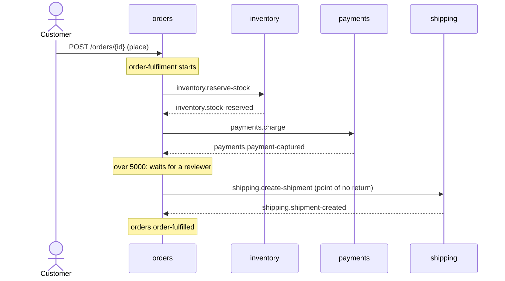

# OrderFulfilment sample

A commerce domain split across four services, and the workflow that takes an order from placement to delivery:

| Service | Project | Owns |
|---------|---------|------|
| orders | [Orders](Orders) | Orders, and the **order-fulfilment** workflow ([Workflows/order-fulfilment.sfflow.yaml](Orders/Workflows/order-fulfilment.sfflow.yaml)) |
| inventory | [Inventory](Inventory) | Stock reservations, behind a warehouse port (`IStockLevels`) |
| payments | [Payments](Payments) | Charges and refunds, behind a payment gateway port (`IPaymentGateway`) |
| shipping | [Shipping](Shipping) | Shipments, and the carrier's address rule |

It is the example of [design doc 15 §5.1](../../docs/v3.0.0/engineering/Design/15-Workflow-DSL-and-Studio.md#51-example-order-fulfilment-with-success-failures-retries-and-rollback).
Each service is its own process with its own PostgreSQL schema, all from one host ([OrderFulfilment.Host](OrderFulfilment.Host)),
where the `Service` setting picks the service. The services talk only through the broker: Amazon SNS and SQS, emulated by
LocalStack in the demo (Azure Service Bus and Google Cloud Pub/Sub work the same way).



## The workflow

```yaml
steps:
  - id: reserve-stock          # inventory.reserve-stock → inventory.stock-reserved
                               # out of stock: the order is cancelled
                               # no answer in 5 minutes: sent again, twice; compensation: inventory.release-stock
  - id: charge-payment         # payments.charge → payments.payment-captured (keeps the payment id)
                               # declined: charged again 3 times, 10 minutes apart; fraud suspected: fails at once
                               # compensation: payments.refund
  - id: review-large-order     # only when the amount is over 5000: waits for a reviewer's approval or rejection;
                               # no decision in a day: an operator takes over
  - id: create-shipment        # pivot: shipping.create-shipment → shipping.shipment-created
                               # the carrier can't deliver to the address: wait for the customer to correct it
  - id: await-address-fix      # orders.address-corrected, then create-shipment again; no correction in 2 days: an operator
on:
  completed:   orders.mark-fulfilled
  compensated: orders.cancel-order (with the failure as the reason)
  manual:      alert
```

What it shows:

- **One service orchestrating three others.** Orders routes their commands (`ReplyOnReject()` for the ones whose
  rejections the workflow handles) and subscribes to their event topics.
- **Business rejections** (`inventory.out_of_stock`, `payments.declined`, `payments.fraud_suspected`), **business retries**
  (a declined card is charged again) and **timeouts** with retries.
- **Compensation in reverse order**: a payment is refunded and the stock released when a later step fails.
- **A guarded step** (`when: "$data.amount > 5000"`) that waits for a person, with a timeout to an operator.
- **A point of no return** (`pivot`) with **forward recovery** (`goto` the address fix) instead of compensation.
- **Ports for the outside world**: the warehouse and the payment gateway are interfaces the services take from the
  container (a sandbox gateway and configured stock levels in the sample).

## Run it

From the repository root:

```bash
docker compose -f samples/OrderFulfilment/docker-compose.yml up -d --build
```

| What | Where |
|------|-------|
| Orders service | http://localhost:8090 |
| Inventory, Payments, Shipping services | http://localhost:8091, 8092, 8093 |
| **SourceFlow Studio** (read-only) | **http://localhost:5090** |
| Aspire dashboard: traces and SourceFlow metrics | http://localhost:18890 |
| PostgreSQL (`sourceflow` / `sourceflow` / `commerce`) | localhost:55433 |

The ports differ from the [TravelBooking demo](../TravelBooking/README.md)'s, so both can run at once.
`docker compose -f samples/OrderFulfilment/docker-compose.yml down -v` stops it and deletes its data.

Open Studio first: the **domain map** shows the four services and how they are wired, the **order-fulfilment**
statechart shows every step, outcome, retry and compensation, **Simulate** steps an instance through outcomes and timers,
and **Paths** lists all 437 paths and the minimal cover of 6 that the specs in [Orders.Tests](Orders.Tests) test.
[Using SourceFlow Studio](../../docs/v3.0.0/reference/guides/using-studio.md) is a guided tour of all of it on this sample.

### An order delivered

```bash
ORDER=0193b000-0000-7000-8000-000000000001

# A customer places an order: the workflow reserves the stock, takes the payment and ships it.
curl -X POST http://localhost:8090/orders/$ORDER -H 'Content-Type: application/json' \
  -d '{ "lines": ["kettle"], "total": 120, "shippingAddress": "1 High Street, Leeds, LS1 1AA" }'
```

Follow it:

```bash
# The workflow instance (status, step, failure), through the domain query generated with the workflow
curl http://localhost:8090/queries                                       # lists the named queries
curl -X POST http://localhost:8090/query -H 'Content-Type: application/json' \
  -d '{ "query": "from readmodel \"workflow-instances\" | project instance, status, step, failureCode" }'
```

In the Aspire dashboard, one trace follows the order from the HTTP request through all four services and the broker.

### The other outcomes

The payment gateway is a sandbox: a total ending in **.51** is declined and one ending in **.66** is suspected fraud. The
warehouse can't reserve `discontinued-lamp`. The carrier needs a street, a town and a postcode, separated by commas, with
a digit somewhere.

| Try | What happens |
|-----|--------------|
| An order with the line `discontinued-lamp` | Inventory rejects it (`inventory.out_of_stock`): the workflow ends `Compensated` and the order is cancelled |
| A total of `30.66` | Payments suspects fraud: the stock is released, `Compensated` |
| A total of `30.51` | The card is declined: charged again three times, ten minutes apart, then the stock is released and the order cancelled |
| A total over 5000, then `POST /orders/{id}/approve` | The order waits at `review-large-order`; once approved, it ships |
| A total over 5000, then `POST /orders/{id}/reject` with `{ "reason": "…" }` | The payment is refunded and the stock released (in reverse order), `Compensated` |
| The address `"somewhere"`, then `POST /orders/{id}/address` with `{ "address": "2 Mill Lane, York, YO1 7HH" }` | Shipping rejects the address after the point of no return; the order waits at `await-address-fix`, and ships once corrected |
| `docker compose -f samples/OrderFulfilment/docker-compose.yml stop payments`, place an order, then `start payments` within two minutes | The charge times out, is sent again, and the order goes on |

A large order no one reviews for a day, or an address no one corrects for two days, stops in `ManualIntervention` for an
operator. The operator's view, inside the Orders service:

```bash
COMPOSE="docker compose -f samples/OrderFulfilment/docker-compose.yml"
$COMPOSE exec orders dotnet OrderFulfilment.Host.dll sourceflow workflow list --name order-fulfilment --active
$COMPOSE exec orders dotnet OrderFulfilment.Host.dll sourceflow workflow show order-fulfilment@1 $ORDER
$COMPOSE exec orders dotnet OrderFulfilment.Host.dll sourceflow workflow abort order-fulfilment@1 $ORDER --reason 'cancelled by phone'
```

## Edit the workflow in Studio

The demo serves Studio read-only. To edit the workflow, generate its specs again or export diagrams, run Studio locally on
the workspace:

```bash
dotnet run --project src/Tooling/SourceFlow.Tool -- studio --workspace samples/OrderFulfilment    # http://127.0.0.1:5180
```

Studio validates the workflow against all four services' manifests as you type. **Generate specs** writes one test per
path of the minimal cover to [Orders.Tests/Workflows](Orders.Tests/Workflows). The build checks the workflow too (an error
is `SF0020` at its line in the YAML).

## Tests

```bash
dotnet test --project samples/OrderFulfilment/Orders.Tests     # the specs Studio generated
dotnet test --project tests/EndToEnd/SourceFlow.EndToEnd.Tests -- --filter-class "SourceFlow.EndToEnd.Tests.OrderFulfilmentScenarios"
```

The end-to-end scenarios (WF-E2E-01..12) run the four services as separate hosts, on the in-memory store and
PostgreSQL, over the in-memory broker and the AWS, Google Cloud and Azure emulators. The Studio tests
([`OrderFulfilmentSampleTests.cs`](../../tests/Workflows/SourceFlow.Studio.Tests/OrderFulfilmentSampleTests.cs)) and the
Playwright tests (`web/app/e2e`) open this workspace too.

## How it is put together

- [`sourceflow.domain.yaml`](sourceflow.domain.yaml): the domain workspace Studio and the build read: the four services,
  their manifests, where the workflow lives, and where its specs go.
- `*/sourceflow.manifest.json`: what each service owns and how it is wired, exported from the host at design time and
  checked for drift in CI:

  ```bash
  dotnet run --project src/Tooling/SourceFlow.Tool -- manifest export --project samples/OrderFulfilment/OrderFulfilment.Host \
    --output samples/OrderFulfilment/Orders/sourceflow.manifest.json \
    -- --Service=orders "--ConnectionStrings:SourceFlow=Host=localhost;Port=1"
  ```

- [`OrderFulfilment.Host/ServiceHost.cs`](OrderFulfilment.Host/ServiceHost.cs): what every service shares: the service
  chosen by `Service`, PostgreSQL (a schema per service), the transport (`Transport:Kind` `aws`, `azure` or `gcp`),
  provisioning, the demo query API and OpenTelemetry.
- [`docker-compose.yml`](docker-compose.yml), [`Dockerfile`](Dockerfile) (one image; each container sets `Service`) and
  [`Studio.Dockerfile`](Studio.Dockerfile) (the Studio site of this workspace).
