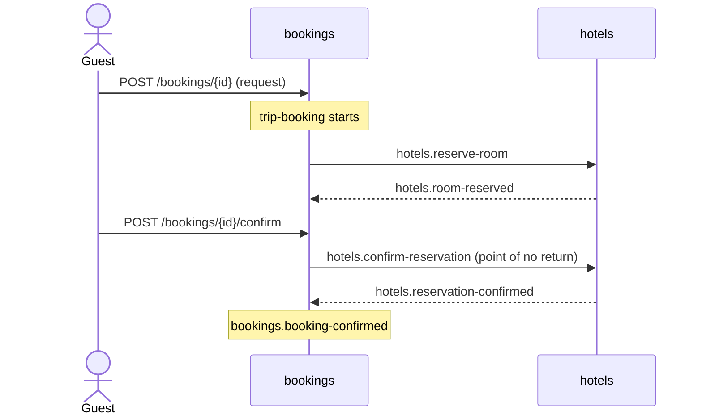

# TravelBooking sample

A domain split across two services, and the workflow that runs between them, with SourceFlow Studio:

| Service | Project | Owns |
|---------|---------|------|
| bookings | [Bookings](Bookings) | Bookings, and the **trip-booking** workflow ([Workflows/trip-booking.sfflow.yaml](Bookings/Workflows/trip-booking.sfflow.yaml)) |
| hotels | [Hotels](Hotels) | Hotels and their rooms: holds, releases and confirmations |

Each service is its own process with its own PostgreSQL schema ([Bookings.Api](Bookings.Api), [Hotels.Api](Hotels.Api)).
They talk only through the broker: Amazon SNS and SQS, emulated by LocalStack in the demo (Azure Service Bus and Google
Cloud Pub/Sub work the same way).



## The workflow

```yaml
steps:
  - id: hold-room              # hotels.reserve-room → hotels.room-reserved
                               # sold out or unknown hotel: the booking is declined
                               # no answer in 1 minute: sent again, twice; compensation: hotels.release-room
  - id: await-guest            # waits for bookings.guest-confirmed; the guest cancelling or 15 minutes passing
                               # undoes the hold (the room is released) and declines the booking
  - id: confirm-reservation    # pivot: hotels.confirm-reservation → hotels.reservation-confirmed
                               # the hold was lost (hotel staff released it): an operator takes over
on:
  completed:   bookings.confirm-booking
  compensated: bookings.decline-booking (with the failure as the reason)
  manual:      alert
```

What it shows:

- **Commands to another service, events back.** Bookings routes the Hotels commands to `hotels` (`ReplyOnReject()` for
  the ones whose rejections the workflow handles) and subscribes to `hotels.events`, where Hotels publishes.
- **Business rejections** (`hotels.sold_out`) and **timeouts**, with retries.
- **Waiting for a person**: the guest's confirmation, or a timeout.
- **Compensation**: the hold is released when a later step fails.
- **A point of no return** (`pivot`) and **manual intervention**: after the guest was told the booking stands, a lost
  hold can't be undone automatically; an operator resolves it with `sourceflow workflow resume|abort`.
- **The workflow's module** registers the Hotels contract ([`BookingsModule`](Bookings/Bookings.cs)), so the service, its
  tests and the specs Studio generates run it the same way.

## Run it

From the repository root:

```bash
docker compose up -d --build
```

| What | Where |
|------|-------|
| Bookings service | http://localhost:8080 |
| Hotels service | http://localhost:8081 |
| **SourceFlow Studio** (read-only) | **http://localhost:5080** |
| Aspire dashboard: traces and SourceFlow metrics | http://localhost:18888 |
| PostgreSQL (`sourceflow` / `sourceflow` / `travel`) | localhost:55432 |

Open Studio first: the **domain map** shows the two services and how they are wired, the **trip-booking** statechart
shows every step, outcome, retry and compensation, **Simulate** steps an instance through outcomes and timers, and
**Paths** lists all 27 paths and the minimal cover of 6 that the specs in [TravelBooking.Tests](TravelBooking.Tests) test.

### A booking confirmed

```bash
HOTEL=0193a7a0-0000-7000-8000-000000000001
BOOKING=0193a7a0-0000-7000-8000-0000000000b1

# Hotel staff register a hotel with one room.
curl -X POST http://localhost:8081/hotels/$HOTEL -H 'Content-Type: application/json' -d '{ "name": "Seaview", "rooms": 1 }'

# A guest requests a booking: the workflow holds the room at the hotel.
curl -X POST http://localhost:8080/bookings/$BOOKING -H 'Content-Type: application/json' \
  -d "{ \"hotelId\": \"$HOTEL\", \"guest\": \"Ada Lovelace\", \"nights\": 2 }"

# The guest confirms: the workflow confirms the reservation with the hotel and the booking.
curl -X POST http://localhost:8080/bookings/$BOOKING/confirm -H 'Content-Type: application/json' -d '{}'
```

Follow it:

```bash
# The workflow instance (status, step, attempt), through the domain query generated with the workflow
curl 'http://localhost:8080/queries'                                     # lists the named queries
curl -X POST http://localhost:8080/query -H 'Content-Type: application/json' \
  -d '{ "query": "from readmodel \"workflow-instances\" | project instance, status, step" }'

# The hotel's rooms, in the Hotels service
curl -X POST http://localhost:8081/query -H 'Content-Type: application/json' \
  -d '{ "query": "from readmodel \"hotel-rooms\" | project name, rooms, held, confirmed" }'
```

In the Aspire dashboard, one trace follows the booking from the HTTP request through both services and the broker.

### The other outcomes

| Try | What happens |
|-----|--------------|
| Request a second booking for the same one-room hotel | Hotels rejects it (`hotels.sold_out`); the workflow ends `Compensated` and the booking is declined |
| Request a booking and cancel it: `POST /bookings/{id}/cancel` | The hold is released (compensation) and the booking stays cancelled |
| Request a booking and wait 15 minutes | The hold lapses: released, and the booking declined |
| Request a booking, release its hold as hotel staff (`POST http://localhost:8081/hotels/{hotel}/holds/{booking}/release`), then confirm as the guest | The confirmation fails after the point of no return: the instance stops in `ManualIntervention` for an operator |
| `docker compose stop hotels`, request a booking, then `docker compose start hotels` within the minute | The hold times out, is sent again, and the booking goes on |

The operator's view, inside the Bookings service:

```bash
docker compose exec bookings sh -c 'dotnet Bookings.Api.dll sourceflow workflow list --name trip-booking --active'
docker compose exec bookings sh -c "dotnet Bookings.Api.dll sourceflow workflow show trip-booking@1 $BOOKING"
docker compose exec bookings sh -c "dotnet Bookings.Api.dll sourceflow workflow abort trip-booking@1 $BOOKING --reason 'rebooked by phone'"
```

## Edit the workflow in Studio

The demo serves Studio read-only. To edit the workflow, generate its specs again or export diagrams, run Studio locally on
the workspace:

```bash
dotnet run --project src/Tooling/SourceFlow.Tool -- studio --workspace samples/TravelBooking    # http://127.0.0.1:5180
```

Studio validates the workflow against both services' manifests as you type. **Generate specs** writes one test per path of
the minimal cover to [TravelBooking.Tests/Workflows](TravelBooking.Tests/Workflows). The build checks the workflow too (an
error is `SF0020` at its line in the YAML).

## Tests

```bash
dotnet test --project samples/TravelBooking/TravelBooking.Tests     # the aggregates, and the specs Studio generated
dotnet test --project tests/EndToEnd/SourceFlow.EndToEnd.Tests -- --filter-class "SourceFlow.EndToEnd.Tests.TravelBookingScenarios"
```

The end-to-end scenarios (TB-E2E-01..06) run the two services as separate hosts, on the in-memory store and PostgreSQL,
over the in-memory broker and the AWS, Google Cloud and Azure emulators.

## How it is put together

- [`sourceflow.domain.yaml`](sourceflow.domain.yaml): the domain workspace Studio and the build read: the two services, their
  manifests, where the workflow lives, and where its specs go.
- `*/sourceflow.manifest.json`: what each service owns and how it is wired, exported from its host at design time and
  checked for drift in CI:

  ```bash
  dotnet run --project src/Tooling/SourceFlow.Tool -- manifest export --project samples/TravelBooking/Bookings.Api \
    --output samples/TravelBooking/Bookings/sourceflow.manifest.json -- "--ConnectionStrings:SourceFlow=Host=localhost;Port=1"
  ```

- [`Shared/ServiceHost.cs`](Shared/ServiceHost.cs): what both hosts share: PostgreSQL (a schema per service), the transport
  (`Transport:Kind` `aws`, `azure` or `gcp`), provisioning, OpenTelemetry and health checks.
- [`docker-compose.yml`](docker-compose.yml), [`Dockerfile`](Dockerfile) (both services) and
  [`Studio.Dockerfile`](Studio.Dockerfile) (the Studio site of this workspace).

The guest's name is personal data (`[PersonalData]`): the workflow doesn't keep it, and with personal-data encryption on
(`sf.Security(s => s.UseAwsKms(…).EncryptPersonalData())`) it is stored encrypted and can be erased.
